# Overview

This lab demonstrates how weak two-factor authentication (2FA) protection can allow an attacker to bypass the second authentication step through a brute-force attack.

The application uses a four-digit security code, giving it only 10,000 possible combinations (`0000`–`9999`). More importantly, the application does not effectively prevent repeated MFA attempts.

I used Burp Suite Intruder to automate the code-guessing process and configured a session-handling rule with a macro to maintain the authentication session and obtain fresh CSRF tokens.

# Question / Lab Objective

The objective was to exploit the broken 2FA verification logic and access Carlos's account without knowing his password or MFA code.

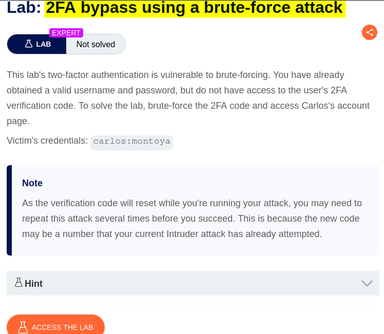

# Walkthrough

## 1. Exploring the application

After launching the lab, I accessed the target application and explored its available functionality. The website displayed a collection of blog posts along with a **My Account** option.

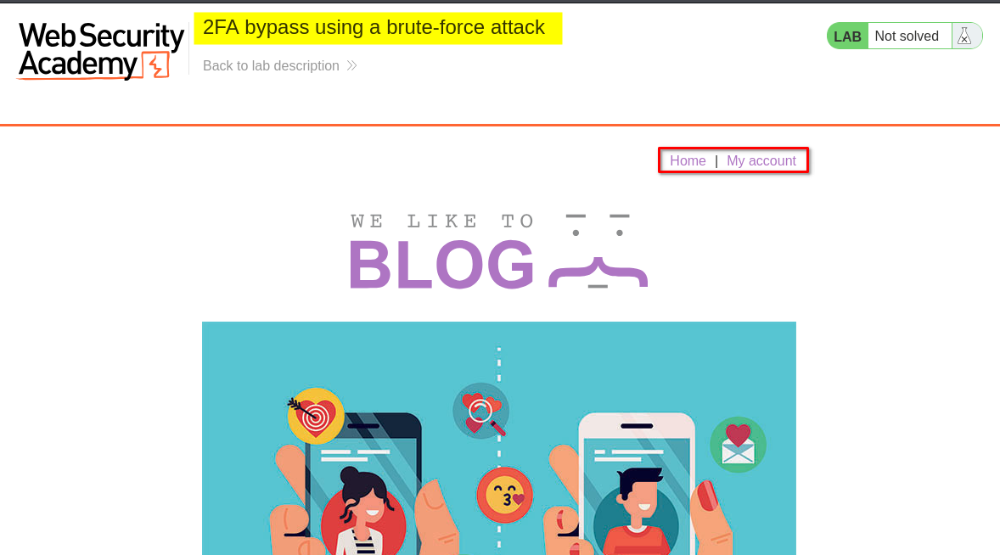

I browsed the application to understand its structure and identify potential entry points for further investigation.

At this stage, I had not identified any obvious authentication weaknesses.

## 2. Inspecting the login functionality

I clicked **My Account**, which redirected me to the login page.

I initially logged in using the provided credentials for the user `carlos`.

After submitting the username and password, the application accepted the first authentication step but requested a four-digit security code to complete the second step.

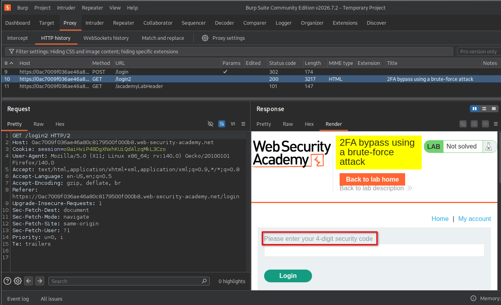

## 3. Inspecting the 2FA verification request

I entered an invalid four-digit code and intercepted the request using Burp Suite.

I noticed that the request included both a CSRF token and the four-digit security code. The server responded with the message: `Incorrect security code`

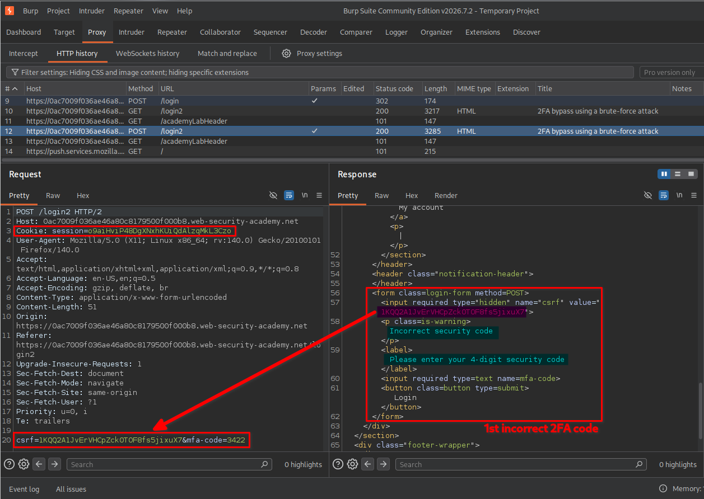

I then submitted another invalid code to observe how the application handled repeated attempts.

This time, the application redirected me to the login page. However, I did not observe an account lockout or any effective restriction preventing further attempts.

This suggested that the MFA verification endpoint might allow repeated code guesses. An attacker could potentially automate requests and try all possible four-digit combinations.

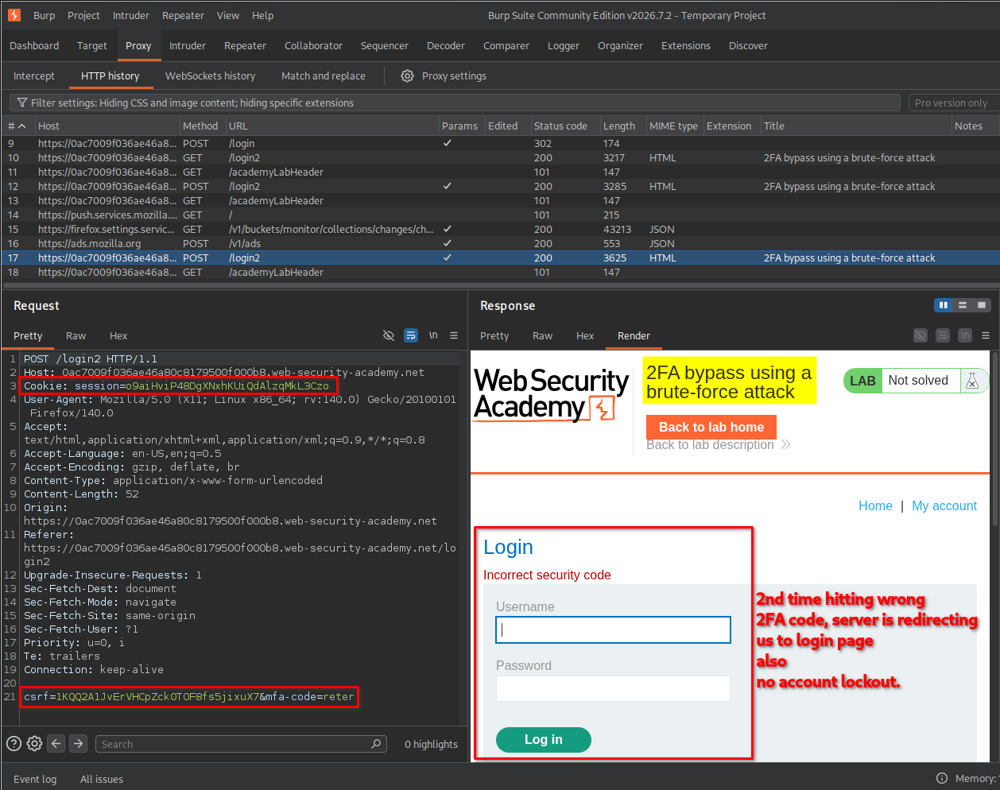

Before automating the attack, I needed to understand how the application's authentication flow worked.

### Understanding the authentication flow

I observed the following sequence of requests:

1. **GET /login**
   - Retrieves the login page.
   - Provides a session cookie and a CSRF token for the login form.

2. **POST /login**
   - Submits the username, password, session cookie, and CSRF token.
   - If the credentials are accepted, the application establishes the next authentication stage and may issue an updated session cookie.

3. **GET /login2**
   - Retrieves the second-factor verification page.
   - Provides the CSRF token required by the MFA form.

4. **POST /login2**
   - Submits the four-digit MFA code and its associated CSRF token.
   - The server validates the code and either rejects the attempt or completes authentication.

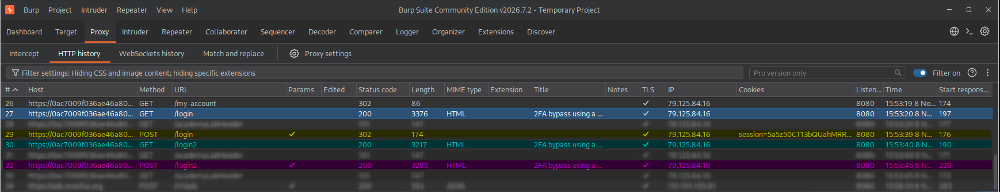

The important observation was that the MFA request depended on a valid session and a CSRF token.

If I repeatedly sent only the `POST /login2` request, the session or CSRF token could become invalid or outdated. Therefore, I needed a way to automatically repeat the authentication preparation steps before every Intruder request.

I decided to use a **Burp Suite macro** together with a **session-handling rule**.

## 4. Configuring the macro and session-handling rule

A macro allows Burp Suite to execute a predefined sequence of requests automatically. I used it to recreate the authentication flow and obtain the required session information and CSRF tokens before each MFA attempt.

### Configuring the session-handling rule

I opened the settings using the gear icon in the top-right corner.

Then I followed these steps:

1. Selected **Sessions** from the left sidebar.
2. Located **Session handling rules**.
3. Added a new rule and named it `2FA bruteforce`.
4. Under the rule's **Scope** settings, selected `Intruder` as the tool scope.
5. Selected **Include all URLs** under the URL scope.

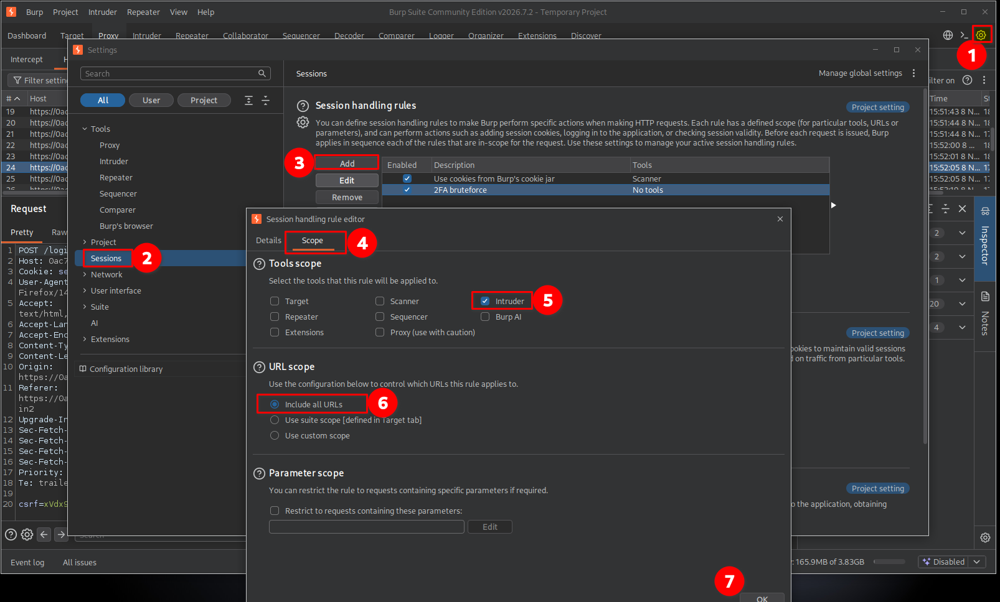

This ensured that the rule would apply to requests generated by Intruder.

### Configuring the macro action

Under the rule's **Details** tab:

1. Named the macro `2FA bruteforce`.
2. Under **Rule Actions**, clicked **Add**.
3. Selected **Run a macro**.
4. Kept the following two options enabled:

**1. Update current request with parameters matched from final macro response**

This option allows Burp to extract relevant parameters from the final response of the macro and update the original request with their current values.

In this lab, the CSRF token can change during the authentication process. The macro retrieves a fresh token from the application, and Burp uses the updated parameter when preparing the Intruder request.

Without this option, Intruder might continue sending an old CSRF token. The server could reject the request before it even checks the MFA code.

**2. Update current request with cookies from session handling cookie jar**

This option updates the request with cookies stored in Burp's session-handling cookie jar.

The authentication process relies on session cookies to identify the current login session and its authentication state. If the macro obtains a new or updated session cookie, Burp needs to use that cookie in the subsequent MFA request.

Without this option, Intruder might send a request with an outdated session cookie, causing the application to reject it or redirect to the login page.

In simple terms:

- The first option keeps the **CSRF token and other matched parameters** up to date.
- The second option keeps the **session cookies** up to date.

Both are important because the MFA request must contain the correct session information and a valid CSRF token.

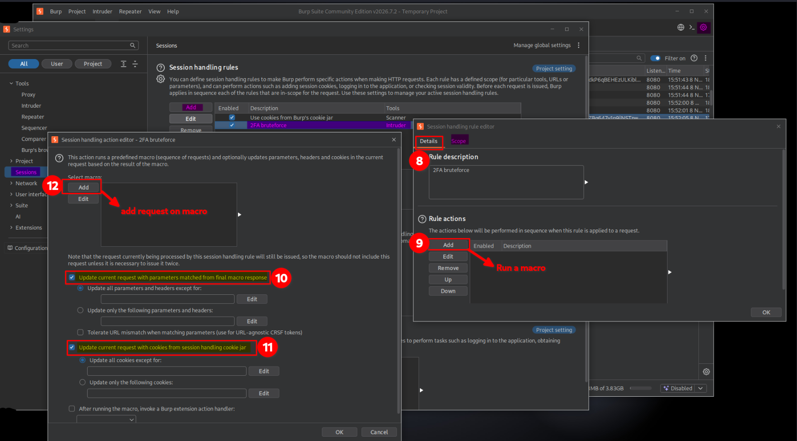

### Adding requests to the macro

I clicked the option to configure the macro and added these three requests in the following order:

1. `GET /login`
2. `POST /login`
3. `GET /login2`

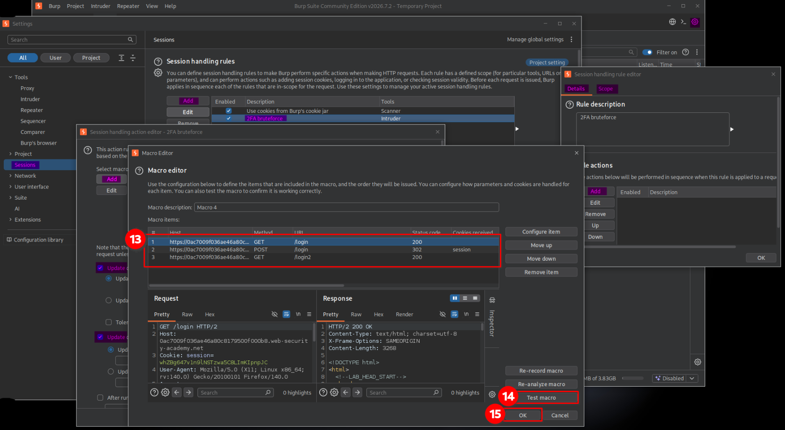

**Why were these three requests necessary?**

Each request performs a specific part of the authentication preparation:

| Request | Purpose |
|---|---|
| `GET /login` | Retrieves the login page and its CSRF token. |
| `POST /login` | Submits the credentials and establishes the authentication session required for the second factor. |
| `GET /login2` | Retrieves the MFA page and its current CSRF token. |

The macro reproduces these steps automatically so that Intruder can focus on testing different MFA codes.

I did not add `POST /login2` to the macro because that was the request I wanted Intruder to send repeatedly with different four-digit payloads.

The intended process was:

```text
Burp Intruder
     |
     v
Session-handling rule
     |
     v
Run macro
     |
     +--> GET /login
     |
     +--> POST /login
     |
     +--> GET /login2
     |
     v
Update session cookie and CSRF token
     |
     v
Send POST /login2 with the current MFA payload
     |
     v
Check server response
```

After adding the requests, I tested the macro.

Each time I clicked **Retest macro**, Burp executed the sequence again. I observed that the CSRF token in the login process was regenerated, confirming that the macro was retrieving fresh authentication data.

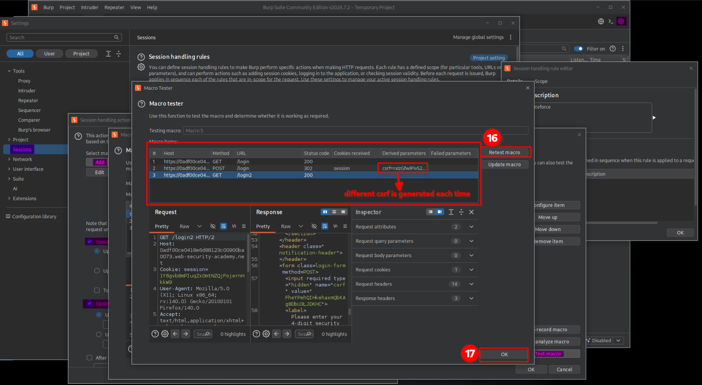

## 5. Brute-forcing the MFA code

After confirming that the macro worked, I configured Burp Intruder to test the possible four-digit codes.

I sent the `POST /login2` request to Intruder and configured the attack as follows:

- **Attack type:** Sniper
- **Payload type:** Numbers
- **Number range from:** `0000`
- **Number range to:** `9999`
- **Minimum length:** `4`
- **Maximum length:** `4`

I could also use the **Brute forcer** payload type to generate combinations of digits. In this case, I used the Numbers payload type with a fixed length of four digits.

This generated all 10,000 possible combinations, including codes with leading zeros.

I also configured the Intruder resource pool to use a maximum of **one concurrent request**.

This was useful for keeping the requests sequential and avoiding multiple simultaneous attempts that could interfere with the session-handling process.

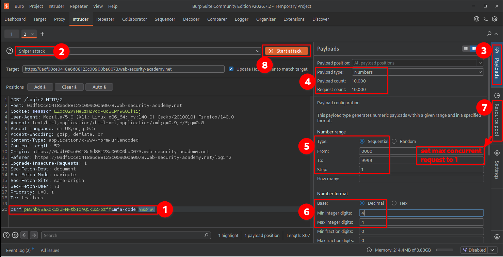

I started the attack and inspected the responses to identify a potentially successful MFA code.

One response returned a `302 Found` status code, which was consistent with the application's redirect behavior after successful verification.


A `302` response can be a useful indicator, but it should not be treated as proof of successful authentication by itself. I confirmed the result by following the redirect and checking which account had been accessed.

### Why might the attack need to be run multiple times?

During this lab, the application periodically resets the MFA verification code while the Intruder attack is running.

This creates an interesting problem: Intruder continues testing the payload list in sequence, but the valid MFA code can change at any time.

For example:

1. Intruder starts testing codes from `0000` to `9999`.
2. Suppose the application generates `7352` as the valid MFA code.
3. Intruder may have already tested `7352` before the application generated it.
4. Since Intruder does not automatically restart its payload list, it will not test `7352` again during the current attack.
5. Therefore, I may need to repeat the attack to have another opportunity to find the currently valid code.

In simple terms, **the valid MFA code can change while Intruder is running, and the new code might already have been tested.**

This is why repeating the attack several times may be necessary before successfully identifying the valid MFA code.

I also used the **Logger** tab to observe the requests generated during the attack. This helped me understand how the macro requests and Intruder requests interacted.


## 6. Confirming lab completion

After identifying the successful request, I opened its response in the browser.

The application redirected me directly to Carlos's account page without requiring Carlos's username or password again.

The application granted access to Carlos's account, and the lab displayed the completion message.


This confirmed that I had successfully bypassed the 2FA verification process and accessed Carlos's account.

# Key Takeaways

- A four-digit MFA code has only 10,000 possible combinations, making it vulnerable to brute-force attacks when attempts are not properly restricted.
- MFA endpoints must enforce rate limiting and brute-force protection independently of the primary login endpoint.
- CSRF tokens can change between requests, so automated attacks may need to retrieve fresh tokens.
- Burp Suite macros can automate multiple requests required to maintain an authentication flow.
- Session-handling rules can update cookies and parameters before Intruder sends each request.
- Intruder's resource pool can control request concurrency. Sequential requests can make session-dependent testing more reliable.
- A redirect or unusual response status is only an indicator. Always verify whether authentication actually succeeded.

# Security Impact

An attacker who obtains or otherwise reaches the MFA verification stage could automate guesses against a four-digit security code if the application does not enforce sufficient attempt restrictions.

Successful exploitation could allow unauthorized access to another user's account, even when the attacker does not know the user's MFA code.

This weakens the protection provided by two-factor authentication and can expose sensitive account information or functionality.

# Remediation

- Enforce strict rate limiting on MFA verification attempts.
- Apply attempt restrictions to the account and authentication session, not only the source IP address.
- Introduce progressive delays or temporary lockouts after repeated failed MFA attempts.
- Monitor and alert on suspicious patterns of repeated verification failures.
- Use sufficiently strong, time-limited, single-use MFA codes.
- Invalidate used codes and prevent code reuse.
- Ensure session identifiers and CSRF tokens are validated correctly throughout the authentication flow.
- Consider phishing-resistant MFA methods, such as passkeys or hardware security keys, where appropriate.

# Conclusion

This lab demonstrated how weak brute-force protection in a 2FA implementation can allow an attacker to bypass the second authentication step.

By combining Burp Suite Intruder with macros and session-handling rules, I was able to automate the authentication preparation process, maintain the required session information, retrieve fresh CSRF tokens, and test the possible four-digit MFA codes.

The main lesson is that implementing MFA is not enough by itself. The verification endpoint must also be protected against automated guessing attacks.

*Thanks for reading!*
