# Overview

This lab demonstrates how differences in server response times can expose valid usernames during authentication. By comparing the time taken to process login requests containing different username and password combinations, I identified a timing discrepancy that revealed valid usernames. I then used Burp Suite Intruder and the `X-Forwarded-For` header to bypass the lab's IP-based rate limiting, enumerate the valid username, and eventually discover the correct password.

# Question / Lab Objective

The objective was to exploit a response-time discrepancy in the login functionality to enumerate a valid username and password, bypassing the application's rate-limiting mechanism when necessary.

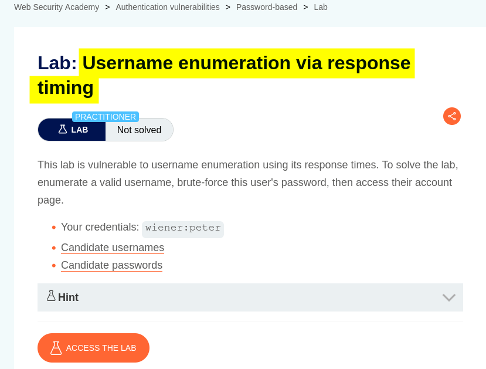

# Walkthrough

## 1. Exploring the application

After launching the lab, I accessed the target application and explored its available functionality. The website displayed a collection of blog posts along with a **My Account** option.

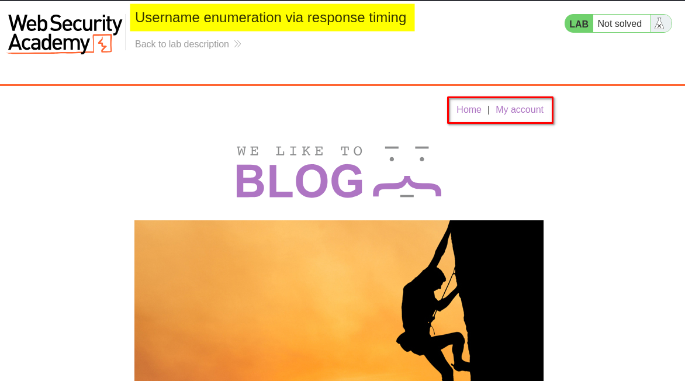

I browsed the application to understand its structure and identify potential entry points for further investigation.

At this stage, I had not identified any obvious authentication weaknesses. I decided to examine the login functionality to understand how the application handled different username and password combinations.

## 2. Inspecting the login functionality

I clicked **My Account**, which redirected me to the login page.

I initially used the credentials provided by the lab (`wiener:peter`) to understand the login request and observe how the application handled authentication.

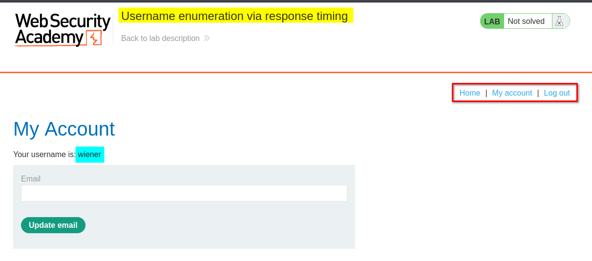

After examining the login functionality, I logged out so that I could focus on testing the authentication mechanism.

My next step was to investigate whether different username and password combinations produced noticeable differences in server response times.

## 3. Burp Suite Repeater: Testing a valid username with a short, incorrect password

I opened Burp Suite, which was already running in the background, and located the login POST request.

I selected the request containing the valid username and sent it to **Repeater**.

I then modified the password to a short but incorrect value while keeping the username unchanged.

After sending the request, I observed that the response took approximately **224 milliseconds (0.224 seconds)**.

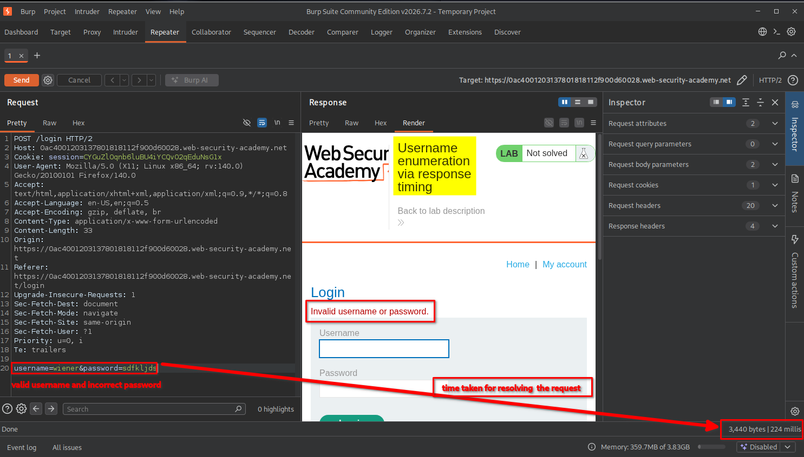

I recorded this response time as my baseline for comparison.

## 4. Burp Suite Repeater: Testing a valid username with a long, incorrect password

Next, I kept the same valid username but replaced the short password with a much longer, incorrect password.

After sending the request, I noticed a significant difference: the server took approximately **6 seconds** to respond.

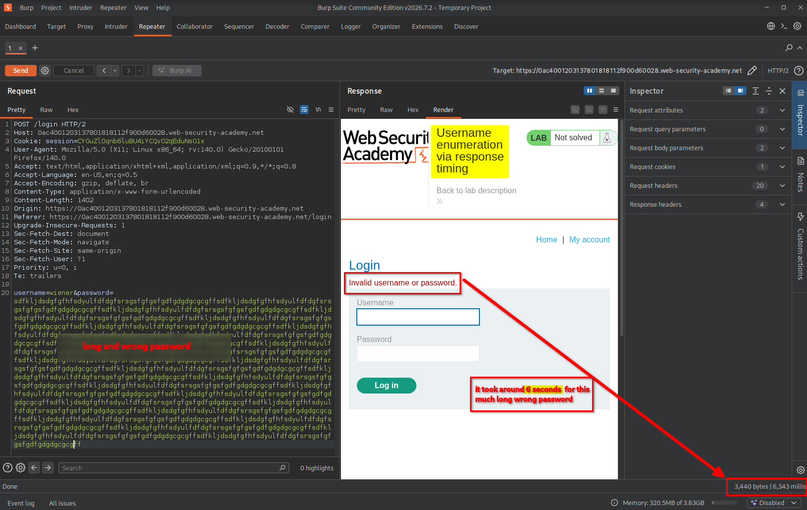

This was an important observation.

The username was valid, but the password was incorrect. Despite the failed authentication, the application took considerably longer to process the request.

This suggested that the application was performing additional password-processing work when the supplied username existed.

### Understanding the timing discrepancy

To understand why this happened, consider a simplified authentication process.

When a user submits a login request, the application generally needs to:

1. Check whether the supplied username exists.
2. Retrieve the corresponding user's authentication information.
3. Process the supplied password and compare it against the stored password hash.
4. Return the authentication result.

The important distinction is what happens when the username does not exist.

A simplified example of the vulnerable logic could look like this:

```python
if username_exists(username):
    if verify_password(password, stored_password_hash):
        return "Login successful"

return "Invalid username or password"
```

Here is what happens in each situation:

**Case 1: Valid username + incorrect password**

- The application finds the username.
- It proceeds with password verification.
- Password processing takes additional time.
- Authentication fails because the password is incorrect.

**Case 2: Invalid username + any password**

- The application cannot find the username.
- It skips the password-verification process.
- It returns an authentication failure more quickly.

The long password in this lab makes the processing-time difference particularly noticeable.

In other words, the application behaves differently depending on whether the username exists.

We can represent the simplified behavior as:

```text
                 Login Request
                       |
                       v
                Check username
                       |
             +---------+---------+
             |                   |
          Valid                Invalid
             |                   |
             v                   |
       Verify password           |
             |                   |
             v                   |
       Additional work            |
             |                   |
             +---------+---------+
                       |
                       v
               Authentication fails
```

The important point is that an attacker does not need to successfully authenticate. They only need to observe the difference in processing time.

### Testing the same behavior with invalid usernames

To verify my assumption, I also tested two additional combinations:

- Invalid username + short, incorrect password.
- Invalid username + long, incorrect password.

Both requests returned relatively quickly.

The first request took approximately **186 milliseconds**.

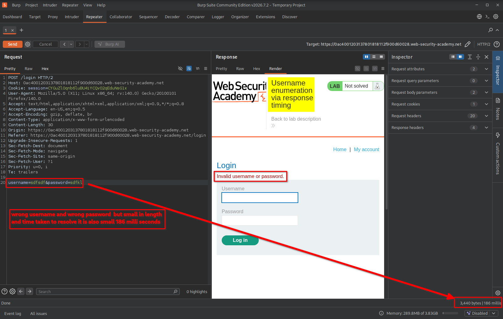

The second request took approximately **175 milliseconds**.

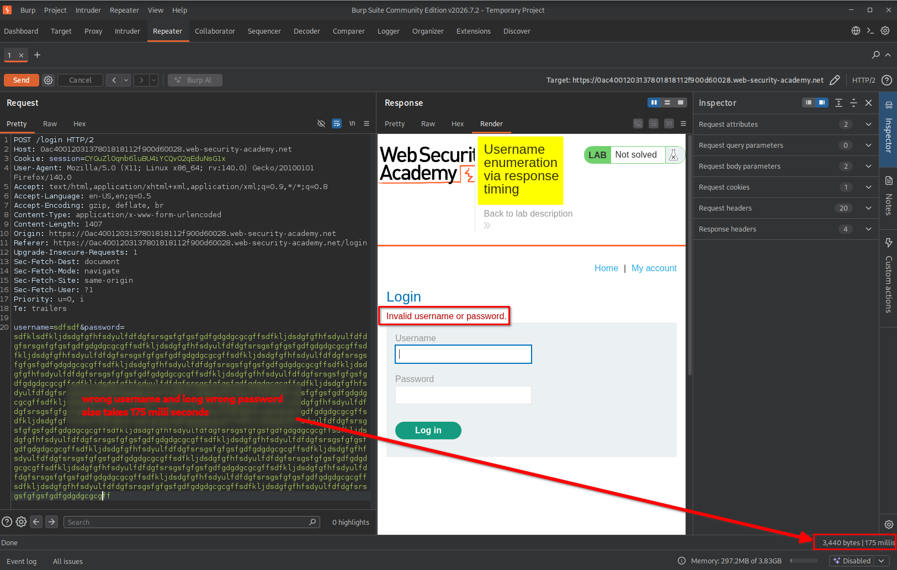

This confirmed the timing discrepancy I was investigating.

Even when I supplied a long password, the response remained relatively fast if the username was invalid.

### Comparing the observations

| Username | Password | Approximate response time |
|---|---|---:|
| Valid | Short and incorrect | 224 ms |
| Valid | Long and incorrect | 6 seconds |
| Invalid | Short and incorrect | 186 ms |
| Invalid | Long and incorrect | 175 ms |

The results suggested that the application performed additional password-processing work only when a valid username was supplied.

**This became the main technique I used to enumerate usernames.**

## 5. Enumerating valid usernames using Burp Suite Intruder

After confirming the timing difference, I decided to automate the process instead of testing usernames individually.

I captured the login request and sent it to **Intruder**.

The configuration steps were:

1. Capture the login POST request through Burp Suite Proxy.
2. Send the request to **Intruder**.
3. Open the **Positions** tab.
4. Clear the automatically selected payload positions.
5. Highlight only the username value and mark it as the payload position.
6. Select the **Sniper** attack type.
7. Open the **Payloads** tab.
8. Set the payload type to **Simple list**.
9. Paste the 101 usernames provided by the lab.
10. Start the attack.

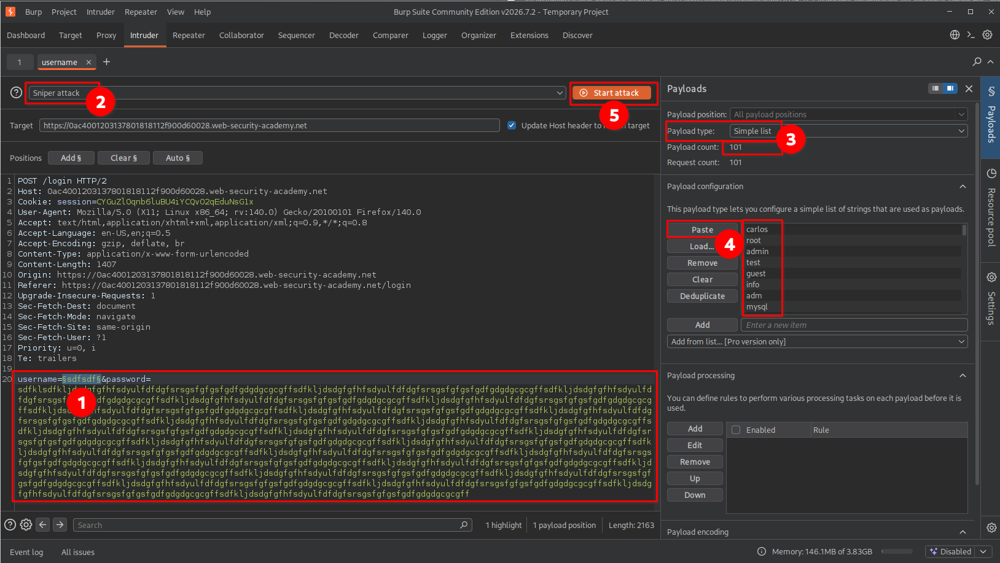

The idea was to test each username while keeping the other request parameters unchanged.

By comparing response times, I expected to identify the username that caused significantly longer processing.

### Encountering the rate limit

After running the attack for some time, the application blocked further login attempts.

I received the following message:

"You have made too many incorrect login attempts. Please try again in 30 minutes."

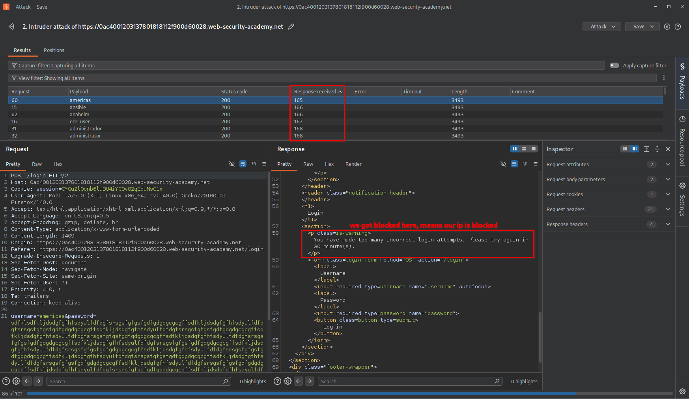

The server had temporarily restricted authentication attempts from my apparent IP address.

This prevented me from completing the enumeration using the original request configuration.

I therefore needed to understand how the application identified the client's IP address and whether the rate-limiting mechanism trusted any client-controlled HTTP headers.

## 6. Bypassing the rate limit using X-Forwarded-For

Before proceeding, it is useful to understand how client IP addresses are handled in real-world web applications.

A typical web request may travel through multiple infrastructure components:

```text
                  Client
                    |
                    v
               CDN / WAF
                    |
                    v
              Reverse Proxy
                    |
                    v
              Load Balancer
                    |
                    v
             Web Application
```

When an application is deployed behind a reverse proxy or load balancer, it may not directly see the original client's IP address.

Instead, infrastructure components can forward the original client IP using HTTP headers such as:

`X-Forwarded-For`

For example:

```http
X-Forwarded-For: 203.0.113.10
```

This header can contain the IP address of the original client or a chain of addresses representing the proxies through which the request passed.

However, an important security consideration is that this header is not inherently trustworthy. A client can manually include or modify it.

If an application incorrectly trusts a client-supplied `X-Forwarded-For` value when identifying users for rate limiting, an attacker may be able to manipulate the apparent source IP address.

### Applying this technique in the lab

In this lab, I added the following header to my login request:

```http
X-Forwarded-For: 123.123.123.123
```

I then changed the last portion of the IP address dynamically for each request.

The purpose was to make the application see different apparent client IP addresses when applying its rate-limiting mechanism.

**Important:** This does not change my actual public IP address or bypass an upstream firewall. It only affects systems that incorrectly trust the supplied header.

### Why I changed the Intruder attack type

Previously, I was testing only one variable: the username.

For the new approach, I needed to change two things simultaneously:

1. The `X-Forwarded-For` value.
2. The username being tested.

Because I now had two payload positions, I selected **Pitchfork** instead of Sniper.

### Understanding the Pitchfork attack

Burp Suite Intruder provides different attack types depending on how multiple payload positions need to be tested.

For this particular exercise, Pitchfork was useful because it takes payloads from multiple payload sets and inserts them into their corresponding positions simultaneously.

For example:

| Request | IP payload | Username payload |
|---|---|---|
| 1 | 123.123.123.0 | Username 1 |
| 2 | 123.123.123.1 | Username 2 |
| 3 | 123.123.123.2 | Username 3 |
| 4 | 123.123.123.3 | Username 4 |

Each request receives one IP value and one username from the corresponding positions in the payload lists.

This allowed me to change the apparent client IP while testing each username.

### Configuring the first payload position

I selected the last portion of the `X-Forwarded-For` header as the first payload position.

```http
X-Forwarded-For: 123.123.123.§0§
```

For its payload configuration, I selected **Numbers** and configured the range from `0` to `100`.

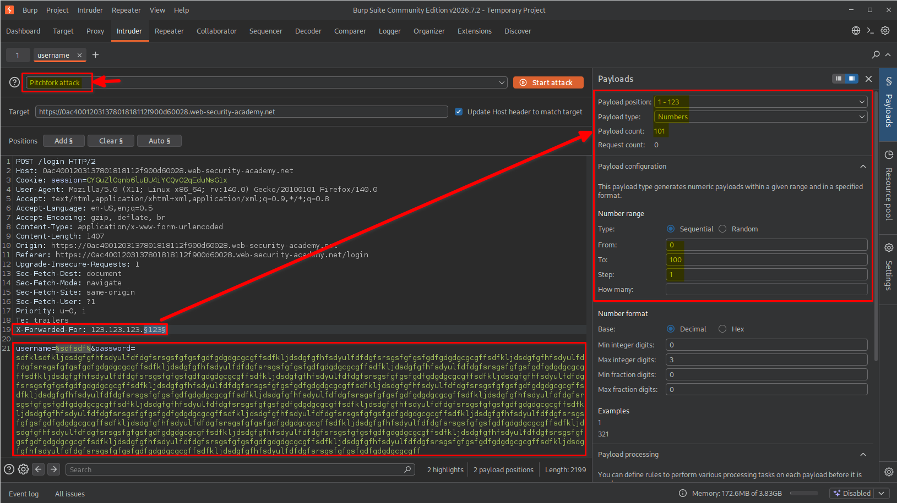

### Configuring the second payload position

Next, I selected the username value as the second payload position.

```http
username=§username§
```

For this position, I selected **Simple list** and pasted the 101 usernames provided by the lab.

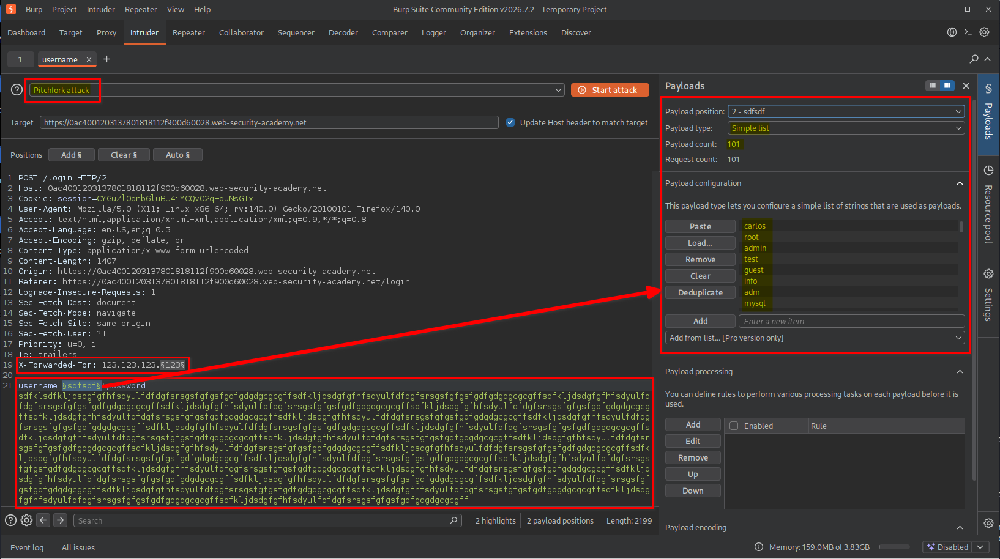

With both positions configured, I was ready to execute the Pitchfork attack.

## 7. Identifying the valid username through response timing

I started the Pitchfork attack and waited for it to finish.

After completion, I examined the response-time information in the Intruder results.

I sorted the results by the **Response received** timing column to bring the requests with the longest response times to the top.

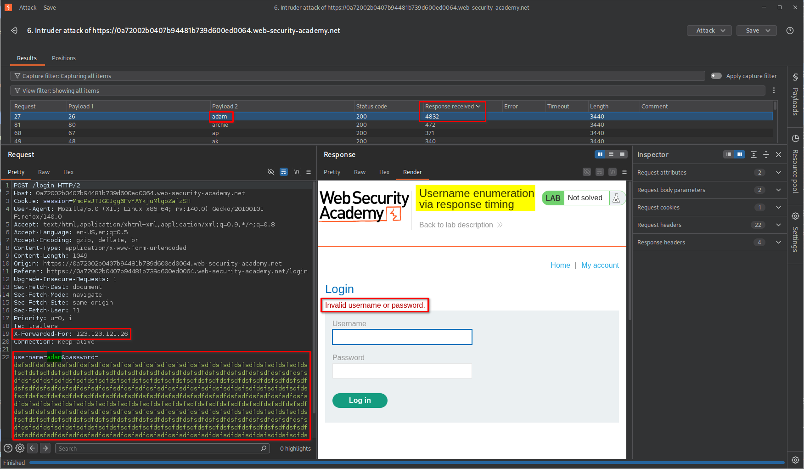

One request showed a significantly longer response time than the others.

I inspected that request and identified the username associated with the unusually long processing time.

This indicated that I had successfully enumerated a valid username.

## 8. Enumerating the valid password using Burp Suite Intruder

After discovering the valid username, I moved on to identifying its corresponding password.

The process was similar to username enumeration, but this time I needed to modify:

1. The `X-Forwarded-For` value.
2. The password value.

Since there were two payload positions again, I selected the **Pitchfork** attack type.

### Configuring the first payload position

I selected the final portion of the IP address as the first payload position.

```http
X-Forwarded-For: 123.123.122.§0§
```

I configured the payload type as **Numbers**, using a range from `0` to `100`.

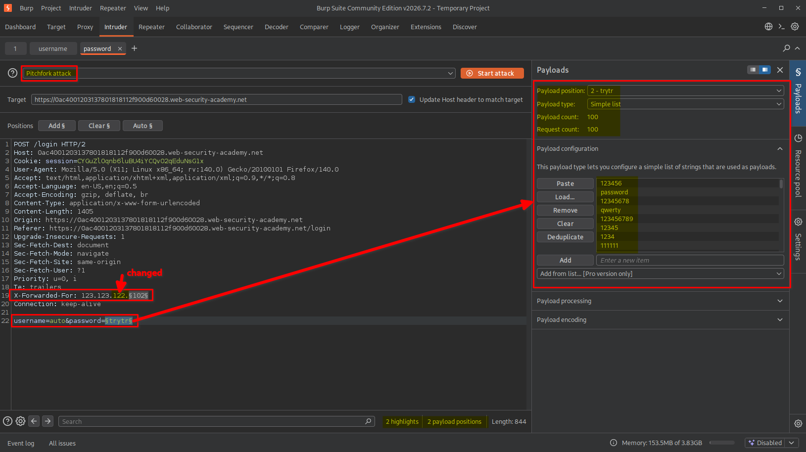

### Configuring the second payload position

Next, I selected the password value as the second payload position.

```http
password=§password§
```

I configured the payload type as **Simple list** and supplied the password wordlist provided by the lab.

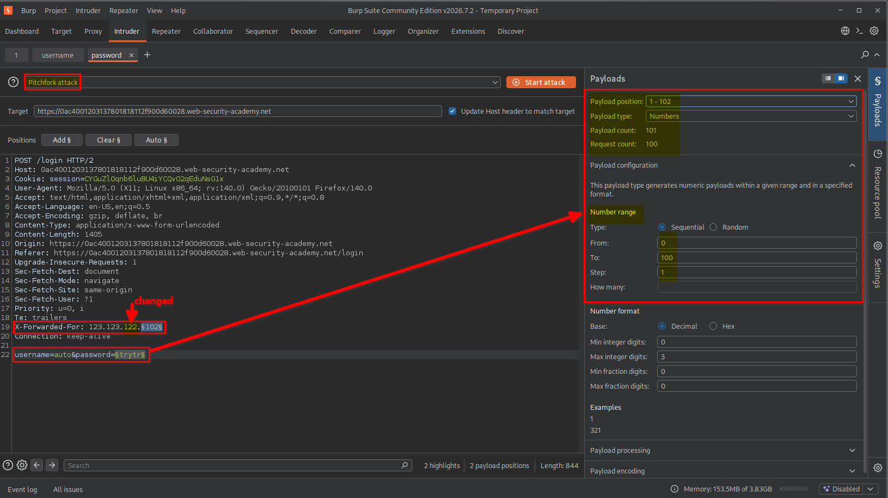

This configuration allowed me to test each candidate password while simultaneously changing the apparent client IP address.

## 9. Identifying the valid password

During the attack, I noticed a request that returned an HTTP 302 Found status code. I examined its response headers and found the following Location header: `Location: /my-account?id=adam`

This indicated that the application was redirecting the request to the account page associated with the username adam, suggesting that the authentication attempt had been successful.

Unlike the previous failed login attempts, this response provided a clear indication that I had identified the correct password.

I inspected the corresponding request in Burp Suite Intruder and confirmed the password associated with the successful authentication response.

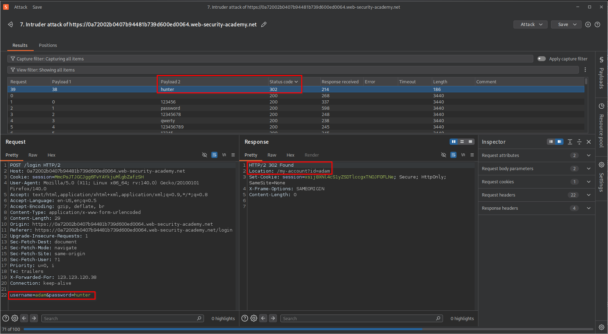

At this point, I had obtained both the valid username and its corresponding password.

**Note**: HTTP 302 Found alone does not always mean successful authentication. In this case, the redirect to   
`/my-account?id=adam` was the important evidence.

## 10. Logging in and confirming lab completion

After identifying the credentials, I returned to the browser and entered the discovered username and password.

The application successfully authenticated me and redirected me to the account page.

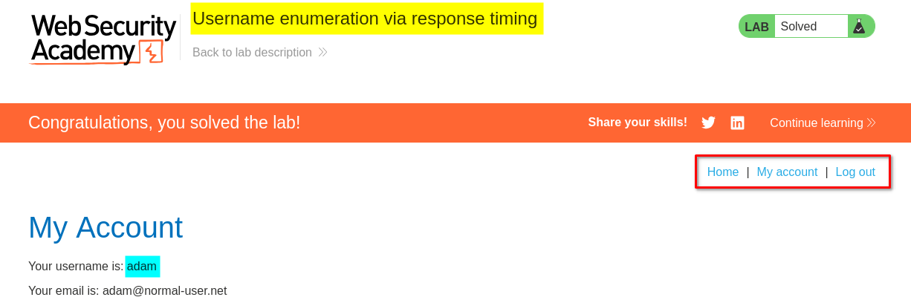

The lab displayed the completion message, confirming that I had successfully enumerated the credentials and completed the challenge.

# Key Takeaways

- **Authentication timing matters:** Differences in response times can reveal information about internal authentication logic.
- **Username enumeration is not limited to error messages:** Even when an application returns identical error messages, processing-time differences may expose valid accounts.
- **Understand password processing:** Applications may perform expensive password verification operations, creating timing differences between valid and invalid usernames.
- **Use Burp Suite Repeater for manual testing:** Repeater helps compare individual requests and establish a baseline before automating tests.
- **Use Intruder for automation:** Intruder can test multiple username and password candidates while allowing response-time comparisons.
- **Understand attack types:** Sniper is useful when testing one payload position, while Pitchfork allows corresponding payloads from multiple lists to be inserted together.
- **Understand HTTP headers:** Headers such as `X-Forwarded-For` can influence how applications identify clients when proxy configurations are insecure.
- **Observe response timing carefully:** Network latency and server load can introduce noise, so multiple measurements and consistent testing conditions are important.

# Security Impact

Username enumeration through response timing can expose valid accounts even when an application displays identical error messages for valid and invalid usernames.

An attacker could use this information to:

- Build a list of valid usernames.
- Conduct targeted password attacks against identified accounts.
- Increase the effectiveness of credential-stuffing attempts.
- Identify accounts for further social engineering or phishing attacks.

If the application also relies on an improperly trusted `X-Forwarded-For` header for rate limiting, attackers may be able to manipulate the apparent client IP and weaken the effectiveness of those protections.

When combined, these weaknesses can make automated credential enumeration significantly easier.

# Remediation

To prevent username enumeration through response timing and protect authentication mechanisms:

1. **Use consistent authentication behavior:** Avoid exposing noticeable timing differences between valid and invalid usernames. Perform comparable password-verification work for both cases where appropriate.
2. **Use secure password hashing:** Use established password-hashing algorithms such as Argon2id, bcrypt, or PBKDF2 with appropriate parameters.
3. **Implement effective rate limiting:** Apply rate limits using trusted client identity information rather than arbitrary client-supplied headers.
4. **Handle X-Forwarded-For securely:** Only trust forwarding headers from explicitly configured reverse proxies. Strip or overwrite untrusted incoming values at the trusted proxy boundary.
5. **Implement account-based protections:** Consider additional controls such as progressive delays, monitoring, and account-level abuse detection.
6. **Use multi-factor authentication:** MFA provides an additional layer of protection even if an attacker discovers a valid username and password.
7. **Monitor authentication activity:** Detect unusual login patterns, repeated failed attempts, and suspicious changes in apparent client IP addresses.

# Conclusion

This lab demonstrated that authentication weaknesses are not always visible through application responses alone. By carefully comparing response times, I identified a timing discrepancy that allowed me to distinguish valid usernames from invalid ones.

Using Burp Suite Repeater, I first established the timing difference manually. I then automated username and password enumeration with Intruder and used the `X-Forwarded-For` header to work around the lab's IP-based rate limiting.

The key lesson is that even small differences in application processing time can become an information disclosure vulnerability. Authentication systems must be designed to avoid exposing internal account information through observable behavior, including response timing.

*Thanks for reading!*
