# Overview

This lab demonstrates how subtle inconsistencies in authentication error messages can expose valid usernames and passwords. Using Burp Suite Intruder, I tested a list of potential usernames and passwords and compared the application's responses. Although response length analysis was initially inconclusive, I successfully identified valid credentials using the `Grep-Match` feature by detecting a small difference in the error message.

# Question / Lab Objective

The objective was to exploit subtle differences in the application's login responses to enumerate a valid username and password, then use the discovered credentials to authenticate and complete the lab.

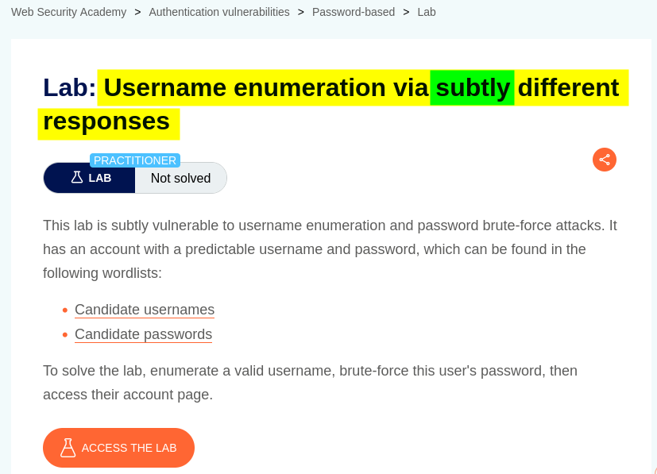

# Walkthrough

## 1. Exploring the application

After launching the lab, I accessed the target application and explored its available functionality. The website displayed a collection of blog posts along with a **My Account** option.

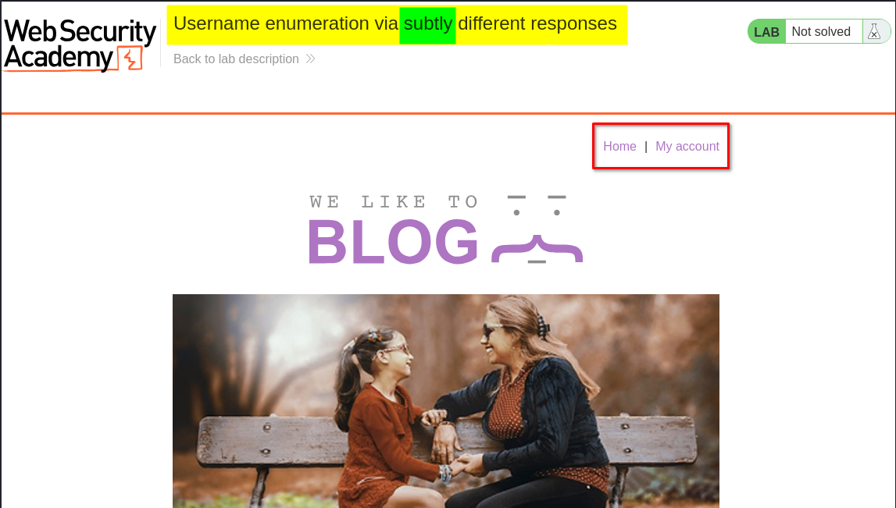

I browsed the application to understand its structure and identify potential entry points for further investigation.

At this stage, I had not identified any obvious authentication weaknesses. I decided to examine the login functionality to understand how the application handled different username and password combinations.

## 2. Inspecting the login functionality

I clicked **My Account**, which redirected me to the login page.

Since I did not have valid credentials, I initially entered a random username and password to observe the application's response.

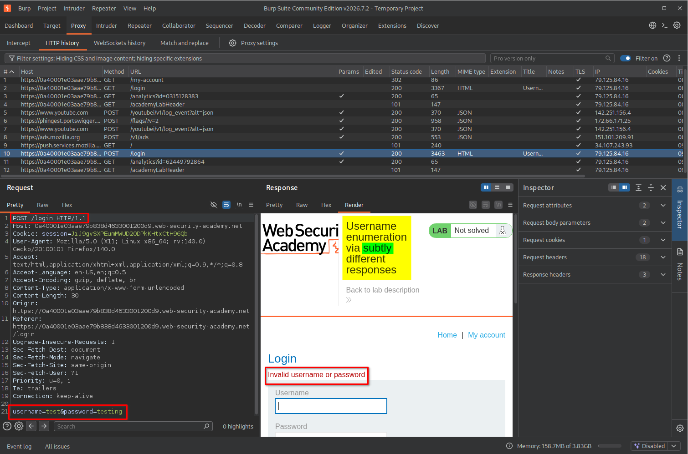

The application returned an error indicating that the username or password was incorrect.

Initially, the response did not reveal whether the username or password was invalid individually. I therefore decided to test a list of possible usernames and look for differences in the application's responses.

## 3. Enumerating valid usernames using Burp Suite Intruder

I captured the login request using Burp Suite and sent it to **Intruder** to test multiple username values.

The steps were:

1. Capture the login request through Burp Suite Proxy.
2. Send the captured request to **Intruder**.
3. Open the **Positions** tab.
4. Clear the automatically selected payload positions.
5. Highlight only the username value and mark it as the payload position.
6. Select the **Sniper** attack type.
7. Open the **Payloads** tab.
8. Set the payload type to **Simple list**.
9. Paste the 101 usernames provided by the lab.
10. Start the attack.

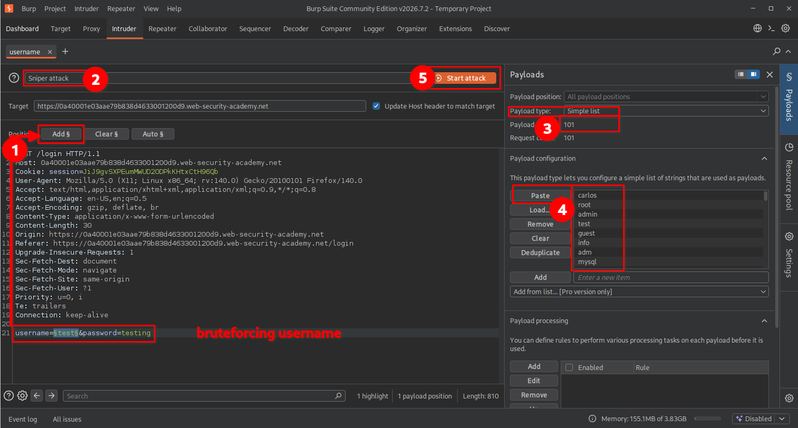

After starting the attack, I waited for Intruder to finish processing the requests.

### 3.1. Initial attempt: Comparing response lengths

My first approach was to examine the response lengths and identify requests that returned a different number of bytes.

However, after the attack completed, I noticed that the response lengths varied across multiple requests. This made it difficult to distinguish the valid username using response length alone.

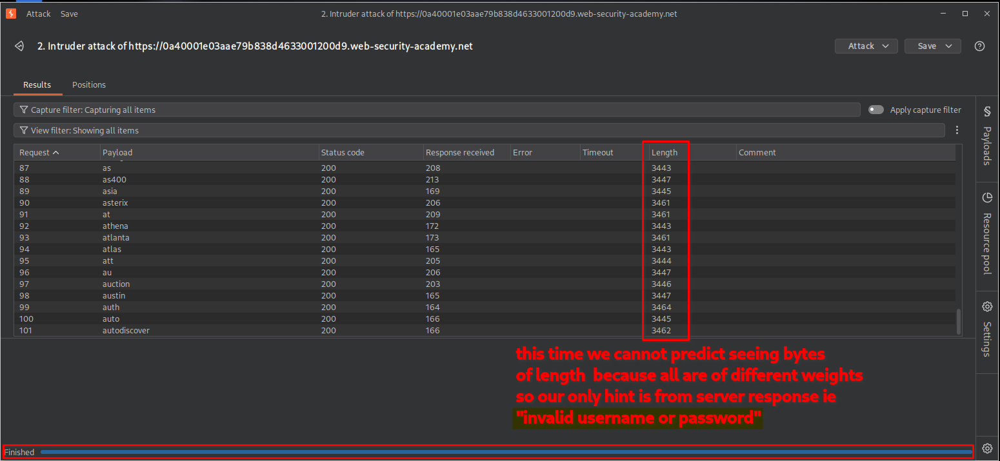

At this point, I remembered the lab's emphasis on **subtly different responses**. Instead of relying on response length, I decided to inspect the actual error message returned by the application.

### 3.2. Identifying the username using Grep-Match

I returned to the Intruder configuration and opened the **Settings** section.

Under the **Grep-Match** option, I added the error message: `invalid username or password.`

I then started the username enumeration attack again.

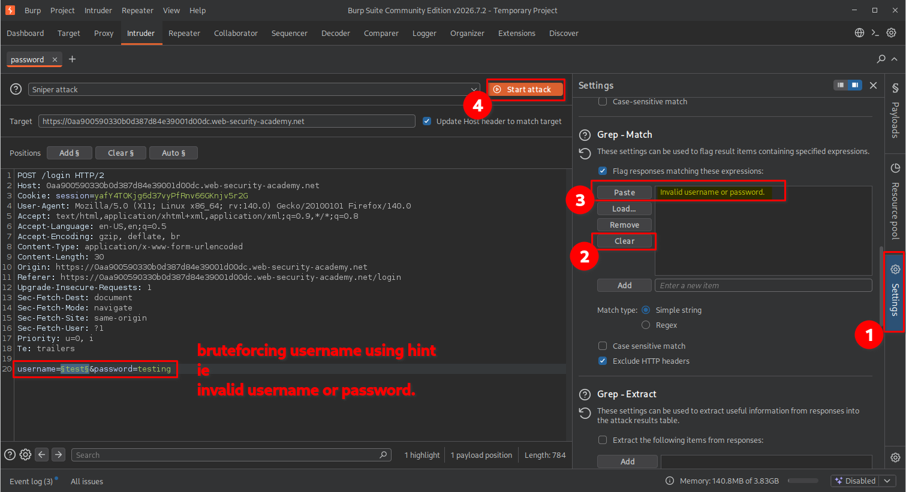

This time, Intruder identified a difference in the responses.

For most invalid usernames, the application returned: `invalid username or password.`

However, when the username was valid, the response contained: `invalid username or password`

Notice the small difference: the period (`.`) at the end was missing.

Because I had configured `Grep-Match` to search for the version containing the period, the valid username's response did not match the configured expression.

As a result, the corresponding `Grep-Match column` was empty for the valid username, while the other responses displayed a match.

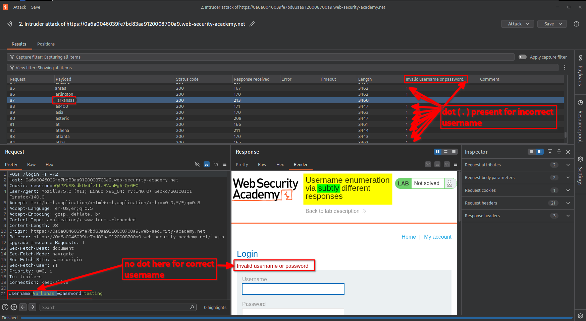

This subtle punctuation difference allowed me to identify the valid username.

**Key observation:** The application returned slightly different error messages depending on whether the supplied username existed. Even a small punctuation inconsistency was enough to distinguish a valid username from an invalid one.

## 4. Enumerating the password using Burp Suite Intruder

After identifying the valid username, I repeated the Intruder process, this time targeting the password parameter.

I kept the discovered username unchanged and tested the list of passwords provided by the lab.

The steps were:

1. Capture the login request again using the valid username.
2. Send the request to **Intruder**.
3. Open the **Positions** tab.
4. Clear the existing payload positions.
5. Highlight only the password value.
6. Select the **Sniper** attack type.
7. Open the **Payloads** tab.
8. Choose **Simple list** as the payload type.
9. Paste the 100 passwords provided by the lab.
10. Start the attack.

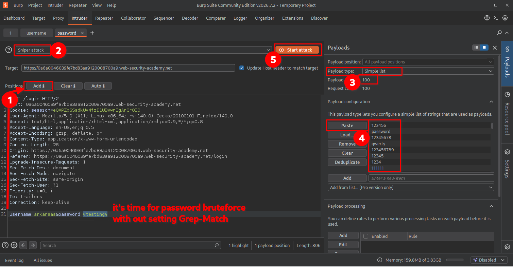

I used two approaches to identify the correct password.

### 4.1. Method 1: Identifying the successful login through the HTTP status code

For the first approach, I did not configure Grep-Match. Instead, I allowed Intruder to send the password list and examined the resulting HTTP responses.

After the attack finished, I sorted the results by the **Status** column.

Most incorrect passwords returned the usual login response. However, one request returned: `302 Found`

This indicated that the application was redirecting the browser after successful authentication.

I inspected the corresponding request and response and found that the redirect pointed to: 

`/my-account?id=arkansas`

The password associated with this successful response was: `nicole`

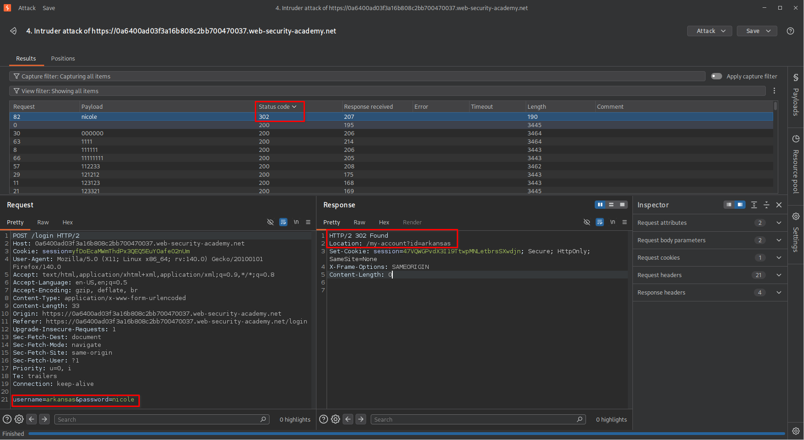

This allowed me to identify the valid password.

### 4.2. Method 2: Identifying the password using Grep-Match

I also repeated the password enumeration process using Grep-Match to understand how the same technique could be applied to password testing.

Under **Settings → Grep-Match**, I configured the following response text: `invalid username or password`

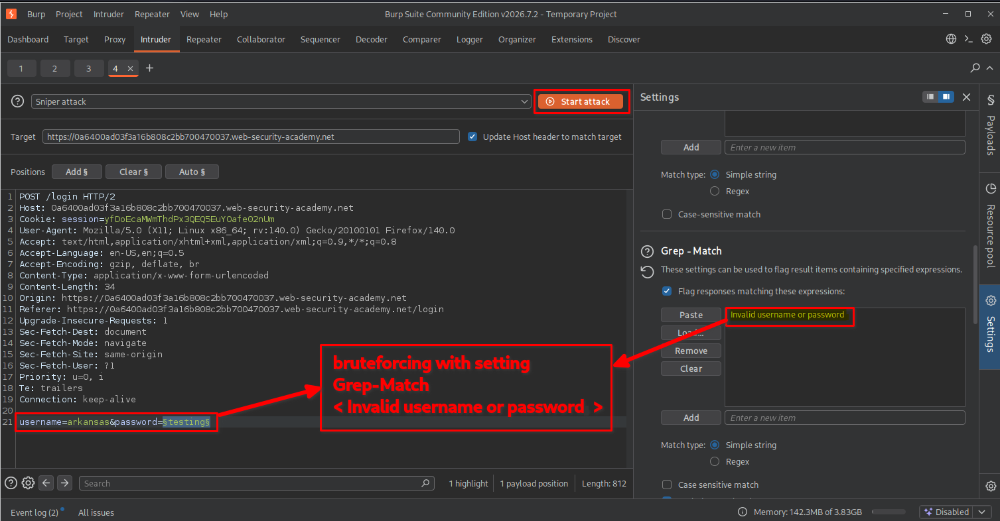

After starting the attack, I examined the `Grep-Match column`.

For incorrect passwords, the application returned the configured error message, resulting in a match.

However, the successful login response did not contain that error message. Therefore, the Grep-Match column was empty for the correct password.

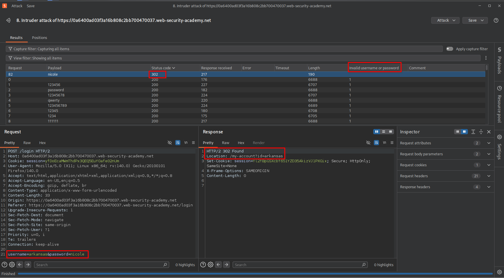

This confirmed the password I had already identified using the HTTP status code.

**Important observation:** Both methods identified the same valid password, but they relied on different response characteristics:

- Method 1 used the HTTP `302` redirect to identify successful authentication.
- Method 2 used the absence of the configured error message in the Grep-Match column.

## 5. Logging in and confirming lab completion

After identifying the valid username and password, I returned to the browser and entered the discovered credentials.

The application successfully authenticated me and redirected me to the account page.

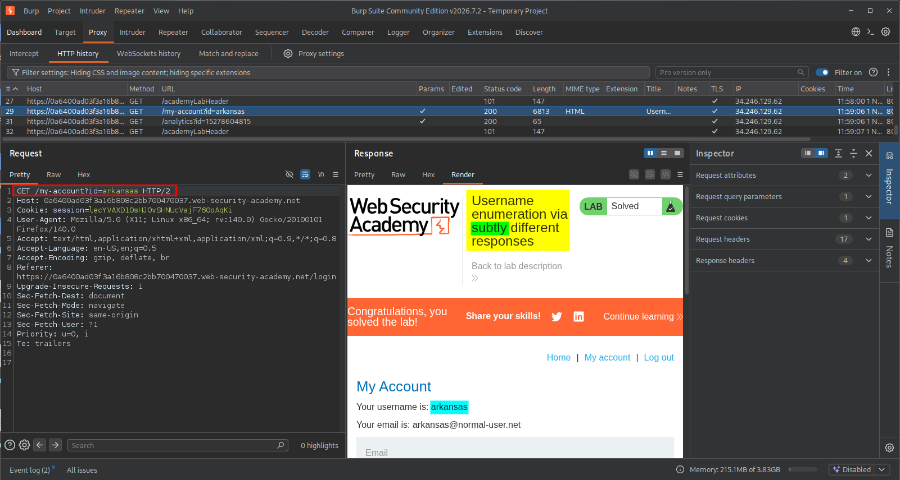

The lab displayed the completion message, confirming that I had successfully enumerated the credentials and completed the challenge.

# Key Takeaways

- **Authentication responses matter:** Login error messages should be examined carefully because even minor inconsistencies can reveal whether a username exists.
- **Understand response analysis:** HTTP status codes, response lengths, response bodies, and redirect locations can all provide useful information during authentication testing.
- **Use Burp Suite Intruder effectively:** Intruder allows systematic testing of multiple username and password candidates.
- **Understand Grep-Match:** This feature helps identify responses containing or not containing specific text, making subtle response differences easier to detect.
- **Do not rely on response length alone:** Different responses may have different lengths for unrelated reasons, so inspecting the actual response content is important.
- **Recognize authentication weaknesses:** Username enumeration can make password attacks more targeted because attackers no longer need to guess both credentials.
- **Validate findings:** A successful authentication response and subsequent login provide stronger confirmation than a response difference alone.

# Security Impact

Username enumeration can help attackers identify valid accounts without knowing their passwords.

Once valid usernames are discovered, attackers can focus password-guessing or credential-stuffing attempts on existing accounts instead of wasting requests on nonexistent usernames.

If the application also permits weak passwords or insufficiently restricts login attempts, this weakness can increase the risk of account compromise.

In this lab, the subtle punctuation difference in the error messages exposed a valid username, while the authentication response differences allowed the correct password to be identified.

# Remediation

To prevent username enumeration through inconsistent authentication responses:

1. **Use generic error messages:** Return the same message for invalid usernames and incorrect passwords.
2. **Maintain consistent responses:** Ensure that response bodies, status codes, and other observable characteristics do not reveal whether an account exists.
3. **Implement rate limiting:** Restrict repeated authentication attempts from the same source or against the same account.
4. **Introduce progressive delays:** Apply appropriate delays after repeated failed login attempts to make automated guessing more difficult.
5. **Use multi-factor authentication:** Add another authentication factor to reduce the impact of compromised passwords.
6. **Monitor authentication activity:** Detect unusual login patterns, repeated failures, and automated username enumeration attempts.

# Conclusion

This lab demonstrated how small inconsistencies in authentication responses can expose valid usernames and passwords. I initially attempted to identify valid usernames by comparing response lengths, but that approach was inconclusive. By switching to Burp Suite's Grep-Match feature, I identified a subtle punctuation difference that revealed the valid username.

I then used two approaches to identify the correct password: analyzing the HTTP `302` redirect and using Grep-Match to detect the absence of the invalid-login message.

The main lesson is that authentication security is not limited to password strength. Even minor differences in application responses can expose sensitive account information and make further attacks easier.

*Thanks for reading!*
