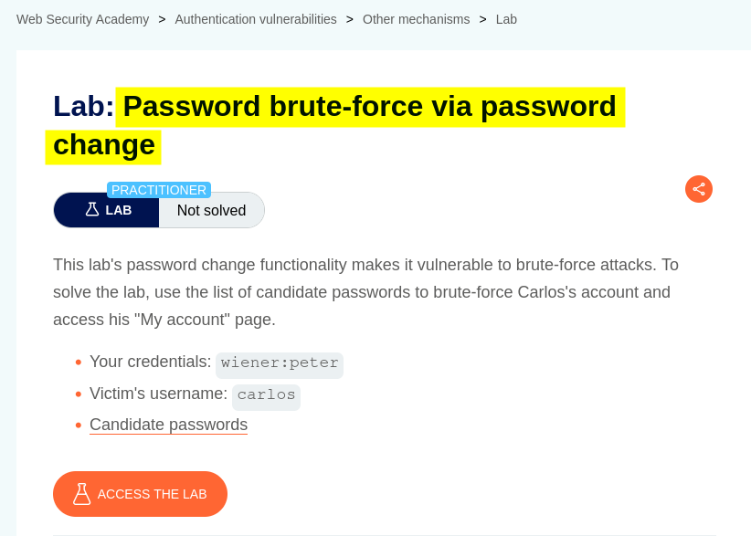
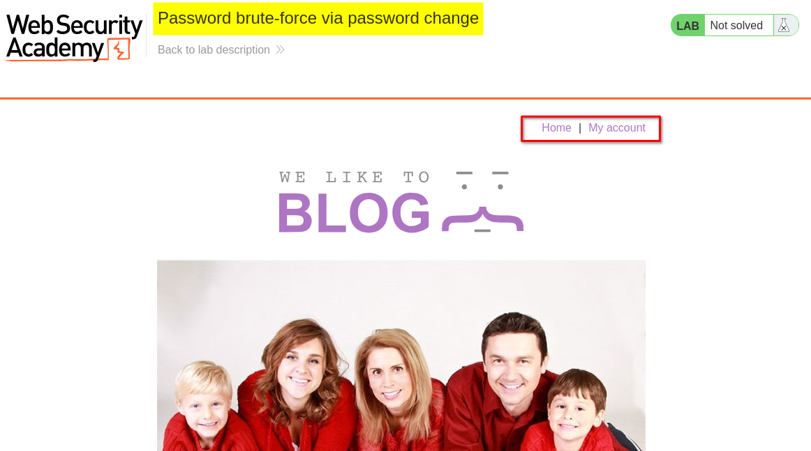
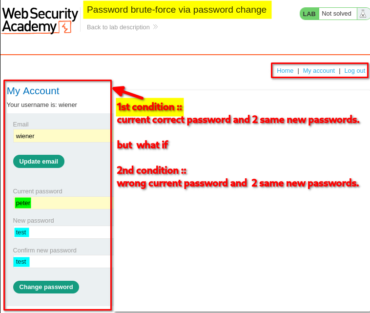
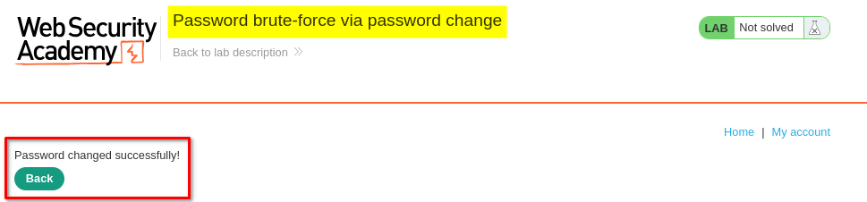
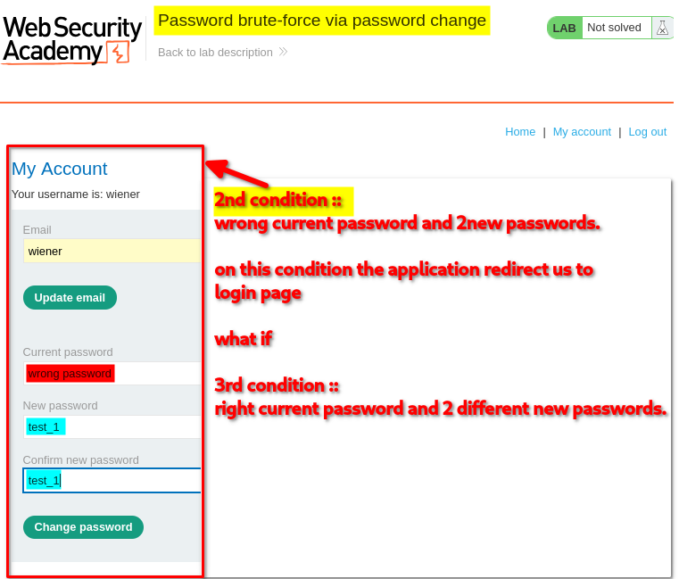
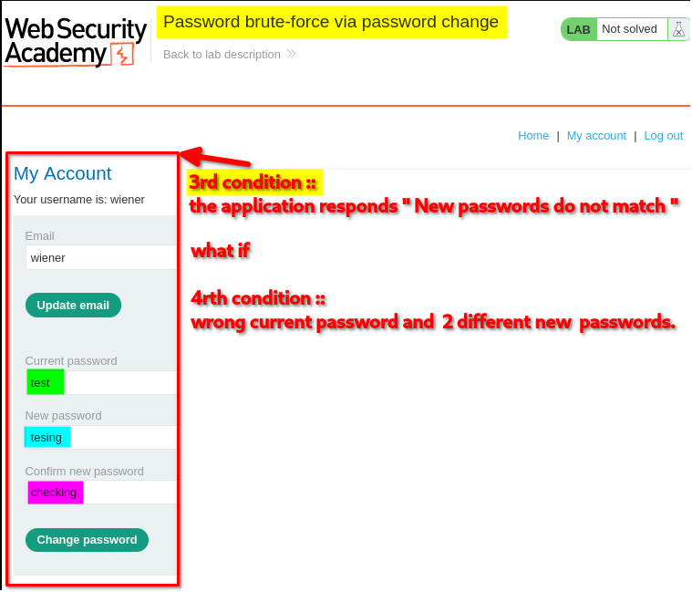
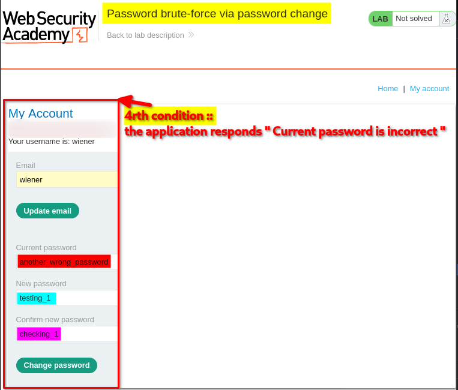
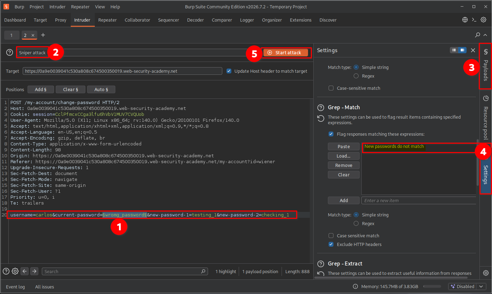
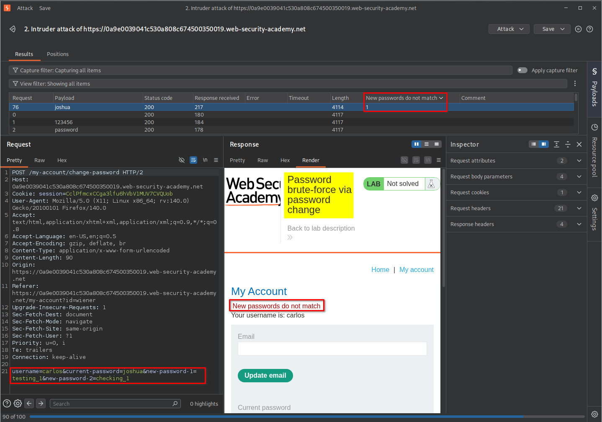
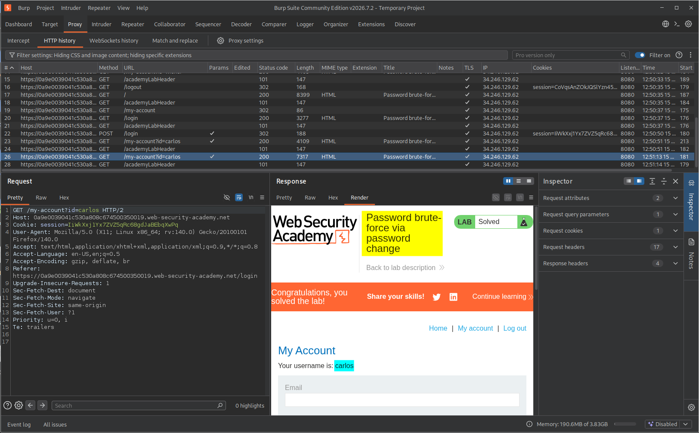

# Overview

This lab demonstrates how a weakness in a password-change mechanism can allow an attacker to brute-force a user's current password. The application validates the new-password fields before checking the current password, creating a distinguishable response that can be used to identify valid credentials.

Using Burp Suite Intruder, I exploited this behavior to discover Carlos's password and gain access to his account.

# Question / Lab Objective

The objective was to exploit the password-change functionality to brute-force Carlos's current password and use the discovered credentials to log in to his account.

# Walkthrough

## 1. Exploring the application

After launching the lab, I accessed the target application and explored its available functionality. The website displayed a collection of blog posts, along with a **My account** option.

I browsed the application to understand its structure and identify potential entry points for further investigation.

At this stage, I had not identified any obvious authentication weaknesses.

## 2. Inspecting the login functionality

I clicked **My Account**, which redirected me to the login page.

I logged in using the credentials provided by the lab for the user `wiener`. After successfully logging in, I explored the account page and noticed a password-change functionality.

I decided to investigate how the application validated the password-change form.

Before testing, I identified four possible combinations:

| Test | Current password | New password fields |
|---|---|---|
| Method 1 | Correct | Matching |
| Method 2 | Incorrect | Matching |
| Method 3 | Correct | Different |
| Method 4 | Incorrect | Different |

By testing these combinations, I could observe how the application handled different validation conditions.

## 3. Testing the password-change functionality

**Method 1: Correct current password and matching new passwords**

I entered the correct current password and used matching values in both new-password fields.

The application responded with: `Password changed successfully`

This confirmed that the password-change operation worked when all supplied values were valid.

**Method 2: Incorrect current password and matching new passwords**

Next, I entered an incorrect current password while keeping both new-password fields identical.

The application redirected me to the login page.

**Method 3: Correct current password and different new passwords**

For the third test, I entered the correct current password but deliberately provided different values in the new-password and confirmation fields.

The application responded with: `New passwords do not match`

This response was particularly interesting because it suggested that the application checked whether the new-password fields matched before validating the current password.

**Method 4: Incorrect current password and different new passwords**

Finally, I entered an incorrect current password and different values in the two new-password fields.

This time, the application responded with: `Current password is incorrect`

The different responses revealed a potentially exploitable validation-order issue.

### Understanding the vulnerability

The application appeared to perform its checks in the following order:

1. Check whether the new password and confirmation match.
2. Validate the current password.
3. Change the password if the supplied values are valid.

This creates a useful difference in application responses:

- If the new-password fields do not match, the application returns `New passwords do not match`.
- If the new-password fields match but the current password is incorrect, the application returns `Current password is incorrect`.

By deliberately making the two new-password fields different, I could use the response to determine whether a guessed current password was valid.

In other words, the application response became an **oracle** that helped distinguish a valid password from an invalid one.

After identifying this behavior, I sent the password-change request to Burp Suite Repeater and checked whether the application enforced rate limiting. I did not observe an effective rate limit during my testing.

## 4. Brute-forcing the current password using Intruder

Since the password-change request produced distinguishable responses, I sent the request to **Burp Suite Intruder** to automate password guessing.

I configured the attack as follows:

- **Attack type:** Sniper
- **Username:** Carlos
- **Payload position:** Current-password parameter
- **Payload type:** Simple list
- **Payload list:** Password candidates provided by the lab
- **Grep-Match:** `New passwords do not match`

I kept the two new-password fields different so that the application would return the validation message used to identify a valid current password.

### Why did I use Grep-Match?

Grep-Match allows Burp Suite to identify responses containing a particular string.

In this case, I used: `New passwords do not match`

The expected behavior was:

- **Valid current password:** The application returned `New passwords do not match`.
- **Invalid current password:** The application returned `Current password is incorrect`.

Therefore, I could identify the correct password by looking for the response containing the configured Grep-Match string.

After starting the attack, I found a password candidate that produced the expected response.

## 5. Logging in as Carlos

After identifying Carlos's password, I returned to the login page and entered the discovered credentials.

The application successfully authenticated me as Carlos, confirming that the password had been identified correctly.

## 6. Confirming lab completion

After successfully accessing Carlos's account, the application displayed the lab completion message.

This confirmed that the vulnerability had been successfully exploited.

# Key Takeaways

- Password-change functionality should be tested carefully because validation behavior can reveal authentication weaknesses.
- Validation order matters. Checking password fields before authenticating the user can expose information about the supplied current password.
- Different error messages can create an authentication oracle.
- Burp Suite Intruder can automate password guessing when an application provides distinguishable responses.
- Grep-Match helps identify specific response patterns during an Intruder attack.
- Rate limiting and monitoring are important defenses against automated password guessing.

# Security Impact

An attacker could exploit the inconsistent validation behavior to brute-force a user's current password without knowing their existing credentials.

If the attacker discovers a valid password, they may be able to authenticate as the targeted user and gain unauthorized access to their account.

The absence of effective rate limiting makes automated password guessing significantly easier.

# Remediation

To prevent this vulnerability:

1. **Authenticate before processing password changes:** Verify the user's current password before performing other password-change operations.
2. **Use consistent error handling:** Avoid exposing different responses that reveal whether a password guess is correct.
3. **Implement rate limiting:** Restrict repeated password-change attempts and apply appropriate delays or temporary restrictions.
4. **Monitor suspicious activity:** Detect repeated failed password-change requests and investigate potential brute-force attempts.
5. **Use multi-factor authentication:** Add another layer of protection to user accounts, particularly for sensitive account operations.

# Conclusion

This lab demonstrated how improper validation order in a password-change mechanism can expose an authentication weakness.

By deliberately submitting mismatched new-password values, I identified a difference in the application's responses that allowed me to distinguish valid password guesses from invalid ones. I then used Burp Suite Intruder and Grep-Match to automate the process, discover Carlos's password, and successfully access his account.

*Thanks for reading!*
