# Overview

This lab demonstrates how flawed IP-based brute-force protection can be bypassed by alternating authentication requests between different accounts. By using Burp Suite Intruder, I exploited this weakness to identify Carlos's valid password. I also explored two approaches: manually alternating payloads using a `Pitchfork attack` and automating the process using Burp Suite Macros.

# Question / Lab Objective

The objective was to bypass the application's IP-based brute-force protection and discover Carlos's valid password using the provided password wordlist.

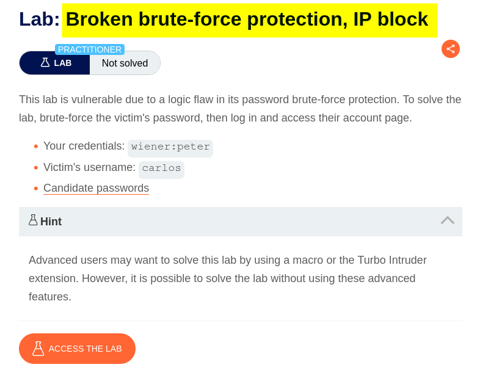

# Walkthrough

## 1. Exploring the application

After launching the lab, I accessed the target application and explored its available functionality. The website displayed a collection of blog posts along with a **My Account** option.

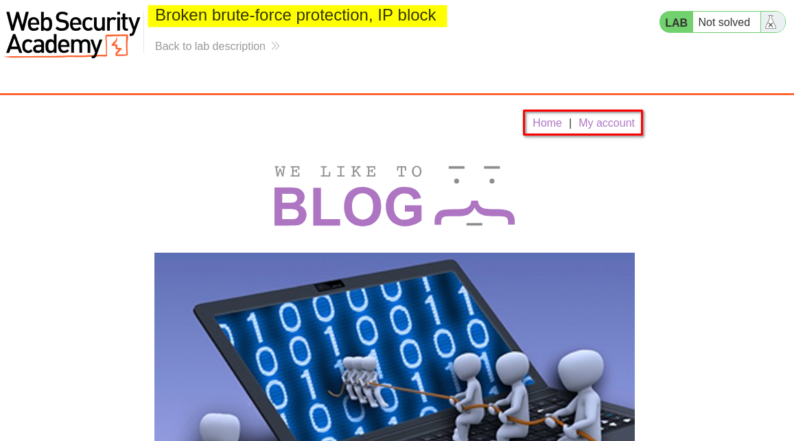

I browsed the application to understand its structure and identify potential entry points for further investigation.

At this stage, I had not identified any obvious authentication weaknesses.

## 2. Inspecting the login functionality

I clicked **My Account**, which redirected me to the login page.

I initially submitted a login request using the credentials provided by the lab to observe how the application handled authentication attempts.

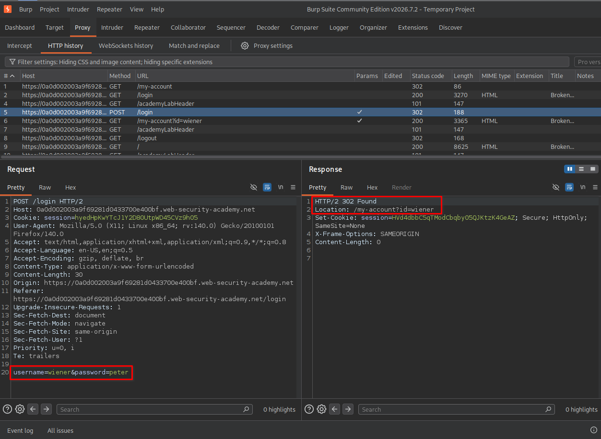

After examining the login functionality, I decided to send the authentication request to Burp Suite Repeater to investigate the application's brute-force protection mechanism.

## 3. Identifying the request threshold

I sent the login request to **Repeater** and performed multiple login attempts using a valid username with an incorrect password.

For the first three attempts, the application returned the following response: `Incorrect password`

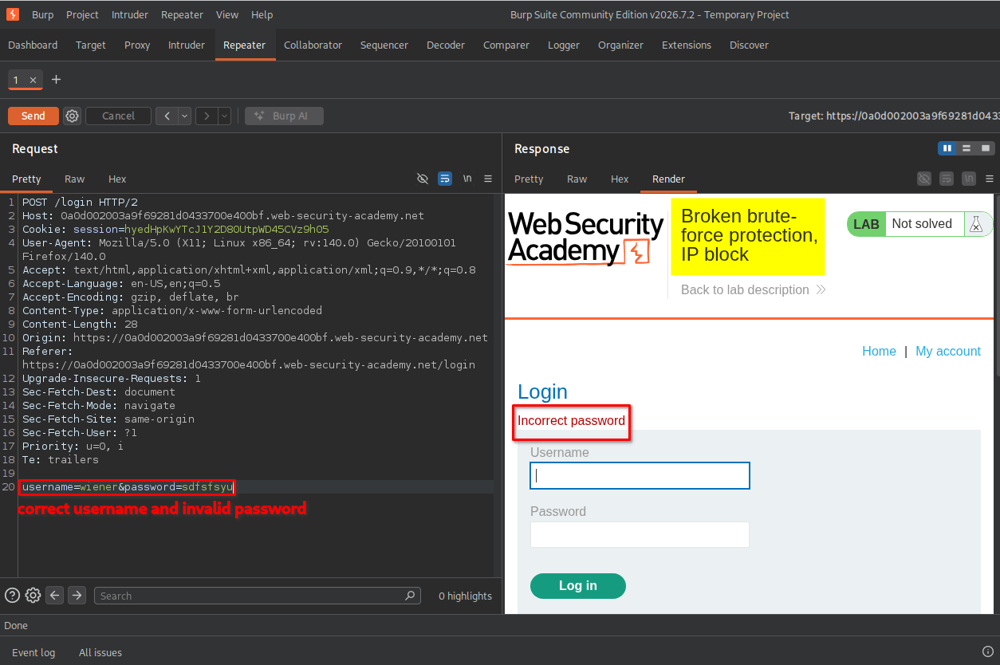

However, after the third failed attempt, the application returned a different response indicating that the request threshold had been reached.

The server displayed the following message:

`You have made too many incorrect login attempts. Please try again in 1 minute(s).`

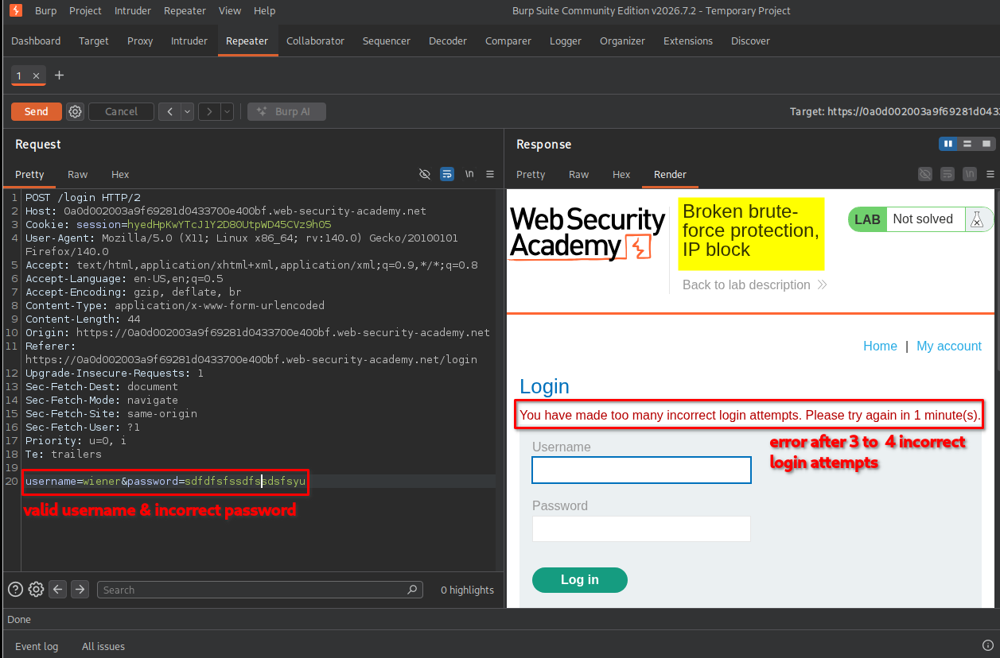

This indicated that the application temporarily blocked further authentication attempts after a certain number of failed logins.

The protection appeared to be based on the client's IP address rather than being exclusively associated with the individual account.

## 4. Confirming the IP-based restriction

After triggering the restriction, I attempted to log in using the valid username and password provided by the lab.

However, the application continued to reject the login attempt because the IP-based restriction was still active.

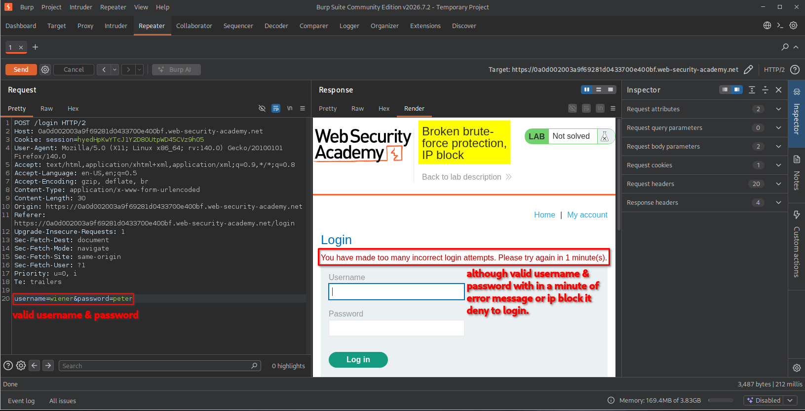

This observation was important because it showed that even a legitimate login attempt could be temporarily blocked after the threshold was reached.

I needed to find a way to continue testing Carlos's password without repeatedly triggering the IP-based restriction.

## 5. Understanding the alternating-request technique

While investigating the behavior, I realized that the protection could be bypassed by alternating authentication requests between two accounts.

The idea was to use the valid credentials of the `wiener` account between attempts against `carlos`.

The sequence would look like this:

1. Attempt to log in as `carlos` using a guessed password.
2. Log in as `wiener` using the valid credentials provided by the lab.
3. Attempt another password against `carlos`.
4. Repeat the sequence.

The successful login as `wiener` resets the failed-login counter, allowing another password attempt against `carlos`.

This exposed the weakness in the application's protection mechanism: successful authentication through another account could reset the counter used to restrict further login attempts from the same IP address.

I identified two ways to implement this technique using Burp Suite:

- **Method 1:** Manually alternate usernames and passwords using a Pitchfork attack.
- **Method 2:** Use a Burp Suite Macro to automate the successful login request between password guesses.

I initially experimented with the manual approach.

# Method 1: Manually alternating payloads using Pitchfork

## 6. Configuring the password payload position

I sent the login request to **Intruder** and selected the password parameter as the first payload position.

I also copied the password wordlist provided by the lab.

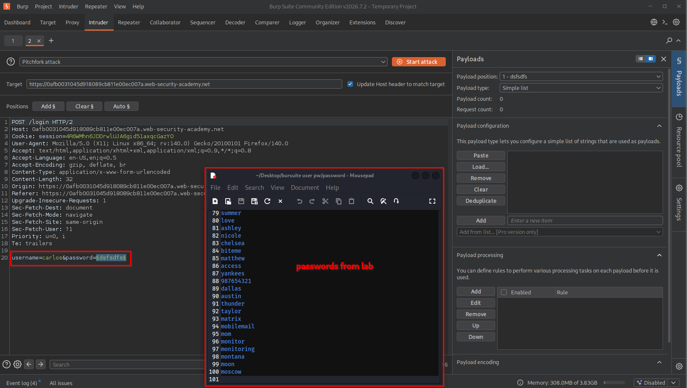

The next step was to modify the wordlist so that every password guess for Carlos would be followed by the known valid password for Wiener.

The valid Wiener credentials provided by the lab were:

- Username: `wiener`
- Password: `peter`

For this exercise, I used ChatGPT to help generate the alternating password list.

For example, the original password list contained 100 entries. After inserting `peter` between each password guess, the resulting list contained 200 entries.

The pattern looked like this:

```text
password1
peter
password2
peter
password3
peter
password4
peter
...
```

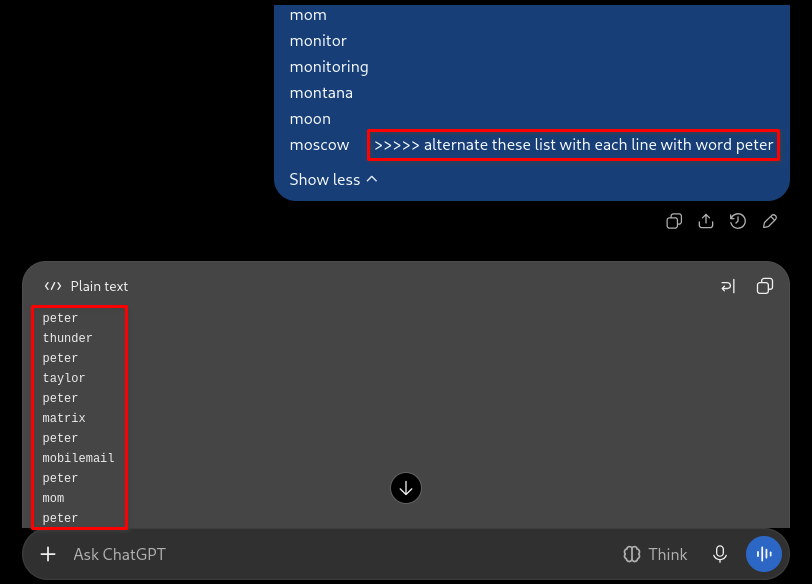

After generating the list, I copied it into the password payload section in Intruder and selected **Simple list** as the payload type.

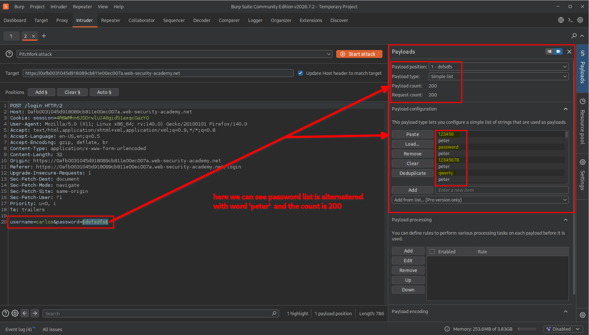

## 7. Configuring the username payload position

Next, I needed to create a username list that followed exactly the same alternating pattern.

For every Carlos password attempt, the next request needed to authenticate as Wiener.

The username sequence therefore looked like this:

```text
carlos
wiener
carlos
wiener
carlos
wiener
carlos
wiener
...
```

Just as with the password list, I used ChatGPT to generate the alternating username wordlist.

The original list contained 100 entries. After alternating `carlos` with `wiener`, the resulting list contained 200 entries.

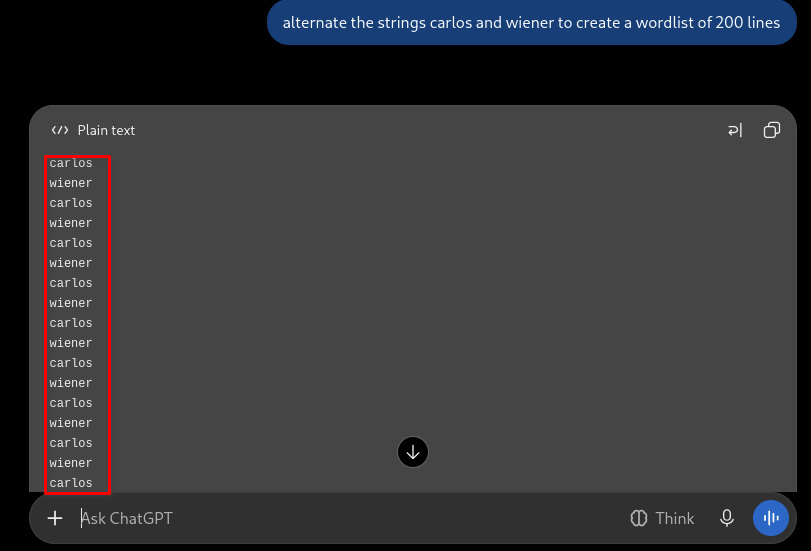

I then copied the generated list into the username payload section and selected **Simple list** for this position as well.

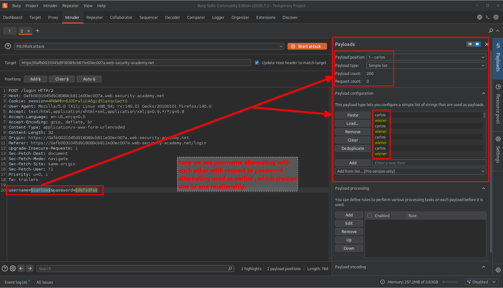

**Important:** Both payload lists must have the same number of entries and follow the same ordering. Otherwise, the username and password combinations will not match the intended request sequence.

## 8. Configuring the Resource Pool

Before starting the attack, I needed to configure the request execution settings.

I opened the **Resource pool** settings on the right side of the Intruder interface and created a new resource pool.

I configured: `Maximum concurrent requests: 1`

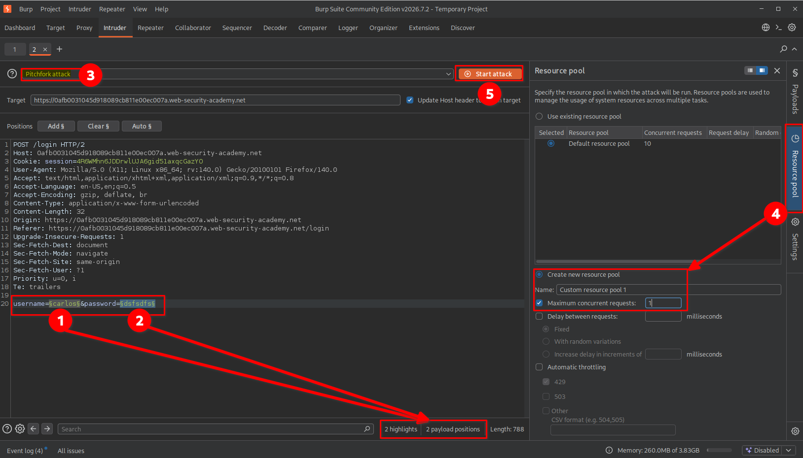

This setting was important because the requests needed to be processed sequentially rather than simultaneously.

The intended sequence was:

```text
Request 1: carlos + guessed password
Request 2: wiener + peter
Request 3: carlos + next guessed password
Request 4: wiener + peter
Request 5: carlos + next guessed password
...
```

Using one concurrent request helped maintain the required request order so that the successful Wiener login could reset the failed-attempt counter before the next Carlos attempt.

## 9. Running the Pitchfork attack

After configuring both payload positions and the Resource Pool, I started the Pitchfork attack.

I could observe the requests being processed in the alternating sequence.

The results showed different HTTP response codes for the requests. Failed login attempts and successful authentication attempts produced different responses.

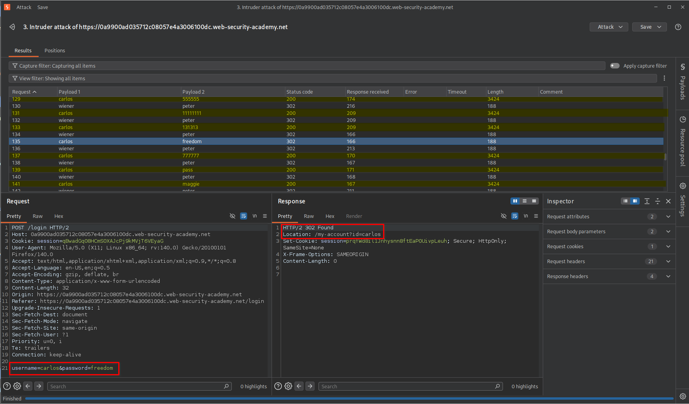

While examining the results, I identified a response associated with Carlos that indicated a successful login redirection.

This helped me identify the valid password from the password payload list.

**Finding:** The alternating-request technique successfully bypassed the flawed IP-based brute-force protection, allowing me to identify Carlos's password.

# Method 2: Automating the process using Burp Suite Macros

After successfully completing the lab using the manual Pitchfork method, I decided to practise the second approach using Burp Suite's Macro functionality.

Unlike the first method, this approach does not require manually creating two alternating payload lists. Instead, Burp Suite automatically performs a predefined successful login request before sending each password guess.

## 10. Initial Intruder configuration

First, I selected the password parameter as the payload position.

For this method:

- Attack type: `Sniper`
- Payload position: Password
- Payload type: `Simple list`
- Payload list: The original password wordlist provided by the lab.

I did not need to configure a second username payload position because the username for the Intruder request remained `carlos`.

I also configured the Resource Pool with a maximum of one concurrent request.

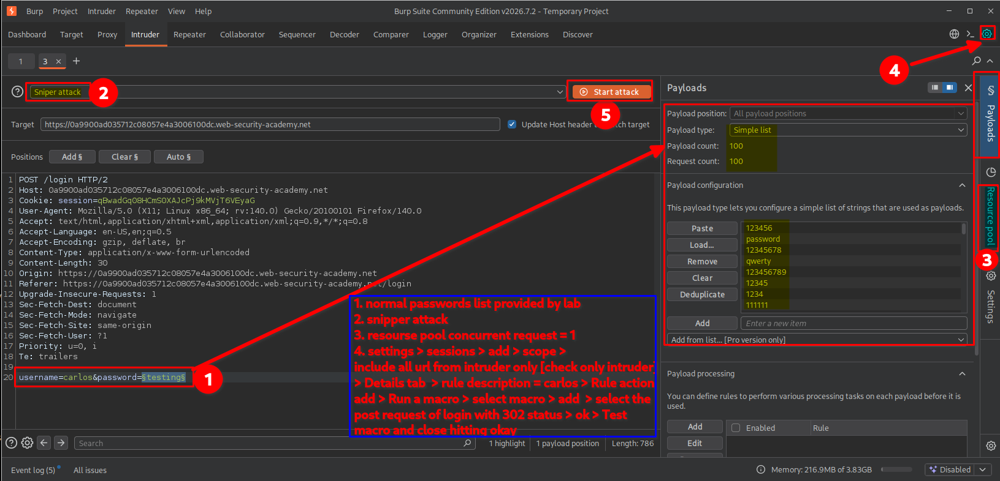

## 11. Creating a Session Handling Rule

Next, I opened Burp Suite's settings using the gear icon and navigated to:

**Sessions → Session handling rules**

I clicked **Add** to create a new session handling rule.

A configuration window appeared with two tabs:

- Scope
- Details

I started with the **Scope** tab.

The steps were:

1. Select the **Intruder** checkbox under Tool scope.
2. Under URL scope, select **Include all URLs**.
3. Confirm the configuration.

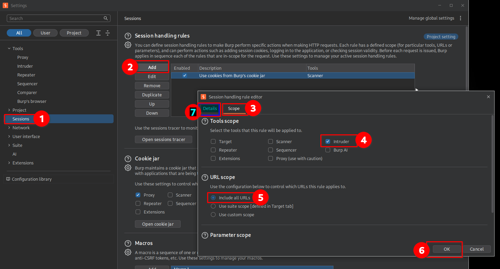

This configuration ensured that the session handling rule would apply to Intruder requests.

## 12. Configuring the Macro action

After configuring the scope, I moved to the **Details** tab.

The steps were:

1. Enter a meaningful name in the Rule description field so that the rule could be identified easily.
2. Under Rule actions, click **Add**.
3. Select **Run a macro**.
4. Choose the previously recorded login request associated with the `wiener` account.

The selected macro contained the POST login request that authenticated as Wiener using the valid credentials.

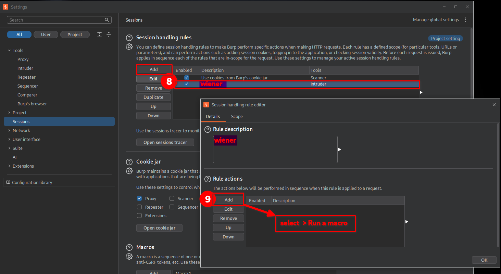

The purpose of this macro was to perform a successful Wiener login before each Intruder password attempt against Carlos.

This automated the same request sequence that I had manually constructed using the Pitchfork method.

## 13. Testing and saving the Macro

After selecting the appropriate macro, I tested it to ensure that Burp Suite could execute the request successfully.

Once the test was successful, I confirmed the configuration and closed the settings windows.

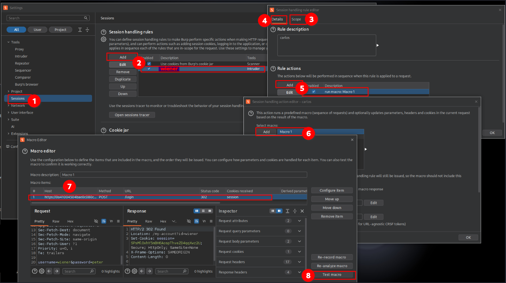

At this point, the session handling rule was configured to run the Wiener login macro before Intruder requests.

## 14. Running the automated attack

I returned to Intruder and started the attack.

Unlike the Pitchfork method, only one payload position was visible in the Intruder results because I was using a single password list for Carlos.

The second authentication request was being generated automatically through the configured Macro.

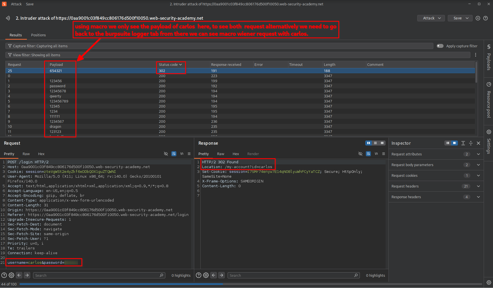

This made the attack configuration simpler because I no longer needed to maintain two manually synchronized payload lists.

## 15. Observing the alternating requests in Logger

To understand what was happening behind the scenes, I opened Burp Suite's **Logger** tab.

There, I could observe the requests generated by Intruder alongside the additional requests executed by the Macro.

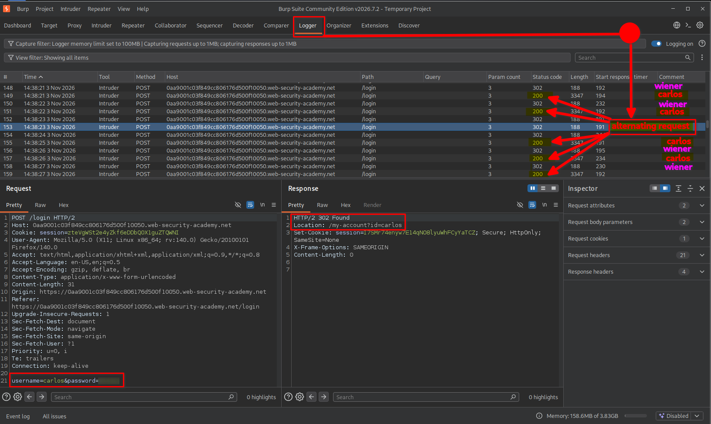

This was particularly useful because the Intruder results displayed only the password payloads, whereas Logger allowed me to observe the additional authentication traffic generated by the session handling rule.

The request sequence demonstrated that Burp Suite was automatically authenticating as Wiener before continuing with the password attempts against Carlos.

This confirmed that the Macro method was automating the same technique used in the manual Pitchfork approach.


# 16. Lab completion

After successfully identifying Carlos's valid password using the manual Pitchfork method, I returned to the lab and logged in using the discovered credentials.

The application authenticated me successfully and redirected me to Carlos's account page.

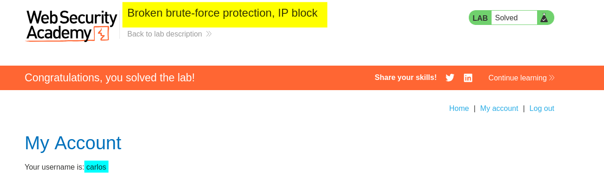

The lab displayed the completion message, confirming that I had successfully bypassed the IP-based brute-force protection and recovered the valid password.

Although the lab was already completed using the first method, I also practised the Macro-based approach to understand how Burp Suite can automate the same authentication sequence without manually alternating two payload lists.

This gave me practical experience with both Intruder payload configuration and Session Handling Rules.

# Key Takeaways

- **Understand brute-force protection:** Applications commonly restrict repeated failed login attempts to prevent password guessing.
- **Identify the protection mechanism:** Determine whether restrictions are applied per account, per IP address, or through a combination of mechanisms.
- **Understand authentication state:** A successful login to another account may affect a shared failed-attempt counter if the implementation is flawed.
- **Use Pitchfork effectively:** Burp Suite's Pitchfork attack pairs multiple payload lists by their position, making it useful for testing alternating username and password combinations.
- **Understand Resource Pools:** Limiting concurrent requests to one helps preserve the intended sequence when request order matters.
- **Automate repetitive requests:** Burp Suite Macros and Session Handling Rules can automate authentication workflows without manually building multiple payload lists.
- **Use Logger for visibility:** Logger helps inspect additional requests generated by session handling rules and understand the actual request sequence.

# Security Impact

Weak brute-force protection can allow attackers to perform password-guessing attacks despite the presence of an account lockout or IP-based restriction.

In this lab, the application relied on an IP-based failed-login counter that could be reset by successfully authenticating through another account. By alternating between Carlos's password guesses and Wiener's valid login, it was possible to continue guessing passwords without being blocked as intended.

In a real-world application, this type of weakness could allow attackers to compromise user accounts through password guessing, potentially resulting in unauthorized access to personal information, account functionality, or other sensitive resources.

The actual impact would depend on the application's authentication design, account privileges, and the strength of its other security controls.

# Remediation

To prevent this type of brute-force protection bypass:

1. **Implement account-based rate limiting:** Track failed authentication attempts against individual accounts rather than relying exclusively on the client's IP address.
2. **Use multiple protection layers:** Combine account-based restrictions, IP-based rate limiting, progressive delays, and other appropriate controls.
3. **Prevent counter-reset abuse:** Ensure that successful authentication to one account cannot improperly reset another account's failed-login counter.
4. **Introduce multi-factor authentication:** MFA provides an additional layer of protection even if an attacker discovers a valid password.
5. **Monitor authentication activity:** Detect suspicious patterns such as repeated failed logins, rapid account switching, and unusual authentication sequences.
6. **Avoid permanent account lockouts:** Use carefully designed temporary restrictions and progressive delays to reduce brute-force attacks without allowing attackers to easily deny service to legitimate users.
7. **Apply risk-based controls:** Consider additional verification when authentication behavior appears suspicious.

# Conclusion

This lab demonstrated how poorly implemented brute-force protection can be bypassed even when an application appears to enforce an IP-based login restriction.

By alternating authentication requests between Carlos and Wiener, I was able to reset the failed-login counter and continue testing password guesses against Carlos.

I successfully implemented this technique using two approaches: manually alternating payloads with a Pitchfork attack and automating the authentication sequence using Burp Suite Macros and Session Handling Rules.

The most important lesson from this lab is that authentication protections must be designed around the actual behavior of the application. A rate limit or lockout mechanism may appear effective in isolation, but weaknesses in how authentication attempts are tracked can make the protection ineffective.

*Thanks for reading!*
