# Overview

This lab demonstrates how account lockout mechanisms can unintentionally reveal valid usernames. By sending multiple login attempts for each username and observing differences in the application's responses, I was able to identify a valid account. I then used Burp Suite Intruder and Grep-Match to identify the corresponding password.

# Question / Lab Objective

The objective was to enumerate a valid username by exploiting the application's account lockout mechanism and then discover the associated password to successfully authenticate.

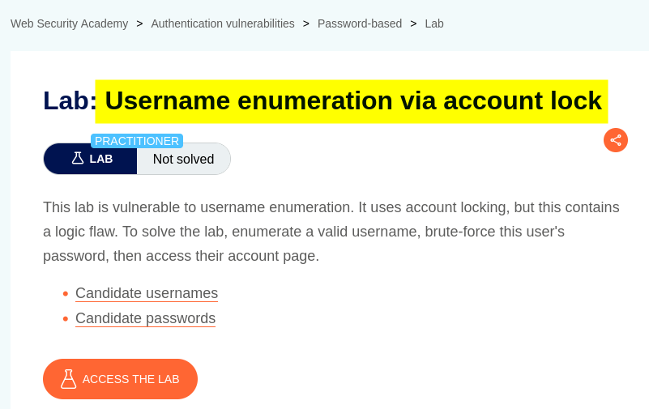

# Walkthrough

## 1. Exploring the application

After launching the lab, I accessed the target application and explored its available functionality. The website displayed a collection of blog posts along with a **My Account** option.

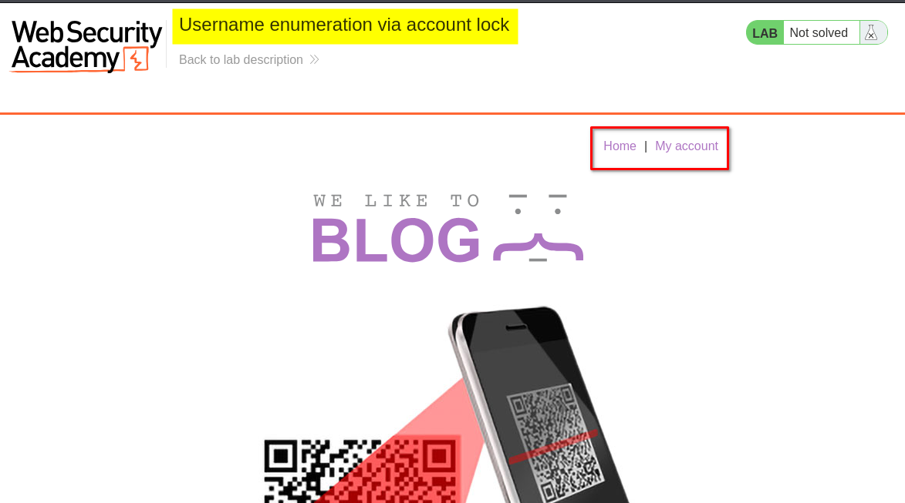

I browsed the application to understand its structure and identify potential entry points for further investigation.

At this stage, I had not identified any obvious authentication weaknesses.

## 2. Inspecting the login functionality

I clicked **My Account**, which redirected me to the login page.

I initially submitted login requests using invalid credentials to observe how the application handled authentication failures.

I sent the login request to **Repeater** and performed multiple attempts using **invalid usernames and incorrect passwords**.

For all these attempts, the application returned the same response:

`Invalid username or password.`

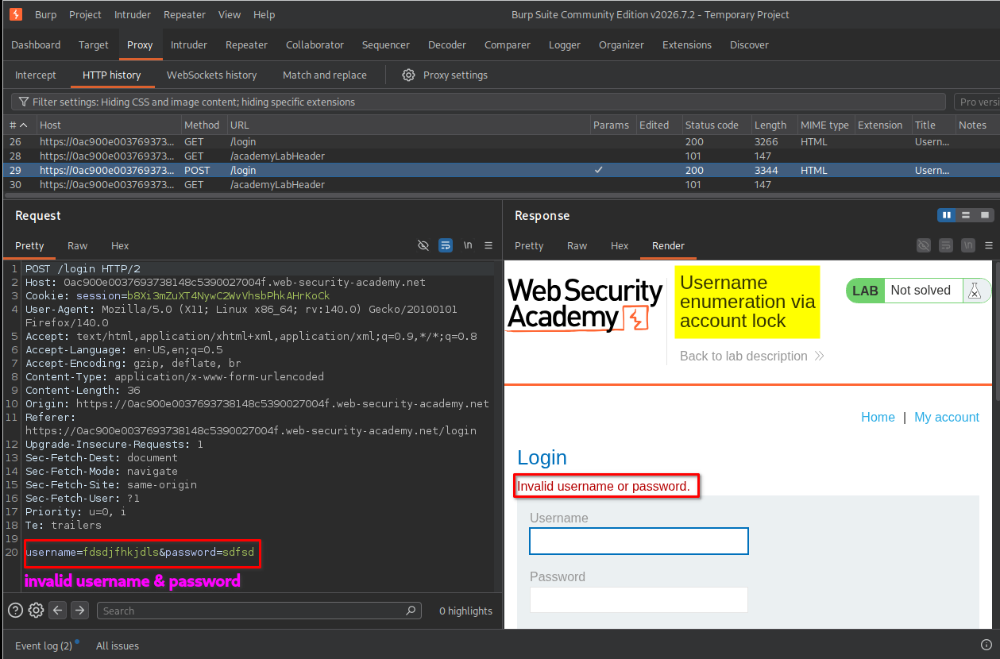

At this point, the responses appeared identical, so I could not distinguish between valid and invalid usernames.

However, the lab description provided an important clue: **the application locks accounts after multiple failed login attempts.**

I decided to investigate this behavior using Burp Suite Intruder.

## 3. Understanding the Cluster Bomb attack

My next objective was to identify which username from the provided wordlist belonged to an existing account.

Since the application locked accounts after repeated failed attempts, I needed to send multiple login requests for each username rather than testing every username only once.

For this purpose, I selected the **Cluster Bomb** attack type in Burp Suite Intruder.

Before configuring the attack, it is important to understand how Cluster Bomb works.

Cluster Bomb allows us to use multiple payload positions, each with its own payload list. Burp Suite generates combinations of the payloads to test different values together.

In this lab, I used:

- **Payload position 1:** Empty payloads (Null payloads).
- **Payload position 2:** The username wordlist.

The intended sequence was five login attempts for each username.

### Visual representation

```text
Username: user1
    |
    +---- Request 1 (empty payload)
    +---- Request 2 (empty payload)
    +---- Request 3 (empty payload)
    +---- Request 4 (empty payload)
    +---- Request 5 (empty payload)
    |
Username: user2
    |
    +---- Request 1 (empty payload)
    +---- Request 2 (empty payload)
    +---- Request 3 (empty payload)
    +---- Request 4 (empty payload)
    +---- Request 5 (empty payload)
    |
Username: user3
    |
    +---- Request 1 (empty payload)
    +---- Request 2 (empty payload)
    +---- Request 3 (empty payload)
    +---- Request 4 (empty payload)
    +---- Request 5 (empty payload)
    |
   ... continues
```

The reason for using five requests was to reach the application's account lockout threshold. A single failed attempt would not necessarily reveal whether an account existed, but repeated attempts could trigger a different response for a valid username.

## 4. Configuring the first payload position

I sent the original login request to **Intruder** and selected the username parameter as the first payload position.

For this position, I selected:

- Attack type: `Cluster Bomb`
- Payload position: Username
- Payload type: `Simple list`
- Payload list: Usernames provided by the lab.

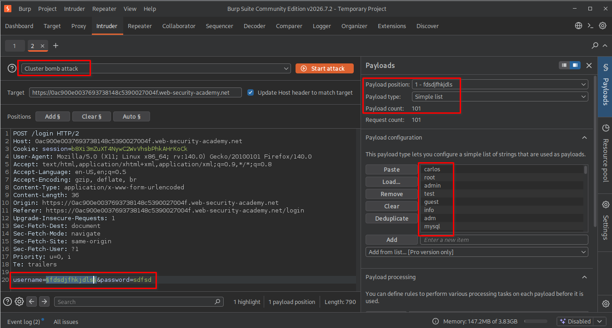

After configuring the username position, I needed to create another payload position to control how many times each username would be tested.

## 5. Adding the second empty payload position

Next, I added another payload position after the password value in the request.

This position was not intended to replace the password with different values. Instead, I wanted Burp Suite to generate multiple requests using the same username and password combination.

For this position, I selected:

- Payload type: `Null payloads`
- Payload configuration: `Generate 5 payloads`

### What are Null payloads?

Null payloads are empty payloads. They do not insert additional text into the selected request position.

However, Burp Suite still generates a separate request for each null payload.

For example, if we configure five null payloads, Burp Suite generates five requests using the same payload values in the other positions.

This was exactly what I needed: five login attempts for each username.

### Why five payloads and not another number?

I selected five because the lab's account lockout behavior required multiple failed attempts to trigger the restriction.

- Fewer than five attempts might not reach the lockout threshold.
- Five attempts were sufficient for the intended test.
- More than five would generate unnecessary requests and additional noise.

Since my username wordlist contained 100 entries, the expected number of combinations was:

\[
100 \times 5 = 500
\]

<text>That is 500 combinations for 100 usernames and five null payloads each. If Burp displays 505, double-check the actual username count, payload configuration, and attack request count rather than assuming the extra five are part of the multiplication.</text>

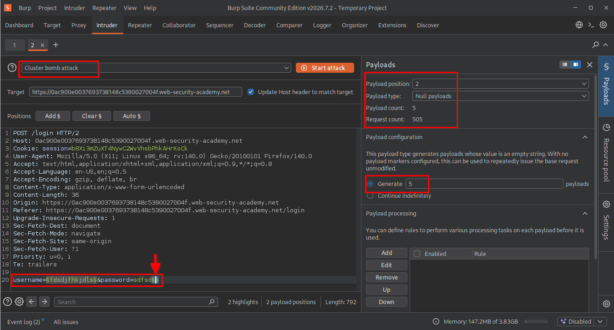

## 6. Configuring the Resource Pool

Before starting the attack, I configured the Resource Pool.

I selected a resource pool with the following setting: `Maximum concurrent requests: 1`

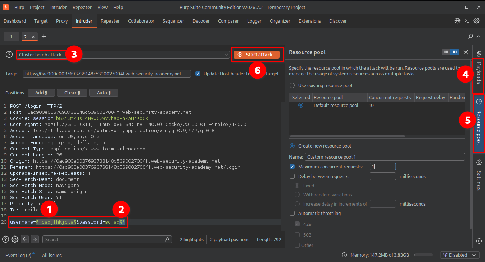

I used one concurrent request because the attack depended on sending login attempts sequentially.

This helped avoid multiple requests being processed simultaneously, which could interfere with the intended lockout sequence.

## 7. First attempt: Incorrect payload position

After configuring the payload positions and Resource Pool, I started the attack.

However, the results were not what I expected.

Instead of sending five requests for each username, Burp Suite processed the entire username wordlist first.

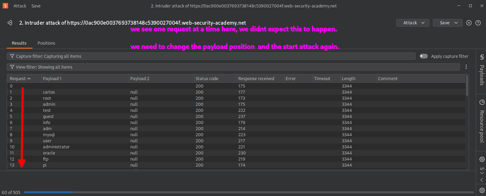

When I examined the results more closely, I noticed that the requests were being processed in this pattern:

```text
Round 1:
user1
user2
user3
...
user100

Round 2:
user1
user2
user3
...
user100

Round 3:
user1
user2
user3
...
user100

Round 4:
user1
user2
user3
...
user100

Round 5:
user1
user2
user3
...
user100
```

In other words, Burp Suite completed the entire username list before starting the next round of null payloads.

This was not the sequence I wanted because my objective was to trigger the account lockout individually for each username.

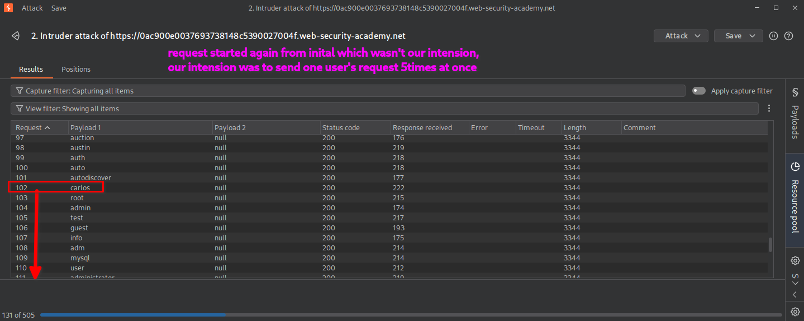

### Why did this happen?

The issue was the order of the payload positions in the raw HTTP request.

In a Cluster Bomb attack, the ordering of payload positions determines how Burp Suite iterates through the combinations.

The username position was appearing before the empty payload position in the request. Consequently, the username payload was changing through its complete list before the next null payload was used.

To achieve five consecutive attempts for each username, I needed the null payload position to appear before the username position in the raw request.

I stopped the attack and corrected the payload placement.

## 8. Correcting the payload position

I moved the second empty payload position to a location before the HTTP request body.

The important point was that the empty payload position now appeared before the username position in the raw HTTP request.

Since HTTP requests contain headers before the request body, placing the additional marker in a suitable header position allowed me to change the payload iteration order.

I kept the same configuration:

- Attack type: `Cluster Bomb`
- Null payloads: `5`
- Username payload type: `Simple list`
- Resource Pool: Maximum concurrent requests set to `1`

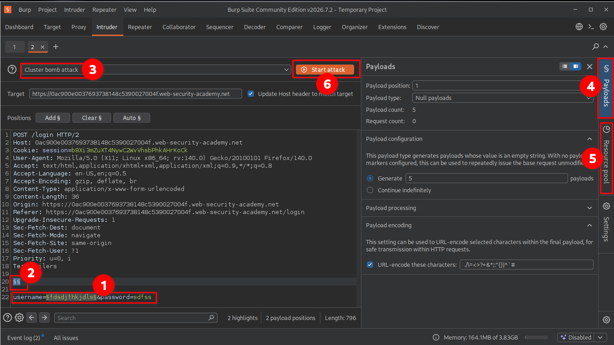

### Why did moving the position matter?

The payload positions are processed according to their order in the request.

By placing the null payload marker before the username marker, the null payload became the first position and the username became the second.

This produced the intended sequence:

```text
Username 1:
    5 consecutive requests

Username 2:
    5 consecutive requests

Username 3:
    5 consecutive requests

Username 4:
    5 consecutive requests

...
```

This was the missing configuration needed to make the Cluster Bomb attack behave as intended.

## 9. Identifying the valid username

After correcting the payload placement, I started the attack again.

This time, the requests followed the expected sequence, with five consecutive login attempts for each username.

While examining the results, I noticed that most usernames returned the same response:

`Invalid username or password.`

However, one username produced a different response after the account lockout threshold was reached:

`You have made too many incorrect login attempts. Please try again in 1 minute(s).`

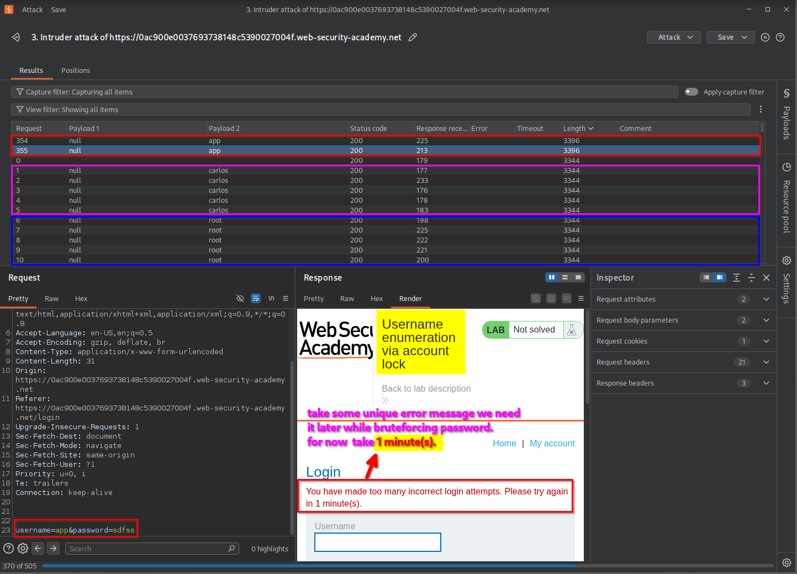

This difference was the key to username enumeration.

The application behaved differently when the supplied username belonged to an existing account. Repeated failed attempts triggered the account lockout response, whereas invalid usernames continued returning the generic authentication error.

By comparing the responses, I identified the valid username.

## 10. Preparing the password brute-force attack

After identifying the valid username, the next objective was to discover its corresponding password.

I sent the login request to Intruder again and configured the attack as follows:

- Attack type: `Sniper`
- Payload position: Password
- Payload type: `Simple list`
- Payload list: Password wordlist provided by the lab.

I kept the identified valid username in the request and selected only the password parameter as the payload position.

I also configured the Resource Pool to use a maximum of one concurrent request.

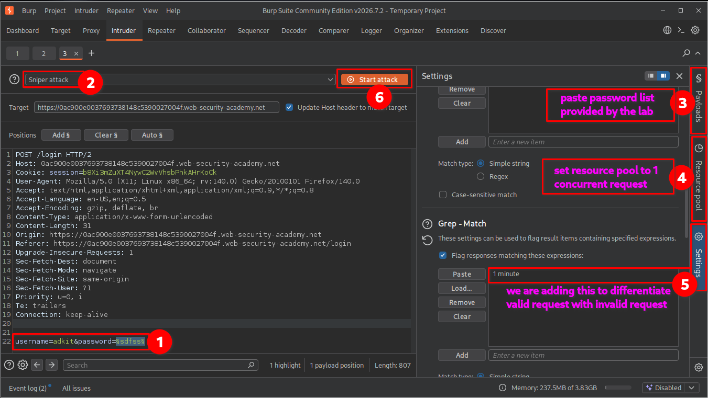

## 11. Configuring Grep-Match

Before starting the password attack, I needed a way to distinguish the different authentication responses.

I opened the **Settings** section in Intruder and located the **Grep-Match** configuration.

I added the following response text: `1 minute`

### Why use Grep-Match?

During the username enumeration stage, the valid username produced a distinctive account lockout message containing the phrase `1 minute`.

I used this phrase as a response-matching indicator.

Grep-Match allows Burp Suite to search server responses for specific text and display whether the configured text was found.

This helped me distinguish responses containing the account lockout message from responses that did not contain it.

For this password attack, I examined the matching results alongside the response lengths and actual response contents.

## 12. Identifying the valid password

After configuring Grep-Match, I started the Intruder attack.

The results showed that most password attempts produced responses containing the account lockout message or otherwise followed the expected failed-authentication behavior.

However, one response behaved differently.

The response associated with the valid password did not contain the `1 minute` message. Its response length and content also differed from the ordinary failed-login responses.

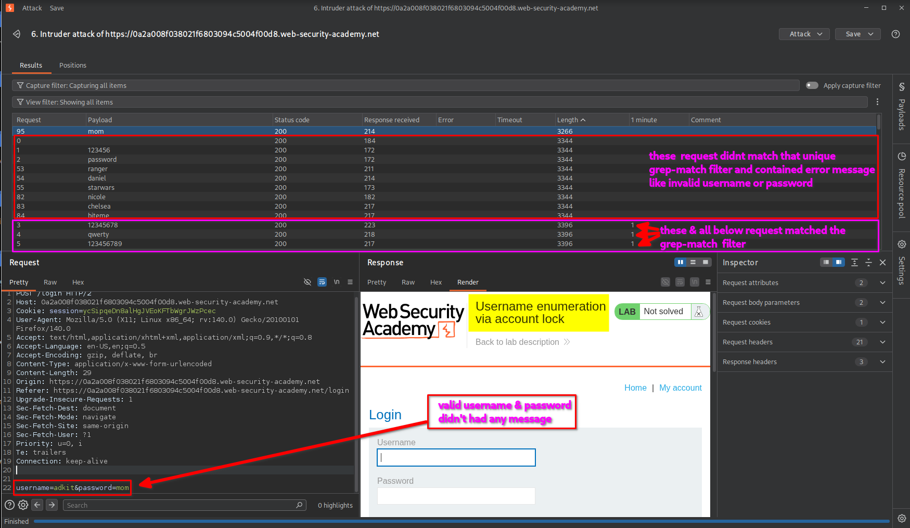

By comparing the responses, I identified the password associated with the valid username.

**Important observation:** Grep-Match helped highlight the responses containing the lockout message. The absence of that phrase alone was not sufficient proof of a valid password, so I also examined the response content and other response characteristics.

## 13. Logging in and confirming lab completion

After successfully identifying the username and password, I returned to the lab's login page and entered the discovered credentials.

The application authenticated me successfully and redirected me to the account page.

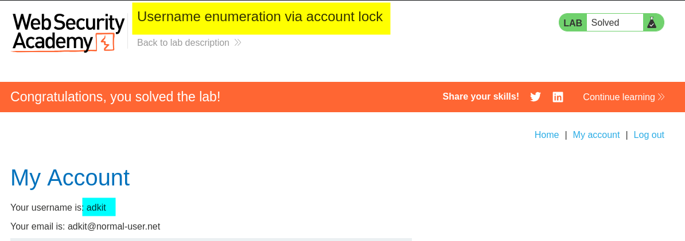

The lab displayed the completion message, confirming that I had successfully enumerated the username, identified its password, and completed the challenge.

# Key Takeaways

- **Account lockout can reveal valid usernames:** Different responses for existing and non-existing accounts can expose username information.
- **Understand Cluster Bomb:** Cluster Bomb tests combinations across multiple payload positions, making it useful for testing repeated authentication attempts.
- **Understand Null payloads:** Null payloads generate repeated requests without inserting additional text into the selected position.
- **Payload position ordering matters:** The order of payload positions in the raw request affects the sequence in which Cluster Bomb generates combinations.
- **Use Resource Pools carefully:** Limiting concurrency to one helps maintain sequential request execution when the attack depends on request order.
- **Understand Grep-Match:** Grep-Match can highlight responses containing specific text, making response comparison easier.
- **Do not rely only on response length:** Compare response content, status codes, redirection behavior, and matching indicators to confirm findings.

# Security Impact

Username enumeration through account lockout behavior can expose valid account names to unauthorized users.

Once an attacker identifies existing usernames, they can focus further password-guessing attempts on those accounts rather than wasting effort on invalid usernames.

This can increase the effectiveness of targeted brute-force and credential-stuffing attacks.

Additionally, account lockout mechanisms that are not carefully designed can create opportunities for denial-of-service attacks. An attacker may deliberately trigger account restrictions to prevent legitimate users from accessing their accounts.

# Remediation

To prevent username enumeration through account lockout behavior:

1. **Use consistent authentication responses:** Return generic error messages for both invalid usernames and incorrect passwords.
2. **Avoid revealing account lockout details:** Do not expose specific account existence or lockout information through unauthenticated login responses.
3. **Implement careful rate limiting:** Apply appropriate restrictions to repeated authentication attempts without creating an easy denial-of-service mechanism.
4. **Monitor authentication activity:** Detect repeated failed login attempts, username enumeration patterns, and suspicious account-lockout activity.
5. **Use multi-factor authentication:** Add another authentication factor to reduce the impact of compromised passwords.
6. **Apply progressive delays:** Introduce increasing delays or risk-based verification instead of relying exclusively on account lockout.
7. **Protect account availability:** Design lockout controls so attackers cannot easily prevent legitimate users from accessing their accounts.

# Conclusion

This lab demonstrated how an application's account lockout mechanism can unintentionally disclose valid usernames through differences in authentication responses.

Using Burp Suite Intruder, I configured a Cluster Bomb attack with username payloads and Null payloads to generate repeated login attempts for each account. After correcting the payload position ordering, I successfully triggered the account lockout response for a valid username.

I then used a Sniper attack and Grep-Match to investigate the password wordlist and identify the corresponding valid password.

The main lesson is that authentication security involves more than checking whether a password is correct. Error messages, account lockout behavior, response differences, and request-handling logic can all introduce weaknesses that expose sensitive account information.

*Thanks for reading!*
