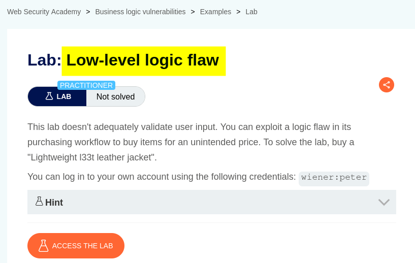
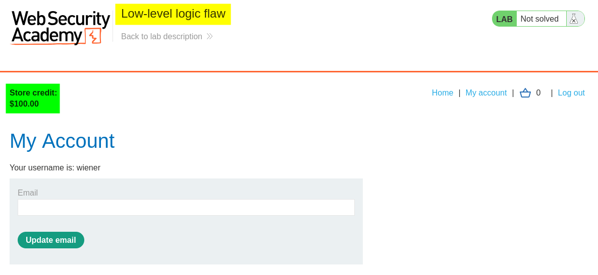
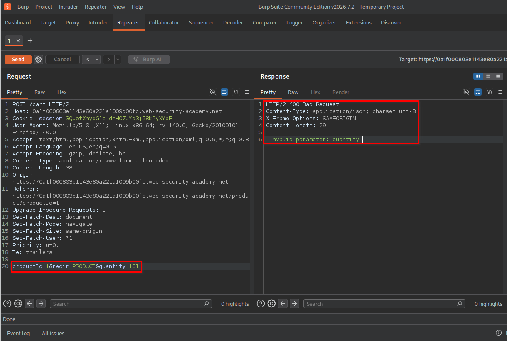
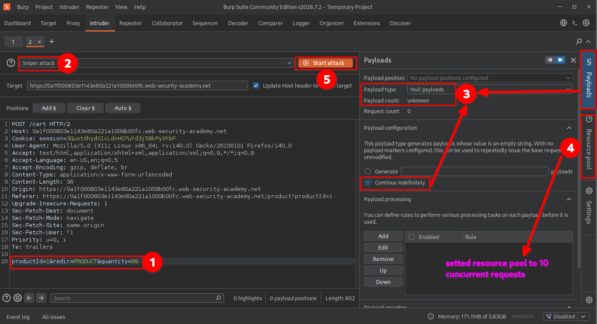
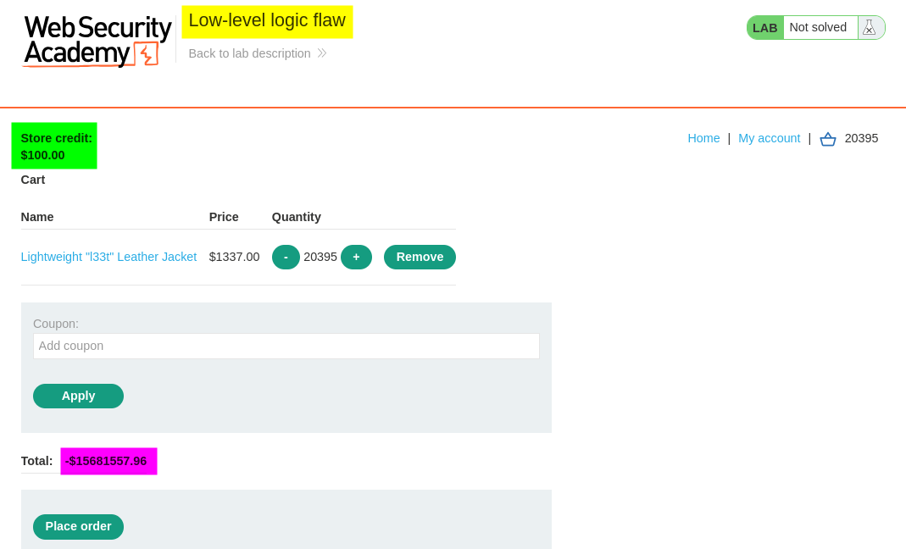
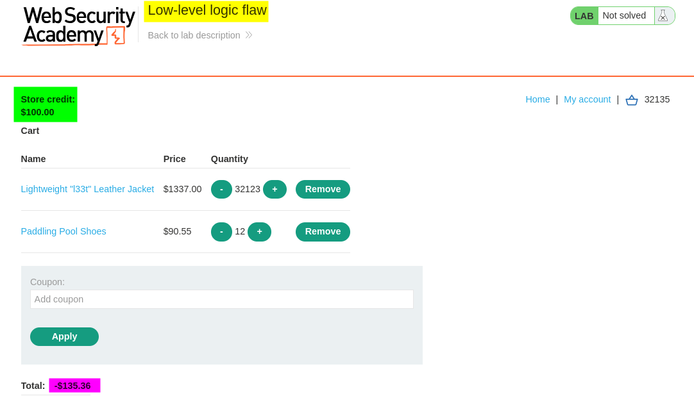
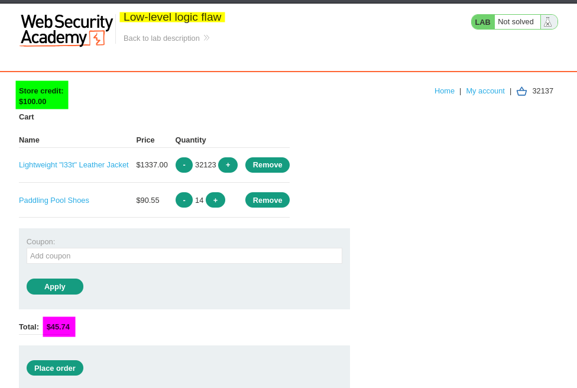
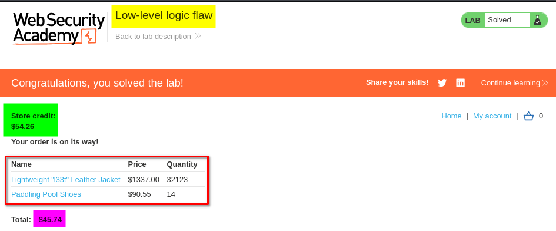

# Overview

This lab demonstrates how an integer overflow vulnerability can affect an application's business logic. By repeatedly adding products to the shopping cart, I triggered a 32-bit integer overflow that caused the calculated total price to wrap around from a large positive value to a negative value. I then added another product to manipulate the final amount and successfully purchased the expensive leather jacket using the available store credit.

# Question / Lab Objective

The objective was to exploit a flaw in the application's purchasing workflow to buy the **Lightweight "l33t" Leather Jacket** for an unintended price, despite having only $100 in store credit.

# Walkthrough

## 1. Exploring the application

After launching the lab, I accessed the target application and explored its available functionality. The website displayed a collection of products, individual product pages, a **My Account** option, and an initially empty shopping cart.

Since the lab description hinted at a flaw in the purchasing workflow, I decided to focus my investigation on the checkout process and how the application handled product quantities and prices.

## 2. Logging in with the provided credentials

I clicked **My Account**, which redirected me to the login page.

The lab provided the following credentials:

- **Username:** `wiener`
- **Password:** `peter`

After logging in, I accessed the account interface and noticed that the account had **$100.00 in store credit**.

This store credit established the spending limit for my investigation. Since the target leather jacket was significantly more expensive than my available credit, I needed to investigate whether the application's purchasing logic could be manipulated.

## 3. Inspecting and testing product quantities

I initially selected a product and attempted to increase its quantity beyond 100.

However, the application rejected the request and returned the following error:

`Invalid parameter: quantity`

This indicated that the application performed some validation on the quantity parameter.

At this point, I considered whether the application could still be made to process a large total quantity through repeated requests rather than supplying an unusually large quantity in a single request.

This was an important change in my testing approach. Instead of focusing only on the value accepted by an individual request, I wanted to investigate how repeated operations affected the application's internal calculations.

## 4. Understanding the low-level logic flaw

Before proceeding, it is important to understand what a low-level logic flaw means in this context.

A low-level logic flaw occurs when an application's internal operations produce unintended results because of incorrect handling of data types, numeric limits, arithmetic operations, or other implementation-level details.

In this lab, the relevant weakness was an **integer overflow**.

An integer is a data type used to represent whole numbers. However, integer data types have a maximum and minimum value that they can store.

For example, a signed 32-bit integer has the following range:

| Property | Value |
|---|---:|
| Data type | Signed 32-bit integer |
| Minimum value | -2,147,483,648 |
| Maximum value | 2,147,483,647 |

When an application performs an arithmetic operation that exceeds the representable range, the result can overflow.

In systems using fixed-width arithmetic with wrapping behavior, the value can wrap around and produce an unexpected result.

For example, when a signed 32-bit calculation exceeds its maximum value, it can wrap into the negative range.

**How should an attacker recognize this type of flaw?**

When investigating purchasing workflows, I keep the following questions in mind:

- Does the application validate quantities only at the individual request level?
- Can the same operation be repeated multiple times?
- Does the application calculate the total price on the server side?
- Does the application use fixed-width numeric types for prices or quantities?
- What happens when the calculated amount approaches or exceeds the numeric limits?
- Can adding or removing another product change an unexpectedly large or negative total into a valid-looking amount?

These questions help identify situations where an application's arithmetic operations may behave differently from what its developers intended.

## 5. Capturing the cart request in Burp Suite Intruder

I returned to the shopping cart and captured the `POST /cart` request using Burp Suite.

I sent the captured request to **Intruder**.

For this particular test, I did not select any payload positions because I wanted to repeatedly send the same request rather than replace a parameter with different values.

I configured the following settings:

- **Attack type:** Sniper
- **Payload position:** None
- **Payload type:** Null payloads
- **Payload configuration:** Continue indefinitely
- **Resource Pool:** Default configuration with 10 concurrent requests

The Null payload option allowed Burp Suite to generate repeated requests without requiring an actual wordlist.

The purpose was to repeatedly execute the cart operation and observe how the application handled the accumulating quantity and total price.

## 6. Triggering the integer overflow

After configuring Intruder, I started the attack.

At the same time, I kept refreshing the shopping cart page to monitor the changing quantity and total price.

As the requests continued, I noticed that the cart quantity kept increasing.

More importantly, the total amount eventually exceeded the range of a signed 32-bit integer. Instead of continuing to increase normally, the calculated value wrapped around and became negative.

This was the key observation confirming that the application's price calculation was vulnerable to integer overflow.

**Why was this necessary?**

The leather jacket originally cost $1,337.00, which was far beyond my available $100 store credit.

The application calculated the cart total using a numeric representation that could not safely handle the extremely large accumulated value.

By repeatedly adding the product, I forced the calculation beyond the signed 32-bit integer boundary.

This caused the calculated value to wrap around into the negative range, creating an opportunity to manipulate the final cart amount.

## 7. Adjusting the cart total using another product

After observing the overflow, I needed to turn the negative amount into a positive amount that was lower than my available $100 store credit.

I paused the continuous Intruder attack when the cart value reached a suitable point.

Next, I added another product priced below $100 and continued sending requests manually, one after another.

The reason for adding another product was to manipulate the arithmetic after the overflow.

The additional product increased the cart total, allowing me to move the negative wrapped value into a positive range.

After carefully adjusting the quantities, I reached the following cart values:

| Product | Unit price | Quantity | Total |
|---|---:|---:|---:|
| Lightweight "l33t" Leather Jacket | $1,337.00 | 32,123 | $42,948,451.00 |
| Second product | $90.55 | 14 | $1,267.70 |
| **Calculated cart total** | | | **$45.74** |

The important detail here is that the application did not correctly handle the large intermediate calculation.

### Understanding the mathematics behind the overflow

The application appears to have performed the calculation using a 32-bit integer representation of the monetary amount in cents.

A signed 32-bit integer can represent a maximum value of:

`2,147,483,647`

However, the leather jacket calculation alone produced:

`$1,337.00 × 32,123 = $42,948,451.00`

Converted into cents:

`4,294,845,100`

This exceeded the maximum signed 32-bit integer value.

With 32-bit wrapping arithmetic, the result became:

`4,294,845,100 - 4,294,967,296 = -122,196 cents`

Therefore, the wrapped leather jacket total became:

`-$1,221.96`

I then added the second product:

`$90.55 × 14 = $1,267.70`

Adding the two wrapped amounts:

`-$1,221.96 + $1,267.70 = $45.74`

This explains why the shopping cart displayed a positive total of **$45.74**, even though the actual combined product value was more than $42 million.

The second product was therefore not added randomly. It was used to adjust the overflowed negative value into a positive amount below the available store credit.

## 8. Completing the purchase

With the cart total reduced to $45.74, I proceeded to place the order.

The application accepted the purchase and displayed the following confirmation:

**"Your order is on its way!"**

This confirmed that I had successfully exploited the integer overflow vulnerability in the purchasing workflow.

The application allowed the expensive leather jacket to be purchased for an unintended amount instead of enforcing the correct product pricing.

# Key Takeaways

- **Understand numeric limits:** Integer data types have fixed representable ranges. Applications must account for these limits when performing arithmetic operations.
- **Look beyond input validation:** Rejecting quantities greater than 100 does not necessarily prevent an attacker from reaching a large accumulated quantity through repeated operations.
- **Understand integer overflow:** Arithmetic operations that exceed a numeric type's limits can produce unexpected results.
- **Test repeated operations:** Repeatedly executing an otherwise valid operation may expose weaknesses that are not visible during normal interaction.
- **Inspect server-side calculations:** Prices and cart totals should be calculated and validated securely on the server.
- **Understand Burp Suite Intruder:** Null payloads can be useful when repeatedly sending the same request without modifying any parameters.
- **Think about the entire workflow:** Adding another product after an overflow can affect the final calculation and reveal additional weaknesses in the application's business logic.

# Security Impact

An integer overflow in a purchasing workflow can allow attackers to manipulate product prices and bypass financial restrictions.

In this lab, the application incorrectly handled a large cart calculation, resulting in an unintended purchase amount. This allowed the expensive leather jacket to be purchased using store credit that would normally have been insufficient.

In a real-world e-commerce application, this type of vulnerability could result in:

- Unauthorized purchases at incorrect prices.
- Financial losses for the business.
- Manipulation of shopping cart totals.
- Bypassing payment and spending restrictions.
- Inconsistent transaction records and accounting calculations.

The severity depends on the affected calculation, the products involved, and whether the manipulated amount is accepted by the payment and order-processing systems.

# Remediation

To prevent integer overflow vulnerabilities in purchasing workflows:

1. **Use appropriate numeric data types:** Select data types capable of safely representing the maximum possible product quantities and monetary calculations.
2. **Validate accumulated quantities:** Do not rely exclusively on individual request validation. Enforce limits on the total quantity accumulated in a cart.
3. **Perform safe arithmetic:** Check for overflow before performing multiplication and addition operations.
4. **Use integer-based monetary calculations carefully:** Represent monetary values in the smallest currency unit, such as cents, and ensure the chosen numeric type can safely handle the maximum expected amount.
5. **Validate the final cart total:** Recalculate and verify the complete order amount on the server before accepting payment.
6. **Apply transaction-level checks:** Ensure that checkout, payment processing, and order creation all use consistent and validated amounts.
7. **Test boundary conditions:** Include extremely large quantities and values in security testing to identify overflow and underflow conditions.

# Conclusion

This lab demonstrated how a seemingly simple shopping cart operation can expose a serious business logic vulnerability when the application does not handle numeric calculations safely.

By repeatedly sending the `POST /cart` request through Burp Suite Intruder, I increased the accumulated product quantity until the application's 32-bit price calculation overflowed and produced an unexpected negative value.

I then added another product to adjust the overflowed amount into a positive value below my available $100 store credit, allowing me to complete the purchase of the expensive leather jacket.

The most important lesson from this lab is that business logic vulnerabilities are not always caused by incorrect permissions or missing input validation. Sometimes, they originate from the way an application performs basic mathematical operations internally.

*Thanks for reading!*
