# Overview

This lab demonstrates **Email Validation Bypass via Input Truncation** business logic vulnerability and how it is exploited due to inconsistent input validation and truncation can introduce a business logic vulnerability in an application's registration process. By submitting an unusually long email address, I discovered that the application truncated email addresses to 255 characters. I exploited this behavior to register an account that was recognized as belonging to the trusted `dontwannacry.com` domain, gaining access to administrative functionality and ultimately deleting the user Carlos.

# Question / Lab Objective

The objective was to exploit inconsistent handling of exceptionally long email addresses during registration, gain access to the administrative functionality, and delete the user Carlos.

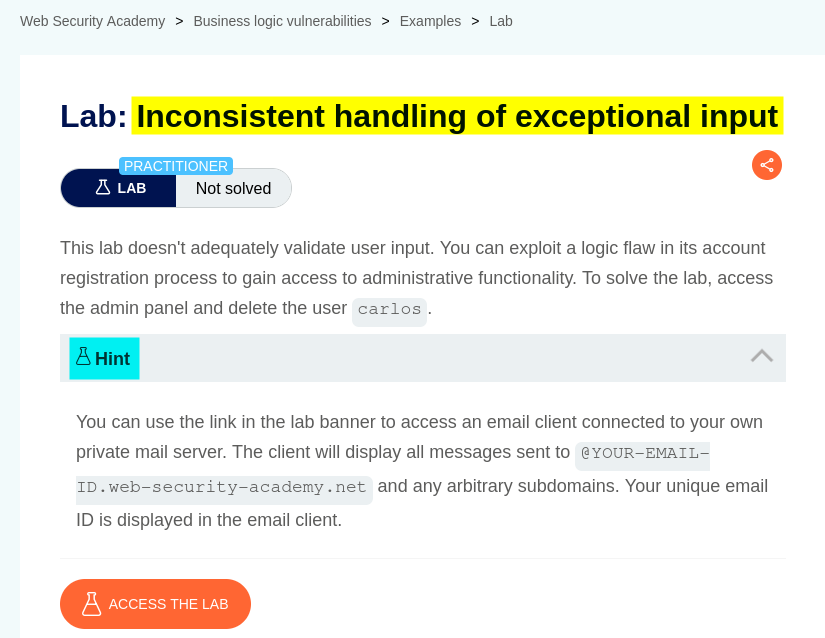

# Walkthrough

## 1. Exploring the application

After launching the lab, I accessed the target application and explored its available functionality. The website displayed a collection of products, individual product pages, a **My Account** option, a **Register** option, and an email client at the top of the page.


Since the lab description hinted at a business logic vulnerability, I decided to investigate the application's registration and account management processes.

At this point, I did not have valid credentials, so I started by examining the registration functionality.

## 2. Inspecting the registration process

I clicked the **Register** option and was redirected to the registration page.

While examining the form, I noticed an interesting message displayed by the application:

"If you work for DontWannaCry, please use your @dontwannacry.com email address."

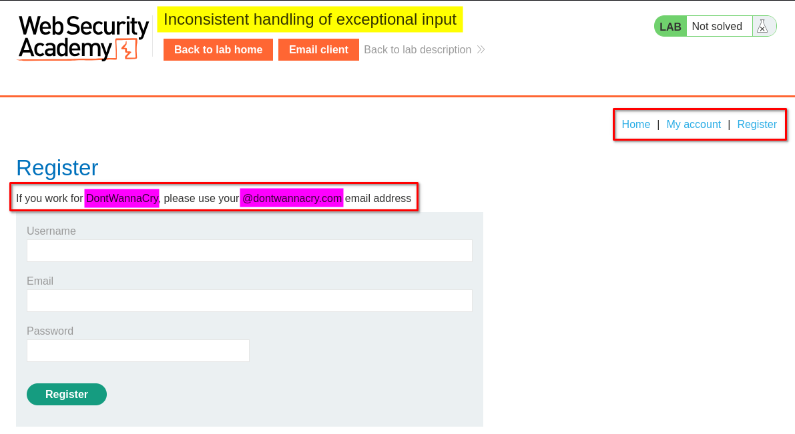

This message caught my attention because it indicated that users registering with the `dontwannacry.com` email domain might receive additional privileges.

However, I did not yet understand how the application verified whether an email address actually belonged to that domain.

## 3. Understanding the email verification mechanism

I then noticed the **Email client** option at the top of the page.

I opened it and observed that the inbox was initially empty. I also copied the unique email address provided by the lab, which followed this format:

`@exploit-<lab-id>.exploit-server.net`

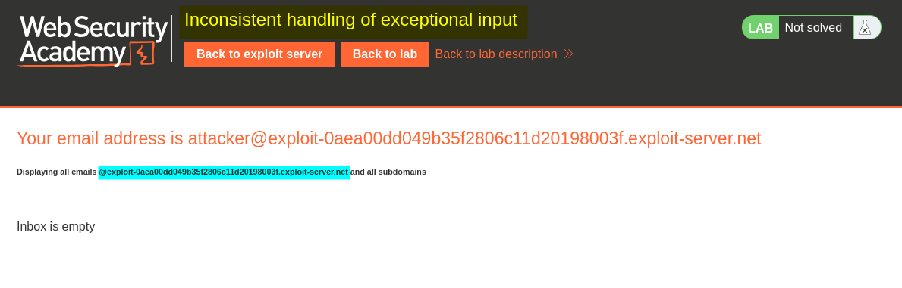

I realized that I could use this email address to register an account and receive the account activation link through the lab's email client.

I returned to the registration page and created a test account using the following credentials:

- Username: `test`
- Email: `test@exploit-<lab-id>.exploit-server.net` OR `test.attacker@exploit-<lab-id>.exploit-server.net`
- Password: `test`

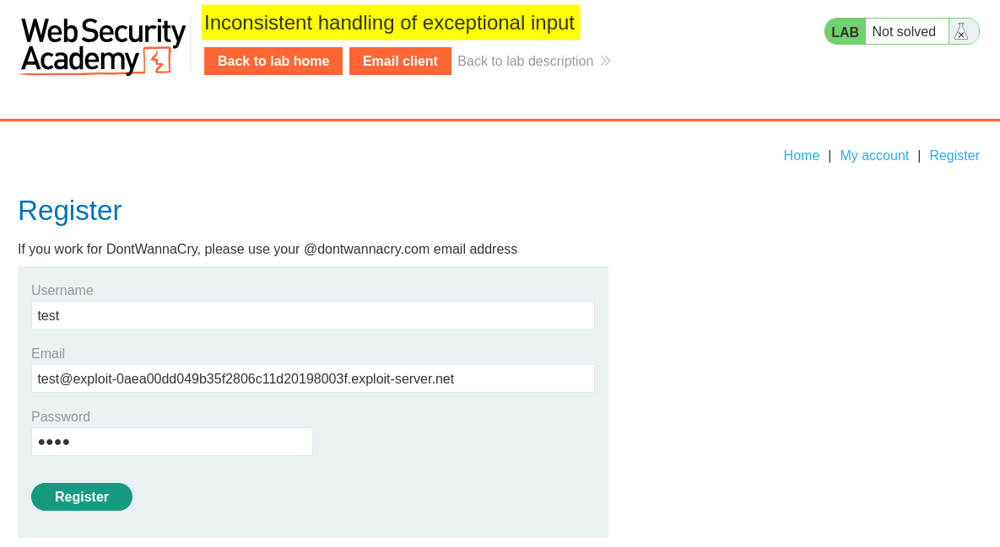
**Alternatively**
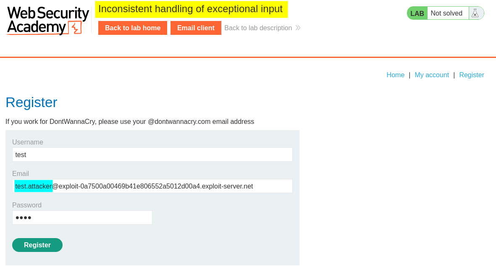

After submitting the registration form, the application displayed the following message:

`Please check your emails for your account registration link.`

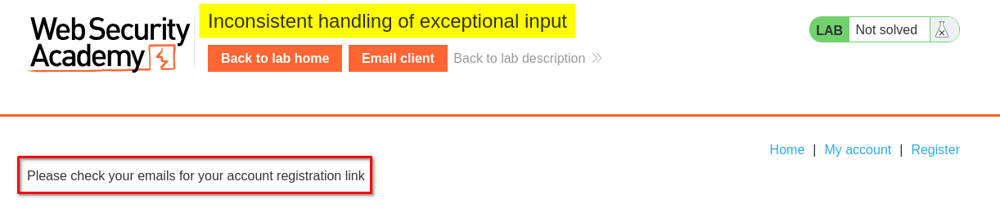

I opened the email client again and found the account activation email.

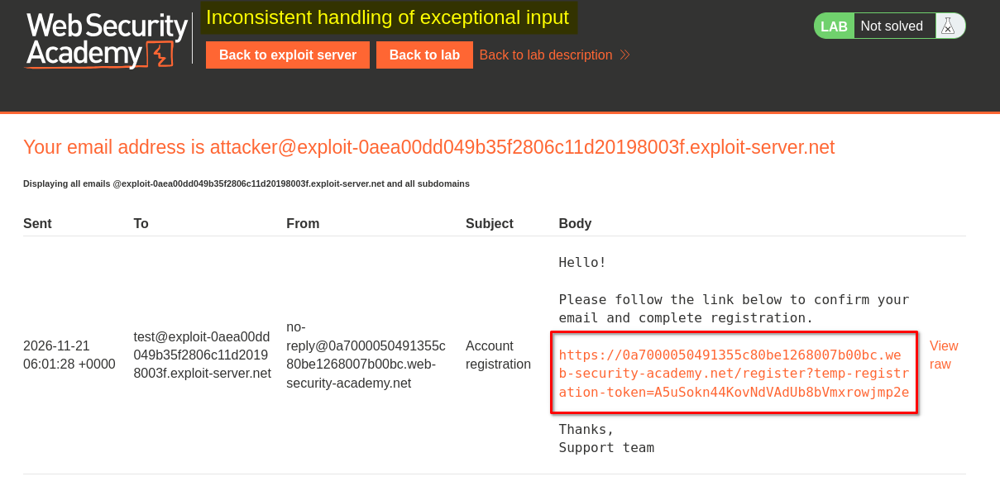
**Alternatively**
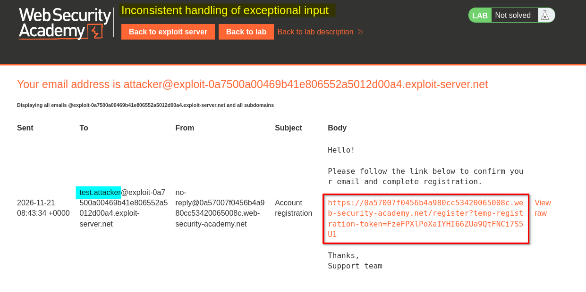

I clicked the activation link, and the application displayed the following confirmation:

`Account registration successful`

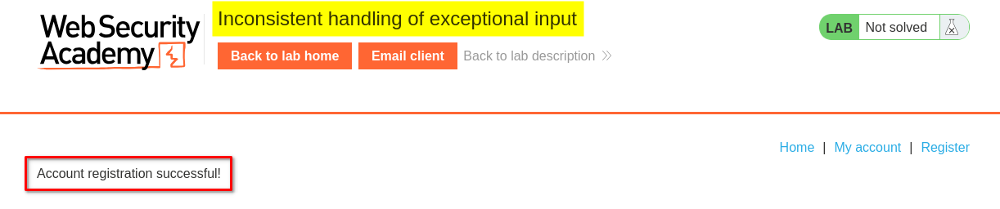

I then logged in using the credentials I had created.

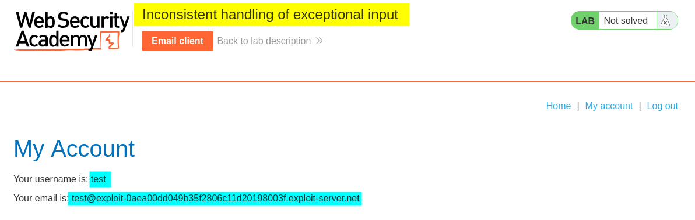

After logging in, I confirmed that the account was associated with the email address I had supplied during registration.

This gave me a baseline understanding of how the registration and email verification process worked before testing unusual input.

## 4. Testing the email field with exceptionally long input

The registration message mentioning `dontwannacry.com` made me curious about how the application validated email addresses.

I decided to test the email input field with an unusually long string.

I created an email address containing approximately 807 characters, including a long prefix followed by the lab-provided email domain.

For this test, I used:

- Username: `test_1`
- Email: A long string containing approximately 807 characters followed by `@exploit-<lab-id>.exploit-server.net`
- Password: `test`

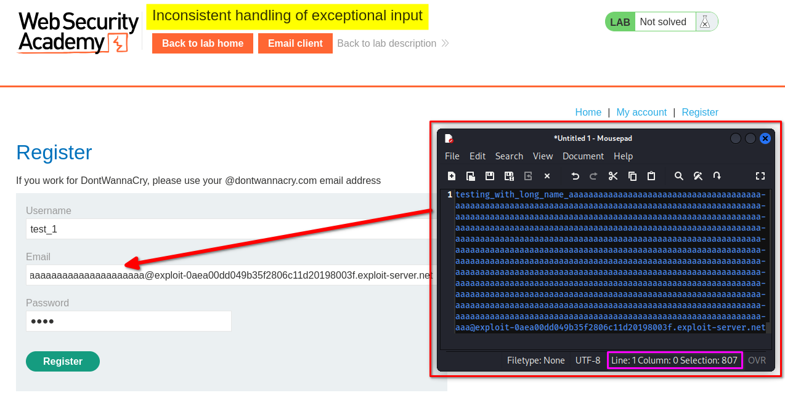

The application accepted the registration request and displayed the same email verification message as before.

I opened the email client and located the activation email for the newly registered account.

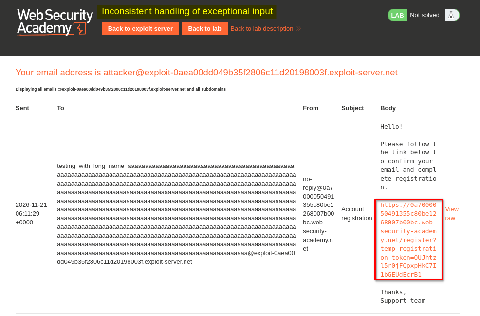

After clicking the activation link, I logged in using the new credentials.

However, something interesting happened when I inspected the registered email address.

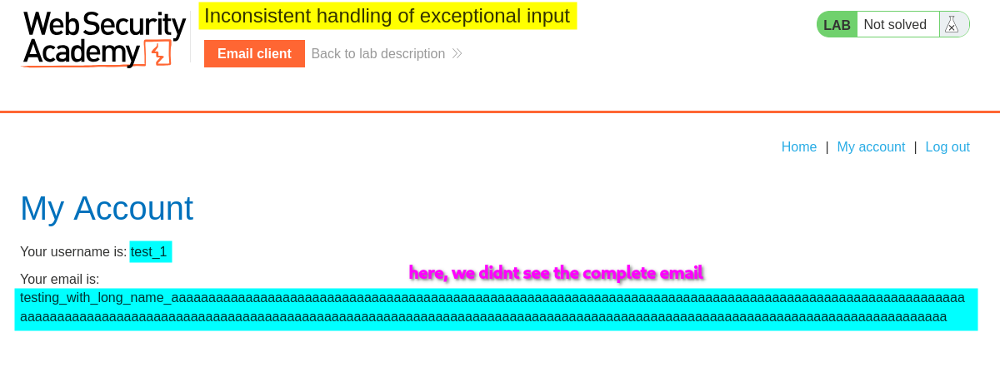

The email address displayed in the account information was incomplete. Although I had originally submitted approximately 807 characters, the application had retained only the first 255 characters and removed the remaining portion.

This revealed an important behavior:

**The application was truncating the supplied email address to 255 characters.**

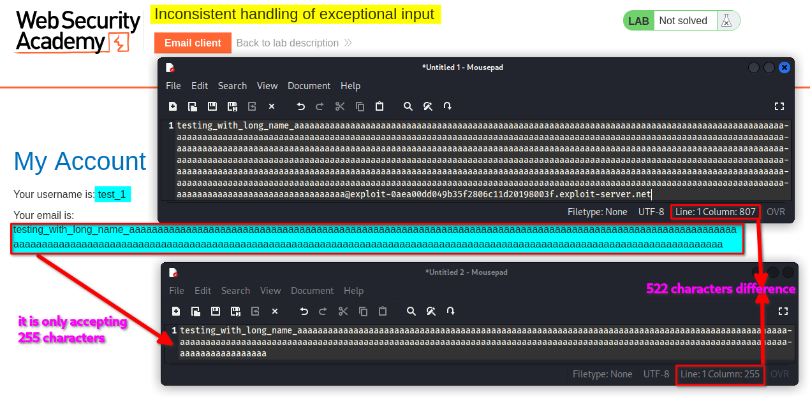

This was the key discovery that helped me understand the vulnerability.

Instead of rejecting an exceptionally long email address, the application silently truncated it. I decided to investigate whether I could use this behavior to manipulate the domain recognized by the application.

## 5. Exploiting the email truncation behavior

After discovering the 255-character limit, I revisited the registration hint:

"If you work for DontWannaCry, please use your @dontwannacry.com email address."

I considered what would happen if I placed `@dontwannacry.com` near the end of the first 255 characters and appended the lab-provided email domain afterward.

The idea was to make the application truncate everything after the trusted domain.

My intended email structure was:

```text
[Long prefix]@dontwannacry.com.exploit-<lab-id>.exploit-server.net
```

I initially tried placing another `@` after `dontwannacry.com`, but the registration form rejected the address because it contained an invalid email format.

Therefore, I removed the additional `@` and used a dot to separate the trusted domain from the lab-provided email domain.

The resulting structure was:

```text
[Long prefix]@dontwannacry.com.exploit-<lab-id>.exploit-server.net
```

The important part was ensuring that the first 255 characters ended at: `@dontwannacry.com` 

This meant that the remaining portion containing the exploit-server domain would be removed when the application truncated the email address.

## 6. Registering with the crafted email address

After preparing the email address, I returned to the registration page and created another account.

I used the following details:

- Username: `test_2`
- Email: A crafted email address containing `@dontwannacry.com` within the first 255 characters, followed by the lab-provided exploit-server domain.
- Password: `test`

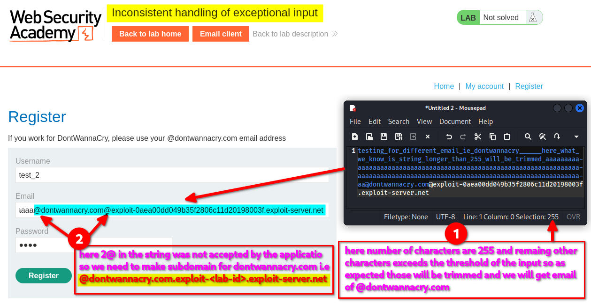

This time, the application accepted the registration request.

As before, it displayed the message asking me to check the email client for the account activation link.

I opened the email client and found the activation email for the newly created account.

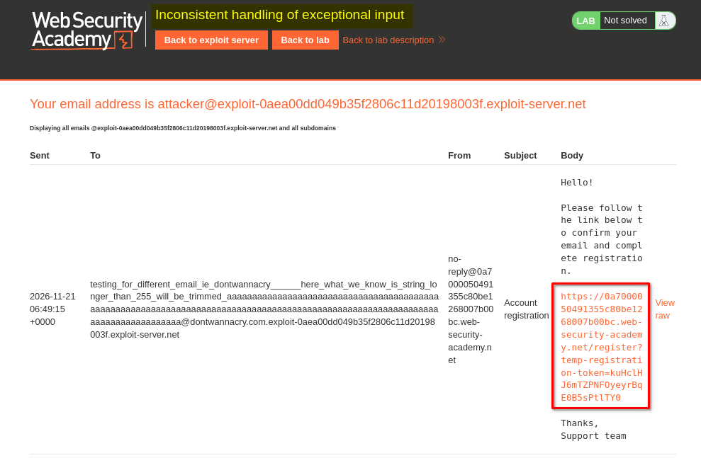

I clicked the activation link and successfully activated the account.

After logging in, I inspected the registered email address.

The application displayed an email address ending in: `@dontwannacry.com`

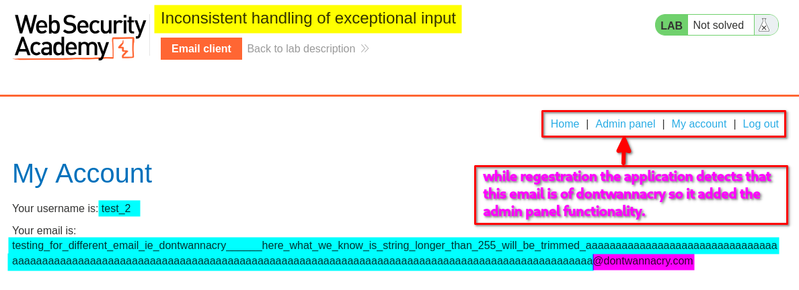

This confirmed that the application had retained the first 255 characters of my crafted email address and removed the remaining exploit-server domain.

As a result, the account was recognized as belonging to the trusted `dontwannacry.com` domain.

More importantly, the application now provided additional administrative functionality that had not been available in my earlier test account.

## 7. Accessing the administrative functionality

After logging in with the newly created account, I noticed an **Admin panel** option.

I opened it to investigate the additional functionality.

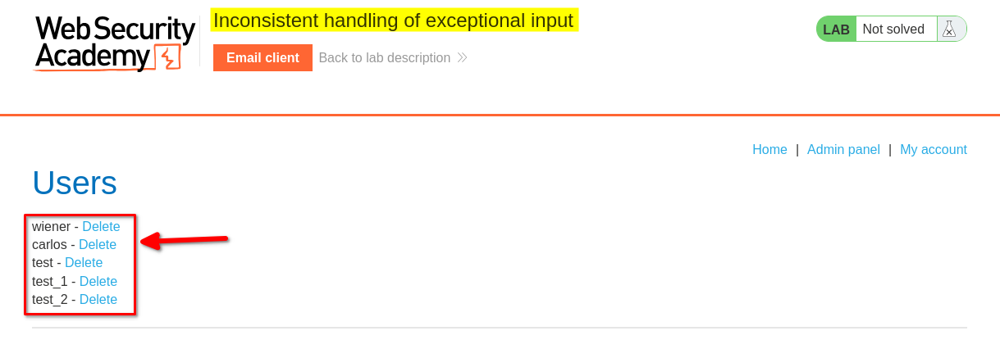

Inside the administrative panel, I found a user management feature that allowed administrative users to manage registered accounts.

The appearance of this functionality confirmed that the application had granted additional privileges based on the manipulated email address.

I then located the account belonging to Carlos.

## 8. Deleting Carlos and completing the lab

The final objective was to delete the user Carlos.

Using the user management functionality in the administrative panel, I selected Carlos's account and performed the delete operation.

The application returned a successful deletion message.

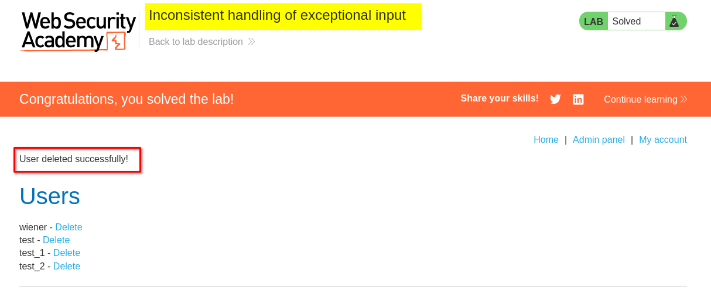

The lab displayed the following confirmation: `Congratulations, you solved the lab!`

This confirmed that I had successfully exploited the inconsistent email handling behavior, obtained administrative functionality, and completed the lab objective.

# Key Takeaways

- **Test exceptional input:** Applications should be tested with unusually long strings, unexpected characters, and boundary values rather than only normal input.
- **Understand input truncation:** Silently truncating user input can create security issues when different application components process the same value differently.
- **Examine registration workflows:** Registration, email verification, and account activation can contain business logic weaknesses that are not immediately visible through normal application browsing.
- **Investigate trust-based registration:** Applications that grant additional privileges based on an email domain must verify domain ownership securely.
- **Understand validation inconsistencies:** A value accepted by the registration form may be processed differently during storage, verification, or authorization.
- **Check account privileges:** After manipulating registration data, inspect whether the resulting account receives unexpected functionality or permissions.
- **Do not rely on client-side validation:** Security-critical validation must be performed consistently on the server side.

# Security Impact

Inconsistent handling of exceptionally long email addresses can create a serious business logic vulnerability when an application uses email domains to determine user privileges.

In this lab, the application silently truncated email addresses to 255 characters. By carefully positioning the trusted `@dontwannacry.com` domain within that limit, I was able to register an account that the application recognized as belonging to the trusted organization.

This resulted in unauthorized access to administrative functionality, including user management.

In a real-world application, similar weaknesses could allow an attacker to obtain unauthorized privileges, modify user accounts, delete users, or access administrative operations.

The impact depends on the application's authorization design and the administrative permissions granted to the affected account.

# Remediation

To prevent this type of vulnerability:

1. **Reject excessively long input:** Enforce appropriate email length limits and reject values that exceed them instead of silently truncating them.
2. **Validate email addresses consistently:** Apply the same validation rules during registration, storage, email verification, and authentication.
3. **Verify domain ownership:** Do not grant organizational privileges solely because an email address contains or ends with a trusted domain string.
4. **Normalize and validate email addresses:** Use a consistent server-side email parsing and validation process before storing or making authorization decisions.
5. **Separate authentication from authorization:** A verified email address should not automatically grant administrative permissions without an appropriate authorization process.
6. **Use explicit role assignment:** Assign privileged roles through a controlled administrative process rather than relying exclusively on user-supplied registration information.
7. **Apply server-side validation:** Never depend exclusively on browser-side validation for security-sensitive input.

# Conclusion

This lab demonstrated how inconsistent handling of exceptionally long input can introduce a serious business logic vulnerability into an application's registration process.

By testing the email field with an unusually long value, I discovered that the application silently truncated email addresses to 255 characters. I used this behavior to position the trusted `@dontwannacry.com` domain within the retained portion of the address, causing the application to recognize my account as belonging to the trusted organization.

This granted access to the administrative panel, where I was able to delete Carlos and successfully complete the lab.

The main lesson is that input validation, data storage, email verification, and authorization must work consistently. Even a seemingly minor issue such as improper input truncation can become a privilege escalation vulnerability when combined with flawed business logic.

*Thanks for reading!*
