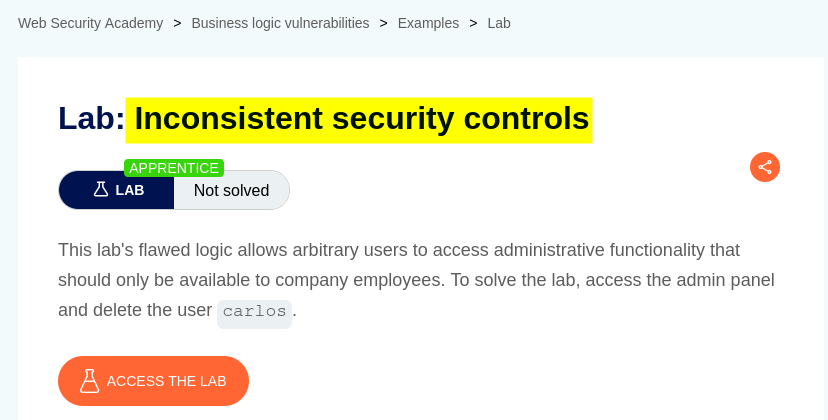
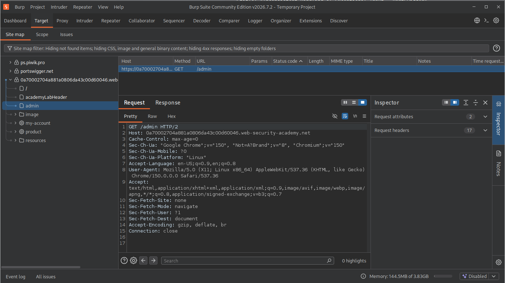
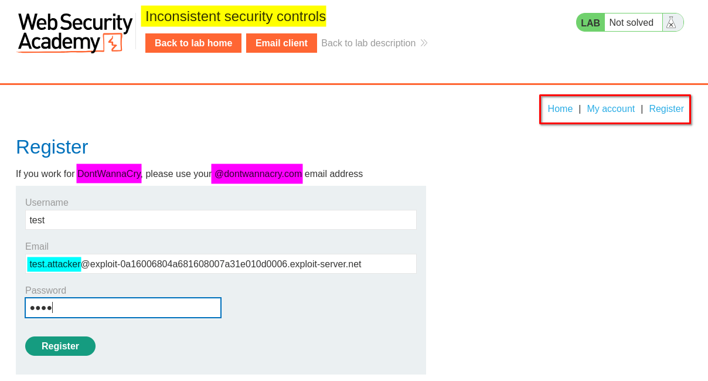
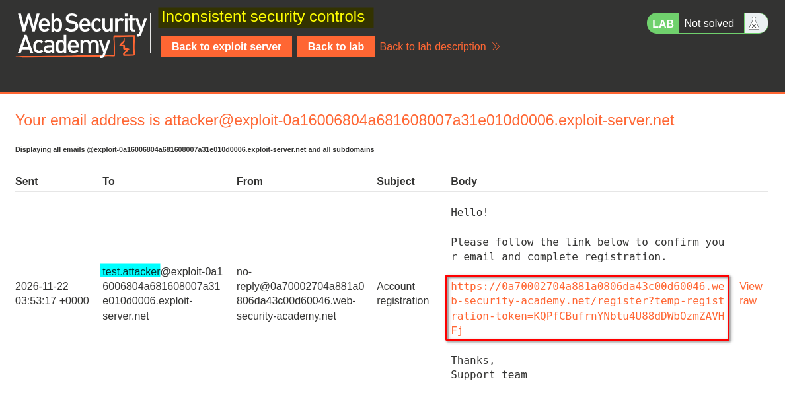
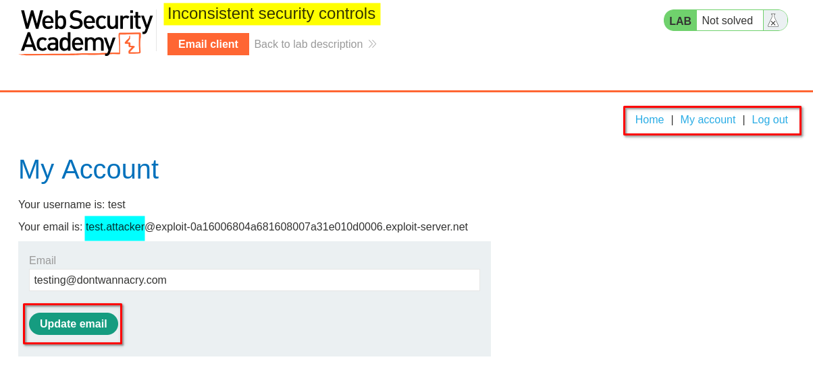
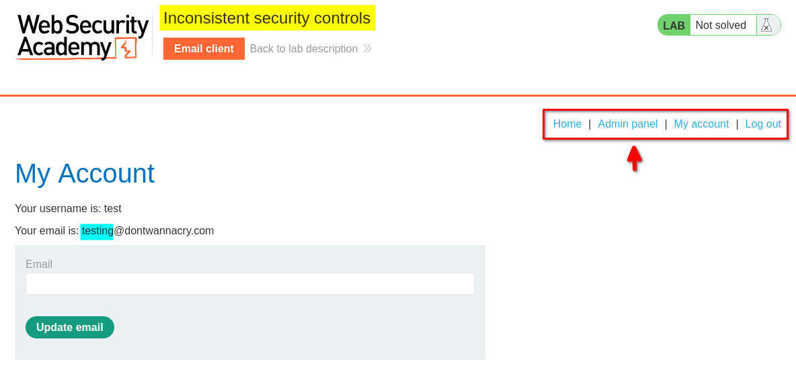
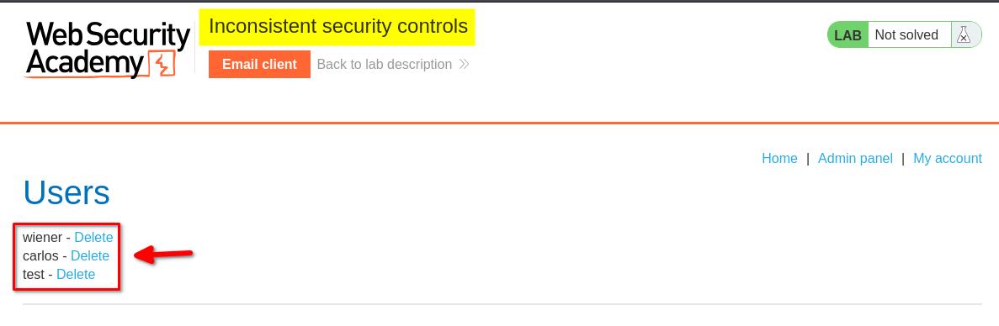

# Overview

This lab demonstrates how inconsistent security controls between account registration and email updates can lead to privilege escalation. By registering a normal account, verifying an email address, and subsequently changing it to the company's trusted domain without further verification, I was able to obtain administrative access and delete the user Carlos.

# Question / Lab Objective

The objective was to exploit inconsistent email verification controls to gain access to administrative functionality and delete the user `carlos`.

# Walkthrough

## 1. Exploring the application

After launching the lab, I accessed the target application and explored its available functionality. The website displayed a collection of products, individual product pages, a **My Account** option, a **Register** option, and an **Email client** at the top of the page.

Since the lab objective involved gaining administrative access, I decided to investigate the application's registration and account management processes.

At this stage, I did not have valid credentials, so I started by examining the registration functionality.

## 2. Inspecting the registration process

I clicked the **Register** option and was redirected to the registration page.

While examining the form, I noticed an interesting message displayed by the application:

`If you work for DontWannaCry, please use your @dontwannacry.com email address.`

This message caught my attention because it suggested that users with an email address belonging to the `dontwannacry.com` domain might receive additional privileges.

I also opened Burp Suite and examined the application's site map. During this inspection, I noticed an `/admin` path.

The presence of the `/admin` endpoint and the registration message gave me a useful starting point for investigating the application's access control.

I also remembered the previous lab, [Inconsistent Handling of Exceptional Input](https://sagar-bhattarai.github.io/portswigger/business%20logic/2026/11/21/Inconsistent_handling_of_exceptional_input.html), where I explored how email-processing inconsistencies could lead to administrative access.

However, I wanted to understand how this particular application handled email verification and account updates.

## 3. Understanding the email verification mechanism

I noticed the **Email client** option at the top of the page and opened it.

Initially, the inbox was empty. I also copied the email address provided by the lab, which followed this format:

`attacker@exploit-<lab-id>.exploit-server.net`

I realized that I could use this address during registration and receive the account activation link through the lab's email client.

I returned to the registration page and created a test account using the following credentials:

- Username: `test`
- Email: `test.attacker@exploit-<lab-id>.exploit-server.net`
- Password: `test`

After submitting the registration form, the application displayed the following message:

`Please check your emails for your account registration link.`

I opened the email client again and found the account activation email.

I clicked the activation link, and the application displayed the following confirmation:

`Account registration successful`

I then logged in using the credentials I had created.

After logging in, I confirmed that the account was associated with the email address I had supplied during registration.

At this point, I had successfully created and verified a normal user account.

## 4. Testing the email update functionality

After logging in, I navigated to the **My Account** page and examined the available account management options.

I noticed that the application allowed users to update their registered email address.

This was particularly interesting because the registration process required email verification. I wanted to determine whether the application enforced the same verification requirement when an existing user changed their email address.

I therefore attempted to change my registered email address to: `testing@dontwannacry.com`

The application accepted the new email address without asking me to verify ownership of the new address.

This was the critical observation.

Although the application required email verification during initial registration, it did not enforce the same security control during subsequent email updates.

As a result, I could change my account's email address to one belonging to the company's trusted domain without actually owning that email address.

## 5. Obtaining administrative functionality

After updating the email address, I returned to the application and noticed that additional functionality had become available.

The application now recognized my account as belonging to the `dontwannacry.com` domain and granted access to the administrative interface.

This confirmed that the application was relying on the current email address to determine whether a user should receive administrative privileges.

The problem was that the email address had not been verified after the change.

I opened the administrative panel and found a user management feature that allowed administrative users to manage registered accounts.

I then located the account belonging to Carlos.

## 6. Deleting Carlos and completing the lab

The final objective was to delete the user `carlos`.

Using the user management functionality in the administrative panel, I selected Carlos's account and performed the delete operation.

The application displayed the following confirmation: `Congratulations, you solved the lab!`

This confirmed that I had successfully exploited the inconsistent email verification mechanism, obtained administrative functionality, and completed the lab objective.

# Key Takeaways

- **Consistency matters in security controls:** Security checks applied during registration should also be enforced during subsequent account modifications.
- **Test account update functionality:** Email, username, password, and other account settings can introduce security weaknesses if they are not properly validated.
- **Understand email verification:** Accepting a new email address is not the same as verifying ownership of that address.
- **Identify privilege escalation opportunities:** If application privileges depend on user-controlled attributes, investigate whether those attributes can be modified without proper authorization.
- **Inspect restricted endpoints:** Burp Suite's site map can help identify potentially interesting paths, such as `/admin`, that are not directly exposed through the normal interface.
- **Understand business logic vulnerabilities:** An application can implement individual security checks correctly while still becoming vulnerable because those checks are inconsistently applied across different workflows.

# Security Impact

Inconsistent email verification can allow an ordinary user to manipulate account attributes and obtain privileges intended for trusted employees.

In this lab, the application verified the email address during registration but failed to verify ownership when the address was subsequently changed. Since administrative access was determined by the current email domain, an ordinary user could change their email address to `@dontwannacry.com` and obtain administrative functionality.

In a real-world application, this type of vulnerability could result in privilege escalation, unauthorized access to administrative interfaces, account management abuse, and potentially unauthorized modification or deletion of user data.

# Remediation

To prevent this type of vulnerability:

1. **Re-verify changed email addresses:** Require users to confirm ownership of a new email address before accepting it as verified.
2. **Do not trust unverified attributes:** Never grant privileges based solely on a user-editable email address.
3. **Implement role-based access control:** Assign administrative privileges through explicit roles and permissions rather than relying on email-domain comparisons.
4. **Apply consistent validation:** Enforce equivalent security requirements across registration, profile updates, and other account management operations.
5. **Invalidate previous verification status:** When an email address changes, mark the new address as unverified until ownership has been confirmed.
6. **Monitor privilege changes:** Log and review changes that affect account roles, permissions, or access to administrative functionality.

# Conclusion

This lab demonstrated how inconsistent security controls can lead to privilege escalation even when an application initially appears to implement proper email verification.

By registering and verifying a normal account, I was able to identify a weakness in the email update functionality. The application allowed me to change my email address to the trusted `@dontwannacry.com` domain without verifying ownership of the new address. Since administrative privileges were determined using the current email address, this allowed me to access the admin panel and delete Carlos.

The main lesson is that security controls must be enforced consistently throughout an application's entire account management lifecycle. Verifying an email address during registration is not sufficient if users can later change that address without undergoing the same verification process.

*Thanks for reading!*
