# Overview

This lab demonstrates how a flawed application state machine can lead to authentication bypass and privilege escalation. By intercepting the login workflow and dropping the role-selection request, I was able to bypass the intended role-assignment process and obtain administrative access.

# Question / Lab Objective

The objective was to exploit a flaw in the application's authentication workflow, gain access to the administrative panel, and delete the user `carlos`.

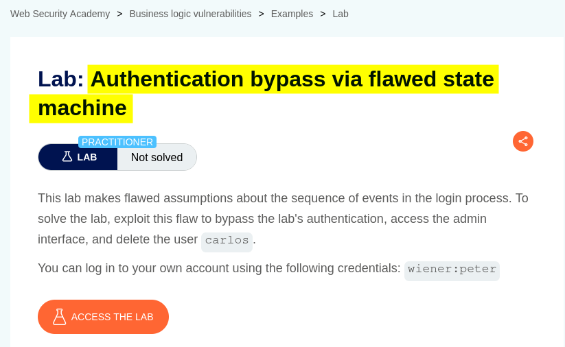

# Walkthrough

## 1. Exploring the application

After launching the lab, I accessed the target application and explored its available functionality. The website displayed a list of products along with a **My Account** option.

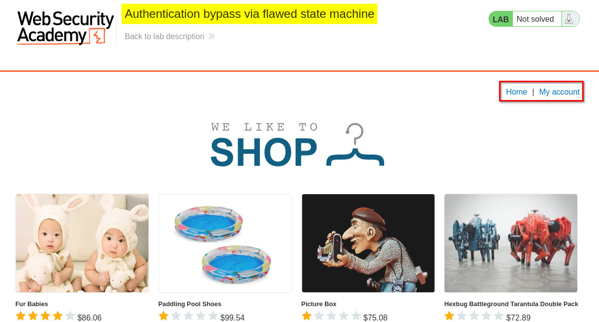

Since the lab objective involved bypassing authentication and gaining administrative access, I decided to investigate the application's login process and account functionality.

I clicked **My Account** and logged in using the credentials provided by the lab.

After successfully logging in as `wiener`, I noticed that the account workflow involved a role-selection step.

This was an interesting observation because the application appeared to handle authentication and role assignment as separate stages. I decided to investigate how these stages were connected.

## 2. Investigating the role-selection functionality

I started by examining the role-related functionality available during the login process.

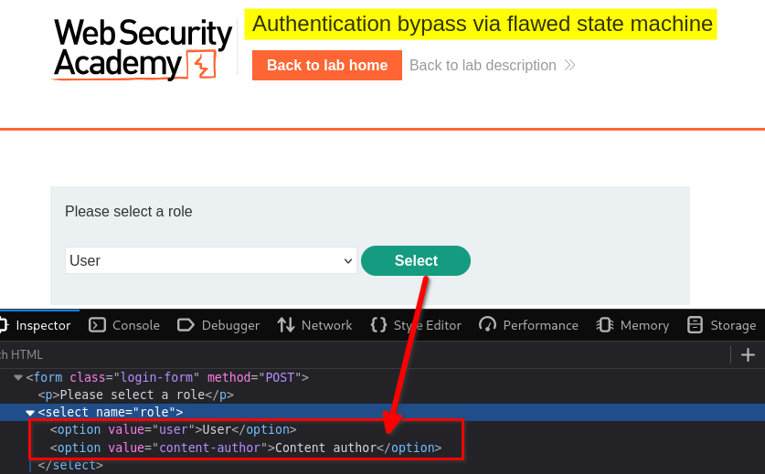

After completing the role-selection process, the application redirected me to the home page.

When I clicked **My Account** again, I was taken to the account page, where I could only find the email-update functionality.

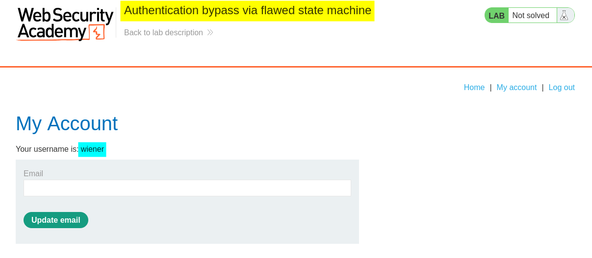

This made me curious about how the application assigned roles internally and whether the role-selection step was mandatory for establishing an authenticated session.

## 3. Analyzing the authentication workflow in Burp Suite

I opened Burp Suite and examined the HTTP requests generated during the login process.

I observed that the initial login request was: `POST /login`

This request contained the username and password supplied during authentication.

After the credentials were accepted, the application initiated another request: `GET /role-selector`

This appeared to be the next stage of the authentication workflow, where the application handled role selection and assigned the default `user` role.

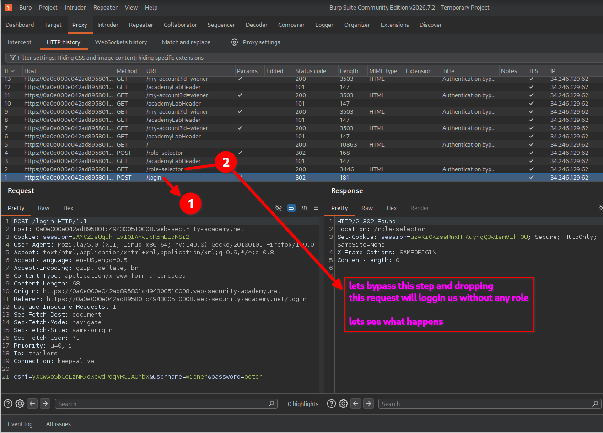

At this point, I suspected that the application might be relying on the role-selection request to complete the authentication process correctly.

I decided to investigate what would happen if this intermediate request was interrupted.

## 4. Intercepting the login request

To test this possibility, I returned to the login page and prepared to authenticate again using the `wiener` credentials.

Before submitting the login form, I enabled **Intercept** in Burp Suite.

I entered the credentials and clicked the login button.

Burp Suite intercepted the following request: `POST /login`

After inspecting the request, I forwarded it to allow the application to process the login credentials.

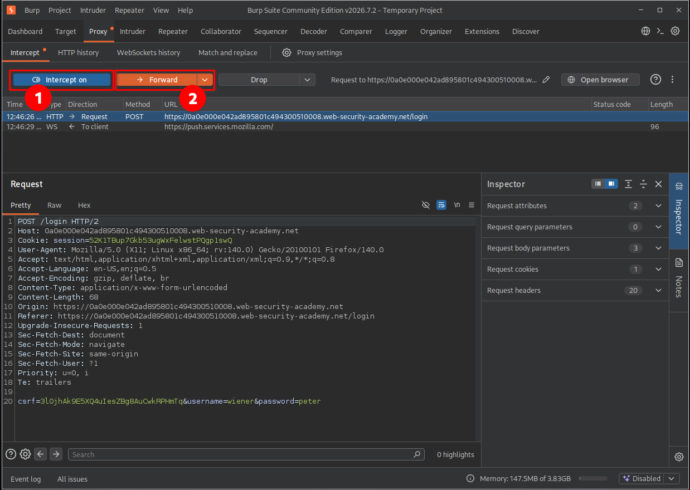

I then waited for the next request generated by the application.

## 5. Dropping the role-selection request

After forwarding the login request, another request appeared: `GET /role-selector`

This was the request responsible for moving the application into the role-selection stage.

Instead of forwarding it, I deliberately dropped the request using Burp Suite.

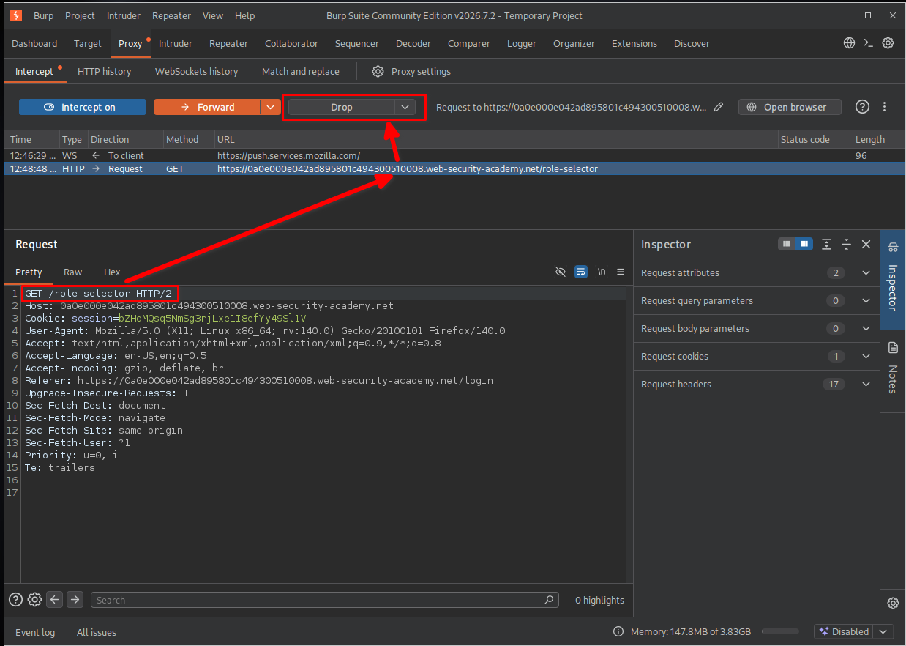

My intention was to interrupt the application's normal authentication workflow and observe how it handled a session in which the role-selection stage had not been completed.

The browser displayed an error message: `Request was dropped by user.`

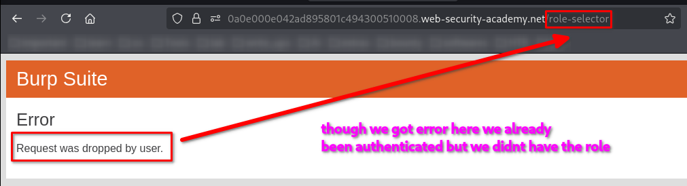

Although the browser displayed an error, I wanted to determine whether the application had already established an authenticated session after processing the initial login request.

## 6. Accessing the application without completing role selection

At this stage, I suspected that the login session had already been established, even though the role-selection request had been interrupted.

Instead of repeating the login process, I removed `/role-selector` from the browser's URL and navigated back to the application's home page.

After refreshing the page, I noticed something unexpected: an **Admin panel** link appeared in the navigation menu.

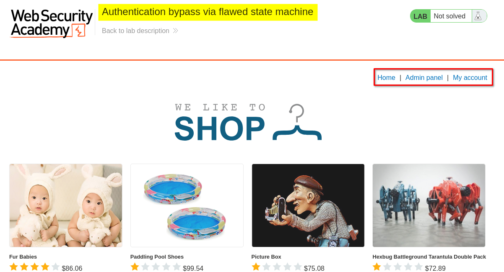

This indicated that I had obtained administrative access without completing the intended role-selection process.

The application had failed to enforce the expected authentication state transition. Rather than safely handling an incomplete workflow, it allowed the session to reach an administrative state.

This was the critical vulnerability that allowed me to bypass the intended role-selection mechanism.

## 7. Exploring the administrative panel

After obtaining administrative access, I opened the **Admin panel** to examine the available administrative functionality.

I noticed that the panel provided user-management functionality, allowing administrators to manage registered accounts.

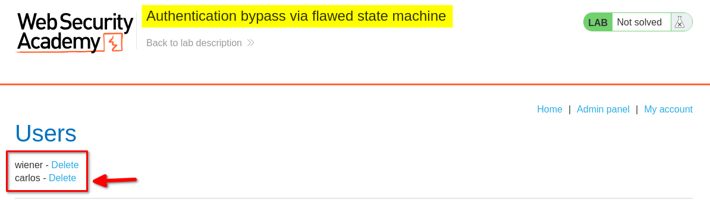

I examined the available options and located the account belonging to `carlos`.

Since deleting Carlos was the final objective of the lab, I proceeded with the deletion operation.

## 8. Deleting Carlos and completing the lab

Using the user-management functionality in the administrative panel, I selected the account belonging to `carlos` and performed the delete operation.

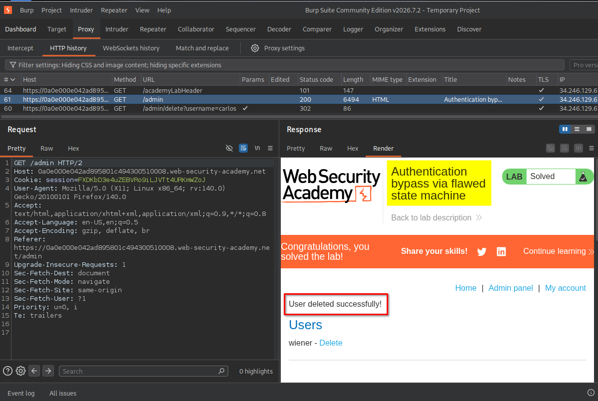

The application displayed the following confirmation: `Congratulations, you solved the lab!`

This confirmed that I had successfully exploited the flawed authentication state machine, bypassed the intended role-selection process, obtained administrative access, and deleted the target user.

# Understanding the Vulnerability

An application state machine defines the different states an application can enter and the transitions allowed between them.

In this lab, the intended authentication workflow involved multiple stages:

1. **Login:** The user submits their credentials.
2. **Authentication:** The application validates the credentials and establishes a session.
3. **Role selection:** The application processes the role-selection stage.
4. **Authorized access:** The user accesses functionality according to their assigned role.

The vulnerability occurred because the application did not correctly enforce the expected transition between these states.

By interrupting the role-selection request, I was able to reach an authenticated application state without completing the intended role-assignment process.

This illustrates why applications must validate the current session state and permissions on the server side rather than assuming that users will follow the expected sequence of requests.

# Key Takeaways

- **Understand application workflows:** Authentication is not always a single request. Applications may use multiple requests and intermediate states.
- **Inspect sequential requests:** Burp Suite helps identify how requests are connected during multi-step authentication workflows.
- **Test interrupted workflows:** Dropping or modifying intermediate requests can reveal weaknesses in how applications handle incomplete processes.
- **Understand state-machine vulnerabilities:** Applications must enforce valid state transitions and prevent users from skipping mandatory steps.
- **Never trust client-side workflow completion:** Security-sensitive decisions, including role assignment, must be enforced on the server.
- **Authentication and authorization are different:** Successfully logging in does not automatically mean a user should have administrative permissions.

# Security Impact

A flawed authentication state machine can allow an attacker to bypass intended authentication or authorization checks and obtain access to functionality that should be restricted.

In this lab, interrupting the role-selection process resulted in unauthorized administrative access. This allowed me to access the administrative panel and delete another user's account.

In a real-world application, similar weaknesses could potentially allow unauthorized users to access administrative functionality, modify user accounts, delete records, or perform other privileged operations.

The actual impact depends on the application's implementation and the privileges available through the affected workflow.

# Remediation

To prevent authentication bypass vulnerabilities caused by flawed state machines:

1. **Enforce server-side state transitions:** Validate every authentication and authorization state transition on the server.
2. **Apply explicit role assignment:** Assign roles securely and never rely on incomplete or missing requests to determine a user's privileges.
3. **Use least privilege:** Assign users only the permissions necessary for their intended activities.
4. **Validate every sensitive request:** Check the authenticated user's permissions on every administrative endpoint, not just when displaying the interface.
5. **Handle incomplete workflows securely:** If a mandatory authentication step is interrupted, the application should reject further access or return the session to a safe state.
6. **Test alternative request sequences:** Security testing should include skipped steps, repeated requests, interrupted workflows, and unexpected state transitions.

# Conclusion

This lab demonstrated how an improperly implemented authentication state machine can lead to unauthorized administrative access. By analyzing the login workflow in Burp Suite, I identified the `/role-selector` request as an intermediate step and deliberately dropped it to test how the application handled an incomplete authentication process.

The application failed to enforce the expected state transition and allowed me to access the administrative panel without completing the intended role-selection process.

The main lesson is that authentication workflows must be designed with strict server-side state validation. Applications should never assume that users will follow the intended sequence of requests, especially when authentication and authorization decisions are involved.

*Thanks for reading!*
