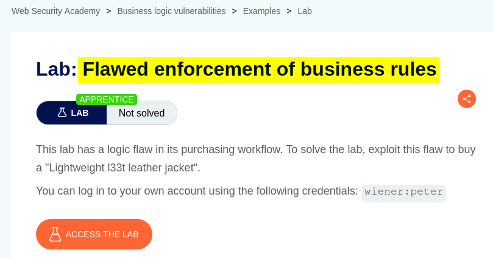
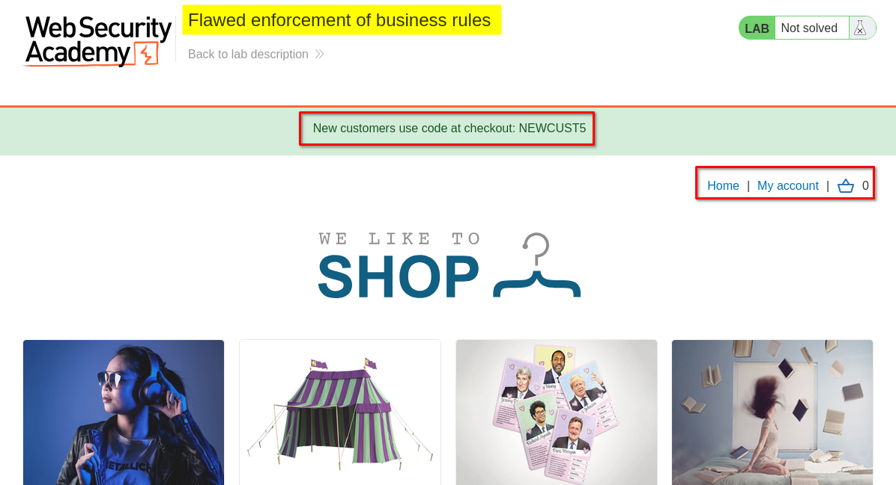
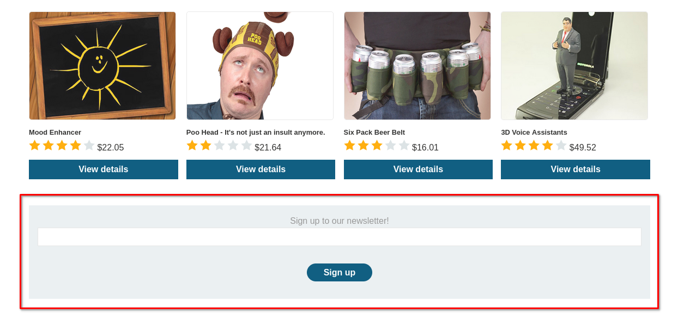
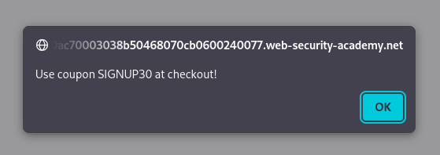
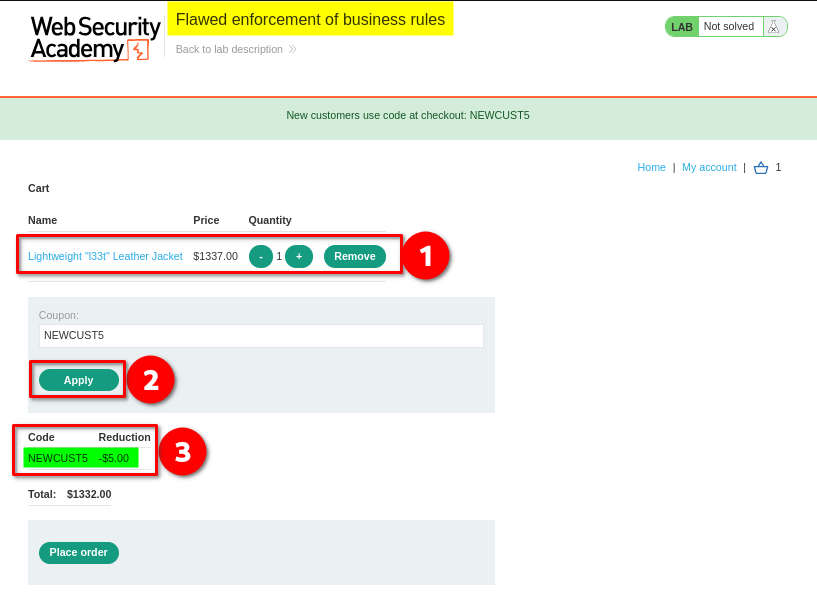
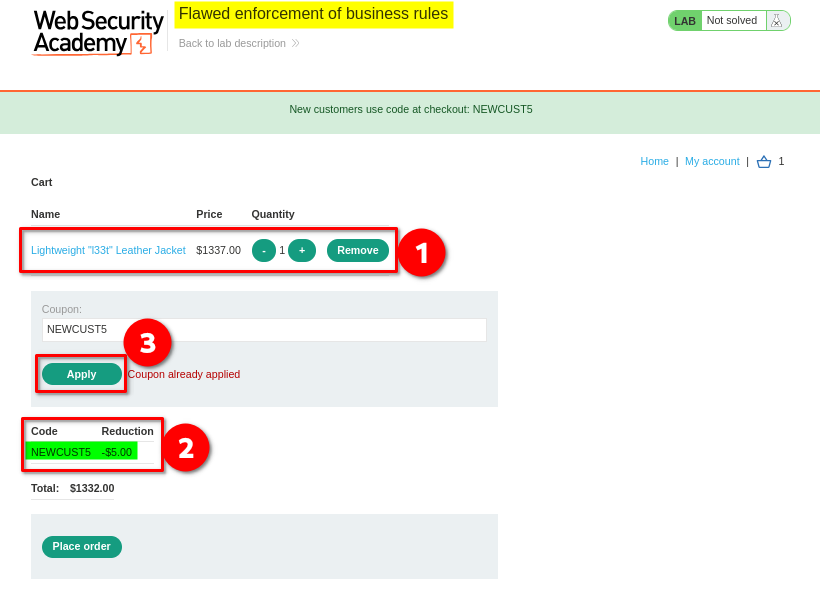
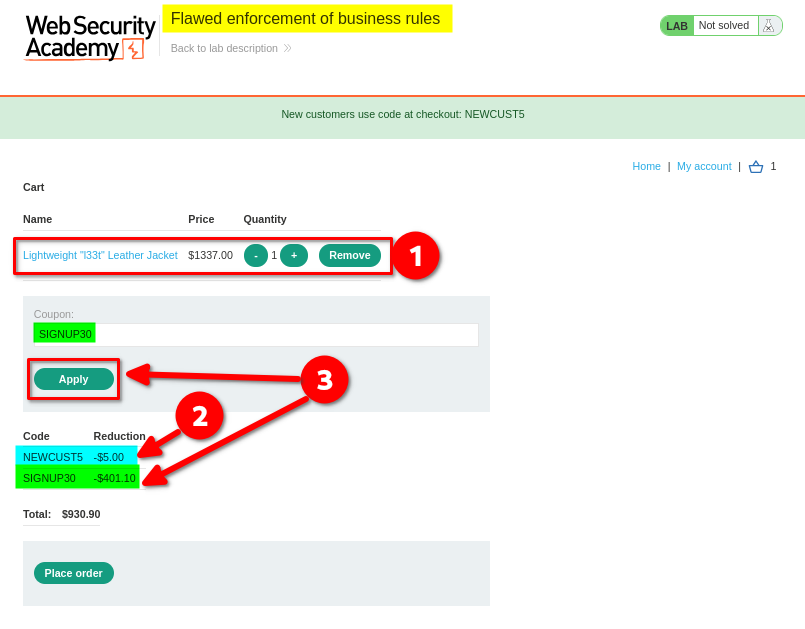
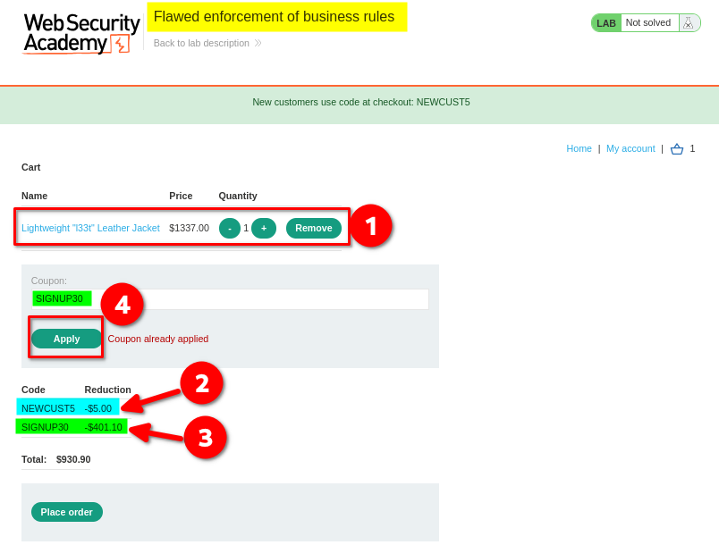
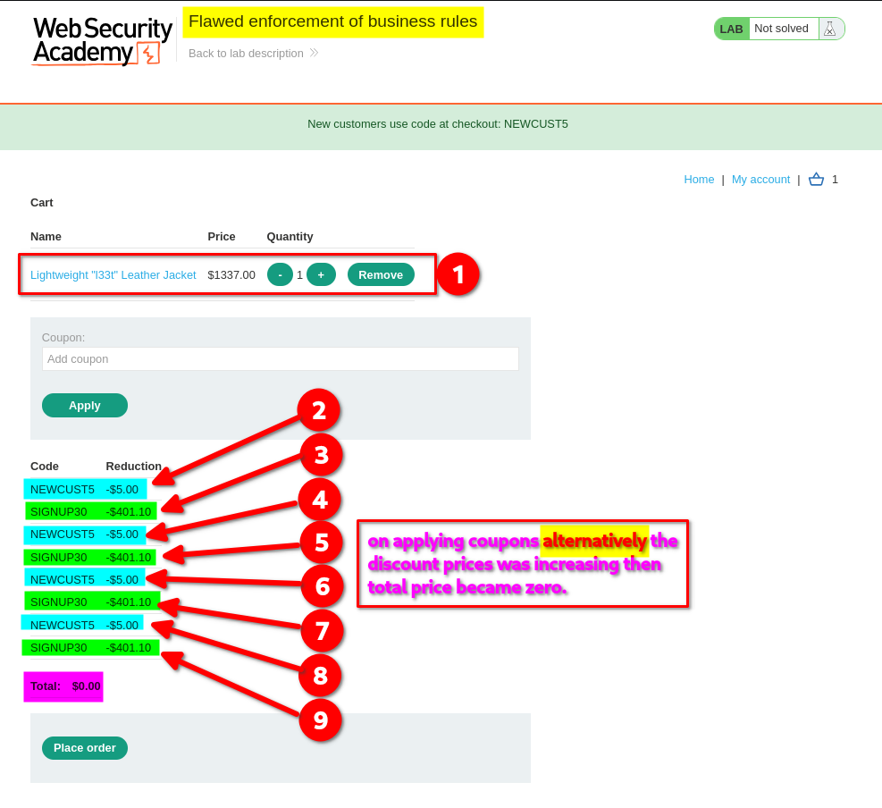
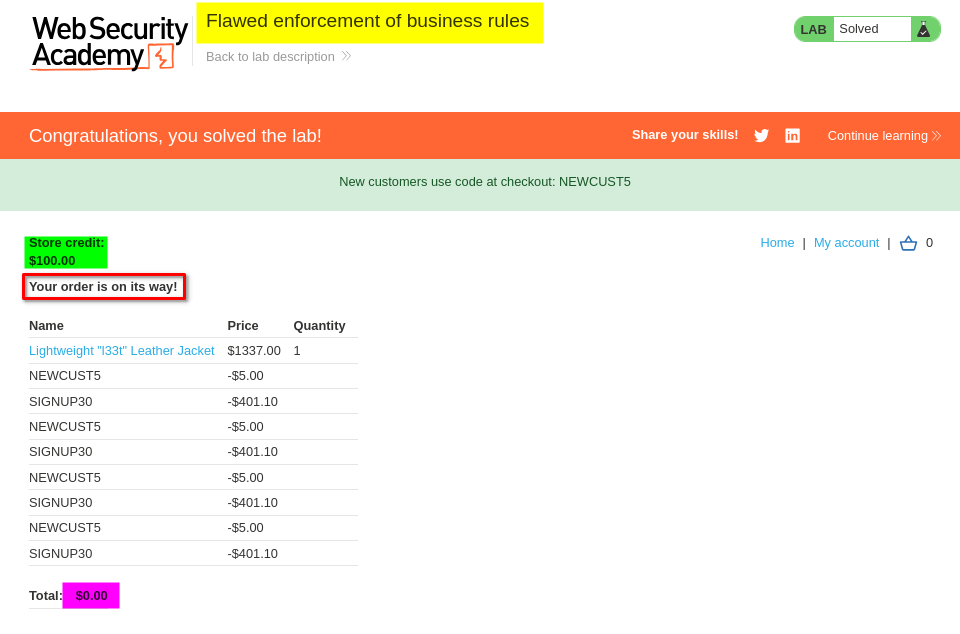

# Overview

This lab demonstrates how incorrect enforcement of business rules can allow users to abuse an application's purchasing workflow. By experimenting with two different promotional coupons, I discovered that the application prevented the same coupon from being applied twice but failed to prevent different coupons from being applied alternately. By exploiting this weakness, I was able to reduce the shopping cart total to $0.00 and successfully place the order.

# Question / Lab Objective

The objective was to identify and exploit a flaw in the application's coupon validation logic to purchase an item without paying for it.

# Walkthrough

## 1. Exploring the application

After launching the lab, I accessed the target application and explored its available functionality.

The website displayed a list of products, along with a promotional banner advertising a new customer coupon:

`NEWCUST5`

I also noticed the **My Account** option and an initially empty shopping cart.

Since the lab focused on the purchasing workflow, I decided to investigate the account functionality, available promotions, and coupon application process.

I clicked **My Account** and logged in using the credentials provided by the lab.

After successfully logging in as `wiener`, I noticed that the account page displayed $100.00 in store credit and provided an option to update the account's email address.

## 2. Exploring the newsletter signup functionality

While exploring the application, I noticed a **Sign up to our newsletter** form at the bottom of the page.

I decided to investigate this functionality as well. I entered the required information and submitted the newsletter signup form.

After completing the signup process, the application provided another promotional coupon: `SIGNUP30`

At this point, I had identified two different promotional codes:

- `NEWCUST5` – New customer discount.
- `SIGNUP30` – Newsletter signup discount.

I decided to test how the application handled these two coupons during checkout.

## 3. Applying the new customer coupon

I returned to the product listing, selected a leather jacket, and added it to my shopping cart.

Next, I entered the new customer coupon: `NEWCUST5`

The application successfully accepted the coupon and applied a $5.00 discount to the order.

To understand how the application enforced coupon restrictions, I attempted to apply the same coupon again.

However, the application rejected the request and displayed the following message: `Coupon already applied`

This indicated that the application had some validation mechanism preventing the same coupon from being applied repeatedly.

## 4. Applying the newsletter signup coupon

Since the first coupon could not be reused, I decided to test the second coupon obtained through the newsletter signup.

I entered: `SIGNUP30`

This time, the application accepted the coupon and applied a $401.10 discount, equivalent to 30% of the applicable order value.

I then attempted to apply the same newsletter coupon again.

As expected, the application rejected the attempt and displayed: `Coupon already applied`

At this point, I understood that the application prevented repeated use of an individual coupon.

However, I wanted to investigate whether its validation logic also prevented the use of multiple different coupons on the same order.

## 5. Bypassing the coupon restriction through alternative application

After observing the application's responses, I came up with another approach.

Instead of applying the same coupon repeatedly, I decided to alternate between the two available coupons:

1. Apply `NEWCUST5`.
2. Apply `SIGNUP30`.
3. Apply `NEWCUST5` again.
4. Apply `SIGNUP30` again.

I continued alternating between the coupons and observed that the application accepted the discounts instead of enforcing the expected restriction.

By repeatedly alternating between the two coupons, I was able to exploit the application's flawed business logic and reduce the shopping cart total to: **$0.00**

This revealed the central weakness in the lab: the application checked whether the same coupon had already been applied but failed to enforce the overall discount restrictions when different coupons were used alternately.

## 6. Completing the lab

After reducing the shopping cart total to $0.00, I clicked the **Place order** button to complete the purchase.

The application responded with the following confirmation: `Your order is on its way`

The application also displayed: `Congratulations, you solved the lab!`

This confirmed that I had successfully exploited the coupon validation weakness and completed the lab.

# Key Takeaways

- **Understand business logic:** Every application has rules governing how its features should work. These rules must be enforced consistently.
- **Test coupon restrictions:** Do not limit testing to applying the same coupon repeatedly. Investigate how different promotional codes interact with one another.
- **Look for alternative workflows:** A restriction that works for one particular action may fail when the same functionality is approached through a different sequence of actions.
- **Test state management:** Applications must correctly track previously applied discounts and maintain consistent transaction states.
- **Do not trust client-side validation:** Important business rules must be enforced on the server, regardless of what the browser displays.
- **Understand coupon stacking:** Applications should explicitly define whether multiple promotional discounts can be combined and under which conditions.

# Security Impact

Flawed business rule enforcement can allow attackers to manipulate an application's purchasing workflow and obtain products or services at unintended prices.

In this lab, the application prevented the repeated use of an individual coupon but failed to enforce restrictions across different promotional codes. By alternating between the two coupons, I was able to accumulate discounts until the final order total reached $0.00.

In a real-world e-commerce application, similar weaknesses could result in:

- Unauthorized discounts and financial losses.
- Products being purchased below their intended prices.
- Abuse of promotional campaigns.
- Inconsistent transaction and order records.
- Repeated exploitation across multiple customer accounts.

The actual impact would depend on the application's discount policies, transaction controls, and the value of the affected products or services.

# Remediation

To prevent this type of business logic vulnerability:

1. **Enforce coupon restrictions server-side:** Validate every coupon application against the complete order state rather than checking only whether the same coupon was previously used.
2. **Implement coupon stacking rules:** Explicitly define whether multiple promotional codes can be combined within a single transaction.
3. **Maintain consistent transaction state:** Track all applied discounts and ensure that subsequent requests cannot bypass previously established restrictions.
4. **Validate the final order total:** Recalculate the total price on the server before accepting an order. Do not rely on client-submitted prices or discount values.
5. **Apply discount limits:** Enforce maximum discount percentages, amounts, and eligibility conditions.
6. **Test alternative application sequences:** Include repeated, alternating, and combined coupon application scenarios in business logic security testing.

# Conclusion

This lab demonstrated how a seemingly minor weakness in coupon validation can lead to a significant business logic vulnerability.

By exploring the purchasing workflow, identifying two promotional coupons, and testing how the application handled repeated coupon submissions, I discovered that the application failed to enforce restrictions when different coupons were applied alternately.

This allowed me to accumulate discounts until the shopping cart total reached $0.00 and successfully place the order.

The main lesson is that security testing should go beyond checking whether individual features work as expected. It is equally important to investigate how different features interact and whether the application's business rules remain consistent across alternative workflows.

*Thanks for reading!*
