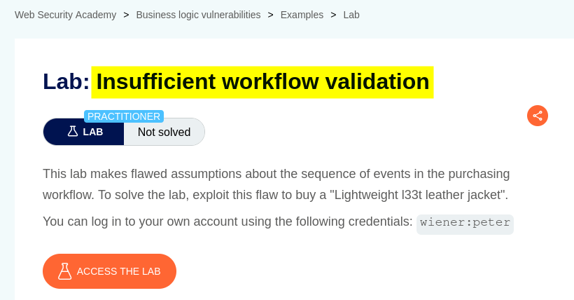
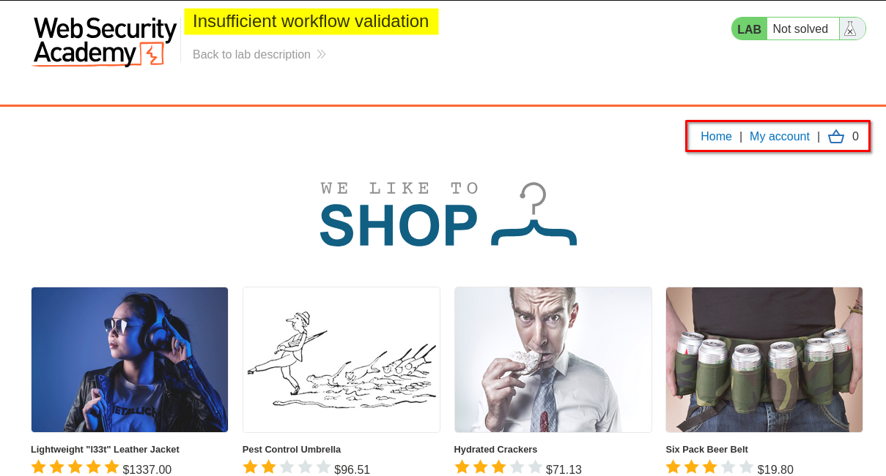
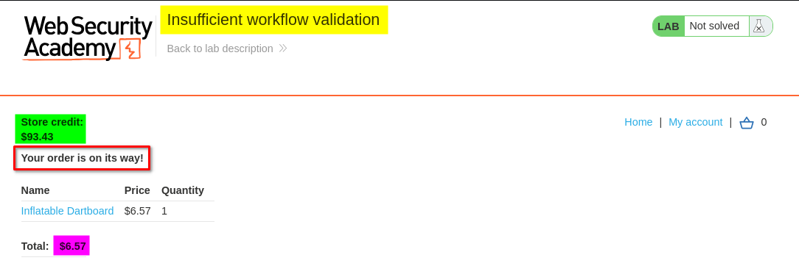
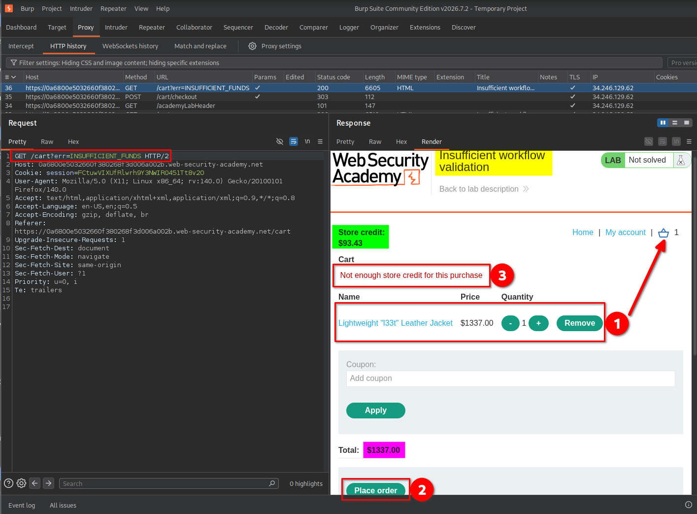
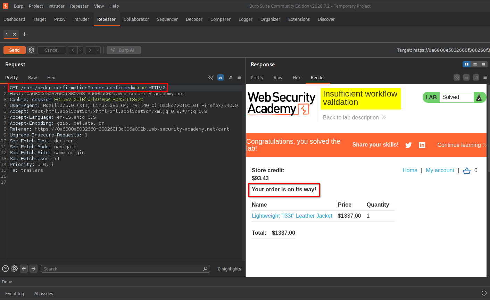

# Overview

This lab demonstrates how insufficient workflow validation can allow an attacker to bypass important steps in an application's purchasing process. By replaying an order confirmation request in Burp Suite Repeater, I was able to purchase the expensive Lightweight "l33t" Leather Jacket, priced at $1,337.00, despite having only $100.00 in store credit.

# Question / Lab Objective

The objective was to exploit a flaw in the application's purchasing workflow to buy the **Lightweight "l33t" Leather Jacket** without having sufficient store credit.

# Walkthrough

## 1. Exploring the application

After launching the lab, I accessed the target application and explored its available functionality. The website displayed a list of products, a **My Account** option, and an initially empty shopping cart.

Since the lab description hinted at a flaw in the purchasing workflow, I decided to focus my investigation on the checkout process and how the application handled product purchases, order confirmation, and store credit.

## 2. Logging in with the provided credentials

I clicked **My Account**, which redirected me to the login page.

The lab provided the following credentials:

- **Username:** `wiener`
- **Password:** `peter`

After logging in, I accessed the account interface and noticed that the account had **$100.00 in store credit**.

I kept this balance in mind because it would help me understand how the application handled purchases when the available credit was insufficient.

## 3. Understanding the normal purchasing workflow

Before manipulating any requests, I wanted to understand how the application's shopping cart and checkout functionality worked.

I selected a product priced below my available $100.00 store credit, added it to the cart, and proceeded through the checkout process.

After placing the order, the application displayed the confirmation message: **"Your order is on its way!"**

This confirmed that the normal purchasing workflow was functioning correctly.

### Examining the checkout requests

Next, I opened Burp Suite and examined the HTTP requests generated during the checkout process.

I identified two important requests:

**First request:**

`POST /cart/checkout HTTP/2`

This request initiated the checkout process. After processing it, the application generated a redirect to the order confirmation endpoint.

**Second request:**

`GET /cart/order-confirmation?order-confirmed=true HTTP/2`

This was the request generated after the redirect. It displayed the order confirmation page.

I found the second request particularly interesting, so I sent it to **Burp Suite Repeater** for further investigation.

The purpose was to retain the request and test how the application behaved when it was replayed under different purchasing conditions.

## 4. Attempting to purchase the expensive product

After examining the normal checkout workflow, I returned to the application's home page and added the **Lightweight "l33t" Leather Jacket** to my shopping cart.

The jacket was priced at **$1,337.00**, which was significantly higher than my available $100.00 store credit.

I proceeded to checkout and attempted to place the order through the normal application interface.

As expected, the application rejected the purchase and displayed the following error:

**"Not enough store credit for this purchase"**

This showed that the application performed a store-credit check during the normal checkout process.

However, I wanted to investigate whether the order confirmation endpoint independently verified that the checkout had been completed successfully.

## 5. Replaying the order confirmation request

I returned to Burp Suite Repeater, where I had previously saved the second request from the successful checkout process: `GET /cart/order-confirmation?order-confirmed=true HTTP/2`

At this point, the expensive leather jacket was still present in my shopping cart, and the previous checkout attempt had failed because of insufficient store credit.

I replayed the saved order confirmation request using Repeater.

Interestingly, the application accepted the request and processed the purchase despite the insufficient store credit.

The application displayed the following confirmation: **"Your order is on its way!"**

This demonstrated that the application did not properly validate the purchasing workflow when handling the order confirmation request.

Instead of independently verifying that a successful checkout had occurred, the application allowed the confirmation endpoint to be accessed directly, resulting in an unintended purchase.

**Key finding:** The application trusted the order confirmation request without adequately verifying that the required checkout conditions had been satisfied.

# Key Takeaways

- **Understand the complete workflow:** Before testing a business logic vulnerability, identify the sequence of actions and HTTP requests involved in the application's normal operation.
- **Inspect redirect-based workflows:** Important application behavior may occur across multiple requests, especially when a POST request redirects to a GET endpoint.
- **Use Burp Suite Repeater:** Repeater allows individual HTTP requests to be replayed to investigate how an application responds under different conditions.
- **Do not trust client-accessible workflow steps:** A user should not be able to bypass important business operations simply by directly requesting a later endpoint.
- **Validate every critical operation:** Applications must verify that prerequisites, such as successful payment or sufficient account credit, have been satisfied before confirming an order.
- **Understand business logic vulnerabilities:** Not every vulnerability requires SQL injection, XSS, or authentication bypass. Sometimes the problem lies in how an application handles its own legitimate functionality.

# Security Impact

Insufficient workflow validation can allow attackers to bypass important business rules and manipulate application processes.

In an e-commerce application, this type of vulnerability could result in:

- Purchasing expensive products without sufficient payment or store credit.
- Bypassing required checkout or payment verification steps.
- Creating orders that should have been rejected by the application.
- Causing financial losses to the business.
- Exploiting other multi-step workflows where later stages are not properly validated.

The severity depends on the application's implementation and the business operations affected. In this lab, the vulnerability allowed an expensive product purchase despite insufficient store credit.

# Remediation

To prevent insufficient workflow validation vulnerabilities:

1. **Validate workflow transitions:** Ensure that each operation can only proceed when all required previous steps have been successfully completed.
2. **Perform server-side validation:** Never rely on a client request, URL parameter, or redirect to establish that a transaction was successful.
3. **Verify payment and account balance:** Before creating an order, independently verify that the user has sufficient funds or store credit.
4. **Use server-side transaction states:** Maintain trusted transaction states on the server instead of relying on user-controlled confirmation parameters.
5. **Prevent request replay:** Use appropriate transaction identifiers, state validation, and idempotency controls to prevent unauthorized or duplicate order processing.
6. **Test alternative workflows:** Verify that directly accessing later-stage endpoints, replaying requests, or skipping intermediate steps cannot bypass business requirements.

# Conclusion

This lab demonstrated how a seemingly simple weakness in workflow validation can lead to a significant business logic vulnerability.

By examining the normal checkout process, identifying the order confirmation request, and replaying it through Burp Suite Repeater, I was able to bypass the application's insufficient store-credit validation and purchase the $1,337.00 Lightweight "l33t" Leather Jacket.

The main lesson is that applications must not blindly trust requests to later stages of a workflow. Every critical business operation must be independently validated on the server to ensure that all required conditions have been satisfied.

*Thanks for reading!*
