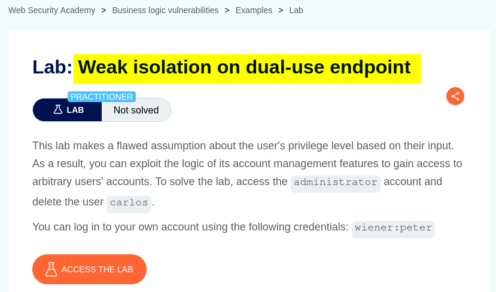
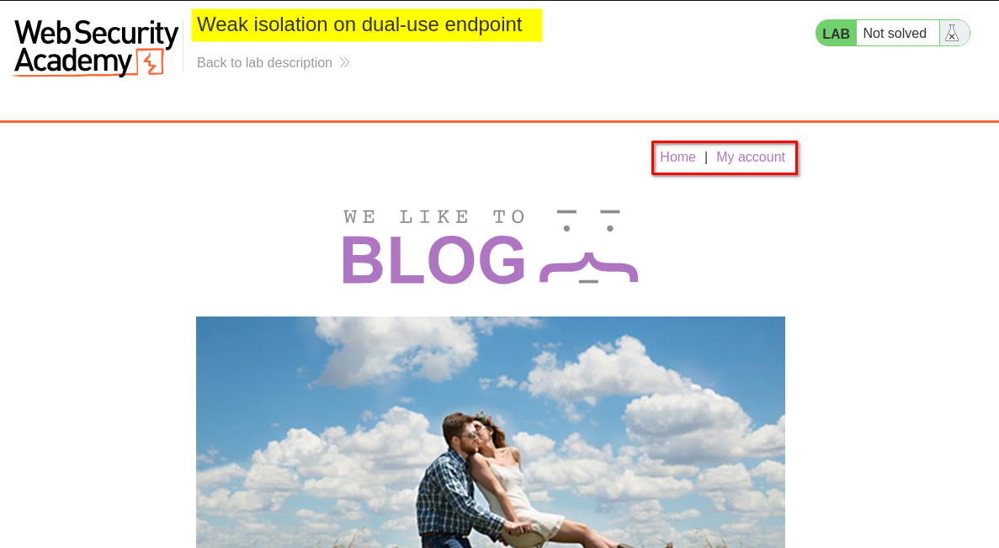
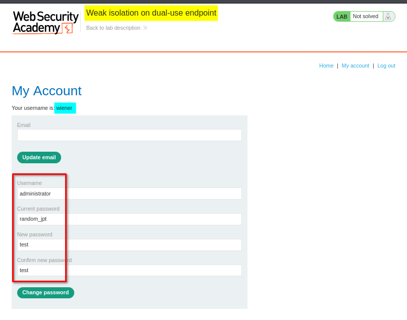
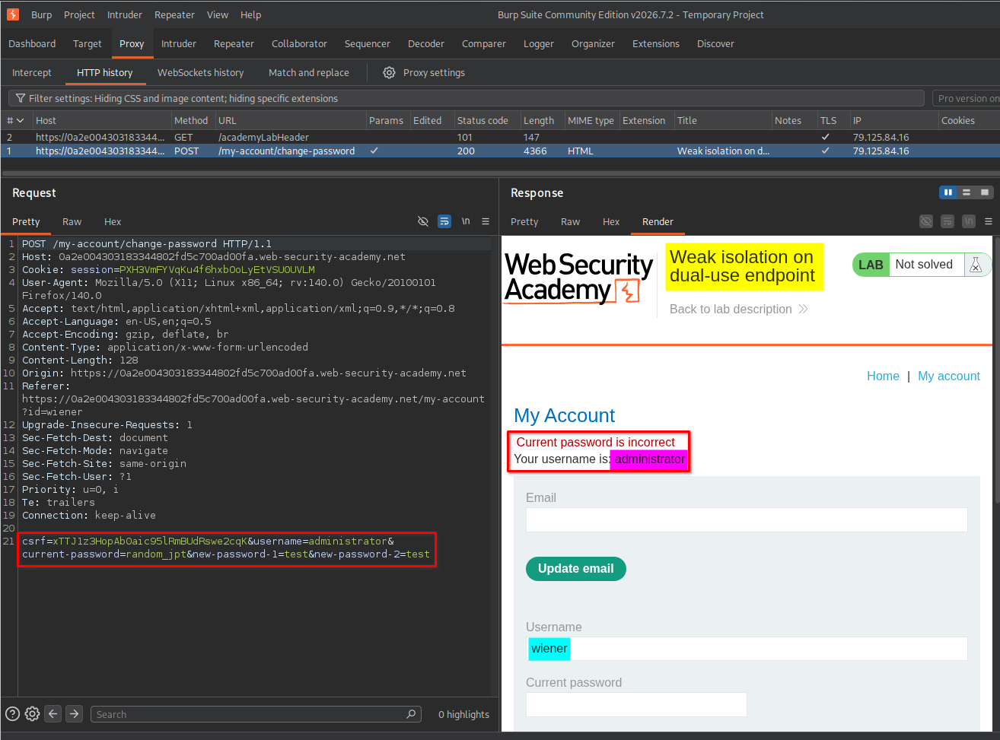
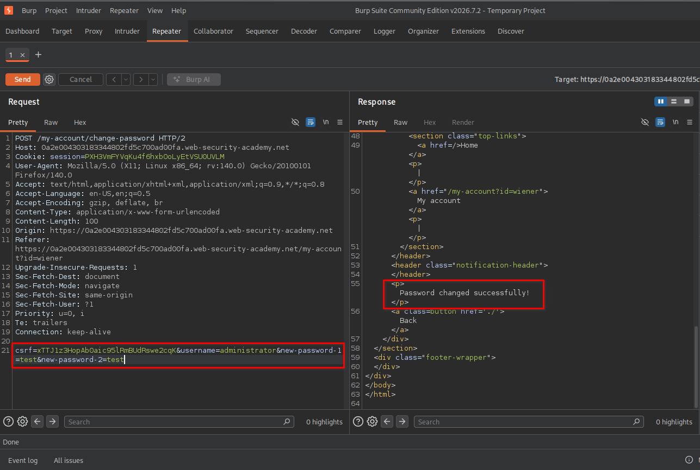
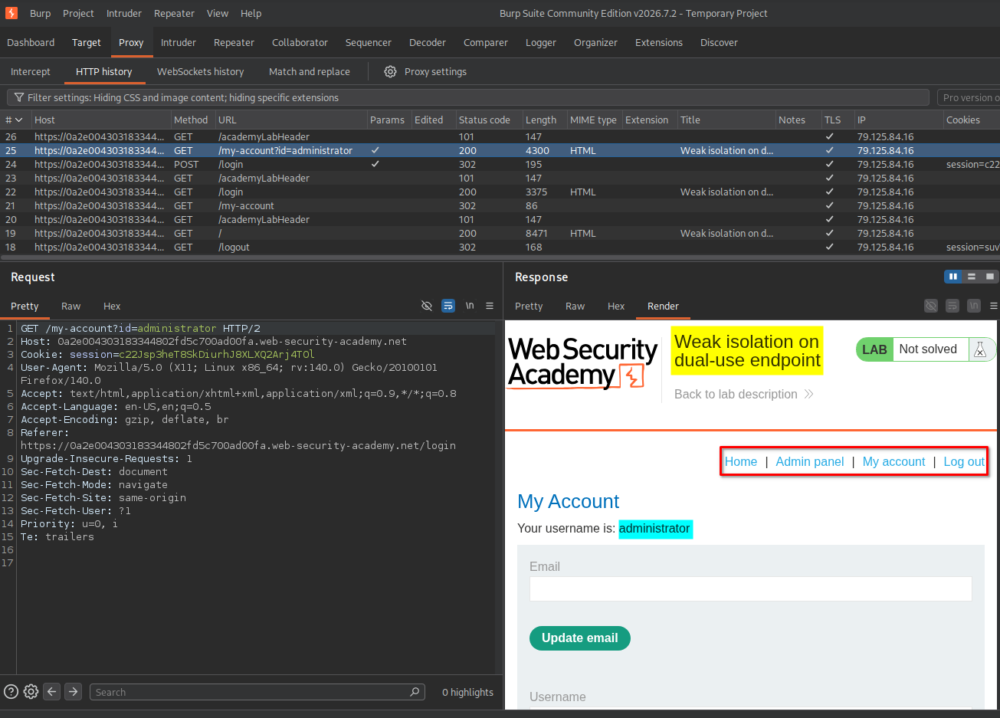
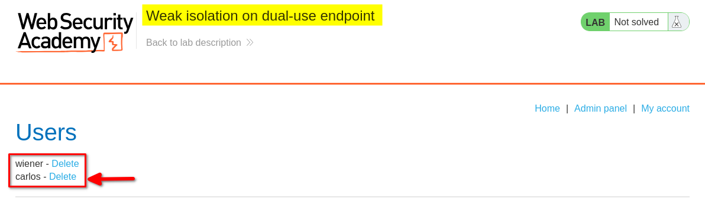
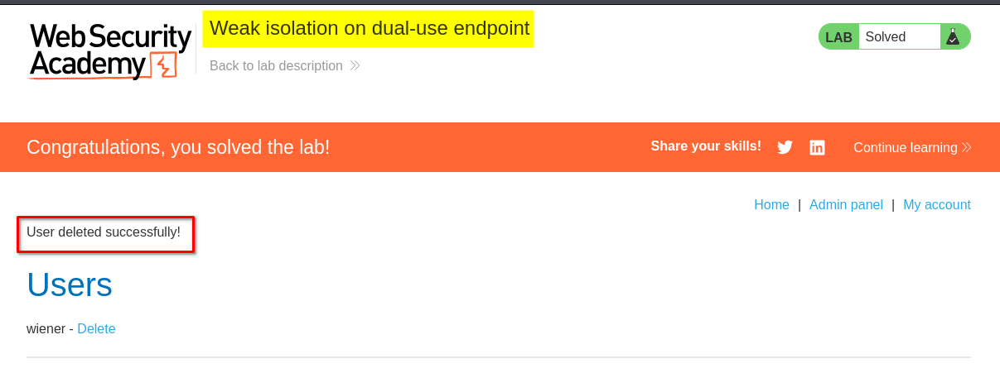

# Overview

This lab demonstrates how weak isolation in a dual-use endpoint can allow unauthorized password changes. By manipulating the username parameter and removing the current-password field from the request, I bypassed the application's password verification mechanism, changed the administrator's password, and gained access to the administrative panel.

# Question / Lab Objective

The objective was to exploit the weak isolation in the application's password-change functionality, gain administrative access, and delete the user `carlos` from the administrative panel.



# Walkthrough

## 1. Exploring the application

After launching the lab, I accessed the target application and explored its available functionality. The website displayed an individual blog post along with a **My Account** option.



Since the lab objective involved obtaining administrative access, I decided to investigate the application's authentication and account-management functionality.

I clicked **My Account** and logged in using the credentials provided by the lab.

After successfully logging in as `wiener`, I noticed that the account page contained a password-change functionality.

This appeared to be a useful starting point for investigating how the application handled password updates.

## 2. Testing the password-change functionality

I decided to investigate whether the password-change functionality properly verified the identity of the account whose password was being modified.

Instead of using my own username, `wiener`, I changed the username parameter to `administrator` and attempted to change the administrator's password directly.

For this test, I supplied the following values:

- Username: `administrator`
- Current password: `random_jpt`
- New password: `test`
- Confirm new password: `test`



After submitting the request, the application returned an error indicating that the current password was incorrect.

However, I noticed something interesting in the response: it displayed the message:

`Your username is: administrator`

This was unexpected because I was authenticated as `wiener`, not `administrator`.



This observation suggested that the application was processing the user-supplied username parameter rather than strictly associating the password-change operation with the authenticated account.

I decided to inspect the request more closely using Burp Suite.

## 3. Capturing and manipulating the password-change request

I intercepted the password-change request using Burp Suite and sent it to **Repeater** for further testing.

After examining the request body, I identified the parameters responsible for the password-change operation.

I noticed that the request included a `current-password` parameter, which appeared to be used for validating the existing password.

I then tested whether the application would still process the password-change operation if I removed this parameter entirely.

The modified request body looked like this:

```http
csrf=<TOKEN>&username=administrator&new-password-1=test&new-password-2=test
```

The important modification was the removal of the `current-password` parameter while keeping the administrator username and the two new-password parameters.



After sending the modified request, the application returned the following response:

`Password changed successfully`

This was the critical finding.

The application allowed the password-change operation to proceed without validating the current password when the corresponding parameter was omitted.

The endpoint was therefore vulnerable to weak isolation: it trusted a user-controlled username while failing to enforce the required authorization checks consistently across the different request variations.

## 4. Obtaining administrative access

After successfully changing the administrator's password, I returned to the login page.

I used the following credentials:

- Username: `administrator`
- Password: `test`

The application successfully authenticated me and redirected me to the administrative dashboard.



This confirmed that I had successfully taken control of the administrator account by exploiting the password-change functionality.

## 5. Exploring the administrative panel

After gaining administrative access, I opened the **Admin panel** to examine the available administrative functionality.

I noticed that the panel provided user-management functionality, which allowed administrators to manage registered accounts.



I examined the available options and located the account belonging to `carlos`.

Since deleting Carlos was the final objective of the lab, I proceeded with the deletion operation.

## 6. Deleting Carlos and completing the lab

Using the user-management functionality in the administrative panel, I selected the account belonging to `carlos` and performed the delete operation.



The application displayed the following confirmation: `Congratulations, you solved the lab!`

This confirmed that I had successfully exploited the weak isolation in the password-change endpoint, obtained administrative access, and completed the lab objective.

# Key Takeaways

- **Understand dual-use endpoints:** An endpoint may support multiple operations or account contexts. Each operation must enforce the appropriate authorization requirements.
- **Never trust user-controlled identity parameters:** A username supplied in a request should not determine which account a user is authorized to modify.
- **Test parameter omission:** Removing optional-looking parameters can reveal weaknesses in server-side validation and business logic.
- **Understand weak isolation:** Different execution paths within the same endpoint may enforce security checks inconsistently.
- **Authentication is not authorization:** Being successfully authenticated as one user does not mean that the user should be allowed to modify another user's account.
- **Use Burp Suite Repeater:** Repeater is useful for modifying individual request parameters, removing fields, and observing how the application responds.
- **Inspect server responses carefully:** Unexpected information, such as another account's username appearing in a response, can provide clues about how the application processes user-controlled data.

# Security Impact

Weak isolation in password-change functionality can allow an authenticated low-privileged user to modify another user's credentials without authorization.

In this lab, the application failed to enforce current-password verification when the corresponding parameter was omitted. By supplying the administrator's username and manipulating the request, I was able to change the administrator's password and gain access to privileged functionality.

In a real-world application, this type of vulnerability could result in:

- Unauthorized password changes affecting other user accounts.
- Account takeover, including privileged administrator accounts.
- Unauthorized access to sensitive administrative functionality.
- Modification or deletion of user data.
- Potential compromise of the confidentiality, integrity, and availability of application data.

The severity would depend on the privileges of the affected accounts and the application's other security controls.

# Remediation

To prevent weak isolation vulnerabilities in dual-use endpoints:

1. **Derive the account identity from the authenticated session:** Do not rely on a user-supplied username to determine which account can be modified.
2. **Enforce server-side authorization:** Verify that the authenticated user is authorized to perform the requested operation on the target account.
3. **Require current-password verification:** For sensitive password changes, consistently validate the current password when required by the application's security design.
4. **Validate parameters consistently:** Ensure that omitting a security-sensitive parameter cannot bypass an authorization or authentication check.
5. **Separate administrative operations:** Use dedicated, properly authorized functionality for administrative password resets rather than relying on a general-purpose user password-change endpoint.
6. **Apply least privilege:** Ensure ordinary authenticated users cannot modify accounts or perform operations outside their assigned permissions.
7. **Test alternative request structures:** Security testing should include missing parameters, modified usernames, unexpected values, and alternative request formats.

# Conclusion

This lab demonstrated how weak isolation in a dual-use endpoint can lead to unauthorized account modification and administrative account takeover.

By inspecting the password-change functionality, manipulating the username parameter, and removing the current-password parameter, I discovered that the application did not consistently enforce its password verification requirements.

Using this weakness, I successfully changed the administrator's password, accessed the administrative dashboard, and deleted the user `carlos` to complete the lab.

The main lesson is that security checks must be consistently enforced on the server side. An application should never assume that a user is authorized to modify an account simply because its username was supplied in a request.

*Thanks for reading!*
