# Overview

This lab demonstrates how a business logic flaw in a gift card purchasing and redemption workflow can allow customers to generate unlimited store credit. By combining a promotional coupon with gift card redemption, I discovered that I could repeatedly earn more credit than I spent.

I then used Burp Suite Macros, Session Handling Rules, and Intruder to automate the purchase-and-redemption process until I had enough credit to purchase the expensive leather jacket and complete the lab.

# Question / Lab Objective

The objective was to exploit the application's business logic flaw to generate sufficient store credit to purchase the leather jacket.

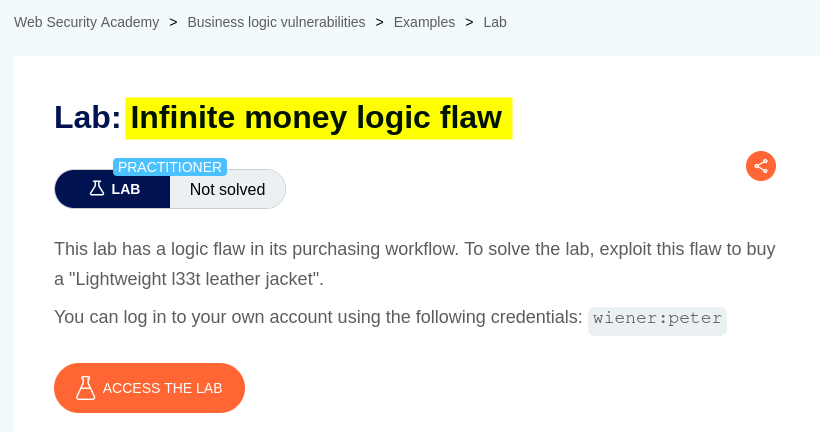

# Walkthrough

## 1. Exploring the application

After launching the lab, I accessed the target application and explored its available functionality.

I noticed an email client option at the top of the page, along with a **My Account** option and an initially empty shopping cart.

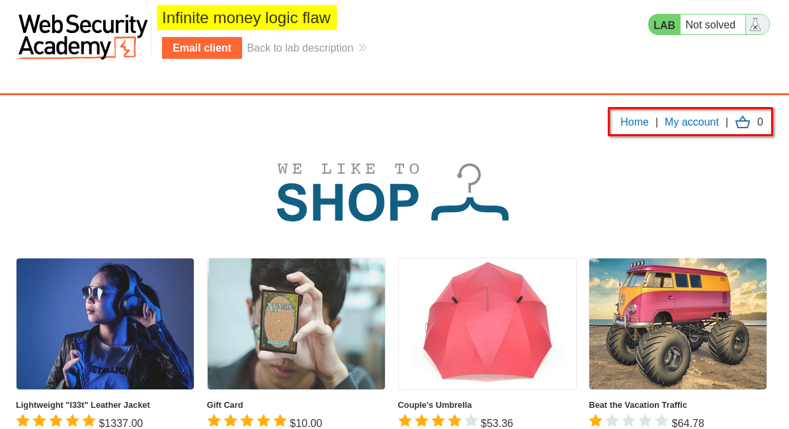

Since the lab focused on the purchasing workflow, I decided to investigate the account functionality, available promotions, and coupon application process.

I clicked **My Account** and logged in using the credentials provided by the lab.

After successfully logging in as `wiener`, I noticed that the account page displayed $100.00 in store credit. It also provided an option to update the account's email address and another option to redeem gift card codes.

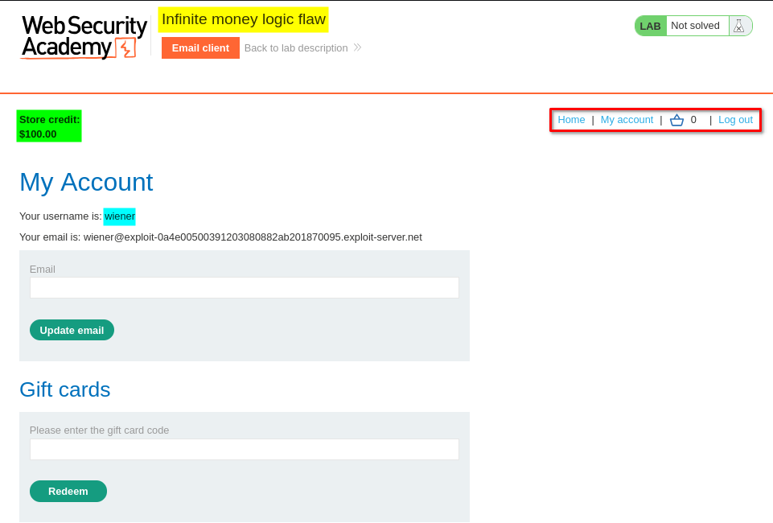

The initial store credit of $100.00 would be useful for testing the purchasing and gift card redemption functionality.

## 2. Exploring the newsletter signup functionality

While exploring the application, I noticed a **Sign up to our newsletter** form at the bottom of the page.

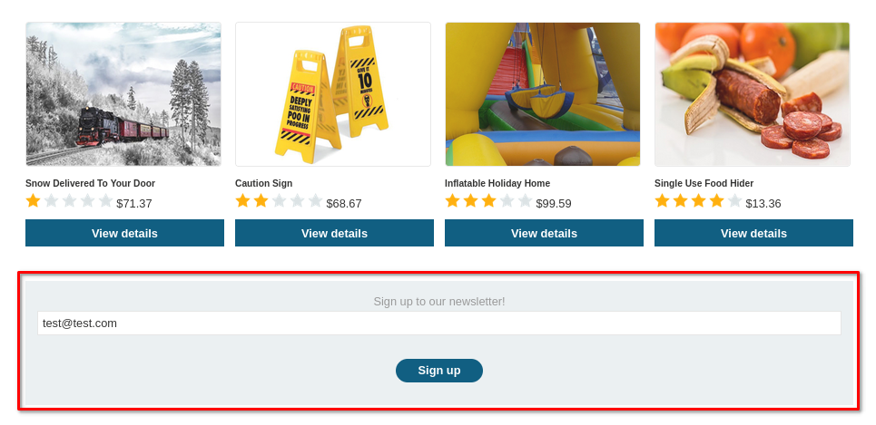

I decided to investigate this functionality as well. I entered the required information and submitted the newsletter signup form.

After completing the signup process, the application provided another promotional coupon: `SIGNUP30`

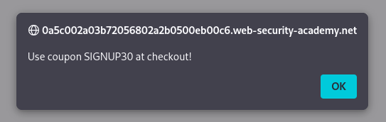

I decided to investigate whether this coupon could be combined with the gift card purchasing and redemption functionality.

## 3. Applying the new customer coupon

I returned to the product listing, selected a $10.00 gift card, and added it to my shopping cart.

Next, I entered the newly obtained coupon code: `SIGNUP30`

The application successfully accepted the coupon and applied a $3.00 discount to the order.

As a result, the gift card's purchase price decreased from $10.00 to $7.00.

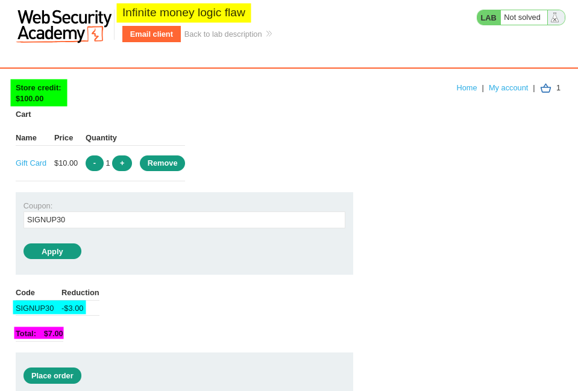

At this point, my store credit was reduced from $100.00 to $93.00.

After placing the order, the application generated a gift card code: `p0QeAPO70m`

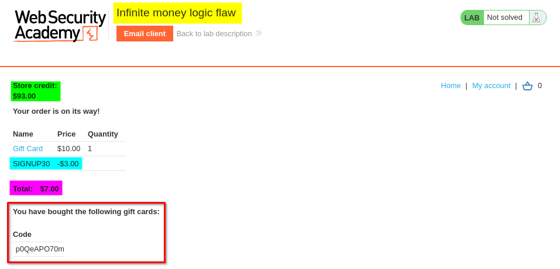

I copied this code because I needed to redeem it through the My Account page.

## 4. Identifying the business logic flaw

After obtaining the gift card code, I returned to **My Account** and entered the generated code into the gift card redemption field.

The application successfully accepted the code and added $10.00 to my store credit.

My balance increased from $93.00 to $103.00.

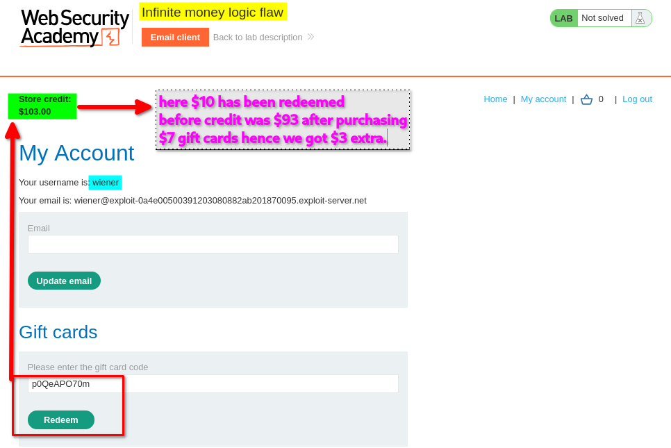

This was the important finding.

Let's understand the calculation:

| Operation | Store credit |
|---|---:|
| Initial balance | $100.00 |
| Purchase $10 gift card | -$7.00 |
| Redeem $10 gift card | +$10.00 |
| Final balance | **$103.00** |

Although I spent only $7.00 to purchase the gift card, I received $10.00 in store credit after redeeming it.

This resulted in a net gain of $3.00.

The application failed to account for the difference between the discounted purchase price and the full face value of the gift card. By repeating this process, I could continuously increase my store credit.

This confirmed the infinite money logic flaw.

However, manually repeating the same process would take considerable time. I therefore decided to automate the workflow using Burp Suite.

## 5. Creating a Burp Suite macro

My next objective was to automate the complete gift card purchase and redemption process.

I opened Burp Suite and navigated to its settings to configure a macro.

The steps were:

1. Click the **Settings (gear icon)** in the upper-right corner.
2. Navigate to **Sessions** from the left sidebar.
3. Locate the **Macros** section.
4. Click the **Add** button.
5. The Macro Editor opened, allowing me to select the required HTTP requests.

I selected the following five requests in the order they needed to execute:

1. `POST /cart HTTP/2`
2. `POST /cart/coupon HTTP/2`
3. `POST /cart/checkout HTTP/2`
4. `GET /cart/order-confirmation?order-confirmed=true HTTP/2`
5. `POST /gift-card HTTP/2`

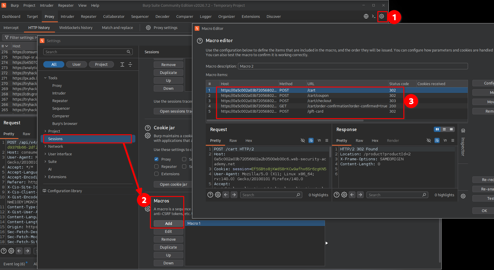

These requests represented the complete transaction sequence:

- Add a gift card to the shopping cart.
- Apply the promotional coupon.
- Complete the checkout process.
- Retrieve the generated gift card code from the order confirmation response.
- Submit the gift card code for redemption.

The purpose of the macro was to execute these requests automatically in the correct sequence.

## 6. Extracting the gift card code from the response

After adding the five requests, I needed to configure the macro to dynamically retrieve the newly generated gift card code.

I selected the fourth request: `GET /cart/order-confirmation?order-confirmed=true HTTP/2`

Then I clicked **Configure item**.

Inside the configuration window, I created a custom parameter named: `gift-card`

I highlighted and selected the HTML response content containing the generated gift card code: `p0QeAPO70m`

After selecting the relevant response content, Burp Suite automatically populated the extraction configuration, including the start and end delimiters.

I saved the configuration.

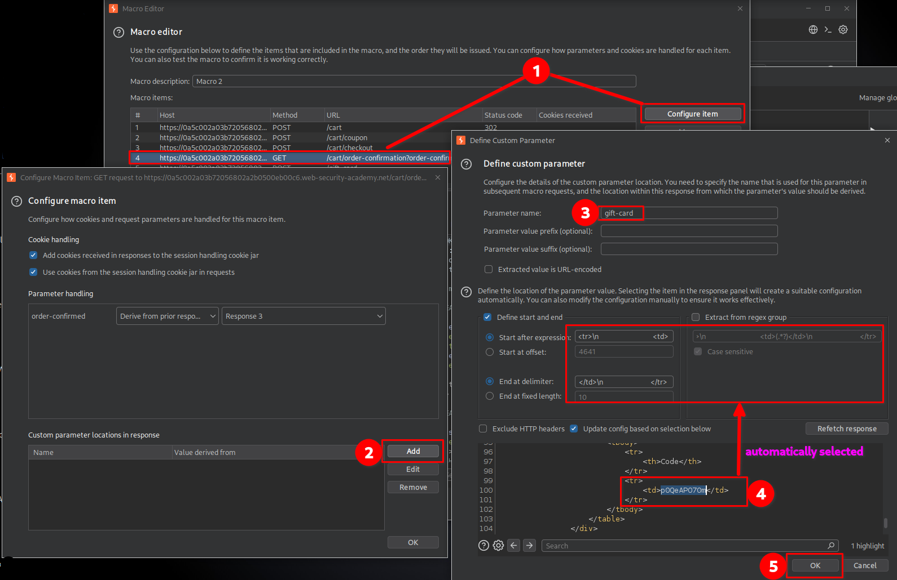

This step was particularly important because every purchase generated a different gift card code.

Instead of manually copying the code each time, the macro could extract the newly generated value from the previous response.

## 7. Configuring automatic gift card redemption

Next, I selected the fifth request: `POST /gift-card HTTP/2`

I clicked **Configure item** to modify its parameter handling.

In the parameter handling section, I located the parameter associated with the gift card code.

I selected the previously created `gift-card` parameter and changed its handling option to:

**Derive from a prior response**

This allowed Burp Suite to use the gift card code extracted from the fourth request automatically when executing the fifth request.

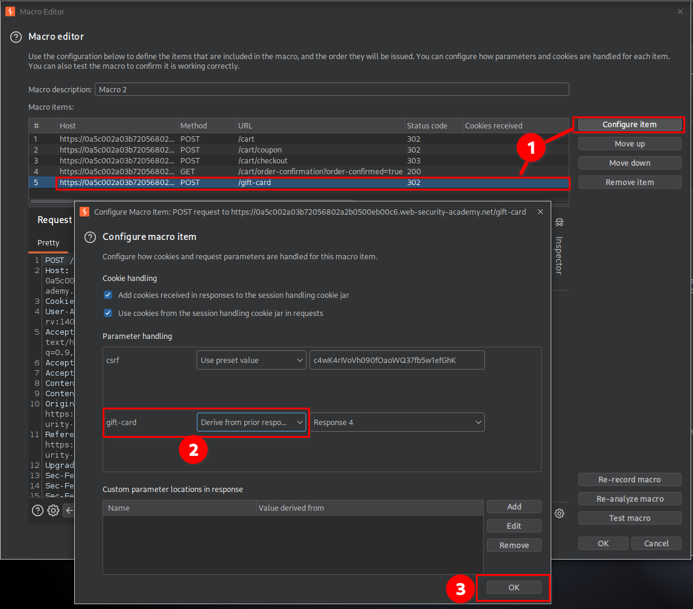

After saving the configuration, the macro could now:

1. Complete a gift card purchase.
2. Extract the newly generated gift card code.
3. Pass the extracted value into the redemption request.
4. Redeem the gift card without requiring manual intervention.

## 8. Testing the configured macro

Before automating the entire process, I tested the macro to verify that the requests were executing correctly.

After running the macro, I observed that the fifth request, `POST /gift-card`, was successfully submitted with the newly generated gift card code.

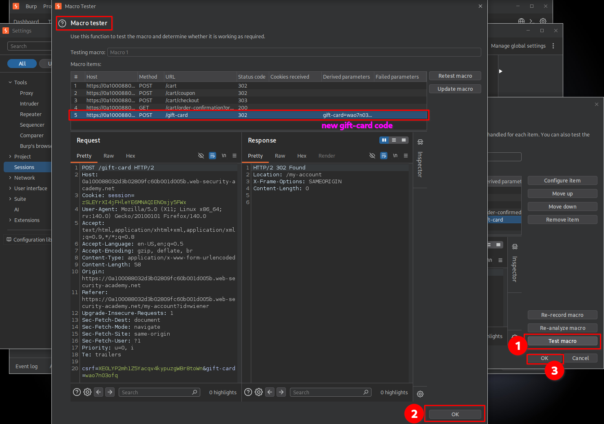

This confirmed that the response extraction and parameter handling were working as expected.

At this stage, the individual purchase-and-redemption workflow was automated. The next step was to configure Burp Suite to execute this macro repeatedly.

## 9. Creating a Session Handling Rule

After successfully testing the macro, I needed to configure a Session Handling Rule so that Burp Suite could automatically execute the macro when a matching request was made.

I returned to **Settings → Sessions** and located the **Session Handling Rules** section.

I clicked the **Add** button to create a new rule.

Inside the rule editor, I configured the rule description as: `Infinite money`

I also reviewed the available options under the Scope and Details sections.

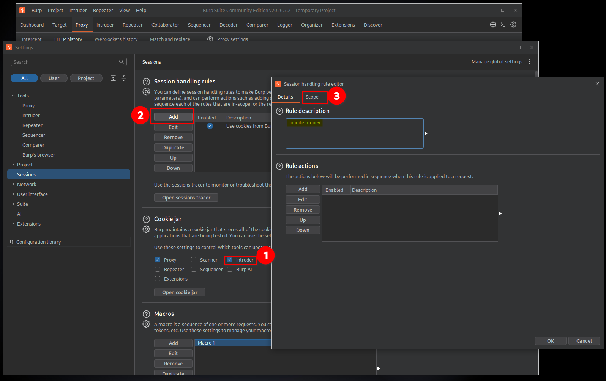
                 
## 10. Configuring the URL scope

Next, I clicked the **scope** tab and navigated to the URL Scope section.

For this lab, I selected: **Include all URLs**

This allowed the session handling rule to be applied across the requests generated during the automated workflow.

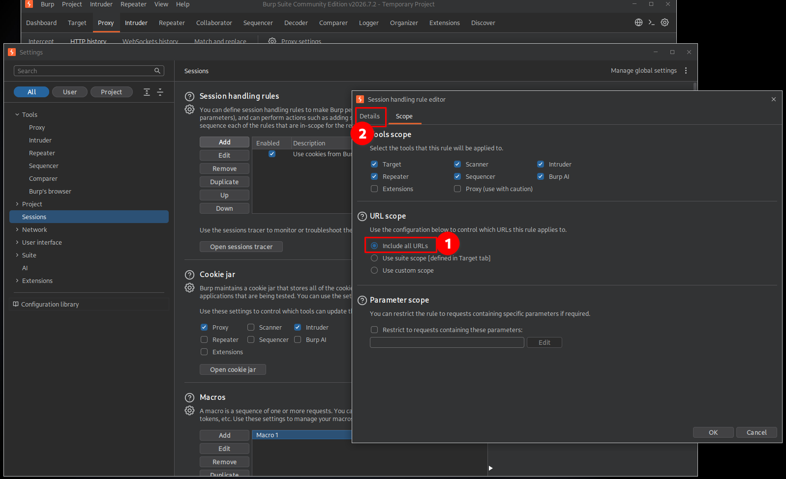

## 11. Configuring the macro execution action

After configuring the URL scope, I returned to the Session Handling Rule editor.

Under the **Rule actions** section, I clicked **Add** to select an action.

From the available options, I selected: **Run a macro**

The Session Handling Action Editor opened, where I selected the previously created macro.

I chose the macro containing the five HTTP requests and saved the configuration.

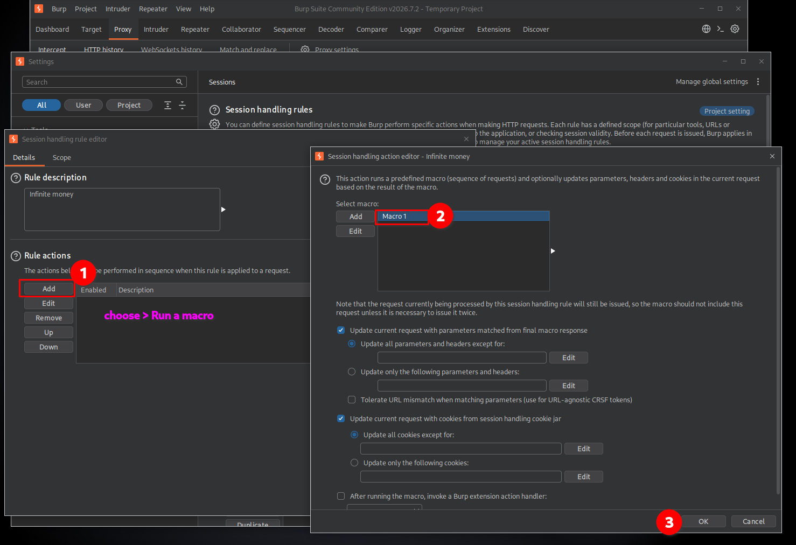

Now, whenever a matching request triggered the session handling rule, Burp Suite would automatically execute the configured macro.

This connected the individual purchase-and-redemption workflow to the request that I would use to trigger repeated execution.

## 12. Automating the process with Intruder

With the macro and Session Handling Rule configured, I moved to the final automation stage.

I returned to **Proxy → HTTP history** and selected a normal account request: `GET /my-account HTTP/2`

I sent this request to **Intruder**.

Inside Intruder, I configured the following settings:

- **Attack type:** Sniper
- **Payload type:** Null payloads
- **Payload configuration:** Continue indefinitely

Since I did not need to modify any particular parameter, I used null payloads to repeatedly send the same request.

I also created a new resource pool and configured the maximum number of concurrent requests to: `1`

This ensured that the attack used a single concurrent request at a time, allowing me to observe the repeated macro execution more clearly.

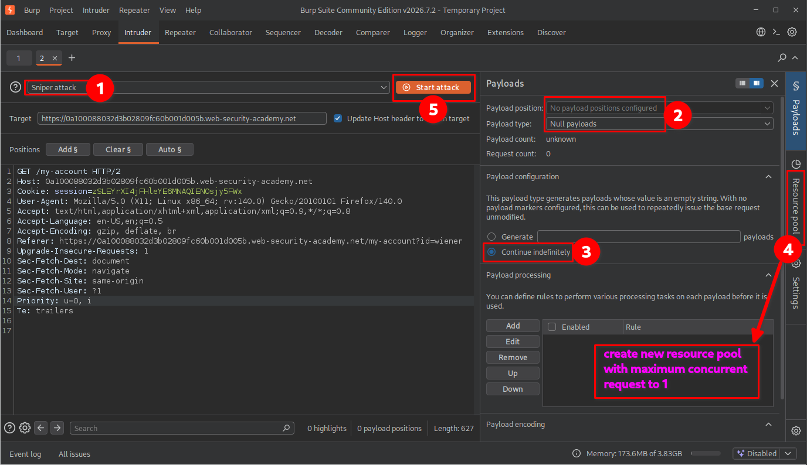

After reviewing the settings, I started the Intruder attack.

## 13. Observing the automated transactions

Once the attack started, I opened Burp Suite's **Logger** tab to observe the generated HTTP traffic.

For each repeated `GET /my-account` request, the Session Handling Rule triggered the macro, which executed the five configured requests.

In other words, one triggering request resulted in the following automated sequence:

`GET /my-account`

↓

`POST /cart`

↓

`POST /cart/coupon`

↓

`POST /cart/checkout`

↓

`GET /cart/order-confirmation?order-confirmed=true`

↓

`POST /gift-card`

This sequence continued repeatedly as Intruder sent additional requests.

I then refreshed the browser and checked the account balance. I observed that the store credit was increasing by $3.00 with each successful purchase-and-redemption cycle.

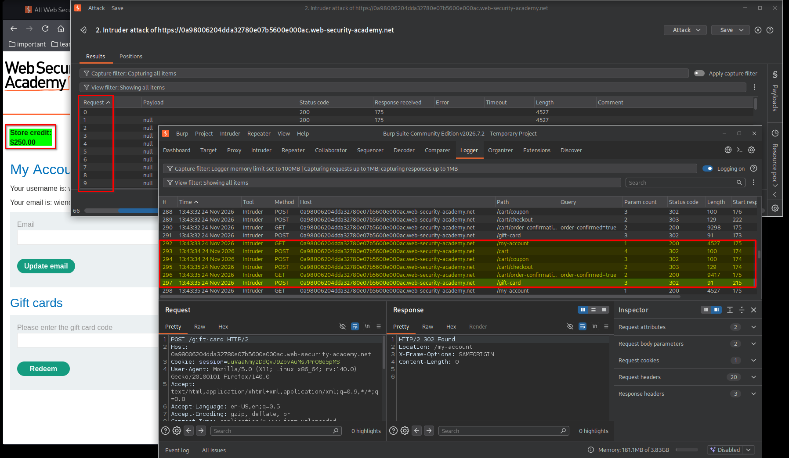

This confirmed that the automation was functioning correctly and that the business logic flaw could be exploited repeatedly without manually completing each transaction.

## 14. Purchasing the leather jacket and completing the lab

I allowed the automated process to continue until my store credit exceeded the leather jacket's price of $1,337.00.

Once I had sufficient credit, I stopped the Intruder attack and returned to the application.

I added the leather jacket to my shopping cart and completed the purchase using the accumulated store credit.

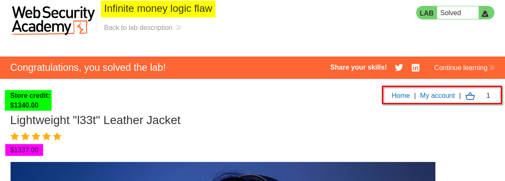

The application displayed the following confirmation: `Congratulations, you solved the lab!`

This confirmed that I had successfully exploited the infinite money logic flaw and completed the challenge.

# Key Takeaways

- **Understand business logic:** Not every vulnerability involves SQL injection, cross-site scripting, or authentication bypass. Incorrect application workflows can also create serious security weaknesses.
- **Look for inconsistencies in financial calculations:** The application charged $7.00 for a $10.00 gift card but allowed the full $10.00 to be redeemed.
- **Test promotional functionality:** Coupons, discounts, gift cards, refunds, and loyalty points can introduce unexpected interactions when combined.
- **Understand Burp Suite Macros:** Macros allow multiple HTTP requests to be grouped and executed in a predefined sequence.
- **Learn response extraction:** Burp Suite can extract dynamic values from previous responses and reuse them in subsequent requests.
- **Understand Session Handling Rules:** These rules can automatically execute macros when matching requests are processed.
- **Use Intruder for repetition:** Null payloads can repeatedly trigger a request without changing its parameters.
- **Verify the business impact:** A small financial inconsistency can become significant when an attacker can repeat the workflow automatically.

# Security Impact

An infinite money logic flaw can allow attackers to generate store credit, gift card balances, or other financial benefits without paying the corresponding amount.

In this lab, the application allowed a $10.00 gift card to be purchased for $7.00 using a promotional coupon and then redeemed for its full $10.00 value.

The attacker gained $3.00 in store credit per successful transaction.

By automating this process, an attacker could repeatedly increase their account balance and potentially purchase expensive products without paying their actual value.

In a real-world application, this vulnerability could result in:

- Direct financial losses for the business.
- Unauthorized generation of store credit.
- Abuse of promotional campaigns and gift card systems.
- Increased operational costs and inventory losses.
- Potential exploitation of other connected financial workflows.

# Remediation

To prevent this type of business logic vulnerability:

1. **Validate gift card transactions:** Ensure that gift card issuance and redemption follow consistent business rules.
2. **Prevent promotional abuse:** Apply appropriate restrictions to prevent discounts from being exploited to generate additional monetary value.
3. **Track gift card states:** Ensure each gift card is uniquely generated, securely tracked, and redeemable only according to its intended rules.
4. **Implement transaction integrity:** Validate the complete purchase and redemption workflow on the server rather than trusting client-side requests.
5. **Apply rate limiting:** Restrict excessive gift card purchases, redemptions, and promotional transactions.
6. **Monitor suspicious activity:** Detect repeated purchase-and-redemption patterns, especially when they consistently generate a positive balance.
7. **Perform server-side financial validation:** Ensure that the final credited amount is consistent with the application's intended pricing and promotional rules.

# Conclusion

This lab demonstrated how a small business logic flaw in a gift card purchasing workflow could be exploited to generate unlimited store credit.

By purchasing a $10.00 gift card for $7.00 using the `SIGNUP30` coupon and redeeming it for its full value, I discovered that each successful transaction generated a net gain of $3.00.

I then went beyond manually repeating the process by configuring Burp Suite Macros, response extraction, Session Handling Rules, and Intruder with null payloads. This allowed me to automate the complete transaction sequence until I accumulated enough credit to purchase the $1,337.00 leather jacket.

The main lesson is that business logic vulnerabilities can arise when individual application features work as expected but their combined behavior produces an unintended result. Testing how promotions, payments, gift cards, and account balances interact is therefore an important part of web application security testing.

*Thanks for reading!*
